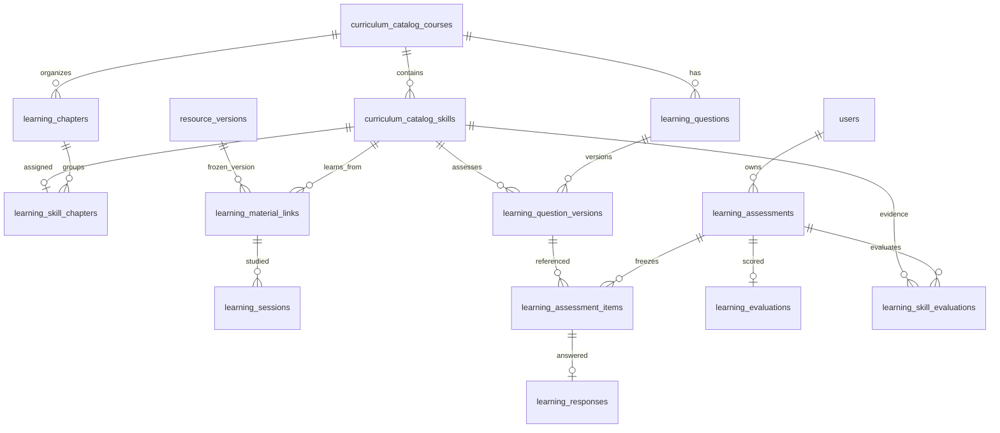

# 课程—知识点—学习资料—题库—评价关系

实施日期：2026-11-15；SQLite迁移0021。当前实现课程级知识学习及单选测验闭环；编程沙箱评分、项目量规评价仍需结合各专业课程另行扩展。

## 表职责与约束

|表|保存内容|约束|
|---|---|---|
|curriculum_catalog_courses|36门课程及年级、类别、考核方式|稳定课程ID，候选目录不等于大纲核准|
|curriculum_catalog_skills|377候选知识点|按课程归属，组合唯一键防止跨课程错连|
|learning_chapters|课程章节及顺序|同课程章节顺序唯一|
|learning_skill_chapters|章节与知识点关系|一个知识点归属一个课程章节，组合外键验证同课程|
|learning_material_links|知识点对应的资源版本及定位说明|同知识点同资源版本唯一；仅关联已发布校级正文|
|learning_sessions|学生实际分钟和笔记|会话ID防重复，时长不直接提高掌握度|
|learning_questions|稳定题目身份及所有者|课程外键，原始题答摘要保留在独立审核区|
|learning_question_versions|题干、选项、答案、解析、来源、用途及审核人|版本唯一，初测/练习/重测分用途，草稿/发布/停用|
|learning_assessments|学生、课程、用途、暂存、交卷状态|学生所有权，提交后答案不能改写|
|learning_assessment_items|题目版本与完整快照|试卷内题版本及题序唯一，保留历史|
|learning_responses|逐题选择与正确标记|每试卷题目只能保存一个作答|
|learning_evaluations|总题数、正确数、百分制得分、规则版本|每试卷一个最终评价，重复提交不重复评分|
|learning_skill_evaluations|本次知识点正确数、题数、BKT估计及累计证据|每试卷每知识点唯一，区分正确率与掌握度|

本次新增11张表，复用既有课程、知识点、资料、资料版本及账号表。来源目录40条及37个题组来源、15条摘要仍保留原审核状态，不自动转换正式试题。

## 页面操作

管理员：课程知识库→选择专业课程→课程学习、测验与评价→维护正式题目与知识点资料关联。填写完整题目、2至8个不同选项、正确序号、解析、来源及用途，保存草稿，逐项核对后审核发布。停用题目会阻止包含它的未提交试卷交卷，已交成绩保留。现阶段正式题目只开放管理员维护；教师授课范围编辑需后续加入课程授权机制。

资料关联填写已发布校级正文的资源编号及定位说明；外链导读不可作为已验证教学正文。接口每次学习时检查资源状态与版本，更新或撤回后不能继续使用旧关联。定位是文本说明，本轮没有实现自动PDF页码跳转。

学生：课程知识库→选课程→选择知识点→打开对应资料→保存学习分钟及笔记→选初测/练习/重测及每知识点题数→开始测验→暂存或交卷→查看按题反馈、知识点正确率和估计掌握度→回到薄弱知识点的学习资料继续学习。历史中可恢复未交试卷或查看已交成绩。

## 接口

统一前缀 `/api/v1`。所有写操作须同源且已登录。

|方法与路径|作用|
|---|---|
|POST /learning/courses/{id}/chapters|管理员新增章节并归入知识点|
|POST /learning/courses/{id}/materials|管理员关联当前资料版本|
|GET /learning/courses/{id}|知识点、有效资料及三用途题库数量；题草稿仅管理员可见|
|POST /learning/questions|录入完整单选题草稿|
|POST /learning/questions/{id}/publish、/disable|管理员明确审核发布或停用|
|POST /learning/materials/{id}/study|保存实际学习记录|
|POST /learning/assessments|只按所选课程知识点和用途组卷，题数不足返回明确缺口|
|GET /learning/assessments/{id}|本人试卷；交卷前无答案，交卷后给出解释|
|PUT /learning/assessments/{id}/draft|部分作答暂存|
|POST /learning/assessments/{id}/submit|同事务保存逐题答案、总评和知识点评价|
|GET /learning/courses/{id}/progress|本人学习分钟、知识点评价与检测历史|

重测排除已向该学生展示的题目身份，即使上次没有交卷也算已见。尚未实现题干相似度去重，因此审核时必须另行确认初测与重测题目独立。每知识点默认2题，最多5题；不会混入其他课程或自动少出题。

当前BKT使用既有函数及初始值0.2，记录single-choice-v1/bkt-v1规则标识；仅是模型估计，样本少时不能等同能力定论。新课程评价暂不写入旧目标规划模块的observations，避免同一证据被重复计算；旧学习路径自动重规划尚未接入本课程测验链路。

## 迁移及验收

正式库备份：`backend/data/backups/before-learning-relations-20261115`。迁移只新增表与索引，不把候选资料发布为教学内容。8项隔离回归通过，覆盖课程与知识点约束、正式正文关联、学习去重、组卷、隐藏答案、所有权、暂存恢复、重复提交、证据计数、题量不足、重测排除及停用题提交回滚。前端构建通过。测试题只存在于隔离库，不能据此宣称36门课程都已有正式题库。

## 0024 课程规划接入更新

已新增审核映射、课程目标绑定、唯一证据关联及试卷作答关联四张表，形成课程初测到目标规划闭环。课程进度保留课程评价；规划从唯一 observations 重放画像，不累加两套概率。具体约束、页面和限制见 [课程桥接实施说明](course-planning-bridge.md)。
