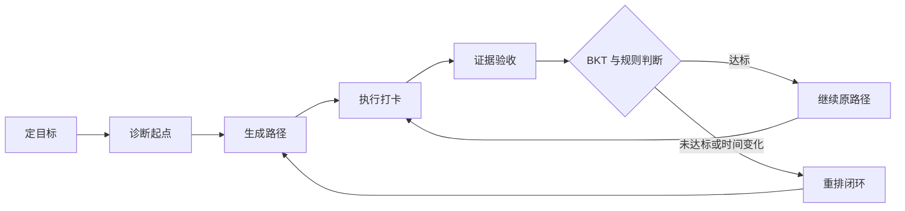
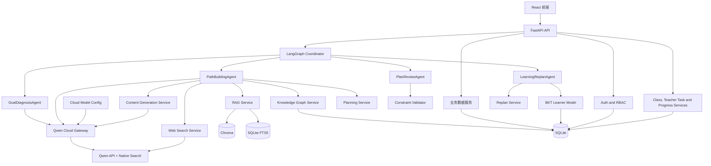
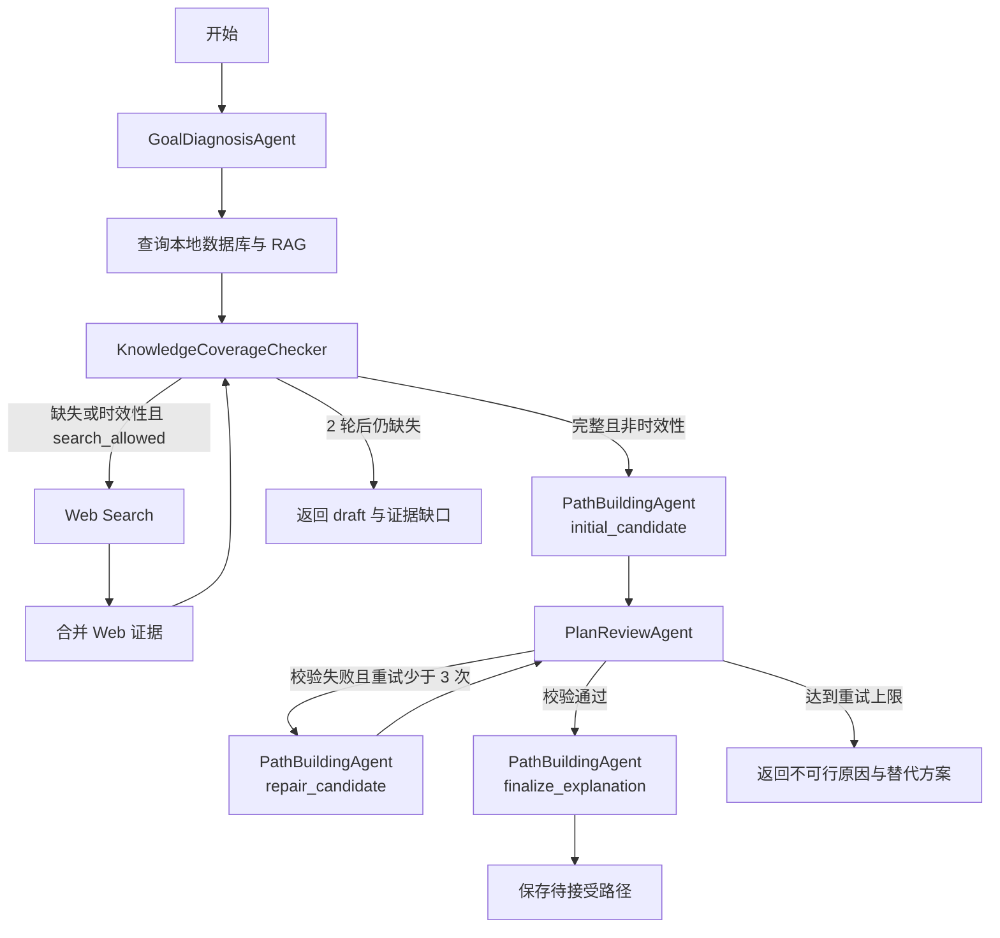
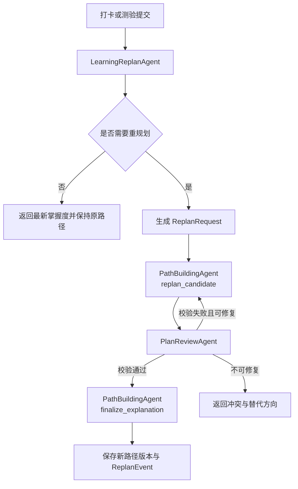
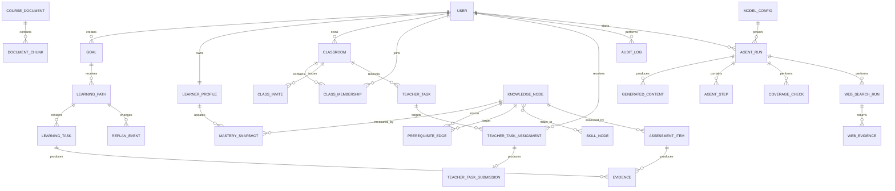

# 智能学习规划助手项目设计方案

> 文档状态：已确认十周教师平台与多教师多班级修订
>
> 文档版本：v3.0
>
> 日期：2026-10-27
>
> 项目类型：课程项目
>
> 开发周期：约 10 周
>
> 团队规模：2 人
>
> 核心用户：计算机专业大一、大二学生与任课教师
>
> 平台形态：单学校部署、多教师、多班级
>
> 目标技能主线：Python 基础 -> 数据结构与算法 -> 后端开发
>
> 模型方案：阿里云百炼/DashScope 千问云端模型 + 原生联网搜索
>
> 验收方式：单次现场连续演示完整学习闭环
>
> 交付物：设计方案、需求规格说明书、可运行源码、演示与答辩材料

## 1. 文档目的

本文档定义“智能学习规划助手”的产品目标、业务边界、平台角色、系统架构、云端联网 AI 内核、教师端、数据模型、接口、非功能要求、测试方案和十周实施计划。

本文档是需求规格说明书、详细设计、代码实现和课程答辩的共同基线。若实现过程中出现冲突，应优先满足本文档中的功能闭环、真实云端检索、引用可追溯性和现场可运行要求。

## 2. 项目概述

### 2.1 项目背景

计算机专业低年级学生通常已经学习部分程序设计基础，也拥有明确的学习目标，例如掌握数据结构与算法、完成一个后端项目或准备进阶课程。但学生往往不清楚：

- 当前掌握的知识与目标技能之间缺少哪些知识。
- 多个知识主题之间有哪些先修依赖。
- 在每周时间预算内，应该先学什么、后学什么。
- 某个学习计划是否真的可以完成。
- 学习过程中掌握度变化后，计划应如何调整。

传统课程表或通用学习资源库只能提供内容列表，无法基于个人基础、先修约束和时间预算生成可执行的个性化路径。

### 2.2 目标用户

产品包含学生和教师两类核心用户，学校管理员负责账号与平台配置。本期采用单学校部署，不实现跨学校租户。

学生的典型特征如下：

- 已学习一门程序设计语言的基础语法。
- 能够完成简单程序，但没有形成系统的知识结构。
- 有明确技能目标，却难以判断目标所需的前置知识。
- 每周可投入的学习时间有限，希望按时间预算拆解任务。
- 需要看到计划依据、学习进度和调整原因。

教师的典型特征如下：

- 同时负责一个或多个班级。
- 需要查看班级整体和学生个体的学习进度、掌握度与风险。
- 需要向整个班级或指定学生布置新任务。
- 需要区分教师任务与 AI 生成路径，避免直接破坏系统规划结果。

### 2.3 核心问题

给定一个技能目标、用户当前基础和时间预算，系统需要回答：

1. 达到目标需要学习哪些知识和技能。
2. 这些知识之间存在何种先修关系。
3. 用户已经掌握什么，还缺什么。
4. 在时间限制内是否存在可行学习路径。
5. 推荐顺序及每条依据从何而来。
6. 用户执行和测验后，路径应该如何变化。
7. 教师如何观察班级与个人进度，并在必要时补充任务。

### 2.4 AI 内核概述

系统采用“千问云端模型 + 原生联网搜索 + 本地课程 RAG + 四智能体编排”。联网搜索负责获取最新公开信息，本地 RAG 负责课程大纲、知识材料、知识到技能映射及个人自测证据，确定性图谱与规则校验负责判断学习路径可行性。

- 千问云端模型负责理解用户意图、生成候选知识内容、拆解任务和解释路径。
- 千问原生联网搜索根据 Agent 查询自动获取最新公开资料，并返回可保存的来源信息。
- 本地 RAG 提供课程专属和用户授权资料的稳定依据。
- 知识图谱表达先修关系和技能映射。
- 图约束搜索生成满足依赖关系的候选路径。
- 规则校验器决定路径是否满足先修与学时约束。
- LLM 负责理解目标、规划诊断、拆解任务和自然语言解释。
- BKT 根据测验证据更新知识掌握度。
- 重规划器根据掌握度、执行状态和时间预算调整路径。

LLM 不负责最终可行性判断。路径是否可行由确定性算法和规则校验器决定。

### 2.5 产品主线

学生端围绕以下完整闭环构建：

`定目标 -> 诊断起点 -> 生成路径 -> 执行打卡 -> 证据验收 -> 重排闭环`

每个环节都必须具有结构化输出、持久化状态、错误处理和可检查的通过条件。课程验收采用单次现场连续演示：从新目标输入开始，经过诊断、规划和首次打卡，使用现场提交的未达标测验证据触发 BKT 更新与重规划，再展示调整后的路径。核心闭环不得依赖预生成路径、缓存规划结果或预先录制视频。

教师端围绕以下干预闭环构建：

`登录 -> 查看班级进度 -> 全班或指定学生布置任务 -> 学生执行 -> 查看提交与风险`

教师任务不直接修改 AI 路径。教师任务计入学习负荷；当任务导致时间冲突时，系统生成重规划建议，由学生确认后生效。

## 3. 目标与范围

### 3.1 项目目标

- 为指定技能目标生成满足先修关系和时间预算的个性化学习路径。
- 根据用户输入的学习目标生成知识内容、任务、验收题和候选路径。
- 让每个知识点和计划调整都可以追溯到课程材料或用户证据。
- 通过自测、打卡和验收形成持续更新的学习者模型。
- 真实调用千问云端模型和联网搜索，并结合本地 RAG、知识图谱、BKT、Agent 编排和规则校验。
- 保存模型配置、搜索查询、网页来源、抓取时间、引用和运行轨迹，支持复现与审计。
- 在联网环境中完成现场 AI 演示，断网时明确失败而不是伪造实时结果。
- 支持单学校管理员、教师和学生登录，并执行服务端角色与数据权限校验。
- 支持多教师、多班级；教师可创建自己负责的班级，学生可通过邀请码加入多个班级。
- 支持教师查看本班学生学习进度、任务完成情况、掌握度和风险。
- 支持教师向全班或指定学生布置一次性任务，并查看提交与完成状态。
- 提供可运行源码、设计文档、需求规格说明和答辩演示。

### 3.2 成功标准

- 在单次现场演示中连续完成“目标、诊断、规划、打卡、验收、重规划”闭环，且路径和重规划结果由现场输入触发。
- 现场演示允许预先配置云端模型、预置已审核课程资料和已建立索引，不允许使用预生成路径、缓存规划响应、缓存搜索结果或预先录制的交互结果代替核心步骤。
- 路径可行性校验通过率不低于 95%。
- 所有生成的学习节点均引用真实检索片段或知识图谱记录。
- 路径中不存在硬先修冲突和重复节点。
- 当路径不可行时，系统能够说明原因并给出可执行替代方案。
- 至少复现一次“测验未达标 -> BKT 更新 -> 插入补强任务 -> 后续任务顺延”的重规划流程。
- 对未预先配置的新计算机学习目标生成结构化内容和候选路径。
- 答辩现场能够展示千问联网搜索结果，并证明路径使用了本次请求获得的最新来源。
- 云端模型的 JSON 合法率、引用存在率和路径规则通过率不低于设定阈值。
- 在可访问千问 API 和互联网的环境中完成现场闭环，断网、鉴权失败或搜索失败时返回明确错误。
- 教师能够创建班级、生成邀请码、布置新任务，并在学生完成后看到进度变化。
- 教师无法访问非本人班级或其他教师的班级数据。

### 3.3 本期范围

- 支持用户输入任意计算机相关学习目标，并根据输入生成内容与路径。
- 将 Python 基础 -> 数据结构与算法 -> 后端开发作为完整验收和演示主线。
- 在约 10 周开发周期内完成云端模型接入、联网搜索、系统联调、现场闭环演练、文档定稿和答辩交付。
- 支持上传课程资料，为任意新目标建立可追溯的 RAG 证据。
- 支持千问云端模型结合本地 RAG 和联网搜索生成知识节点、任务、题目、路径解释和重规划建议。
- 支持自动联网检索最新公开资料，并保存搜索查询、来源、摘要、发布时间和抓取时间。
- 支持保存云端模型配置、搜索策略、提示词版本、评估结果和运行记录。
- 支持单学校内的管理员、教师和学生账号，以及学生多个学习目标和多个班级。
- 支持课程文档、知识节点、技能映射、题库和先修关系导入。
- 支持目标解析、自测诊断、学习画像、路径生成、路径解释和路径调整。
- 支持学习打卡、测验提交、BKT 更新和重规划。
- 支持 Agent 执行轨迹展示，便于课程答辩说明 AI 内核。
- 支持本地业务数据、课程 RAG 数据和联网搜索证据的本地持久化。
- 支持单学校管理员、教师和学生的账号与角色管理。
- 支持教师创建多个班级、生成邀请码和学生加入班级。
- 支持教师班级总览、学生详情、进度指标和风险提示。
- 支持教师向全班或指定学生发布一次性任务，并查看提交状态。
- 支持教师任务计入学习负荷并触发重规划建议，但不直接修改 AI 路径节点。

### 3.4 非目标

- 不接入真实教务系统或学校统一身份认证。
- 不实现跨学校多租户、教育集团或 SaaS 计费体系。
- 不实现同一班级的多教师协同授课。
- 不实现家长端、学生社交和公开排行。
- 不自动抓取互联网大规模课程资料。
- 不保证在无课程资料时生成的内容具有正式课程级权威性。
- 不自建或微调基础模型，模型能力由千问云端 API 提供。
- 不保证互联网搜索结果本身的权威性，系统必须执行来源校验和可信级别判定。
- 不在断网环境中提供核心 AI 闭环。
- 不使用手工编排的假数据、预生成路径或缓存响应代替现场规划的六阶段闭环。
- 不实现生产级云部署、集群和高可用架构。
- 不提供正式学分、成绩单或学校教务认证。

### 3.5 约束与假设

- 团队规模固定为 2 人，开发周期约 10 周。
- 平台采用单学校部署，支持多教师、多班级，不实现跨学校租户。
- 学校管理员负责教师和学生账号；教师负责创建班级和发布教师任务。
- 首个管理员账号由初始化脚本从环境变量创建，不设置硬编码默认密码。
- 教师只能访问自己负责的班级；学生只能访问自己的学习数据和已加入班级的数据。
- 同一班级采用单负责教师模型，不做多教师协同授课。
- 教师任务为一次性任务，可关联知识节点，但不直接修改 AI 路径节点。
- 十周内必须完成至少三轮完整现场闭环演练，最后一轮用于验收冻结。
- 演示环境为 Windows 11，64 位 x64 系统。
- 默认云端模型为千问商业 API 中的 `qwen-plus`，具体模型名、搜索开关和生成参数通过版本化配置管理。
- 现场演示设备必须能够访问阿里云百炼/DashScope API 和互联网搜索服务。
- API Key 只通过服务端环境变量或本地密钥文件加载，不写入前端、日志或源码。
- 用户学习数据采用最小必要原则发送到云端模型；课程资料、答案和画像只在生成所需范围内传递。
- Web 证据默认保存搜索查询、URL、标题、摘要、发布时间、抓取时间和内容哈希。
- 对“最新、当前、今年”等时效性声明，至少一条来源的发布时间不得早于请求日期前 30 天；不足时标记 `draft`。
- 课程资料应为具有使用权限的 Markdown、TXT 或 PDF 文件。
- 当目标在时间预算内不可行时，系统返回冲突原因和替代选项，不伪造可行路径。
- 无本地 RAG 或联网搜索证据的内容标记为 `draft`，不得进入 `verified` 路径。

## 4. 用户与使用场景

### 4.1 核心用户画像

**姓名：小林**

**背景：** 计算机专业大一学生，学习过 Python 语法，能完成基础程序设计题。

**目标：** 两个月内掌握数据结构与算法，并具备后端开发入门能力。

**时间：** 每周 10 小时。

**困难：** 不知道是否需要先补 Python 进阶、面向对象、复杂度分析、数据库和网络基础。

**教师画像：**

- 同时负责一个或多个计算机课程班级。
- 希望快速识别未开始、逾期、掌握度偏低或频繁触发重规划的学生。
- 需要针对班级共性问题或个人薄弱点布置补充任务。
- 只能查看自己班级的学生学习数据。

### 4.2 主要场景

1. 用户输入目标、当前基础、每周时间和截止日期。
2. 系统生成诊断题，估计各知识节点的初始掌握度。
3. 系统检索本地课程依据和最新公开资料，并提取目标所需的先修子图。
4. 系统生成候选路径，校验先修、学时和截止日期。
5. 系统展示路径、预计学时、掌握度、锁定原因、资料来源、发布时间和抓取时间。
6. 用户每天打卡并提交测验证据。
7. BKT 更新掌握度，触发局部重规划。
8. 系统说明路径变化原因，用户接受或拒绝调整。
9. 教师登录后查看班级进度和学生风险。
10. 教师向全班或指定学生布置新任务。
11. 学生完成任务并提交，教师查看完成状态和进度变化。

### 4.3 核心用户故事

- 作为学生，我希望输入技能目标后看到完整学习路径，以便知道从何开始。
- 作为学生，我希望输入任何新的学习主题后，系统能够生成知识框架、任务和候选路径。
- 作为学生，我希望系统依据我的现有基础跳过已掌握内容，以减少重复学习。
- 作为学生，我希望知道每个知识点的先修原因和资料出处，以便信任计划。
- 作为学生，我希望系统能联网获取最新课程和技术信息，并明确显示来源时间。
- 作为学生，我希望看到每周和每天的任务负荷，以便判断计划是否可执行。
- 作为学生，我希望测验失败后系统自动补强，而不是继续推进后续内容。
- 作为教师，我希望查看多个班级的任务完成率、学习时长和掌握度分布。
- 作为教师，我希望对全班或个别学生布置新任务并查看完成情况。
- 作为教师，我希望只看到自己班级的数据，保护学生隐私。
- 作为答辩评审，我希望看到 Agent、联网搜索、本地 RAG、知识图谱、BKT 和规则校验的真实执行轨迹。

## 5. 业务流程



### 5.1 定目标

输入包括用户自由描述的学习内容、当前基础、期望完成日期、每周可投入时间、每日最大学习时间、偏好学习方式和可选课程材料。

输出为结构化 `GoalSpec`，包含目标技能 ID、目标类型、时间预算、约束条件和可验证完成标准。

通过条件：目标技能能够映射到知识图谱中的至少一个目标节点，时间和约束字段格式合法。

### 5.2 诊断起点

系统根据目标的先修子图选择诊断题，覆盖关键知识节点。题目区分难度和知识点，避免全部集中在入门内容。

输出为诊断作答记录和初始掌握度向量。

通过条件：所有目标关键节点至少有一个先验估计，低置信度节点被明确标记。

### 5.3 生成路径

系统先查询本地数据库、知识图谱和本地 RAG，执行知识完整性检查。非时效性目标在本地数据完整时直接由千问模型生成候选计划；存在缺失项或查询涉及时效性时，才调用千问联网搜索补充证据，合并后重新检查并生成或修复计划。

输出为包含知识覆盖结果、缺失项、生成内容可信级别、路径节点、预计学时、先修关系、掌握阈值、本地与联网依据引用、搜索时间和锁定原因的 `LearningPath`。

通过条件：`verified` 内容具有真实本地或联网引用，时效性声明使用本次搜索获得的来源，路径满足硬先修、时间预算和负荷上限要求；`draft` 内容不能发布为正式路径。

### 5.4 执行打卡

用户对任务提交实际学习时长、完成状态、困难程度和可选备注。

输出为任务打卡记录，并更新计划执行偏差。

通过条件：单次时长合法，任务状态和用户反馈成功保存。

### 5.5 证据验收

用户通过选择题、简答题或代码任务提供掌握证据。系统根据题目映射的知识节点和评分结果触发 BKT。

输出为验收结果、掌握度变化、薄弱知识点和重规划判断。

通过条件：答题记录能够映射到知识节点，评分结果可重复计算。

### 5.6 重排闭环

系统根据掌握度阈值、计划偏差、时间预算变化和证据冲突决定是否重规划。

输出为原路径与调整后路径的差异、触发原因和证据引用。

通过条件：重规划不会破坏未完成的硬先修，也不会超出更新后的时间预算。

### 5.7 教师干预闭环

教师登录后进入本人负责的班级，查看班级总览或学生详情，并根据进度创建一次性教师任务。

教师任务输入包括：

- 任务标题与说明。
- 截止时间和预计学习时长。
- 全班或指定学生。
- 可选知识节点关联。
- 可选资料链接。
- 完成方式：打卡确认、文本提交或链接提交。

输出为教师任务、学生任务分配、学生提交和教师查看状态。

通过条件：

- 教师只能操作自己负责的班级。
- 任务可以按班级或指定学生分配。
- 教师任务独立于 AI 路径节点，不直接修改路径。
- 任务时长计入学习负荷；产生冲突时生成重规划建议，不自动替换路径。
- 学生只能看到分配给自己的教师任务。
- 教师只能看到本班学生的进度和与班级任务相关的提交。

## 6. 功能需求

| 编号 | 功能 | 需求说明 | 优先级 |
| --- | --- | --- | --- |
| FR-001 | 目标管理 | 创建、读取、更新和归档学习目标 | 必须 |
| FR-002 | 目标解析 | 将自然语言目标转换为结构化技能目标和约束 | 必须 |
| FR-003 | 诊断生成 | 根据目标子图生成个性化诊断题 | 必须 |
| FR-004 | 诊断评估 | 根据答题结果初始化各知识节点掌握度 | 必须 |
| FR-005 | 学习者画像 | 汇总基础、时间、偏好、掌握度和证据 | 必须 |
| FR-006 | 文档导入 | 导入并解析课程大纲和知识材料 | 必须 |
| FR-007 | RAG 检索 | 使用关键词与向量混合检索返回带引用的证据 | 必须 |
| FR-008 | 知识图谱 | 管理知识节点、技能节点和先修边 | 必须 |
| FR-009 | 缺失知识计算 | 根据目标与掌握度计算待学习节点 | 必须 |
| FR-010 | 路径生成 | 使用图约束搜索生成候选学习顺序 | 必须 |
| FR-011 | 路径校验 | 校验硬先修、学时、截止日期、负荷和引用 | 必须 |
| FR-012 | 路径解释 | 使用 LLM 解释路径、先修原因和资料依据 | 必须 |
| FR-013 | 任务拆解 | 将知识节点拆分为可执行学习任务 | 必须 |
| FR-014 | 打卡记录 | 保存学习时长、完成度和困难反馈 | 必须 |
| FR-015 | 测验验收 | 提交题目答案并生成掌握证据 | 必须 |
| FR-016 | BKT 更新 | 根据作答结果更新知识节点掌握度 | 必须 |
| FR-017 | 重规划 | 根据掌握度和执行偏差局部调整路径 | 必须 |
| FR-018 | 四智能体协作 | 使用 LangGraph 协调目标诊断、路径构建、质量审查和学习重规划 4 个专业 Agent | 必须 |
| FR-019 | 千问云端模型 | 通过服务端安全调用千问云端模型，并记录模型和配置版本 | 必须 |
| FR-020 | 执行追踪 | 保存并展示 Agent 步骤输入、输出、状态补丁和工具调用 | 必须 |
| FR-021 | 异常恢复 | 处理模型超时、非法 JSON、无检索结果和不可行计划 | 必须 |
| FR-022 | 演示数据管理 | 支持可重复导入和重置课程数据与演示账户 | 应当 |
| FR-023 | 任意目标生成 | 对未预先配置的计算机主题生成知识框架、任务、题目和候选路径 | 必须 |
| FR-024 | 实时联网搜索 | 对时效性或最新信息查询自动调用千问联网搜索，并保存查询和来源 | 必须 |
| FR-025 | Web 证据管理 | 保存网页标题、URL、摘要、来源域名、发布时间、抓取时间和内容哈希 | 必须 |
| FR-026 | 来源与时效校验 | 校验联网引用真实存在、可追溯，并检查时效性声明是否满足新鲜度要求 | 必须 |
| FR-027 | 云端模型配置 | 管理模型名称、搜索开关、生成参数、超时、提示词和激活状态 | 必须 |
| FR-028 | 在线服务可用性 | 处理云端模型鉴权失败、超时、限流和联网搜索失败，不伪造实时结果 | 必须 |
| FR-029 | 内容可信级别 | 区分带证据的 `verified` 内容和待核验的 `draft` 内容 | 必须 |
| FR-030 | 现场闭环可验证性 | 现场核心请求生成新的运行记录和 Agent 轨迹，可证明未复用预生成路径、缓存规划结果或缓存搜索结果 | 必须 |
| FR-031 | 知识覆盖门控 | 生成计划前检查本地目标映射、节点、先修、学时、题目和证据覆盖；非时效性目标仅在缺失时触发联网补充，联网合并后必须重新检查 | 必须 |
| FR-032 | 登录与会话 | 支持管理员、教师和学生登录、退出和当前身份查询 | 必须 |
| FR-033 | 学校账号管理 | 管理员可创建、停用和重置教师与学生账号 | 必须 |
| FR-034 | 班级管理 | 教师可创建、查看和归档自己负责的班级，并查看成员 | 必须 |
| FR-035 | 班级邀请 | 教师可生成邀请码，学生可通过邀请码加入班级 | 必须 |
| FR-036 | 教师进度总览 | 教师可查看本人多个班级的任务完成率、学习时长、掌握度分布和风险学生 | 必须 |
| FR-037 | 学生详情与隐私 | 教师可查看本班学生的目标、路径、任务、掌握度、成绩和风险，但不得查看无关私人数据 | 必须 |
| FR-038 | 教师任务管理 | 教师可为全班或指定学生创建、发布和撤回一次性任务 | 必须 |
| FR-039 | 教师任务提交 | 学生可查看分配给自己的任务并提交打卡、文本或链接，教师可查看状态 | 必须 |
| FR-040 | 教师任务负荷联动 | 教师任务计入学习和排期负荷，冲突时生成重规划建议，不直接修改 AI 路径 | 必须 |
| FR-041 | 授权隔离与审计 | 服务端强制执行角色、班级归属和数据权限，并记录教师关键操作 | 必须 |

## 7. 系统架构

### 7.1 架构风格

系统采用前后端分离的模块化单体架构。业务模块在部署上运行于同一台本地设备，但在代码、接口和数据职责上保持明确边界。

选择模块化单体而非微服务的原因：

- 十周课程项目内避免服务发现、消息队列和跨服务一致性成本。
- 便于一名开发者独立调试完整 AI 链路。
- 保留清晰的组件边界，方便后续拆分。
- 降低 Windows 本地演示的部署风险。

### 7.2 逻辑架构



### 7.3 组件职责

| 组件 | 技术 | 职责 | 不负责 |
| --- | --- | --- | --- |
| 前端应用 | React、TypeScript、Vite | 学生端、教师端、管理员登录态和角色页面路由 | 不直接访问模型或数据库 |
| API 服务 | FastAPI | 请求校验、业务接口、统一错误、事务边界 | 不实现 LLM 推理逻辑 |
| Auth and RBAC | FastAPI、密码哈希、会话 | 登录、退出、角色判断、班级对象级授权 | 不决定学习路径质量 |
| School Account Service | FastAPI、SQLite | 管理员创建、停用和重置账号 | 不允许教师创建管理员账号 |
| Classroom Service | FastAPI、SQLite | 班级创建、邀请码、成员关系和学生加入 | 不修改学习路径 |
| Teacher Task Service | FastAPI、SQLite | 教师任务定义、全班/指定学生分配、发布、撤回和提交 | 不直接修改 AI 路径节点 |
| Progress Analytics Service | Python、SQLite 查询 | 班级总览、学生详情、完成率、掌握度和风险聚合 | 不伪造缺失学习证据 |
| Audit Log Service | SQLite | 记录登录失败、任务发布、撤回、账号停用等关键操作 | 不保存明文密码或 API Key |
| LangGraph Coordinator | LangGraph | 读取共享状态、选择下一个 Agent、控制条件边和有限重试 | 不作为第 5 个自治 Agent，不生成业务内容 |
| GoalDiagnosisAgent | LLM、诊断与 BKT 工具 | 解析目标、生成并评估诊断、初始化学习者画像 | 不生成正式路径，不发布内容 |
| PathBuildingAgent | LLM、RAG、图谱与规划工具 | 生成候选知识、任务、题目、候选路径和解释 | 不自行宣布路径通过审核 |
| PlanReviewAgent | 规则、Schema 与引用校验工具 | 审查内容可信级别、引用、先修、预算、负荷和重复节点 | 不生成或修改正式路径 |
| LearningReplanAgent | 规则、BKT 与重规划工具 | 处理打卡和测验证据，更新掌握度并判断是否重规划 | 不直接发布新路径 |
| LLM Gateway | DashScope/OpenAI-compatible API | 调用千问云端模型、启用联网搜索、结构化输出、超时和重试 | 不修改持久化状态，不向前端暴露 API Key |
| Content Generation Service | Python、LLM Gateway | 生成知识框架、任务、题目、内容摘要和候选路径 | 不决定最终路径可行性 |
| Web Search Service | 千问原生联网搜索封装 | 发起搜索查询、保存来源快照、抓取时间和引用证据 | 不宣称搜索结果天然权威，不决定路径顺序 |
| Cloud Model Config Registry | SQLite | 记录模型名称、搜索开关、生成参数、提示词和激活状态 | 不保存模型权重 |
| RAG Service | Chroma、SQLite FTS5 | 文档导入、切分、向量化、混合检索、引用生成 | 不决定学习顺序 |
| Knowledge Graph Service | SQLite、NetworkX | 知识节点、技能映射、先修边、DAG 校验、子图提取 | 不生成自然语言解释 |
| Planning Service | Python | 拓扑约束、候选路径搜索、学时分配、局部重排 | 不绕过规则校验 |
| Constraint Validator | 确定性 Python 规则 | 先修、预算、截止日期、负荷、重复和引用校验 | 不接受 LLM 覆盖失败结果 |
| Learner Model | Python、SQLite | 学习者画像、证据记录、BKT 参数和掌握度快照 | 不直接执行规划 |
| Replanner | 规则与 LangGraph 节点 | 判断局部调整或全局重排，生成差异 | 不伪造缺失证据 |
| 本地数据层 | SQLite、Chroma、本地文件 | 业务数据、课程索引、Web 证据快照和运行记录 | 不保存 API Key 明文或未授权云端数据 |

### 7.4 部署拓扑

本地运行两个主要进程，并依赖一个外部云端服务：

1. `FastAPI`：默认监听 `127.0.0.1:8000`，负责 API、Agent 和本地数据访问。
2. `React`：开发时使用 Vite，生产演示可构建为静态文件并由 FastAPI 托管。
3. `Qwen Cloud API`：通过阿里云百炼/DashScope 访问，负责模型生成和原生联网搜索。

启动脚本负责检查 Python、Node.js、本地课程索引、API Key 是否存在，以及 Qwen API 是否可达。模型、搜索配置或 API Key 缺失时给出明确提示，不自动切换到本地模型或伪造搜索结果。

### 7.5 架构规则

- 前端只通过 REST API 访问后端。
- 所有受保护接口必须在服务端校验身份、角色和对象级权限。
- 教师数据访问必须限定为本人负责班级；学生只能访问本人数据和已加入班级。
- 管理员账号只能由学校管理员创建，教师不得提升自身或其他账号权限。
- LLM 只能通过 LLM Gateway 调用。
- Agent 工具调用必须产生结构化记录。
- 只有 LangGraph Coordinator 可以决定下一个 Agent。
- 四个专业 Agent 只能通过共享 `AgentState` 和结构化 `AgentHandoff` 交接。
- 正式路径必须经过 `PlanReviewAgent` 和确定性规则校验。
- `LearningReplanAgent` 产生重规划请求后，必须复用 `PathBuildingAgent` 和 `PlanReviewAgent`。
- LLM 输出不得直接写入 SQLite。
- 模型生成的知识节点必须经过内容可信级别判定。
- 路径生成结果必须经过 Constraint Validator。
- 所有掌握度更新必须通过 BKT Learner Model。
- 所有路径修改必须形成 `ReplanEvent`。
- API 响应中的引用必须来自真实检索结果。
- 每次生成必须记录使用的云端模型、搜索开关、提示词版本、请求时间和数据版本。
- Web 引用必须保存 URL、标题、抓取时间和内容哈希，并经过来源校验。
- API Key 只允许由服务端读取，不得出现在前端响应、日志或 Agent 轨迹中。
- 教师任务不得写入 `path_items`，只能通过独立的教师任务表和负荷计算影响规划建议。
- 教师关键操作必须写入审计日志。

## 8. AI 内核设计

### 8.1 千问云端模型与联网搜索

默认配置：

| 项目 | 配置 |
| --- | --- |
| 推理服务 | 阿里云百炼/DashScope 云端 API |
| 默认生成模型 | `qwen-plus` |
| 联网搜索 | 启用千问原生搜索能力 |
| 联网参数 | 搜索开关、搜索条数、时效范围和来源过滤按配置执行 |
| 嵌入服务 | DashScope 文本嵌入服务，模型名版本化配置 |
| 调用方式 | 服务端 HTTPS API，密钥只从环境变量读取 |
| 结构化输出 | JSON Schema 或模型 JSON 输出模式 |
| 最大重试 | 2 次格式修复重试 |
| 推理超时 | 单节点默认 90 秒，路径生成总超时 180 秒 |

千问云端模型负责领域表达、结构化生成和路径候选；千问联网搜索负责获取最新公开信息；本地课程 RAG 负责课程专属材料；最终路径可行性仍由确定性算法判断。

联网请求流程：

1. Agent 判断问题是否需要最新公开资料，并生成搜索查询。
2. LLM Gateway 通过 DashScope 调用千问，并启用原生搜索。
3. Web Search Service 将返回的标题、URL、摘要、发布时间和抓取时间标准化为 Web 证据。
4. Citation Validator 校验来源存在性、域名和时效性。
5. 时效性声明缺少 30 天内的来源时，内容保持 `draft`。
6. 搜索查询、来源快照、模型配置和运行 ID 写入本地数据库。

系统不包含本地生成模型、模型权重或微调适配器。云端模型不可用时，只能返回明确错误或基于已有本地资料生成不含时效性声明的草稿，不得声称已获得最新信息。

### 8.2 内容生成设计

内容生成不是让模型自由编写学习计划，而是执行“本地查询、覆盖检查、按需联网补充、构建图谱、约束搜索、规则校验”的受控流程。

输入包括：

- 用户输入的学习目标。
- 当前基础诊断结果。
- 每周、每日时间和截止日期。
- 课程文档或用户上传资料。
- 学习者已有掌握度与历史证据。

生成流程：

1. GoalDiagnosisAgent 将自由输入转换为结构化 `GoalSpec`，生成诊断并初始化学习者画像。
2. PathBuildingAgent 将目标技能展开为本地知识查询和 RAG 查询。
3. 本地数据库、知识图谱和 RAG Service 返回已知技能、节点、先修、学时、题目和引用。
4. KnowledgeCoverageChecker 检查目标所需数据是否完整，并标记缺失原因。
5. 数据完整且不属于时效性查询时，PathBuildingAgent 直接生成任务、验收题和候选路径，不调用联网搜索。
6. 数据缺失或属于时效性查询时，PathBuildingAgent 根据缺口生成搜索查询，Web Search Service 获取最新公开资料。
7. Web 证据经过结构标准化、URL 校验和时效校验后写入本地证据存储。
8. PathBuildingAgent 合并本地与 Web 证据，KnowledgeCoverageChecker 重新检查；仍不完整时返回 `draft` 和明确缺口。
9. PathBuildingAgent 基于通过覆盖检查的证据生成任务、说明、验收题和候选路径。
10. PlanReviewAgent 使用 Schema、Citation、Content 和 Constraint Validator 审查候选路径。
11. 审核通过后，PathBuildingAgent 生成路径依据和调整说明。

模型输出必须包含：

```json
{
  "goal_spec": {},
  "candidate_skills": [],
  "candidate_knowledge_nodes": [],
  "candidate_prerequisites": [],
  "learning_tasks": [],
  "assessment_items": [],
  "candidate_path": [],
  "citations": [],
  "confidence": 0.0
}
```

内容可信级别：

- `verified`：关键节点具有真实本地或联网证据，时效性声明满足来源日期要求，图谱和规则校验通过，可生成正式路径。
- `draft`：模型可生成内容，但缺少足够资料，只能作为待核验草案，不能进入正式路径。

LLM 可以提出知识节点和先修关系，但不能把 `draft` 内容提升为 `verified`。该决定由证据覆盖率和规则校验器共同完成。

### 8.3 联网搜索与证据治理

#### 8.3.1 知识完整性门控

KnowledgeCoverageChecker 在生成计划前执行，输入为目标技能、本地图谱子图、RAG 证据、题目映射和时间约束，输出统一的覆盖结果：

```json
{
  "coverage_id": "coverage-001",
  "goal_id": "goal-001",
  "is_complete": false,
  "time_sensitive": false,
  "search_allowed": true,
  "search_required": true,
  "missing_items": [
    {
      "gap_type": "MISSING_EVIDENCE",
      "node_id": "algo-complexity",
      "reason": "本地 RAG 未找到可引用的复杂度分析材料"
    },
    {
      "gap_type": "MISSING_NODE",
      "node_id": "backend-api-testing",
      "reason": "目标技能缺少 API 测试节点"
    }
  ],
  "checked_at": "2026-10-27T08:00:00Z"
}
```

`gap_type` 至少包含：

- `MISSING_SKILL_MAPPING`：目标无法映射到技能节点。
- `MISSING_NODE`：目标闭包缺少必需知识节点。
- `MISSING_PREREQUISITE`：节点缺少先修关系。
- `MISSING_ESTIMATED_HOURS`：节点无法参与时间规划。
- `MISSING_ASSESSMENT`：节点缺少可验收题目。
- `MISSING_EVIDENCE`：节点没有任何可引用证据。
- `STALE_EVIDENCE`：时效性内容没有 30 天内的来源。
- `GRAPH_INVALID`：硬先修图存在环或结构冲突。

判定规则：

- 目标技能、硬先修闭包、预计学时、验收题和真实引用全部存在时，`is_complete = true`。
- `time_sensitive = true` 时，即使本地覆盖完整也必须联网核验。
- 除 `search_allowed = false` 外，`is_complete = false` 或 `time_sensitive = true` 时，`search_required = true`。
- `search_allowed = false` 时，即使存在缺失或时效性要求也禁止联网，相关结果强制为 `draft`。
- `is_complete = true` 且 `time_sensitive = false` 时，不调用联网搜索。
- 联网证据合并后必须再次执行检查，最多允许 2 轮“检查 -> 搜索 -> 合并”。

#### 8.3.2 搜索触发

除非用户明确选择“仅使用上传资料”，以下情况必须使用联网搜索：

- 用户明确要求最新、当前、今年或近期资料。
- 课程目标涉及快速变化的工具、框架或版本。
- KnowledgeCoverageChecker 返回任一缺失项。
- Agent 需要核验课程材料是否过期。

以下情况可只使用本地 RAG：

- KnowledgeCoverageChecker 返回 `is_complete = true` 且 `time_sensitive = false`。
- 查询针对已审核课程大纲、内部讲义或固定知识概念。
- 用户明确要求只依据上传资料回答；此模式下即使发现缺失或时效性要求也不得联网，相关内容只能标记 `draft`。

#### 8.3.3 Web 证据结构

```json
{
  "search_run_id": "sr-001",
  "query": "2026 Python 后端开发入门课程大纲",
  "title": "Python 后端开发课程大纲",
  "url": "https://example.edu/course/python-backend",
  "domain": "example.edu",
  "snippet": "课程涵盖 API、数据库和测试基础……",
  "published_at": "2026-10-01",
  "fetched_at": "2026-10-23T08:00:00Z",
  "content_hash": "sha256:...",
  "source_rank": 1
}
```

#### 8.3.4 来源优先级

1. 官方文档、学校课程页和标准组织资料。
2. 有明确作者和发布时间的专业课程或技术文档。
3. 技术社区文章仅作为补充，不作为唯一 `verified` 依据。
4. 无发布时间、无法访问或来源不明的页面不得支撑时效性声明。

#### 8.3.5 证据合并

- 本地 RAG 与 Web 证据统一映射为 `EvidenceItem`。
- 每条证据具有稳定 `evidence_id`、来源类型和抓取时间。
- 模型只能引用本次传入的 `evidence_id`。
- 相同 URL 的重复搜索结果按内容哈希和抓取时间去重。
- 时效性声明优先使用发布时间较新的官方来源。
- Web 证据写入 `web_evidence` 后可参与本次生成，并在满足时效和可访问条件时供后续请求复用。
- 官方文档和学校资料通过校验后可进入可复用的 RAG 证据池；社区文章默认只作为单次补充证据。
- 合并后必须重新调用 KnowledgeCoverageChecker，确认原缺失项已闭合。

#### 8.3.6 搜索失败

- API 超时或限流时允许有限重试，超过上限返回 `SEARCH_UNAVAILABLE`。
- 搜索无结果时允许扩展查询；仍无结果时使用本地 RAG 生成明确标注的非实时草稿。
- 不允许用模型记忆冒充实时搜索结果。
- 来源网页无法访问时降低可信级别并保留失败记录。

### 8.4 RAG 设计

RAG 的目标是为知识点、生成内容、路径解释和调整原因提供可追溯依据。

#### 8.4.1 数据来源

- 课程教学大纲。
- 教材目录和章节摘要。
- 教师讲义或自建知识材料。
- 用户上传且具有使用权限的学习资料。
- 课程知识点与技能映射表。
- 题目与知识节点映射。

#### 8.4.2 导入流程

1. 读取 Markdown、TXT 或 PDF。
2. 提取文档元数据，包括课程、章节、版本和来源。
3. 按标题、段落和 token 上限进行语义切分。
4. 为每个片段生成稳定 `chunk_id`。
5. 使用嵌入模型生成向量并写入 Chroma。
6. 将原始文本和检索元数据写入 SQLite FTS5。
7. 校验文档引用链完整性。

#### 8.4.3 混合检索

检索同时使用向量相似度和关键词匹配，避免纯向量检索丢失精确术语。

```text
final_score = 0.65 * vector_score + 0.35 * normalized_bm25_score
```

默认召回 8 个片段，过滤课程、知识域和文档版本后返回前 5 个片段。若没有达到最低分数，RAG 节点返回“证据不足”，不能由 LLM 编造引用。

#### 8.4.4 引用格式

```json
{
  "document_id": "doc-python-001",
  "chunk_id": "doc-python-001-c03",
  "title": "Python 程序设计课程大纲",
  "section": "函数与模块",
  "page": 12,
  "score": 0.82
}
```

### 8.5 知识图谱设计

知识图谱表达“学什么、先后关系是什么、属于哪项技能”。

#### 8.5.1 节点

- 知识节点：变量、控制流、函数、递归、复杂度分析、数组、链表、树、图、数据库基础等。
- 技能节点：Python 程序设计、数据结构与算法、后端开发基础等。
- 课程节点：课程或资料来源。
- 题目节点：诊断题、练习题和验收题。

#### 8.5.2 边

| 边类型 | 含义 | 是否阻断 |
| --- | --- | --- |
| `HARD_PREREQUISITE` | 目标节点必须完成后的硬先修 | 是 |
| `SOFT_PREREQUISITE` | 有助于理解但可不先完成的软先修 | 否 |
| `MAPS_TO_SKILL` | 知识节点映射到技能目标 | 是 |
| `COVERED_BY_COURSE` | 知识节点被课程或文档覆盖 | 否 |
| `ASSESSED_BY` | 知识节点由题目验收 | 是 |

#### 8.5.3 图谱不变量

- 硬先修子图必须是 DAG。
- 每个目标技能至少映射一个知识节点。
- 每个可规划知识节点必须有预计学习时间。
- 每个 `verified` 可规划知识节点至少有一条证据来源。
- 每个验收题必须映射到至少一个知识节点。

### 8.6 路径规划算法

LLM 根据用户输入生成候选知识结构和候选路径，确定性算法负责重建依赖、搜索可行顺序并给出最终路径。LLM 的候选结果不能绕过图谱和规则校验。

#### 8.6.1 输入

- 目标技能节点。
- 学习者各知识节点掌握度。
- 硬先修和软先修边。
- 每节点预计学时。
- 每周和每日时间预算。
- 截止日期。
- 节点证据引用。
- 千问云端模型生成的候选节点、先修边和候选顺序。

#### 8.6.2 步骤

1. 从目标技能反向提取必需知识子图。
2. 将模型候选节点与已有图谱进行实体归一化并合并。
3. 删除掌握度达到解封阈值且证据有效的节点。
4. 保留未掌握节点及其硬先修依赖。
5. 对剩余子图执行 Kahn 拓扑排序。
6. 根据节点难度、掌握度和软先修计算推荐优先级。
7. 将节点分配到可用学习时间窗口。
8. 生成一个主候选路径和若干可替代顺序。
9. 调用 Constraint Validator 校验候选路径。
10. 校验失败时将具体错误返回模型或规划器进行局部修复。

#### 8.6.3 目标函数

在所有可行路径中选择综合风险最低的方案：

```text
risk = 0.50 * prerequisite_gap
     + 0.25 * schedule_pressure
     + 0.15 * difficulty_jump
     + 0.10 * context_switch
```

- `prerequisite_gap`：软先修未满足程度。
- `schedule_pressure`：剩余学时与剩余时间的比值。
- `difficulty_jump`：相邻节点难度变化。
- `context_switch`：频繁切换知识领域的惩罚。

### 8.7 规则校验器

| 规则 | 校验内容 | 失败处理 |
| --- | --- | --- |
| VR-001 | 所有硬先修已掌握或排在目标节点前 | 返回缺失先修并阻止发布 |
| VR-002 | 总预计学时不超过剩余时间预算 | 返回超时量和压缩方案 |
| VR-003 | 每日和每周任务不超负荷上限 | 重新分配时间窗口 |
| VR-004 | 路径无重复知识节点 | 去重并记录修复 |
| VR-005 | 每个节点至少有一条真实证据引用 | 触发重新检索或标记资料缺失 |
| VR-006 | 每个验收任务映射有效知识节点 | 拒绝任务发布 |
| VR-007 | 路径支持已完成节点被锁定 | 修正路径状态 |
| VR-008 | 重规划不破坏未完成硬先修 | 回退并重新规划 |

校验器输出统一结构：

```json
{
  "is_valid": false,
  "errors": [
    {
      "rule_id": "VR-001",
      "node_id": "algo-recursion",
      "message": "递归需要函数与调用栈基础",
      "related_node_ids": ["python-function"]
    }
  ],
  "repair_hint": "insert_before"
}
```

### 8.8 BKT 学习者模型

每个知识节点维护一组 BKT 参数：

| 参数 | 含义 | 初始范围 |
| --- | --- | --- |
| `p_init` | 学习前掌握概率 | 由诊断结果初始化 |
| `p_learn` | 一次学习后从未掌握到掌握的概率 | 0.15 至 0.30 |
| `p_slip` | 已掌握但答错的概率 | 0.05 至 0.15 |
| `p_guess` | 未掌握但答对的概率 | 根据题型计算 |

正确作答后的后验概率：

```text
P(L_t | correct) = P(L_t)(1 - p_slip) /
                   [P(L_t)(1 - p_slip) + (1 - P(L_t))p_guess]
```

错误作答后的后验概率：

```text
P(L_t | wrong) = P(L_t)p_slip /
                 [P(L_t)p_slip + (1 - P(L_t))(1 - p_guess)]
```

下一状态的掌握概率：

```text
P(L_{t+1}) = P(L_t | evidence) +
             (1 - P(L_t | evidence)) * p_learn
```

默认阈值：

- 低于 `0.45`：薄弱，必须补强。
- `0.45` 至 `0.75`：进行中，需要继续练习。
- 达到 `0.75`：解锁后续硬先修依赖。

每次更新生成 `MasterySnapshot`，记录旧值、新值、证据、参数版本和时间。

### 8.9 四智能体协作工作流

系统包含 4 个专业 Agent。LangGraph Coordinator 是确定性协调层，不是额外的自治 Agent，也不生成业务内容。

#### 8.9.1 Agent 职责

| Agent | 核心任务 | 允许调用的工具 | 输出 | 明确禁止 |
| --- | --- | --- | --- | --- |
| GoalDiagnosisAgent | 理解学习目标、生成并评估诊断、初始化学习者画像 | LLM Gateway、题库、诊断评估、BKT 初始化 | `GoalSpec`、诊断题、作答结果、`LearnerSnapshot` | 不生成正式路径 |
| PathBuildingAgent | 查询本地知识、执行覆盖检查、按需联网补充，并构建候选知识、任务、题目、路径和解释 | LLM Gateway、KnowledgeCoverageChecker、RAG、Web Search、知识图谱、图搜索、任务拆解 | 覆盖结果、候选内容、证据、候选路径、路径解释 | 不自行宣布路径通过审核 |
| PlanReviewAgent | 审查内容可信级别、引用和路径约束，返回修复建议 | Schema Validator、Citation Validator、Content Validator、Constraint Validator、LLM Gateway（仅生成审查说明） | `ReviewResult`、`verified/draft`、规则错误和 `repair_hint` | 不使用 LLM 覆盖规则结论，不生成或修改路径 |
| LearningReplanAgent | 处理打卡和测验证据，更新掌握度，判断是否重规划 | ExecutionMonitor、EvidenceEvaluator、BKTUpdater、ReplanDecider、ReplanNarrator | 执行偏差、掌握度快照、重规划请求和差异说明 | 不直接发布新路径 |

`PathBuildingAgent` 有两种工作模式：

- `initial_candidate`：生成首次候选路径。
- `replan_candidate`：接收 `LearningReplanAgent` 的重规划请求，生成调整后的候选路径。

两种模式都必须复用同一套图谱、规划器和规则校验，不允许维护两套路径生成逻辑。

#### 8.9.2 共享状态

```text
AgentState
  run_id
  user_id
  goal_id
  workflow_type
  active_agent
  state_version
  model_config_id
  search_enabled
  goal_spec
  diagnostic_plan
  diagnostic_answers
  learner_snapshot
  planning_mode
  coverage_result
  missing_items
  search_round
  evidence_chunks
  candidate_content
  content_status
  graph_subgraph
  candidate_path
  review_result
  explanation
  execution_snapshot
  mastery_updates
  replan_request
  new_path
  agent_retry_counts
  errors
  trace_refs
```

所有 Agent 读取同一份状态，但只能通过 `state_patch` 写入自己拥有的字段，避免互相覆盖。

#### 8.9.3 Agent 交接协议

```json
{
  "run_id": "run-20261020-001",
  "from_agent": "PathBuildingAgent",
  "to_agent": "PlanReviewAgent",
  "action": "review_candidate_path",
  "state_version": 7,
  "input_ref": "candidate_path",
  "output_schema": "ReviewResult",
  "retry_count": 0,
  "trace_id": "trace-20261020-001"
}
```

- Agent 之间不进行自由文本对话。
- Coordinator 根据 `workflow_type`、`action`、`agent_retry_counts` 和校验状态选择下一个 Agent。
- 每次交接生成新的 `agent_steps` 记录，并保存输入、状态补丁和输出。
- Agent 不得直接调用另一个 Agent；需要协作时返回 `next_action` 给 Coordinator。
- Agent 不得绕过 Schema、引用、图谱和规则校验写入正式路径。

#### 8.9.4 首次计划流程



首次计划中，GoalDiagnosisAgent 负责形成学习者起点；PathBuildingAgent 负责本地查询、覆盖检查和按需联网补充；PlanReviewAgent 负责证明候选内容是否可信和可行。

#### 8.9.5 学习后重规划流程



LearningReplanAgent 不直接修改路径。它只根据证据决定是否重规划，并把结构化请求交给 Coordinator，再由 PathBuildingAgent 和 PlanReviewAgent 完成新路径生成与审核。

#### 8.9.6 失败修复与重试

- 非法 JSON：当前 Agent 将 Schema 错误返回 LLM Gateway 修复，最多 2 次。
- 检索无结果：PathBuildingAgent 扩大检索词、降低阈值或标记证据缺失。
- 内容为 `draft`：允许保存和查看，但阻止进入正式路径。
- 路径校验失败：PlanReviewAgent 返回规则编号和 `repair_hint`，Coordinator 调用 PathBuildingAgent 的 `repair_candidate`。
- 三次规划仍失败：停止自动修复，返回冲突原因和替代方案。
- 模型超时：保留最近一次有效状态，允许从当前 Agent 重试。
- LearningReplanAgent 的重规划请求必须幂等，重复请求不得重复更新 BKT。

### 8.10 重规划策略

重规划触发条件：

- 知识节点 BKT 低于 0.45。
- 同一任务连续两次未完成。
- 用户修改每周时间预算或截止日期。
- 验收证据与已有高掌握度冲突。
- 目标范围发生变化。

默认策略：

- 局部插入补强节点。
- 降低任务粒度。
- 将后续节点顺延。
- 调整软先修节点顺序。
- 在必要时减少非核心扩展内容。

全局重规划条件：

- 目标技能发生变化。
- 总时间预算变化超过 30%。
- 多个关键节点持续不达标。
- 当前路径已无法通过局部调整满足硬约束。

每次重规划输出：

- 触发事件。
- 原路径与新路径的节点差异。
- 变更原因。
- 涉及的证据或规则。
- 新的预计完成日期。
- 对用户的影响。

### 8.11 提示词与结构化输出

- 提示词以版本化模板文件保存。
- 每次 Agent 运行记录提示词版本、云端模型配置 ID、搜索开关和推理参数。
- 所有 LLM 业务输出必须满足 JSON Schema。
- 解析失败时不得把原始文本写入业务表。
- LLM 只能引用 `evidence_chunks` 中存在的 `chunk_id`。
- 解释文本与结构化路径分开存储。

## 9. 数据设计

### 9.1 数据模型



### 9.2 数据表

| 表 | 关键字段 | 说明 |
| --- | --- | --- |
| `users` | `id, username, display_name, password_hash, role, status, created_at` | 管理员、教师和学生账号 |
| `classrooms` | `id, name, description, owner_teacher_id, status, created_at` | 教师负责的班级 |
| `class_memberships` | `id, class_id, user_id, member_role, status, joined_at` | 班级成员关系；本期主要为学生 |
| `class_invites` | `id, class_id, code_hash, expires_at, max_uses, used_count, status, created_by` | 班级邀请码 |
| `teacher_tasks` | `id, class_id, created_by, title, description, due_at, estimated_minutes, linked_knowledge_node_id, target_type, completion_mode, resource_urls_json, status, published_at, revoked_at` | 教师一次性任务定义 |
| `teacher_task_assignments` | `id, teacher_task_id, student_id, status, assigned_at` | 任务接收人和执行状态 |
| `teacher_task_submissions` | `id, assignment_id, student_id, submission_type, content, resource_url, submitted_at, review_comment, status` | 学生提交和教师查看结果 |
| `audit_logs` | `id, actor_user_id, action, target_type, target_id, payload_json, created_at` | 登录、任务发布、撤回和权限变更审计 |
| `goals` | `id, user_id, target_skill_id, deadline, weekly_hours, daily_hours, status` | 学习目标 |
| `learner_profiles` | `id, user_id, preferences_json, version` | 学习者画像 |
| `knowledge_nodes` | `id, name, domain, difficulty, estimated_hours, mastery_threshold, evidence_required` | 知识节点 |
| `skill_nodes` | `id, name, description, level` | 技能节点 |
| `prerequisite_edges` | `source_id, target_id, edge_type, weight, reason` | 先修关系 |
| `course_documents` | `id, title, course_id, version, source_path, status` | 课程资料 |
| `document_chunks` | `id, document_id, section, page, content, token_count` | 文档片段 |
| `assessment_items` | `id, knowledge_node_id, item_type, difficulty, answer_schema, scoring_rule` | 题目 |
| `assessment_attempts` | `id, item_id, user_id, answer_json, score, submitted_at` | 作答记录 |
| `learning_paths` | `id, goal_id, status, version, total_hours, risk_score, created_at` | 学习路径 |
| `path_items` | `id, path_id, knowledge_node_id, sequence, planned_hours, state, unlock_rule` | 路径节点 |
| `learning_tasks` | `id, path_item_id, title, task_type, planned_minutes, due_date, status` | 可执行任务 |
| `checkins` | `id, task_id, actual_minutes, completion_ratio, difficulty_feedback, note` | 打卡记录 |
| `evidence` | `id, user_id, knowledge_node_id, source_type, source_id, score, payload_json` | 学习证据 |
| `mastery_snapshots` | `id, user_id, knowledge_node_id, previous_probability, new_probability, evidence_id` | 掌握度快照 |
| `bkt_parameters` | `knowledge_node_id, p_init, p_learn, p_slip, p_guess, version` | BKT 参数 |
| `replan_events` | `id, path_id, trigger_type, before_json, after_json, reason, accepted` | 重规划事件 |
| `agent_runs` | `id, user_id, goal_id, workflow_type, graph_version, state_version, model_config_id, search_enabled, status, started_at, finished_at` | 四智能体协同运行 |
| `agent_steps` | `id, run_id, sequence, agent_name, node_name, action, input_json, output_json, duration_ms, status, error_json` | Agent 步骤和工具调用轨迹 |
| `coverage_checks` | `id, run_id, goal_id, input_version, is_complete, time_sensitive, search_allowed, search_required, search_round, gaps_json, checked_at` | 生成前的数据完整性门控 |
| `generated_contents` | `id, run_id, goal_id, model_config_id, content_type, status, payload_json, citations_json` | 模型生成内容及可信级别 |
| `web_search_runs` | `id, agent_run_id, query, provider, search_enabled, status, result_count, queried_at, error_json` | 一次联网搜索请求 |
| `web_evidence` | `id, search_run_id, title, url, domain, snippet, published_at, fetched_at, content_hash, source_rank, trust_level, status` | 可追溯的网页证据快照 |
| `model_configs` | `id, provider, model_name, search_enabled, parameters_json, prompt_version, secret_ref, evaluation_json, status, activated_at` | 千问云端模型与搜索配置；不保存密钥明文 |

### 9.3 数据完整性

- 所有主键使用可排序字符串或 UUID。
- 所有时间使用 UTC ISO 8601 保存，界面转换为本地时区。
- 知识节点、路径和 BKT 参数使用版本号，避免规则变化影响历史解释。
- 删除课程文档时采用软删除，已有路径引用继续可读。
- 路径发布后不允许原地修改，重规划创建新路径版本。
- JSON 字段必须通过应用层 Schema 校验。
- Web 证据必须记录查询、URL、抓取时间和内容哈希，来源不可访问时保留失败状态。
- 模型配置必须关联提示词版本和评估结果，未通过评估的配置不得激活。
- 发送到云端模型的数据必须记录数据类别和最小化范围。
- 每个 Agent 只能提交本人拥有的状态字段补丁，且 `base_version` 必须与当前 `state_version` 一致。
- 正式路径必须具有 `PlanReviewAgent` 的通过记录。
- 重规划候选路径必须复用 `PathBuildingAgent` 与 `PlanReviewAgent`，不得绕过审核直接发布。
- 每次生成或修复前必须存在一次 `coverage_checks` 记录；正式路径必须来自 `is_complete = true` 的检查结果。
- 用户角色只能是 `admin`、`teacher` 或 `student`，密码只保存哈希。
- 一个班级只有一个负责教师；本期不支持同一班级多教师协同管理。
- 教师只能管理自己创建的班级和该班级的教师任务。
- 教师任务不得写入 `path_items`；教师任务变更不得直接修改 AI 路径版本。
- 教师任务分配必须指向该班级的有效学生成员。
- 教师只能查看本班学生的进度数据和与班级任务相关的提交。
- 账号停用、班级归档、任务发布、任务撤回和权限变更必须写入审计日志。

## 10. API 设计

### 10.1 通用约定

- 基础路径：`/api/v1`
- 数据格式：JSON
- 时间格式：ISO 8601
- 错误格式：

```json
{
  "error": {
    "code": "PLAN_INFEASIBLE",
    "message": "当前时间预算无法完成目标",
    "details": {},
    "trace_id": "run-20260930-001"
  }
}
```

### 10.2 接口列表

| 方法 | 路径 | 用途 |
| --- | --- | --- |
| `POST` | `/auth/login` | 登录并建立会话 |
| `POST` | `/auth/logout` | 退出并失效当前会话 |
| `GET` | `/auth/me` | 查询当前身份、角色和班级范围 |
| `POST` | `/admin/users` | 管理员创建教师或学生账号 |
| `PATCH` | `/admin/users/{user_id}` | 停用账号或重置密码 |
| `POST` | `/classes` | 教师创建班级 |
| `GET` | `/classes` | 查询当前用户可见班级 |
| `GET` | `/classes/{class_id}` | 查询班级和成员 |
| `POST` | `/classes/{class_id}/invites` | 生成班级邀请码 |
| `POST` | `/class-invites/{code}/join` | 学生通过邀请码加入班级 |
| `GET` | `/teacher/classes/{class_id}/progress` | 查看班级进度总览 |
| `GET` | `/teacher/classes/{class_id}/students/{student_id}/progress` | 查看本班学生详情 |
| `POST` | `/teacher/classes/{class_id}/tasks` | 创建教师任务 |
| `POST` | `/teacher/tasks/{task_id}/publish` | 发布教师任务 |
| `POST` | `/teacher/tasks/{task_id}/revoke` | 撤回教师任务 |
| `GET` | `/teacher/tasks/{task_id}/submissions` | 查看任务提交 |
| `GET` | `/student/teacher-tasks` | 查询分配给当前学生的任务 |
| `POST` | `/student/teacher-tasks/{assignment_id}/submit` | 提交教师任务 |
| `POST` | `/goals` | 创建并解析学习目标 |
| `GET` | `/goals/{goal_id}` | 查询目标 |
| `POST` | `/diagnostics` | 生成诊断题 |
| `POST` | `/diagnostics/{diagnostic_id}/submit` | 提交诊断答案 |
| `GET` | `/learners/{user_id}/profile` | 获取学习者画像 |
| `POST` | `/content/generate` | 根据用户输入生成知识、任务、题目和候选路径 |
| `POST` | `/paths/generate` | 生成并校验学习路径 |
| `GET` | `/paths/{path_id}` | 获取路径、引用和锁定原因 |
| `POST` | `/paths/{path_id}/accept` | 接受路径 |
| `GET` | `/tasks/today` | 获取当前任务 |
| `POST` | `/tasks/{task_id}/check-in` | 提交打卡 |
| `POST` | `/assessments/{item_id}/submit` | 提交测验证据 |
| `GET` | `/paths/{path_id}/replans/preview` | 预览重规划 |
| `POST` | `/replans/{replan_id}/accept` | 接受重规划 |
| `GET` | `/traces/{run_id}` | 查看 Agent 执行轨迹 |
| `POST` | `/admin/import` | 导入课程资料和知识图谱数据 |
| `GET` | `/models` | 查询千问模型与搜索配置 |
| `POST` | `/models/{model_id}/activate` | 切换到已通过评估的云端模型配置 |
| `POST` | `/models/{model_id}/evaluate` | 运行云端模型和搜索质量评估 |
| `GET` | `/web-evidence/{evidence_id}` | 查看网页证据快照和来源状态 |
| `POST` | `/admin/reset-demo` | 重置演示数据 |

### 10.3 路径生成请求示例

```json
{
  "goal_id": "goal-001",
  "goal_text": "我想学习后端开发，并掌握数据结构和算法",
  "target_skill_id": "skill-backend-basic",
  "deadline": "2026-11-30",
  "weekly_hours": 10,
  "daily_hours": 2,
  "preferred_modes": ["reading", "coding"],
  "constraints": {
    "avoid_weekends": false,
    "max_session_minutes": 90
  }
}
```

### 10.4 路径响应示例

```json
{
  "path_id": "path-001",
  "status": "valid",
  "content_status": "verified",
  "model_config": "qwen-plus-search-v1",
  "search_enabled": true,
  "coverage": {
    "is_complete": true,
    "time_sensitive": false,
    "search_allowed": true,
    "search_required": false,
    "search_round": 0
  },
  "total_hours": 72,
  "risk_score": 0.31,
  "items": [
    {
      "sequence": 1,
      "knowledge_node_id": "python-function",
      "name": "函数与模块",
      "planned_hours": 6,
      "mastery": 0.35,
      "state": "ready",
      "evidence": ["doc-python-001-c03", "web-001"],
      "web_evidence": [
        {
          "evidence_id": "web-001",
          "url": "https://example.edu/python-backend",
          "published_at": "2026-10-01",
          "fetched_at": "2026-10-23T08:00:00Z"
        }
      ]
    }
  ],
  "validation": {
    "is_valid": true,
    "errors": []
  },
  "explanation": "先补强函数和模块，再进入递归与复杂度分析。"
}
```

### 10.5 测验提交响应示例

```json
{
  "evidence_id": "ev-001",
  "knowledge_node_id": "algo-recursion",
  "score": 0.4,
  "mastery": {
    "previous": 0.62,
    "current": 0.54,
    "threshold": 0.75
  },
  "replan_required": true,
  "replan_reason": "递归掌握度低于当前路径阈值"
}
```

## 11. 前端设计

### 11.1 页面结构

| 页面 | 核心内容 | 主要操作 |
| --- | --- | --- |
| 登录 | 用户名、密码、角色提示 | 登录与退出 |
| 管理员账号管理 | 教师和学生账号、状态、重置密码 | 创建账号、停用账号 |
| 教师班级总览 | 多个班级、完成率、学习时长、掌握度和风险学生 | 进入班级、查看学生 |
| 教师任务管理 | 任务定义、全班/指定学生、截止时间、预计时长 | 创建、发布、撤回 |
| 教师学生详情 | 目标、路径进度、任务、掌握度、成绩、风险和提交 | 查看提交、布置补充任务 |
| 目标设置 | 目标技能、基础描述、时间预算、截止日期 | 创建目标 |
| 基础诊断 | 个性化题目、答题进度、预计耗时 | 提交诊断 |
| 内容生成 | 生成知识框架、任务、题目、候选路径、内容可信级别 | 编辑并确认生成内容 |
| 学习路径 | 节点图、学时、掌握度、先修、引用、锁定原因 | 接受路径 |
| 今日任务 | 当日任务、预计时长、关联知识、资料引用 | 打卡 |
| 教师任务（学生端） | 教师任务、截止时间、资料链接和提交状态 | 打卡确认、文本或链接提交 |
| 证据验收 | 题目、作答、评分、掌握度变化 | 提交答案 |
| 重规划 | 原路径、新路径、差异、原因和影响 | 接受或拒绝调整 |
| 云端模型管理 | 千问模型名、搜索开关、提示词版本、限流状态和评估指标 | 激活配置、查看搜索质量 |
| AI 轨迹 | Agent、云端调用、联网搜索、Web 证据、耗时和校验结果 | 展开查看 |

### 11.2 路径可视化

路径使用节点和连线展示：

- 绿色：已达到掌握阈值。
- 蓝色：当前可学习。
- 灰色：受硬先修锁定。
- 橙色：需要补强。
- 红色：校验冲突或延期风险。

点击节点后展示预计学时、掌握度、先修原因、任务列表、本地资料和联网资料来源。联网来源必须显示发布时间与抓取时间。

### 11.3 交互原则

- 长耗时 Agent 操作显示当前节点和处理状态。
- 联网搜索期间显示“正在检索最新资料”，搜索失败时显示可重试原因。
- 所有生成结果保留“重新生成”和“查看原因”入口。
- `draft` 内容必须显示醒目标识，并禁止直接发布为正式路径。
- 重规划必须显示前后差异，不只展示新计划。
- 错误信息说明用户可采取的动作。
- 演示模式提供一键重置，保证流程可重复。

## 12. 非功能需求

### 12.1 性能

在目标演示设备、网络正常且课程数据已建立索引的条件下：

| 指标 | 目标 |
| --- | --- |
| RAG 检索响应 | 小于 2 秒 |
| 千问联网搜索响应 | 小于 15 秒 |
| 图约束搜索 | 小于 1 秒 |
| 规则校验 | 小于 500 毫秒 |
| BKT 单次更新 | 小于 100 毫秒 |
| 千问模型首次可见输出 | 小于 10 秒 |
| 完整路径生成 | 小于 150 秒 |
| 教师班级进度查询 | 小于 1 秒 |
| API 普通查询 | 小于 500 毫秒 |

云端服务排队和网络异常不计入模型自身处理时间，但必须计入用户等待状态并显示当前 Agent 节点。搜索超过 15 秒时必须提示网络或服务异常。

### 12.2 可靠性

- Agent 每个节点具有超时和失败状态。
- 路径生成支持从最近成功节点重试。
- 重复提交测验使用幂等键避免重复更新 BKT。
- 数据导入事务失败时回滚。
- 应用退出后不丢失已提交打卡与证据。
- 登录会话失效后清理前端身份状态，受保护接口返回 `AUTH_REQUIRED`。
- 云端模型超时、限流和搜索失败时保留最近成功状态并允许重试。
- 云端模型配置切换失败时回退到上一个已通过评估的配置。

### 12.3 可解释性

- 每个 `verified` 知识节点显示至少一个资料来源，`draft` 节点显示待核验标识。
- 每个路径限制显示对应规则编号。
- 每次重规划显示触发原因与变更差异。
- Agent 轨迹展示模型节点、联网搜索、Web 证据、工具节点和校验结果。
- LLM 不得生成不存在的引用。

### 12.4 安全与隐私

- 默认只监听本地回环地址。
- 密码只保存 Argon2 或 bcrypt 哈希，不保存明文。
- 登录会话使用 HttpOnly Cookie 或等价安全会话；修改数据的请求必须校验 CSRF 或同源策略。
- 所有受保护接口必须在服务端执行角色和对象级权限校验，前端隐藏菜单不能替代后端授权。
- 教师只能访问本人负责班级的学生数据；学生只能访问本人数据和已加入班级。
- 管理员、教师和学生登录失败、角色变更、任务发布/撤回和账号停用必须进入审计日志。
- 千问云端调用只发送完成任务所需的最小数据，不上传无关信息；API Key 仅用于服务端鉴权。
- 学生首次使用云端功能前应看到数据发送说明；不上传未授权课程资料或完整答题原文。
- API Key 只保存在服务端环境变量或本地密钥文件中。
- 上传文档限制类型、大小和路径，防止目录穿越。
- 日志不记录完整用户答案时，可使用摘要或哈希代替。
- Web 证据和课程数据来源需在项目材料中说明。
- Web 证据使用 URL、抓取时间和内容哈希，避免不可追溯覆盖。

### 12.5 可维护性

- 前端、API、Agent、算法和数据访问分层。
- 核心算法具有单元测试。
- 提示词、云端模型配置和搜索策略独立于业务代码并版本化。
- API 依赖版本锁定，重新运行评估时可复现配置和来源。
- 数据导入脚本可重复执行。
- 所有业务接口具有请求和响应 Schema。

## 13. 异常与边界处理

| 场景 | 系统行为 |
| --- | --- |
| Qwen API 不可达 | 返回 `MODEL_UNAVAILABLE`，保留当前状态并提示检查网络 |
| API Key 无效或过期 | 返回 `MODEL_AUTH_FAILED`，不重试无限次 |
| 云端模型限流或配额不足 | 返回 `MODEL_RATE_LIMITED`，显示预估重试时间 |
| 联网搜索不可用 | 返回 `SEARCH_UNAVAILABLE`，不得伪造最新资料 |
| 时效性来源缺失或超过 30 天 | 标记 `draft` 并显示来源时间不足 |
| 云端模型配置未通过评估 | 保持上一配置激活，不允许切换 |
| LLM 返回非法 JSON | 自动修复两次，仍失败则终止当前节点 |
| RAG 无有效结果 | 标记证据不足，生成内容只能保存为 `draft` |
| 生成内容缺少证据 | 标记为 `draft`，仅允许查看和编辑 |
| 图谱存在环 | 拒绝发布规划数据并指出环路 |
| 路径时间超出预算 | 禁止发布，返回压缩范围和替代方案 |
| 用户修改目标 | 创建新目标，不覆盖历史路径 |
| 重复打卡或测验 | 使用幂等键返回原结果 |
| BKT 参数缺失 | 使用版本化默认参数并记录回退 |
| 用户拒绝重规划 | 保留原路径并显示延期风险 |

## 14. 测试与验收

### 14.1 测试层次

| 层次 | 范围 | 工具建议 |
| --- | --- | --- |
| 单元测试 | BKT、校验器、图搜索、评分规则 | pytest |
| 集成测试 | RAG、SQLite、Qwen Gateway、Web Search、LangGraph 节点 | pytest、FastAPI TestClient |
| 搜索质量测试 | 查询扩展、URL 可验证、来源时效和引用去重 | 固定查询集与网络回放 |
| 权限与平台测试 | 登录、RBAC、班级归属、邀请码、任务分配和审计 | pytest、FastAPI TestClient |
| API 测试 | 请求 Schema、错误码、事务、幂等 | pytest |
| 端到端测试 | 学生六阶段闭环、教师布置与进度查看 | Playwright |
| AI 评测 | 结构化输出率、搜索引用有效率、时效合规率、路径规则通过率和修复率 | 固定问题集与多轮联网运行 |

### 14.2 验收用例

| 编号 | 场景 | 预期结果 |
| --- | --- | --- |
| AT-015 | 单次现场连续演示完整闭环 | 现场完成目标创建、联网搜索、诊断、路径生成与接受、打卡、未达标测验、BKT 更新和重规划，无预生成路径、缓存规划或缓存搜索结果 |
| AT-016 | 本地数据完整与缺失两种生成路径 | 本地完整且非时效性时不联网直接生成；存在缺失项时联网补充、重新检查后再生成 |
| AT-017 | 多教师多班级与邀请码 | 管理员创建教师和学生账号；教师创建多个班级；学生通过邀请码加入班级 |
| AT-018 | 教师布置新任务 | 教师向全班或指定学生发布任务，只有目标学生看到并收到任务 |
| AT-019 | 教师查看进度 | 学生提交教师任务后，教师班级总览和该生详情更新完成状态与进度 |
| AT-020 | 跨班级数据隔离 | 教师访问非本人班级或学生提交他人任务时返回拒绝，不泄露数据 |
| AT-021 | 教师任务负荷联动 | 教师任务造成时间冲突时生成重规划建议，学生确认前 AI 路径不变 |
| AT-022 | 单次现场师生平台闭环 | 管理员/教师账号、班级邀请、教师任务、学生提交、教师进度与 AI 学习闭环在同一现场演示中连续可用 |
| AT-001 | 输入可完成目标 | 生成满足先修和预算的有效路径 |
| AT-002 | 缺少函数基础 | 路径在递归前插入函数节点 |
| AT-003 | 总学时超出预算 | 不发布路径，返回三种替代方案 |
| AT-004 | RAG 无相关证据 | 标记资料缺失，不编造引用 |
| AT-005 | 测验未达到阈值 | BKT 下降并触发补强任务 |
| AT-006 | 连续两次未打卡 | 触发局部重规划并顺延后续节点 |
| AT-007 | 修改每周时间 | 新路径时间预算与用户输入一致 |
| AT-008 | 模型返回非法 JSON | 自动修复或明确失败，不写入脏数据 |
| AT-009 | 关闭外部网络 | 返回明确联网错误，保留已保存状态，不伪造最新资料 |
| AT-010 | 查看 Agent 轨迹 | 可看到节点、工具、耗时和校验结果 |
| AT-011 | 输入未预先配置的新主题 | 通过本地 RAG 与联网搜索生成结构化知识框架和候选路径 |
| AT-012 | 询问最新技术变化 | 启用联网搜索，返回带 URL、发布时间和抓取时间的来源 |
| AT-013 | 新主题同时缺少本地 RAG 与联网证据 | 内容标记为 `draft`，不能发布为正式路径 |
| AT-014 | 使用无效 API Key 或未评估配置 | 系统拒绝运行或切换，并保留上一可用配置 |

### 14.3 AI 质量指标

- 结构化输出成功率不低于 95%。
- 联网回答的引用存在率必须为 100%。
- 时效性声明的 30 天来源合规率必须为 100%，不合格内容只能为 `draft`。
- 搜索来源可访问率不低于 95%；不可访问来源必须显示失败状态。
- 路径硬先修冲突率必须为 0。
- 在 20 个未预先配置的目标中，至少 80% 可生成通过规则校验的路径。
- 在本地数据完整的非时效性测试目标中，联网搜索调用次数必须为 0。
- 在缺失数据测试目标中，覆盖检查必须识别缺口、触发搜索并在合并后重新检查。
- 不可行计划必须返回明确冲突，不得伪造成功。

## 15. 十周实施计划

| 周次 | 阶段目标 | 主要任务 | 里程碑与验收输出 |
| --- | --- | --- | --- |
| 第 1 周 | 需求、权限与云端可行性冻结 | 冻结角色、权限、数据 Schema、API 边界和演示脚本；验证 DashScope 账号、千问模型和联网搜索 | `v0.1` 需求基线；登录/RBAC 与云端 Smoke Test 通过 |
| 第 2 周 | 平台关系与知识底座 | 完成账号、班级、成员、教师任务模型；完成课程资料、知识图谱、DAG 和 BKT 基础 | 班级/任务 Schema、知识图谱 v1、核心单测通过 |
| 第 3 周 | 覆盖门控、本地 RAG 与搜索证据 | 完成知识覆盖检查、文档切分、混合检索、Web 证据结构、引用去重和来源时效规则 | 覆盖检查 v1、RAG v1、Web 证据 v1 |
| 第 4 周 | 千问网关与搜索质量 | 完成云端模型网关、联网搜索、JSON 修复、限流重试和固定问题集评估 | 云端模型配置 v1、搜索质量报告 v1 |
| 第 5 周 | 四智能体与规划闭环 | 完成 GoalDiagnosisAgent、PathBuildingAgent、PlanReviewAgent、LearningReplanAgent 和 LangGraph 协调主链路 | 后端可调用六阶段闭环；失败规划返回替代方案 |
| 第 6 周 | API 与数据持久化 | 完成核心 REST API、事务、幂等、路径版本、证据快照和 Agent 轨迹记录 | OpenAPI 契约冻结；API 集成测试通过 |
| 第 7 周 | 学生端与教师端前端 | 完成学生路径闭环、教师班级总览、学生详情、教师任务和提交查看页面 | 学生闭环可用；教师可完成布置任务与查看进度 |
| 第 8 周 | 权限、云端与搜索加固 | 完成 RBAC、数据隔离、审计、模型配置、来源审计、限流和网络异常恢复 | 权限/隐私测试、云端配置和异常测试通过 |
| 第 9 周 | 师生端到端与现场演练 | 完成学生闭环、教师任务、进度查看、越权拒绝、三轮现场演练和性能调优 | AT-001 至 AT-022 通过；现场时长满足要求 |
| 第 10 周 | 验收冻结与交付 | 冻结演示数据、模型、依赖和脚本；完成 SRS、测试报告、PPT、答辩讲稿和最终演练 | 完整课程交付包；最终现场彩排通过 |

每周结束必须产出可验证结果，不以“代码已完成但未联调”作为里程碑完成条件。第 4 周云端网关与搜索质量、第 6 周 API 契约和第 9 周现场闭环为该计划的三个强制检查点。任一检查点延期超过一周时，应优先削减模型管理页和非关键泛化场景，不得削减六阶段现场闭环。

### 15.1 双人团队分工

| 成员 | 责任主线 | 具体职责 |
| --- | --- | --- |
| A | 首次学习计划与教师任务联动 | 负责目标解析、诊断、千问云端网关、联网搜索、内容生成、RAG、知识图谱、首次路径规划、任务拆解、路径解释，以及教师任务的负荷/节点关联接口 |
| B | 平台权限与学习后重规划 | 负责账号、RBAC、班级、邀请码、教师任务、进度统计、学生提交、BKT 更新、执行偏差和重规划 |
| 共同 | 集成与验收 | 共同维护 API 与数据结构契约、师生端联调、权限审计、搜索来源审核、三轮现场演练、文档和答辩材料 |

## 16. 风险与缓解

| 风险 | 影响 | 缓解措施 |
| --- | --- | --- |
| DashScope API 不可用或网络波动 | 现场闭环中断 | 第 1 周完成连接验证；设置超时、有限重试和明确错误提示 |
| API Key 泄露或权限过大 | 账号和数据风险 | 仅使用服务端环境变量，限制权限，不写入前端和日志 |
| 限流或调用配额不足 | 生成失败或延迟 | 第 1 周申请足够配额；限制并发；显示 `MODEL_RATE_LIMITED` |
| 联网搜索结果质量不稳定 | 最新信息错误 | 来源优先级、交叉验证、引用校验和 `draft` 降级 |
| 来源发布时间缺失或过旧 | 无法证明实时性 | 强制记录抓取时间；时效性声明 30 天内无来源时标记 `draft` |
| 第三方搜索服务变更 | 搜索能力下降 | 统一封装 Web Search Service，保留原始证据和失败日志 |
| 用户数据发送到云端 | 隐私和合规风险 | 最小化数据、使用前提示、明确供应商和隐私说明 |
| 教师端增加导致十周范围过大 | 学生闭环或教师端任一方不完整 | 教师任务只做一次性任务；不做协同授课、家长端和正式成绩单 |
| 对象级权限实现错误 | 教师越权查看其他班级数据 | 每个班级/学生接口统一走 RBAC 和班级归属检查，加入越权测试 |
| 教师任务直接改路径 | 破坏 AI 路径和规则校验 | 教师任务独立建表，只参与负荷计算和重规划建议 |
| 邀请码泄露或滥用 | 非目标学生加入班级 | 邀请码设置有效期、次数上限，并支持撤回 |
| 课程数据准备量过大 | 无法在十周内形成真实 RAG | 完整验收固定为一条技能主线，其他主题作为泛化测试 |
| Agent 流程过于复杂 | 联调时间不足 | 先实现确定性主路径，再增加条件修复 |
| LLM 输出不稳定 | 无法写入业务数据 | JSON Schema、固定参数、修复重试和确定性校验 |
| 图谱先修关系错误 | 推荐路径错误 | 数据审核、DAG 校验、单元测试和样例验收 |
| 前后端联调占用过多时间 | 演示不完整 | 第 6 周冻结 API 契约，使用 Mock 并行开发 |
| 现场闭环依赖缓存或人工操作 | 答辩无法证明真实闭环 | 第 9 周完成三轮无缓存演练，核心步骤禁止直接写库或返回固定响应 |
| 四个 Agent 职责重叠 | 状态冲突或重复生成 | 每个 Agent 只写自己拥有的状态字段，Coordinator 统一路由，路径必须由 ReviewAgent 校验 |
| 时间不足导致功能蔓延 | 核心闭环延期 | 以本文档 MVP 为唯一范围，非关键功能延期 |

## 17. 交付清单

课程最终交付包括：

1. 项目设计方案。
2. 需求规格说明书。
3. 软件架构与数据库说明。
4. 可运行的前端、后端和 Agent 源代码。
5. 千问模型配置、搜索策略、提示词和数据 Schema。
6. 联网搜索质量、引用存在率和时效合规报告。
7. API Key、云服务、隐私和数据最小化说明。
8. 本地运行、联网依赖和故障排查说明。
9. 测试用例和测试结果。
10. 演示数据和一键重置脚本。
11. 演示脚本、PPT 和答辩材料。
12. 管理员、教师、学生角色权限矩阵和数据隔离说明。
13. 多教师多班级与教师任务演示脚本。

## 18. 后续演进

在课程 MVP 完成后，可进一步增加：

- 更大规模的动态知识图谱和跨课程规划。
- 更多学科课程资料。
- 代码题自动评测与沙箱执行。
- 更细粒度的自然语言证据分析。
- 跨学校多租户和教育集团管理。
- 同一班级多教师协同授课与审批流。
- 基于真实学习数据的 BKT 参数估计。
- 多搜索供应商切换和来源可信度评分。
- 用户自定义课程资料与云端搜索的优先级策略。
- 学习提醒和日历集成。
- 可选的离线本地模型降级模式。

## 19. 术语表

| 术语 | 定义 |
| --- | --- |
| RAG | 检索增强生成，先检索真实资料再生成回答 |
| Agent | 在授权工具和状态边界内完成专业任务的智能执行体 |
| LangGraph | 用于构建有状态 Agent 工作流的图执行框架 |
| BKT | 贝叶斯知识追踪，根据答题证据估计知识掌握概率 |
| 千问云端模型 | 通过阿里云百炼/DashScope 调用的 Qwen 商业模型 |
| 原生联网搜索 | 由千问模型服务在生成过程中自动检索公开网页的能力 |
| Web Evidence | 保存 URL、标题、摘要、发布时间、抓取时间和哈希的网页证据 |
| KnowledgeCoverageChecker | 在生成前检查目标、节点、先修、学时、题目和证据是否完整的确定性门控 |
| RBAC | 基于角色的访问控制；接口同时校验角色和班级/学生对象归属 |
| Classroom | 单学校内由一名负责教师管理的班级 |
| Teacher Task | 教师创建的一次性任务，独立于 AI 路径节点并可计入学习负荷 |
| 对象级权限 | 除角色外，还检查用户是否有权访问某个具体班级、学生或任务 |
| 时效合规 | 时效性声明至少有一条发布时间在请求日期前 30 天内的来源 |
| `verified` | 有真实本地或联网证据，并通过来源、图谱与规则校验的内容 |
| `draft` | 缺少充分证据、只能作为待核验草案的内容 |
| 知识图谱 | 由知识节点、技能节点和先修边组成的结构化网络 |
| 硬先修 | 未满足时会阻断后续学习的必要条件 |
| 软先修 | 建议先学习但不强制阻断的关系 |
| 规则校验器 | 使用确定性规则判断路径是否可行的组件 |
| 掌握阈值 | 解锁后续知识所需的 BKT 概率 |
| 重规划 | 根据新证据或约束变化调整现有路径 |

## 20. 设计结论

本项目以一条可验证的计算机技能主线为切入点，并将范围扩展为单学校、多教师、多班级的学习规划平台。系统将千问云端模型、原生联网搜索、本地课程 RAG、知识图谱、约束搜索、规则校验、四智能体协作、BKT、教师任务和班级进度观察组合成完整闭环。

设计的核心边界是：4 个专业 Agent 分别负责目标诊断、路径构建、质量审查和学习重规划，LangGraph Coordinator 负责受控路由；KnowledgeCoverageChecker 决定何时使用本地数据或触发联网搜索，千问云端模型负责理解和内容生成，原生联网搜索补充缺失或时效性资料，本地 RAG 提供课程依据，确定性算法负责可行性，BKT 负责掌握度更新。教师端通过 RBAC、班级归属和独立教师任务表观察进度并布置任务，不直接修改 AI 路径。十周开发期内完成学生闭环、教师平台、云端模型接入、权限隔离、系统联调和现场演练。
