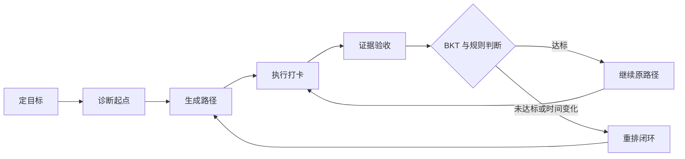
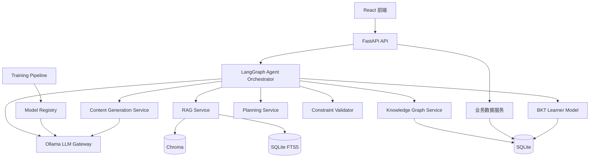
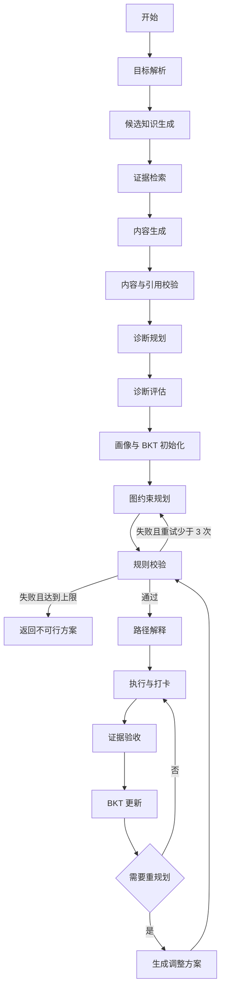
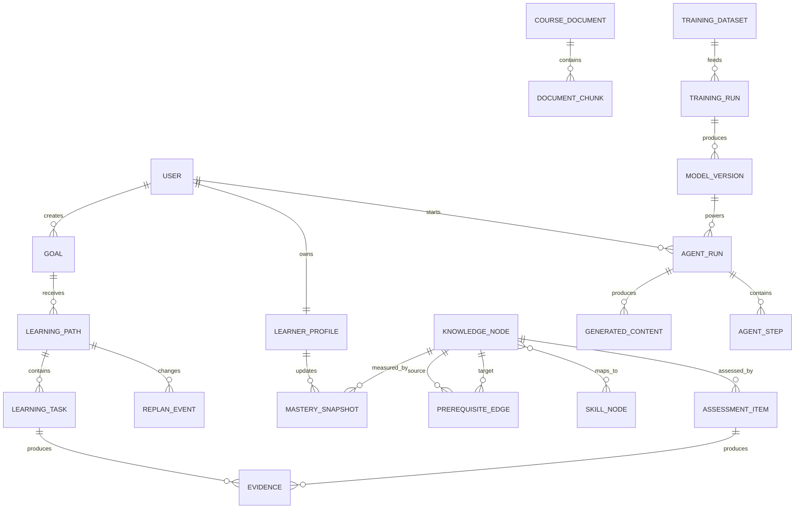

# 智能学习规划助手项目设计方案

> 文档状态：已确认可训练模型修订
>
> 文档版本：v1.1
>
> 日期：2026-09-30
>
> 项目类型：课程项目
>
> 目标用户：计算机专业大一、大二学生
>
> 目标技能主线：Python 基础 -> 数据结构与算法 -> 后端开发
>
> 模型方案：Qwen2.5-1.5B-Instruct + 4-bit QLoRA 微调
>
> 交付物：设计方案、需求规格说明书、可运行源码、演示与答辩材料

## 1. 文档目的

本文档定义“智能学习规划助手”的产品目标、业务边界、系统架构、可训练 AI 内核、数据模型、接口、非功能要求、测试方案和两周实施计划。

本文档是需求规格说明书、详细设计、代码实现和课程答辩的共同基线。若实现过程中出现冲突，应优先满足本文档中的功能闭环、真实 AI 内核、可解释性和本地可运行要求。

## 2. 项目概述

### 2.1 项目背景

计算机专业低年级学生通常已经学习部分程序设计基础，也拥有明确的学习目标，例如掌握数据结构与算法、完成一个后端项目或准备进阶课程。但学生往往不清楚：

- 当前掌握的知识与目标技能之间缺少哪些知识。
- 多个知识主题之间有哪些先修依赖。
- 在每周时间预算内，应该先学什么、后学什么。
- 某个学习计划是否真的可以完成。
- 学习过程中掌握度变化后，计划应如何调整。

传统课程表或通用学习资源库只能提供内容列表，无法基于个人基础、先修约束和时间预算生成可执行的个性化路径。

### 2.2 目标用户

核心用户为计算机专业大一、大二学生。其典型特征如下：

- 已学习一门程序设计语言的基础语法。
- 能够完成简单程序，但没有形成系统的知识结构。
- 有明确技能目标，却难以判断目标所需的前置知识。
- 每周可投入的学习时间有限，希望按时间预算拆解任务。
- 需要看到计划依据、学习进度和调整原因。

### 2.3 核心问题

给定一个技能目标、用户当前基础和时间预算，系统需要回答：

1. 达到目标需要学习哪些知识和技能。
2. 这些知识之间存在何种先修关系。
3. 用户已经掌握什么，还缺什么。
4. 在时间限制内是否存在可行学习路径。
5. 推荐顺序及每条依据从何而来。
6. 用户执行和测验后，路径应该如何变化。

### 2.4 AI 内核概述

系统采用“可微调领域模型 + Agent 编排”，以 RAG 检索课程大纲、知识材料、知识到技能映射及个人自测结果为依据，调用知识图谱约束搜索与规则校验器判断学习路径可行性。

- 本地领域模型负责理解用户意图、生成候选知识内容、拆解任务和解释路径。
- LoRA/QLoRA 微调让模型更稳定地适应目标解析、内容生成和路径规划格式。
- RAG 提供可追溯的课程依据。
- 知识图谱表达先修关系和技能映射。
- 图约束搜索生成满足依赖关系的候选路径。
- 规则校验器决定路径是否满足先修与学时约束。
- LLM 负责理解目标、规划诊断、拆解任务和自然语言解释。
- BKT 根据测验证据更新知识掌握度。
- 重规划器根据掌握度、执行状态和时间预算调整路径。

LLM 不负责最终可行性判断。路径是否可行由确定性算法和规则校验器决定。

### 2.5 产品主线

系统围绕以下完整闭环构建：

`定目标 -> 诊断起点 -> 生成路径 -> 执行打卡 -> 证据验收 -> 重排闭环`

每个环节都必须具有结构化输出、持久化状态、错误处理和可检查的通过条件。

## 3. 目标与范围

### 3.1 项目目标

- 为指定技能目标生成满足先修关系和时间预算的个性化学习路径。
- 根据用户输入的学习目标生成知识内容、任务、验收题和候选路径。
- 让每个知识点和计划调整都可以追溯到课程材料或用户证据。
- 通过自测、打卡和验收形成持续更新的学习者模型。
- 真实运行本地微调模型、RAG、知识图谱、BKT、Agent 编排和规则校验。
- 提供可复现的训练数据集、QLoRA 微调脚本、模型评估和适配器部署流程。
- 在 Windows 11 本地环境中完成离线 AI 演示。
- 提供可运行源码、设计文档、需求规格说明和答辩演示。

### 3.2 成功标准

- 完整演示“目标、诊断、规划、打卡、验收、重规划”闭环。
- 路径可行性校验通过率不低于 95%。
- 所有生成的学习节点均引用真实检索片段或知识图谱记录。
- 路径中不存在硬先修冲突和重复节点。
- 当路径不可行时，系统能够说明原因并给出可执行替代方案。
- 至少复现一次“测验未达标 -> BKT 更新 -> 插入补强任务 -> 后续任务顺延”的重规划流程。
- 对未出现在训练集中的新学习目标生成结构化内容和候选路径。
- 答辩现场能够加载微调后模型，并对比基座模型与微调模型的输出。
- 微调模型的 JSON 合法率、引用存在率和路径规则通过率不低于设定阈值。
- 在已下载模型和依赖的本地环境中完成演示，不依赖云端 API。

### 3.3 本期范围

- 支持用户输入任意计算机相关学习目标，并根据输入生成内容与路径。
- 将 Python 基础 -> 数据结构与算法 -> 后端开发作为完整验收和演示主线。
- 支持上传课程资料，为任意新目标建立可追溯的 RAG 证据。
- 支持本地生成知识节点、任务、题目、路径解释和重规划建议。
- 支持构建 600 至 1200 条 SFT 数据集并完成 QLoRA 微调。
- 支持保存训练配置、数据集版本、适配器、评估结果和模型版本。
- 支持单个本地用户及其多个学习目标。
- 支持课程文档、知识节点、技能映射、题库和先修关系导入。
- 支持目标解析、自测诊断、学习画像、路径生成、路径解释和路径调整。
- 支持学习打卡、测验提交、BKT 更新和重规划。
- 支持 Agent 执行轨迹展示，便于课程答辩说明 AI 内核。
- 支持本地模型和本地数据存储。

### 3.4 非目标

- 不接入真实教务系统或学校统一身份认证。
- 不实现多人课堂管理、教师端和社交功能。
- 不自动抓取互联网大规模课程资料。
- 不保证在无课程资料时生成的内容具有正式课程级权威性。
- 不从随机参数开始预训练基础模型。
- 不做全参数微调、分布式训练和多机训练。
- 不在答辩现场执行完整训练过程，现场只加载已完成的模型适配器。
- 不实现生产级云部署、集群和高可用架构。
- 不承诺替代教师、导师或课程考核。

### 3.5 约束与假设

- 团队规模为 2 至 4 人，开发周期约两周。
- 演示环境为 Windows 11，64 位 x64 系统。
- 演示设备配置为 Intel Core Ultra 9 275HX、NVIDIA GeForce RTX 5070 Laptop GPU 8 GB、系统内存 8 GB。
- 基础模型采用 Qwen2.5-1.5B-Instruct，以 4-bit QLoRA 完成领域微调。
- 训练与应用在同一设备上分时运行，训练期间不启动前端和 Ollama 推理进程。
- 微调完成后导出适配器或 GGUF，通过 Ollama 进行本地推理。
- 首次安装模型和嵌入模型需要网络；模型下载完成后，核心演示可离线运行。
- 课程资料应为具有使用权限的 Markdown、TXT 或 PDF 文件。
- 当目标在时间预算内不可行时，系统返回冲突原因和替代选项，不伪造可行路径。
- 无 RAG 证据的内容标记为 `draft`，不得进入 `verified` 路径。

## 4. 用户与使用场景

### 4.1 核心用户画像

**姓名：小林**

**背景：** 计算机专业大一学生，学习过 Python 语法，能完成基础程序设计题。

**目标：** 两个月内掌握数据结构与算法，并具备后端开发入门能力。

**时间：** 每周 10 小时。

**困难：** 不知道是否需要先补 Python 进阶、面向对象、复杂度分析、数据库和网络基础。

### 4.2 主要场景

1. 用户输入目标、当前基础、每周时间和截止日期。
2. 系统生成诊断题，估计各知识节点的初始掌握度。
3. 系统检索课程依据并提取目标所需的先修子图。
4. 系统生成候选路径，校验先修、学时和截止日期。
5. 系统展示路径、预计学时、掌握度、锁定原因和资料来源。
6. 用户每天打卡并提交测验证据。
7. BKT 更新掌握度，触发局部重规划。
8. 系统说明路径变化原因，用户接受或拒绝调整。

### 4.3 核心用户故事

- 作为学生，我希望输入技能目标后看到完整学习路径，以便知道从何开始。
- 作为学生，我希望输入任何新的学习主题后，系统能够生成知识框架、任务和候选路径。
- 作为学生，我希望系统依据我的现有基础跳过已掌握内容，以减少重复学习。
- 作为学生，我希望知道每个知识点的先修原因和资料出处，以便信任计划。
- 作为学生，我希望看到每周和每天的任务负荷，以便判断计划是否可执行。
- 作为学生，我希望测验失败后系统自动补强，而不是继续推进后续内容。
- 作为答辩评审，我希望看到 Agent、RAG、知识图谱、BKT 和规则校验的真实执行轨迹。

## 5. 业务流程



### 5.1 定目标

输入包括用户自由描述的学习内容、当前基础、期望完成日期、每周可投入时间、每日最大学习时间、偏好学习方式和可选课程材料。

输出为结构化 `GoalSpec`，包含目标技能 ID、目标类型、时间预算、约束条件和可验证完成标准。

通过条件：目标技能能够映射到知识图谱中的至少一个目标节点，时间和约束字段格式合法。

### 5.2 诊断起点

系统根据目标的先修子图选择诊断题，覆盖关键知识节点。题目区分难度和知识点，避免全部集中在入门内容。

输出为诊断作答记录和初始掌握度向量。

通过条件：所有目标关键节点至少有一个先验估计，低置信度节点被明确标记。

### 5.3 生成路径

系统先由微调模型生成候选知识节点、任务、题目和候选顺序，再检索课程资料、合并目标子图、计算缺失知识并执行规则校验。

输出为包含生成内容可信级别、路径节点、预计学时、先修关系、掌握阈值、依据引用和锁定原因的 `LearningPath`。

通过条件：`verified` 内容具有真实引用，路径满足硬先修、时间预算和负荷上限要求；`draft` 内容不能发布为正式路径。

### 5.4 执行打卡

用户对任务提交实际学习时长、完成状态、困难程度和可选备注。

输出为任务打卡记录，并更新计划执行偏差。

通过条件：单次时长合法，任务状态和用户反馈成功保存。

### 5.5 证据验收

用户通过选择题、简答题或代码任务提供掌握证据。系统根据题目映射的知识节点和评分结果触发 BKT。

输出为验收结果、掌握度变化、薄弱知识点和重规划判断。

通过条件：答题记录能够映射到知识节点，评分结果可重复计算。

### 5.6 重排闭环

系统根据掌握度阈值、计划偏差、时间预算变化和证据冲突决定是否重规划。

输出为原路径与调整后路径的差异、触发原因和证据引用。

通过条件：重规划不会破坏未完成的硬先修，也不会超出更新后的时间预算。

## 6. 功能需求

| 编号 | 功能 | 需求说明 | 优先级 |
| --- | --- | --- | --- |
| FR-001 | 目标管理 | 创建、读取、更新和归档学习目标 | 必须 |
| FR-002 | 目标解析 | 将自然语言目标转换为结构化技能目标和约束 | 必须 |
| FR-003 | 诊断生成 | 根据目标子图生成个性化诊断题 | 必须 |
| FR-004 | 诊断评估 | 根据答题结果初始化各知识节点掌握度 | 必须 |
| FR-005 | 学习者画像 | 汇总基础、时间、偏好、掌握度和证据 | 必须 |
| FR-006 | 文档导入 | 导入并解析课程大纲和知识材料 | 必须 |
| FR-007 | RAG 检索 | 使用关键词与向量混合检索返回带引用的证据 | 必须 |
| FR-008 | 知识图谱 | 管理知识节点、技能节点和先修边 | 必须 |
| FR-009 | 缺失知识计算 | 根据目标与掌握度计算待学习节点 | 必须 |
| FR-010 | 路径生成 | 使用图约束搜索生成候选学习顺序 | 必须 |
| FR-011 | 路径校验 | 校验硬先修、学时、截止日期、负荷和引用 | 必须 |
| FR-012 | 路径解释 | 使用 LLM 解释路径、先修原因和资料依据 | 必须 |
| FR-013 | 任务拆解 | 将知识节点拆分为可执行学习任务 | 必须 |
| FR-014 | 打卡记录 | 保存学习时长、完成度和困难反馈 | 必须 |
| FR-015 | 测验验收 | 提交题目答案并生成掌握证据 | 必须 |
| FR-016 | BKT 更新 | 根据作答结果更新知识节点掌握度 | 必须 |
| FR-017 | 重规划 | 根据掌握度和执行偏差局部调整路径 | 必须 |
| FR-018 | Agent 状态机 | 使用 LangGraph 编排真实 Agent 工作流 | 必须 |
| FR-019 | 本地模型 | 通过 Ollama 调用本地量化模型 | 必须 |
| FR-020 | 执行追踪 | 保存并展示 Agent 节点输入、输出和工具调用 | 必须 |
| FR-021 | 异常恢复 | 处理模型超时、非法 JSON、无检索结果和不可行计划 | 必须 |
| FR-022 | 演示数据管理 | 支持可重复导入和重置课程数据与演示账户 | 应当 |
| FR-023 | 任意目标生成 | 根据用户输入生成知识框架、任务、题目和候选路径 | 必须 |
| FR-024 | 训练数据集 | 管理 SFT 样本、标签、来源、版本和数据集划分 | 必须 |
| FR-025 | QLoRA 微调 | 执行可配置的 4-bit QLoRA 训练并保存适配器 | 必须 |
| FR-026 | 模型评估 | 对比基座模型和微调模型的格式、引用与路径质量 | 必须 |
| FR-027 | 模型版本 | 注册基础模型、适配器、数据集和评估指标 | 必须 |
| FR-028 | 模型加载 | 在推理阶段加载指定微调模型并记录版本 | 必须 |
| FR-029 | 内容可信级别 | 区分带证据的 `verified` 内容和待核验的 `draft` 内容 | 必须 |

## 7. 系统架构

### 7.1 架构风格

系统采用前后端分离的模块化单体架构。业务模块在部署上运行于同一台本地设备，但在代码、接口和数据职责上保持明确边界。

选择模块化单体而非微服务的原因：

- 两周课程项目内避免服务发现、消息队列和跨服务一致性成本。
- 便于一名开发者独立调试完整 AI 链路。
- 保留清晰的组件边界，方便后续拆分。
- 降低 Windows 本地演示的部署风险。

### 7.2 逻辑架构



### 7.3 组件职责

| 组件 | 技术 | 职责 | 不负责 |
| --- | --- | --- | --- |
| 前端应用 | React、TypeScript、Vite | 目标录入、诊断、路径展示、打卡、测验、重规划交互 | 不直接访问模型或数据库 |
| API 服务 | FastAPI | 请求校验、业务接口、统一错误、事务边界 | 不实现 LLM 推理逻辑 |
| Agent Orchestrator | LangGraph | 执行状态机、条件路由、失败修复、工具调用 | 不直接判断路径可行性 |
| LLM Gateway | Ollama HTTP API | 加载指定模型版本、结构化输出、超时、重试、提示词版本 | 不修改持久化状态 |
| Content Generation Service | Python、LLM Gateway | 生成知识框架、任务、题目、内容摘要和候选路径 | 不决定最终路径可行性 |
| Training Pipeline | PyTorch、Transformers、PEFT、TRL、bitsandbytes | 数据校验、SFT 训练、评估和适配器导出 | 不直接服务用户请求 |
| Model Registry | SQLite、文件系统 | 记录基座模型、数据集、适配器、评估指标和部署状态 | 不执行训练或推理 |
| RAG Service | Chroma、SQLite FTS5 | 文档导入、切分、向量化、混合检索、引用生成 | 不决定学习顺序 |
| Knowledge Graph Service | SQLite、NetworkX | 知识节点、技能映射、先修边、DAG 校验、子图提取 | 不生成自然语言解释 |
| Planning Service | Python | 拓扑约束、候选路径搜索、学时分配、局部重排 | 不绕过规则校验 |
| Constraint Validator | 确定性 Python 规则 | 先修、预算、截止日期、负荷、重复和引用校验 | 不接受 LLM 覆盖失败结果 |
| Learner Model | Python、SQLite | 学习者画像、证据记录、BKT 参数和掌握度快照 | 不直接执行规划 |
| Replanner | 规则与 LangGraph 节点 | 判断局部调整或全局重排，生成差异 | 不伪造缺失证据 |
| 本地数据层 | SQLite、Chroma | 结构化数据和向量索引 | 不保存云端用户隐私数据 |

### 7.4 部署拓扑

运行时有三个主要进程：

1. `Ollama`：加载微调后的本地模型，默认监听 `127.0.0.1:11434`。
2. `FastAPI`：默认监听 `127.0.0.1:8000`。
3. `React`：开发时使用 Vite，生产演示可构建为静态文件并由 FastAPI 托管。

训练阶段通过独立 CLI 运行，不在 API 服务进程内执行。训练、适配器合并和 GGUF 导出完成后，Ollama 才加载新模型。启动脚本负责检查 Python、Node.js、Ollama 和目标模型版本，模型缺失时给出明确下载或构建命令，不静默失败。

### 7.5 架构规则

- 前端只通过 REST API 访问后端。
- LLM 只能通过 LLM Gateway 调用。
- 用户请求不得在同步链路中启动模型训练。
- Agent 工具调用必须产生结构化记录。
- LLM 输出不得直接写入 SQLite。
- 模型生成的知识节点必须经过内容可信级别判定。
- 路径生成结果必须经过 Constraint Validator。
- 所有掌握度更新必须通过 BKT Learner Model。
- 所有路径修改必须形成 `ReplanEvent`。
- API 响应中的引用必须来自真实检索结果。
- 每次生成必须记录使用的模型版本和数据版本。

## 8. AI 内核设计

### 8.1 本地大模型

默认配置：

| 项目 | 配置 |
| --- | --- |
| 推理运行时 | Ollama |
| 基础模型 | Qwen2.5-1.5B-Instruct |
| 微调方式 | 4-bit QLoRA |
| 部署模型 | 基础模型 + LoRA 适配器，或合并后的 GGUF |
| 嵌入模型 | nomic-embed-text |
| 可选应急模型 | Qwen2.5-0.5B-Instruct |
| 调用方式 | 本机 HTTP API |
| 结构化输出 | JSON Schema 或 Ollama JSON 模式 |
| 最大重试 | 2 次格式修复重试 |
| 推理超时 | 单节点默认 90 秒，路径生成总超时 180 秒 |

1.5B 模型用于兼顾 8 GB 显存、8 GB 系统内存、训练可行性和中文指令理解能力。模型参数负责领域表达、结构化生成与路径候选，课程事实和引用由 RAG 提供，最终路径可行性由确定性算法判断。

微调后的模型通过以下流程进入推理环境：

1. 加载基础模型和训练完成的 LoRA 适配器。
2. 运行固定的模型评估集。
3. 合并适配器或导出 GGUF。
4. 写入 Ollama Modelfile。
5. 注册模型版本并通过 LLM Gateway 加载。

系统保留基座模型和微调模型两个推理配置，用于答辩时进行同输入输出对比。

### 8.2 内容生成设计

内容生成不是让模型自由编写学习计划，而是执行“生成候选结构、检索证据、构建图谱、约束搜索、规则校验”的受控流程。

输入包括：

- 用户输入的学习目标。
- 当前基础诊断结果。
- 每周、每日时间和截止日期。
- 课程文档或用户上传资料。
- 学习者已有掌握度与历史证据。

生成流程：

1. GoalInterpreter 将自由输入转换为结构化 `GoalSpec`。
2. 模型生成知识领域、候选知识节点、技能映射和检索查询。
3. RAG 为候选知识节点返回真实资料片段。
4. Content Generator 生成任务、说明、验收题和候选路径。
5. Schema Validator 检查模型输出结构。
6. Citation Validator 删除不存在的引用。
7. Graph Merger 将候选节点与已有图谱合并，进行实体归一化和环路检查。
8. GraphPlanner 与 Constraint Validator 生成并校验最终路径。
9. PlanExplainer 生成路径依据和调整说明。

模型输出必须包含：

```json
{
  "goal_spec": {},
  "candidate_skills": [],
  "candidate_knowledge_nodes": [],
  "candidate_prerequisites": [],
  "learning_tasks": [],
  "assessment_items": [],
  "candidate_path": [],
  "citations": [],
  "confidence": 0.0
}
```

内容可信级别：

- `verified`：关键节点具有 RAG 证据，图谱和规则校验通过，可生成正式路径。
- `draft`：模型可生成内容，但缺少足够资料，只能作为待核验草案，不能进入正式路径。

LLM 可以提出知识节点和先修关系，但不能把 `draft` 内容提升为 `verified`。该决定由证据覆盖率和规则校验器共同完成。

### 8.3 训练与微调流水线

#### 8.3.1 训练目标

微调目标是让 1.5B 模型更稳定地完成领域任务，而不是依靠模型记忆课程事实。训练重点为：

- 将中文自然语言目标转换为固定 JSON Schema。
- 根据目标拆解知识节点和技能结构。
- 生成可执行任务、阶段目标和验收题。
- 生成满足先修约束的候选路径。
- 根据校验错误修复路径结构。
- 使用 RAG 引用解释路径和重规划原因。

#### 8.3.2 数据集设计

目标规模为 600 至 1200 条高质量 SFT 样本，按 80%/10%/10% 划分为训练集、验证集和测试集。测试集按学习目标或模板分组隔离，防止相似样本泄漏。

| 数据类型 | 建议占比 | 示例 |
| --- | --- | --- |
| 目标解析 | 15% | 将自由目标转换为 GoalSpec |
| 知识拆解 | 20% | 生成知识节点、技能和先修候选 |
| 内容生成 | 15% | 生成任务、说明和测验题 |
| 路径规划 | 25% | 根据掌握度和时间输出候选路径 |
| 路径解释 | 15% | 解释先修、顺序和资料依据 |
| 重规划 | 10% | 根据 BKT 和执行偏差调整路径 |

数据来源包括人工设计的种子模板、依据课程资料构建的正例、本地基座模型辅助生成后人工审核的样本，以及规则校验失败后修复成功的样本。未经审核的模型输出不得直接进入训练集。

每条样本至少包含：

```json
{
  "sample_id": "sft-0001",
  "task_type": "path_planning",
  "instruction": "为有 Python 基础、每周学习 10 小时的学生规划后端开发路径",
  "input": {},
  "target_json": {},
  "citations": [],
  "source": "curated",
  "dataset_version": "ds-v1"
}
```

#### 8.3.3 QLoRA 训练配置

| 项目 | 默认值 |
| --- | --- |
| 训练环境 | WSL2 Ubuntu 22.04 + 与 RTX 5070 驱动兼容的 CUDA/PyTorch |
| 量化方式 | 4-bit NF4 |
| 计算精度 | bfloat16 或 float16，按设备支持选择 |
| LoRA rank | 16 |
| LoRA alpha | 32 |
| LoRA dropout | 0.05 |
| 目标模块 | 注意力与投影层 |
| batch size | 1 |
| 梯度累积 | 8 至 16 |
| 最大序列长度 | 1024 |
| epochs | 1 至 3 |
| 学习率 | 1e-4 至 2e-4 |
| 梯度检查点 | 开启 |
| 早停 | 验证损失连续两次未改善时停止 |

训练配置、随机种子、环境版本、GPU 信息和数据哈希必须写入 `training_runs`。当 1.5B 训练发生内存不足时，可按预设命令降级到 0.5B 模型，但不能在未重新评估的情况下替换演示模型。

#### 8.3.4 训练与部署流程

1. 校验数据集 Schema、引用和标签完整性。
2. 运行基座模型评估，保存基线结果。
3. 执行 QLoRA 训练并保存检查点、损失曲线和日志。
4. 在测试集上评估微调模型。
5. 通过门槛后合并适配器或导出 GGUF。
6. 注册模型版本并加载到 Ollama。
7. 在答辩现场对比基座模型与微调模型。

#### 8.3.5 微调评估门槛

- JSON Schema 合法率不低于 95%。
- 相对基座模型的结构化输出成功率提升至少 10 个百分点。
- 引用必须存在于 RAG 返回值中，引用存在率必须为 100%。
- 最终路径的硬先修冲突率必须为 0。
- 在未参与训练的 20 个目标测试集上，至少 80% 可生成通过规则校验的路径。
- 微调模型不得因训练样本泄漏而在测试目标上直接复现完整答案。

### 8.4 RAG 设计

RAG 的目标是为知识点、生成内容、路径解释和调整原因提供可追溯依据。

#### 8.4.1 数据来源

- 课程教学大纲。
- 教材目录和章节摘要。
- 教师讲义或自建知识材料。
- 用户上传且具有使用权限的学习资料。
- 课程知识点与技能映射表。
- 题目与知识节点映射。

#### 8.4.2 导入流程

1. 读取 Markdown、TXT 或 PDF。
2. 提取文档元数据，包括课程、章节、版本和来源。
3. 按标题、段落和 token 上限进行语义切分。
4. 为每个片段生成稳定 `chunk_id`。
5. 使用嵌入模型生成向量并写入 Chroma。
6. 将原始文本和检索元数据写入 SQLite FTS5。
7. 校验文档引用链完整性。

#### 8.4.3 混合检索

检索同时使用向量相似度和关键词匹配，避免纯向量检索丢失精确术语。

```text
final_score = 0.65 * vector_score + 0.35 * normalized_bm25_score
```

默认召回 8 个片段，过滤课程、知识域和文档版本后返回前 5 个片段。若没有达到最低分数，RAG 节点返回“证据不足”，不能由 LLM 编造引用。

#### 8.4.4 引用格式

```json
{
  "document_id": "doc-python-001",
  "chunk_id": "doc-python-001-c03",
  "title": "Python 程序设计课程大纲",
  "section": "函数与模块",
  "page": 12,
  "score": 0.82
}
```

### 8.5 知识图谱设计

知识图谱表达“学什么、先后关系是什么、属于哪项技能”。

#### 8.5.1 节点

- 知识节点：变量、控制流、函数、递归、复杂度分析、数组、链表、树、图、数据库基础等。
- 技能节点：Python 程序设计、数据结构与算法、后端开发基础等。
- 课程节点：课程或资料来源。
- 题目节点：诊断题、练习题和验收题。

#### 8.5.2 边

| 边类型 | 含义 | 是否阻断 |
| --- | --- | --- |
| `HARD_PREREQUISITE` | 目标节点必须完成后的硬先修 | 是 |
| `SOFT_PREREQUISITE` | 有助于理解但可不先完成的软先修 | 否 |
| `MAPS_TO_SKILL` | 知识节点映射到技能目标 | 是 |
| `COVERED_BY_COURSE` | 知识节点被课程或文档覆盖 | 否 |
| `ASSESSED_BY` | 知识节点由题目验收 | 是 |

#### 8.5.3 图谱不变量

- 硬先修子图必须是 DAG。
- 每个目标技能至少映射一个知识节点。
- 每个可规划知识节点必须有预计学习时间。
- 每个 `verified` 可规划知识节点至少有一条证据来源。
- 每个验收题必须映射到至少一个知识节点。

### 8.6 路径规划算法

LLM 根据用户输入生成候选知识结构和候选路径，确定性算法负责重建依赖、搜索可行顺序并给出最终路径。LLM 的候选结果不能绕过图谱和规则校验。

#### 8.6.1 输入

- 目标技能节点。
- 学习者各知识节点掌握度。
- 硬先修和软先修边。
- 每节点预计学时。
- 每周和每日时间预算。
- 截止日期。
- 节点证据引用。
- 微调模型生成的候选节点、先修边和候选顺序。

#### 8.6.2 步骤

1. 从目标技能反向提取必需知识子图。
2. 将模型候选节点与已有图谱进行实体归一化并合并。
3. 删除掌握度达到解封阈值且证据有效的节点。
4. 保留未掌握节点及其硬先修依赖。
5. 对剩余子图执行 Kahn 拓扑排序。
6. 根据节点难度、掌握度和软先修计算推荐优先级。
7. 将节点分配到可用学习时间窗口。
8. 生成一个主候选路径和若干可替代顺序。
9. 调用 Constraint Validator 校验候选路径。
10. 校验失败时将具体错误返回模型或规划器进行局部修复。

#### 8.6.3 目标函数

在所有可行路径中选择综合风险最低的方案：

```text
risk = 0.50 * prerequisite_gap
     + 0.25 * schedule_pressure
     + 0.15 * difficulty_jump
     + 0.10 * context_switch
```

- `prerequisite_gap`：软先修未满足程度。
- `schedule_pressure`：剩余学时与剩余时间的比值。
- `difficulty_jump`：相邻节点难度变化。
- `context_switch`：频繁切换知识领域的惩罚。

### 8.7 规则校验器

| 规则 | 校验内容 | 失败处理 |
| --- | --- | --- |
| VR-001 | 所有硬先修已掌握或排在目标节点前 | 返回缺失先修并阻止发布 |
| VR-002 | 总预计学时不超过剩余时间预算 | 返回超时量和压缩方案 |
| VR-003 | 每日和每周任务不超负荷上限 | 重新分配时间窗口 |
| VR-004 | 路径无重复知识节点 | 去重并记录修复 |
| VR-005 | 每个节点至少有一条真实证据引用 | 触发重新检索或标记资料缺失 |
| VR-006 | 每个验收任务映射有效知识节点 | 拒绝任务发布 |
| VR-007 | 路径支持已完成节点被锁定 | 修正路径状态 |
| VR-008 | 重规划不破坏未完成硬先修 | 回退并重新规划 |

校验器输出统一结构：

```json
{
  "is_valid": false,
  "errors": [
    {
      "rule_id": "VR-001",
      "node_id": "algo-recursion",
      "message": "递归需要函数与调用栈基础",
      "related_node_ids": ["python-function"]
    }
  ],
  "repair_hint": "insert_before"
}
```

### 8.8 BKT 学习者模型

每个知识节点维护一组 BKT 参数：

| 参数 | 含义 | 初始范围 |
| --- | --- | --- |
| `p_init` | 学习前掌握概率 | 由诊断结果初始化 |
| `p_learn` | 一次学习后从未掌握到掌握的概率 | 0.15 至 0.30 |
| `p_slip` | 已掌握但答错的概率 | 0.05 至 0.15 |
| `p_guess` | 未掌握但答对的概率 | 根据题型计算 |

正确作答后的后验概率：

```text
P(L_t | correct) = P(L_t)(1 - p_slip) /
                   [P(L_t)(1 - p_slip) + (1 - P(L_t))p_guess]
```

错误作答后的后验概率：

```text
P(L_t | wrong) = P(L_t)p_slip /
                 [P(L_t)p_slip + (1 - P(L_t))(1 - p_guess)]
```

下一状态的掌握概率：

```text
P(L_{t+1}) = P(L_t | evidence) +
             (1 - P(L_t | evidence)) * p_learn
```

默认阈值：

- 低于 `0.45`：薄弱，必须补强。
- `0.45` 至 `0.75`：进行中，需要继续练习。
- 达到 `0.75`：解锁后续硬先修依赖。

每次更新生成 `MasterySnapshot`，记录旧值、新值、证据、参数版本和时间。

### 8.9 LangGraph Agent 工作流

#### 8.9.1 Agent 状态

```text
AgentState
  run_id
  user_id
  model_version
  goal_spec
  learner_snapshot
  diagnostic_plan
  diagnostic_answers
  evidence_chunks
  generated_content
  content_status
  graph_subgraph
  candidate_path
  validation_result
  explanation
  execution_snapshot
  replan_decision
  retry_count
  errors
  trace
```

#### 8.9.2 节点定义

| 节点 | 类型 | 输入 | 输出 |
| --- | --- | --- | --- |
| GoalInterpreter | LLM | 自然语言目标 | 结构化 `GoalSpec` |
| ConceptGenerator | 微调 LLM | `GoalSpec`、现有图谱 | 候选知识节点、先修边和检索查询 |
| RAGTool | 确定性工具 | 检索查询集合 | 带引用片段 |
| ContentGenerator | 微调 LLM | 候选概念、画像、证据 | 任务、题目、内容摘要和候选路径 |
| ContentValidator | 规则 | 生成内容与引用 | `verified` 或 `draft` 状态 |
| DiagnosticPlanner | LLM + 工具 | `GoalSpec`、候选知识、证据 | 诊断题集合 |
| DiagnosticEvaluator | 规则 + BKT | 作答记录 | 初始掌握度 |
| ProfileBuilder | 确定性 | 用户基础与掌握度 | `LearnerSnapshot` |
| GraphPlanner | 确定性工具 | 图谱、画像、时间预算 | 候选路径 |
| ConstraintValidator | 确定性工具 | 候选路径 | 校验结果 |
| PlanExplainer | LLM | 路径、证据、校验结果 | 用户可读解释 |
| ExecutionMonitor | 规则 | 打卡和进度 | 执行偏差 |
| EvidenceEvaluator | 规则 + LLM 辅助 | 测验答案 | 掌握证据 |
| BKTUpdater | 确定性工具 | 掌握证据 | 新掌握度 |
| ReplanDecider | 规则 | 掌握度、时间、偏差 | 保持或重规划 |
| ReplanNarrator | LLM | 路径差异和触发原因 | 调整说明 |

#### 8.9.3 状态流转



#### 8.9.4 失败修复策略

- 非法 JSON：将校验错误和原输出返回 LLM 修复，最多 2 次。
- 检索无结果：扩大检索词、降低阈值或标记证据缺失。
- 内容为 `draft`：允许保存和查看，但阻止发布为正式路径。
- 路径校验失败：根据错误类型插入先修、调整顺序或减少范围。
- 三次规划仍失败：停止自动修复，输出冲突原因和替代方案。
- 模型超时：保留已完成状态，允许用户重试当前节点。

### 8.10 重规划策略

重规划触发条件：

- 知识节点 BKT 低于 0.45。
- 同一任务连续两次未完成。
- 用户修改每周时间预算或截止日期。
- 验收证据与已有高掌握度冲突。
- 目标范围发生变化。

默认策略：

- 局部插入补强节点。
- 降低任务粒度。
- 将后续节点顺延。
- 调整软先修节点顺序。
- 在必要时减少非核心扩展内容。

全局重规划条件：

- 目标技能发生变化。
- 总时间预算变化超过 30%。
- 多个关键节点持续不达标。
- 当前路径已无法通过局部调整满足硬约束。

每次重规划输出：

- 触发事件。
- 原路径与新路径的节点差异。
- 变更原因。
- 涉及的证据或规则。
- 新的预计完成日期。
- 对用户的影响。

### 8.11 提示词与结构化输出

- 提示词以版本化模板文件保存。
- 每次 Agent 运行记录提示词版本、模型版本 ID 和推理参数。
- 所有 LLM 业务输出必须满足 JSON Schema。
- 解析失败时不得把原始文本写入业务表。
- LLM 只能引用 `evidence_chunks` 中存在的 `chunk_id`。
- 解释文本与结构化路径分开存储。

## 9. 数据设计

### 9.1 数据模型



### 9.2 数据表

| 表 | 关键字段 | 说明 |
| --- | --- | --- |
| `users` | `id, display_name, created_at` | 本地用户 |
| `goals` | `id, user_id, target_skill_id, deadline, weekly_hours, daily_hours, status` | 学习目标 |
| `learner_profiles` | `id, user_id, preferences_json, version` | 学习者画像 |
| `knowledge_nodes` | `id, name, domain, difficulty, estimated_hours, mastery_threshold, evidence_required` | 知识节点 |
| `skill_nodes` | `id, name, description, level` | 技能节点 |
| `prerequisite_edges` | `source_id, target_id, edge_type, weight, reason` | 先修关系 |
| `course_documents` | `id, title, course_id, version, source_path, status` | 课程资料 |
| `document_chunks` | `id, document_id, section, page, content, token_count` | 文档片段 |
| `assessment_items` | `id, knowledge_node_id, item_type, difficulty, answer_schema, scoring_rule` | 题目 |
| `assessment_attempts` | `id, item_id, user_id, answer_json, score, submitted_at` | 作答记录 |
| `learning_paths` | `id, goal_id, status, version, total_hours, risk_score, created_at` | 学习路径 |
| `path_items` | `id, path_id, knowledge_node_id, sequence, planned_hours, state, unlock_rule` | 路径节点 |
| `learning_tasks` | `id, path_item_id, title, task_type, planned_minutes, due_date, status` | 可执行任务 |
| `checkins` | `id, task_id, actual_minutes, completion_ratio, difficulty_feedback, note` | 打卡记录 |
| `evidence` | `id, user_id, knowledge_node_id, source_type, source_id, score, payload_json` | 学习证据 |
| `mastery_snapshots` | `id, user_id, knowledge_node_id, previous_probability, new_probability, evidence_id` | 掌握度快照 |
| `bkt_parameters` | `knowledge_node_id, p_init, p_learn, p_slip, p_guess, version` | BKT 参数 |
| `replan_events` | `id, path_id, trigger_type, before_json, after_json, reason, accepted` | 重规划事件 |
| `agent_runs` | `id, user_id, graph_version, model_version_id, status, started_at, finished_at` | Agent 运行 |
| `agent_steps` | `id, run_id, node_name, input_json, output_json, duration_ms, status` | Agent 节点轨迹 |
| `generated_contents` | `id, run_id, goal_id, model_version_id, content_type, status, payload_json, citations_json` | 模型生成内容及可信级别 |
| `training_datasets` | `id, name, version, storage_path, sample_count, split_hash, status` | SFT 数据集版本 |
| `training_runs` | `id, dataset_id, base_model, method, config_json, metrics_json, output_path, status` | QLoRA 训练记录 |
| `model_versions` | `id, base_model, adapter_path, gguf_path, training_run_id, evaluation_json, status` | 可加载模型版本 |

### 9.3 数据完整性

- 所有主键使用可排序字符串或 UUID。
- 所有时间使用 UTC ISO 8601 保存，界面转换为本地时区。
- 知识节点、路径和 BKT 参数使用版本号，避免规则变化影响历史解释。
- 删除课程文档时采用软删除，已有路径引用继续可读。
- 路径发布后不允许原地修改，重规划创建新路径版本。
- JSON 字段必须通过应用层 Schema 校验。
- 训练数据必须记录来源、授权说明、数据哈希和划分方式。
- 模型版本必须关联训练运行、数据集和评估结果，未评估模型不得激活。

## 10. API 设计

### 10.1 通用约定

- 基础路径：`/api/v1`
- 数据格式：JSON
- 时间格式：ISO 8601
- 错误格式：

```json
{
  "error": {
    "code": "PLAN_INFEASIBLE",
    "message": "当前时间预算无法完成目标",
    "details": {},
    "trace_id": "run-20260930-001"
  }
}
```

### 10.2 接口列表

| 方法 | 路径 | 用途 |
| --- | --- | --- |
| `POST` | `/goals` | 创建并解析学习目标 |
| `GET` | `/goals/{goal_id}` | 查询目标 |
| `POST` | `/diagnostics` | 生成诊断题 |
| `POST` | `/diagnostics/{diagnostic_id}/submit` | 提交诊断答案 |
| `GET` | `/learners/{user_id}/profile` | 获取学习者画像 |
| `POST` | `/content/generate` | 根据用户输入生成知识、任务、题目和候选路径 |
| `POST` | `/paths/generate` | 生成并校验学习路径 |
| `GET` | `/paths/{path_id}` | 获取路径、引用和锁定原因 |
| `POST` | `/paths/{path_id}/accept` | 接受路径 |
| `GET` | `/tasks/today` | 获取当前任务 |
| `POST` | `/tasks/{task_id}/check-in` | 提交打卡 |
| `POST` | `/assessments/{item_id}/submit` | 提交测验证据 |
| `GET` | `/paths/{path_id}/replans/preview` | 预览重规划 |
| `POST` | `/replans/{replan_id}/accept` | 接受重规划 |
| `GET` | `/traces/{run_id}` | 查看 Agent 执行轨迹 |
| `POST` | `/admin/import` | 导入课程资料和知识图谱数据 |
| `POST` | `/admin/datasets` | 注册或导入训练数据集 |
| `POST` | `/admin/training-runs` | 启动可配置的 QLoRA 训练任务 |
| `GET` | `/admin/training-runs/{run_id}` | 查询训练状态、损失和评估指标 |
| `POST` | `/admin/training-runs/{run_id}/evaluate` | 运行基座模型与微调模型对比评估 |
| `GET` | `/models` | 查询模型版本和部署状态 |
| `POST` | `/models/{model_id}/activate` | 切换到已通过评估的模型版本 |
| `POST` | `/admin/reset-demo` | 重置演示数据 |

### 10.3 路径生成请求示例

```json
{
  "goal_id": "goal-001",
  "goal_text": "我想学习后端开发，并掌握数据结构和算法",
  "target_skill_id": "skill-backend-basic",
  "deadline": "2026-11-30",
  "weekly_hours": 10,
  "daily_hours": 2,
  "preferred_modes": ["reading", "coding"],
  "constraints": {
    "avoid_weekends": false,
    "max_session_minutes": 90
  }
}
```

### 10.4 路径响应示例

```json
{
  "path_id": "path-001",
  "status": "valid",
  "content_status": "verified",
  "model_version": "model-qlora-v1",
  "total_hours": 72,
  "risk_score": 0.31,
  "items": [
    {
      "sequence": 1,
      "knowledge_node_id": "python-function",
      "name": "函数与模块",
      "planned_hours": 6,
      "mastery": 0.35,
      "state": "ready",
      "evidence": ["doc-python-001-c03"]
    }
  ],
  "validation": {
    "is_valid": true,
    "errors": []
  },
  "explanation": "先补强函数和模块，再进入递归与复杂度分析。"
}
```

### 10.5 测验提交响应示例

```json
{
  "evidence_id": "ev-001",
  "knowledge_node_id": "algo-recursion",
  "score": 0.4,
  "mastery": {
    "previous": 0.62,
    "current": 0.54,
    "threshold": 0.75
  },
  "replan_required": true,
  "replan_reason": "递归掌握度低于当前路径阈值"
}
```

## 11. 前端设计

### 11.1 页面结构

| 页面 | 核心内容 | 主要操作 |
| --- | --- | --- |
| 目标设置 | 目标技能、基础描述、时间预算、截止日期 | 创建目标 |
| 基础诊断 | 个性化题目、答题进度、预计耗时 | 提交诊断 |
| 内容生成 | 生成知识框架、任务、题目、候选路径、内容可信级别 | 编辑并确认生成内容 |
| 学习路径 | 节点图、学时、掌握度、先修、引用、锁定原因 | 接受路径 |
| 今日任务 | 当日任务、预计时长、关联知识、资料引用 | 打卡 |
| 证据验收 | 题目、作答、评分、掌握度变化 | 提交答案 |
| 重规划 | 原路径、新路径、差异、原因和影响 | 接受或拒绝调整 |
| 模型管理 | 基座与微调模型版本、数据集、训练日志、评估指标 | 激活模型、查看对比 |
| AI 轨迹 | Agent 节点、工具调用、耗时和校验结果 | 展开查看 |

### 11.2 路径可视化

路径使用节点和连线展示：

- 绿色：已达到掌握阈值。
- 蓝色：当前可学习。
- 灰色：受硬先修锁定。
- 橙色：需要补强。
- 红色：校验冲突或延期风险。

点击节点后展示预计学时、掌握度、先修原因、任务列表和资料来源。

### 11.3 交互原则

- 长耗时 Agent 操作显示当前节点和处理状态。
- 所有生成结果保留“重新生成”和“查看原因”入口。
- `draft` 内容必须显示醒目标识，并禁止直接发布为正式路径。
- 重规划必须显示前后差异，不只展示新计划。
- 错误信息说明用户可采取的动作。
- 演示模式提供一键重置，保证流程可重复。

## 12. 非功能需求

### 12.1 性能

在目标演示设备、模型已预热且课程数据已建立索引的条件下：

| 指标 | 目标 |
| --- | --- |
| RAG 检索响应 | 小于 2 秒 |
| 图约束搜索 | 小于 1 秒 |
| 规则校验 | 小于 500 毫秒 |
| BKT 单次更新 | 小于 100 毫秒 |
| 本地 LLM 首次可见输出 | 小于 10 秒 |
| 完整路径生成 | 小于 120 秒 |
| API 普通查询 | 小于 500 毫秒 |

模型冷启动时间不计入路径生成目标，但界面必须显示加载状态。

训练阶段不与推理阶段同时运行。单次课程演示训练允许耗时数小时，但必须支持从最近检查点恢复，避免设备中断导致训练进度全部丢失。

### 12.2 可靠性

- Agent 每个节点具有超时和失败状态。
- 路径生成支持从最近成功节点重试。
- 重复提交测验使用幂等键避免重复更新 BKT。
- 数据导入事务失败时回滚。
- 应用退出后不丢失已提交打卡与证据。
- 训练中断后能够从最近检查点恢复。
- 模型激活失败时回退到上一个已评估版本。

### 12.3 可解释性

- 每个 `verified` 知识节点显示至少一个资料来源，`draft` 节点显示待核验标识。
- 每个路径限制显示对应规则编号。
- 每次重规划显示触发原因与变更差异。
- Agent 轨迹展示模型节点、工具节点和校验结果。
- LLM 不得生成不存在的引用。

### 12.4 安全与隐私

- 默认只监听本地回环地址。
- 不接入云端 API，不上传学习记录。
- 上传文档限制类型、大小和路径，防止目录穿越。
- 日志不记录完整用户答案时，可使用摘要或哈希代替。
- 模型和课程数据来源需在项目材料中说明。
- 训练数据不得包含未授权教材、个人隐私或真实用户答题原文。
- 数据集和模型产物使用版本号与哈希，避免不可追溯覆盖。

### 12.5 可维护性

- 前端、API、Agent、算法和数据访问分层。
- 核心算法具有单元测试。
- 提示词和模型配置独立于业务代码。
- 数据集和训练配置使用版本化文件。
- 训练脚本能够在干净环境中根据锁定的依赖版本复现实验结果。
- 数据导入脚本可重复执行。
- 所有业务接口具有请求和响应 Schema。

## 13. 异常与边界处理

| 场景 | 系统行为 |
| --- | --- |
| Ollama 未启动 | 返回 `MODEL_UNAVAILABLE`，提示启动命令 |
| 模型不存在 | 返回模型名称及下载命令，不自动选择其他模型 |
| 微调模型未通过评估 | 保持上一版本激活，不允许部署新版本 |
| 训练过程显存不足 | 从最近检查点停止，建议降低序列长度或使用备用模型 |
| LLM 返回非法 JSON | 自动修复两次，仍失败则终止当前节点 |
| RAG 无有效结果 | 标记证据不足，生成内容只能保存为 `draft` |
| 生成内容缺少证据 | 标记为 `draft`，仅允许查看和编辑 |
| 图谱存在环 | 拒绝发布规划数据并指出环路 |
| 路径时间超出预算 | 禁止发布，返回压缩范围和替代方案 |
| 用户修改目标 | 创建新目标，不覆盖历史路径 |
| 重复打卡或测验 | 使用幂等键返回原结果 |
| BKT 参数缺失 | 使用版本化默认参数并记录回退 |
| 用户拒绝重规划 | 保留原路径并显示延期风险 |

## 14. 测试与验收

### 14.1 测试层次

| 层次 | 范围 | 工具建议 |
| --- | --- | --- |
| 单元测试 | BKT、校验器、图搜索、评分规则 | pytest |
| 集成测试 | RAG、SQLite、Ollama Gateway、LangGraph 节点 | pytest、FastAPI TestClient |
| 训练测试 | 数据 Schema、划分、LoRA 加载、检查点恢复和导出 | pytest、训练 Smoke Test |
| API 测试 | 请求 Schema、错误码、事务、幂等 | pytest |
| 端到端测试 | 六阶段完整闭环 | Playwright |
| AI 评测 | 结构化输出率、引用有效率、路径规则通过率和修复率 | 固定基线与微调评测集 |

### 14.2 验收用例

| 编号 | 场景 | 预期结果 |
| --- | --- | --- |
| AT-001 | 输入可完成目标 | 生成满足先修和预算的有效路径 |
| AT-002 | 缺少函数基础 | 路径在递归前插入函数节点 |
| AT-003 | 总学时超出预算 | 不发布路径，返回三种替代方案 |
| AT-004 | RAG 无相关证据 | 标记资料缺失，不编造引用 |
| AT-005 | 测验未达到阈值 | BKT 下降并触发补强任务 |
| AT-006 | 连续两次未打卡 | 触发局部重规划并顺延后续节点 |
| AT-007 | 修改每周时间 | 新路径时间预算与用户输入一致 |
| AT-008 | 模型返回非法 JSON | 自动修复或明确失败，不写入脏数据 |
| AT-009 | 关闭外部网络 | 已安装模型和索引后可完成演示 |
| AT-010 | 查看 Agent 轨迹 | 可看到节点、工具、耗时和校验结果 |
| AT-011 | 输入未出现在训练集的新主题 | 生成结构化知识框架和候选路径，并正确标记可信级别 |
| AT-012 | 加载微调模型对比基座模型 | 展示相同输入下的结构化输出和质量指标差异 |
| AT-013 | 新主题没有 RAG 证据 | 内容标记为 `draft`，不能发布为正式路径 |
| AT-014 | 激活未通过评估的模型 | 系统拒绝激活并保留当前模型 |

### 14.3 AI 质量指标

- 结构化输出成功率不低于 95%。
- 微调模型的结构化输出成功率比基座模型提升至少 10 个百分点。
- 引用存在率必须为 100%。
- 路径硬先修冲突率必须为 0。
- 在未参与训练的 20 个目标中，至少 80% 可生成通过规则校验的路径。
- 不可行计划必须返回明确冲突，不得伪造成功。

## 15. 两周实施计划

| 阶段 | 时间 | 主要任务 | 验收输出 |
| --- | --- | --- | --- |
| 需求与训练准备 | 第 1 至 2 天 | 冻结范围、数据 Schema、技术基线；验证 PyTorch/QLoRA 环境；准备 150 条种子样本 | 数据格式、训练 Smoke Test 通过 |
| 数据与算法 | 第 3 至 4 天 | 扩展到 600 条以上样本；整理知识节点和材料；实现图、BKT 与数据校验 | 数据集 v1、算法单测通过 |
| AI 与微调 | 第 5 至 7 天 | 完成 RAG、内容生成、LangGraph、QLoRA 训练、评估和模型导出 | 微调模型 v1、六阶段后端闭环可调用 |
| 产品界面 | 第 8 至 10 天 | 完成 API、核心页面、内容生成页、模型管理和 Agent 轨迹页 | 用户可完成主流程 |
| 联调加固 | 第 11 至 12 天 | 加载微调模型，完成异常处理、性能、幂等和端到端测试 | 验收用例通过 |
| 文档演示 | 第 13 至 14 天 | 文档定稿、演示数据、答辩材料和演练 | 完整课程交付包 |

### 15.1 团队分工建议

2 人团队：

- A：模型训练、LLM Gateway、内容生成、Agent、RAG 与重规划。
- B：前端、API、数据库、知识图谱、BKT、路径校验与测试。
- 共享：训练数据制作与审核、模型评测、联调和答辩材料。

4 人团队：

- A：Agent 与 LLM Gateway。
- B：RAG、知识图谱与路径算法。
- C：FastAPI、SQLite、BKT 与测试。
- D：React 前端、可视化和演示材料。

## 16. 风险与缓解

| 风险 | 影响 | 缓解措施 |
| --- | --- | --- |
| 8 GB 内存导致训练或推理压力 | 训练中断或演示卡顿 | 默认 1.5B QLoRA；训练与推理分时执行；限制并发 |
| RTX 5070 驱动或运行时兼容问题 | 本地模型无法使用 GPU | 提前在第 1 天验证 Ollama GPU 推理；准备 CPU 降级模式 |
| QLoRA 训练时间超出预期 | 无法完成微调模型交付 | 先训练 1.5B 最小可用版本，保存检查点，必要时降级到 0.5B |
| 训练数据质量不足 | 模型输出格式不稳定或过拟合 | 种子样本人工审核、规则过滤、按目标划分测试集 |
| 训练样本泄漏到测试集 | 评估结果虚高 | 按目标、模板和知识域分组划分，检查输入相似度 |
| 课程数据准备量过大 | 无法在两周内形成真实 RAG | 完整验收固定为一条技能主线，其他主题作为泛化测试 |
| Agent 流程过于复杂 | 联调时间不足 | 先实现确定性主路径，再增加条件修复 |
| LLM 输出不稳定 | 无法写入业务数据 | JSON Schema、固定参数、修复重试和确定性校验 |
| 图谱先修关系错误 | 推荐路径错误 | 数据审核、DAG 校验、单元测试和样例验收 |
| 前后端联调占用过多时间 | 演示不完整 | 第 5 天冻结 API 契约，使用 Mock 并行开发 |
| 时间不足导致功能蔓延 | 核心闭环延期 | 以本文档 MVP 为唯一范围，非关键功能延期 |

## 17. 交付清单

课程最终交付包括：

1. 项目设计方案。
2. 需求规格说明书。
3. 软件架构与数据库说明。
4. 可运行的前端、后端、Agent 和训练源代码。
5. 训练数据集、数据 Schema、数据版本和授权说明。
6. QLoRA 训练脚本、配置、日志、检查点和模型适配器。
7. 基座模型与微调模型对比评估报告。
8. 本地模型与依赖安装说明。
9. 测试用例和测试结果。
10. 演示数据和一键重置脚本。
11. 演示脚本、PPT 和答辩材料。

## 18. 后续演进

在课程 MVP 完成后，可进一步增加：

- 更大规模的动态知识图谱和跨课程规划。
- 更多学科课程资料。
- 代码题自动评测与沙箱执行。
- 更细粒度的自然语言证据分析。
- 多用户和教师端。
- 基于真实学习数据的 BKT 参数估计。
- 在 SFT 基础上增加 DPO 或基于规则反馈的偏好优化。
- 自动化数据合成、质量过滤和主动学习。
- 学习提醒和日历集成。
- 本地模型与云端模型的可配置切换。

## 19. 术语表

| 术语 | 定义 |
| --- | --- |
| RAG | 检索增强生成，先检索真实资料再生成回答 |
| Agent | 根据状态选择工具和下一步动作的智能执行体 |
| LangGraph | 用于构建有状态 Agent 工作流的图执行框架 |
| BKT | 贝叶斯知识追踪，根据答题证据估计知识掌握概率 |
| SFT | 监督微调，使用输入和期望输出样本训练模型 |
| LoRA | 只训练低秩适配器参数的高效微调方法 |
| QLoRA | 结合 4-bit 量化与 LoRA 的低显存微调方法 |
| Adapter | LoRA 训练产生的可加载参数文件 |
| GGUF | 供本地推理运行时加载的量化模型格式 |
| `verified` | 有 RAG 证据且通过图谱与规则校验的内容 |
| `draft` | 缺少充分证据、只能作为待核验草案的内容 |
| 知识图谱 | 由知识节点、技能节点和先修边组成的结构化网络 |
| 硬先修 | 未满足时会阻断后续学习的必要条件 |
| 软先修 | 建议先学习但不强制阻断的关系 |
| 规则校验器 | 使用确定性规则判断路径是否可行的组件 |
| 掌握阈值 | 解锁后续知识所需的 BKT 概率 |
| 重规划 | 根据新证据或约束变化调整现有路径 |

## 20. 设计结论

本项目以一条可验证的计算机技能主线为切入点，并将范围扩展为用户输入任意计算机学习主题后生成结构化内容与候选路径。系统将本地 QLoRA 微调、RAG、知识图谱、约束搜索、规则校验、LangGraph Agent 和 BKT 组合成完整的个性化学习闭环。

设计的核心边界是：微调 LLM 负责理解、内容生成、候选路径和解释，RAG 负责事实依据，确定性算法负责可行性，BKT 负责掌握度更新，规则引擎负责约束检查。课程开发期完成 QLoRA 微调，答辩现场加载微调模型并进行基座模型对比，从而在两周周期内交付可训练、可评估、可运行的完整课程项目。
