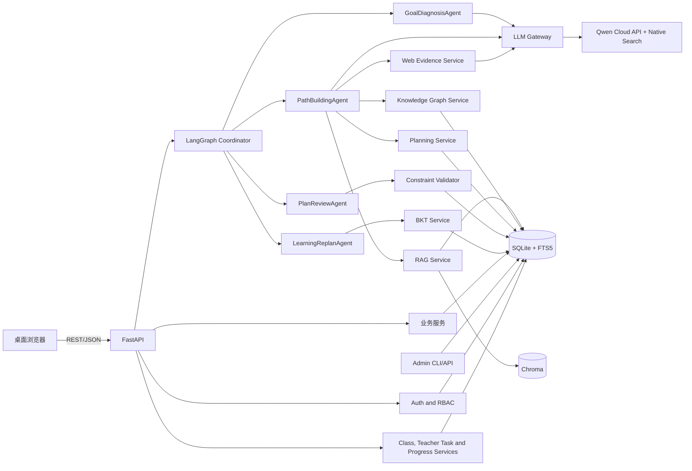
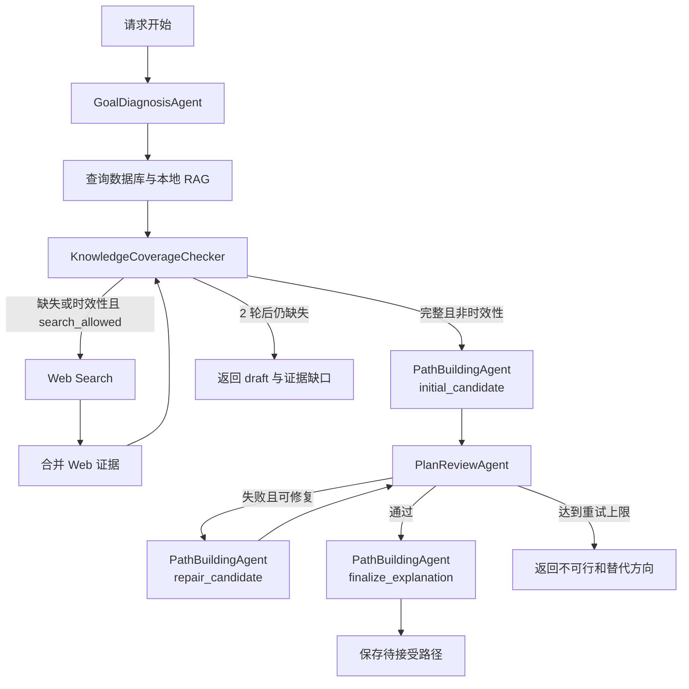
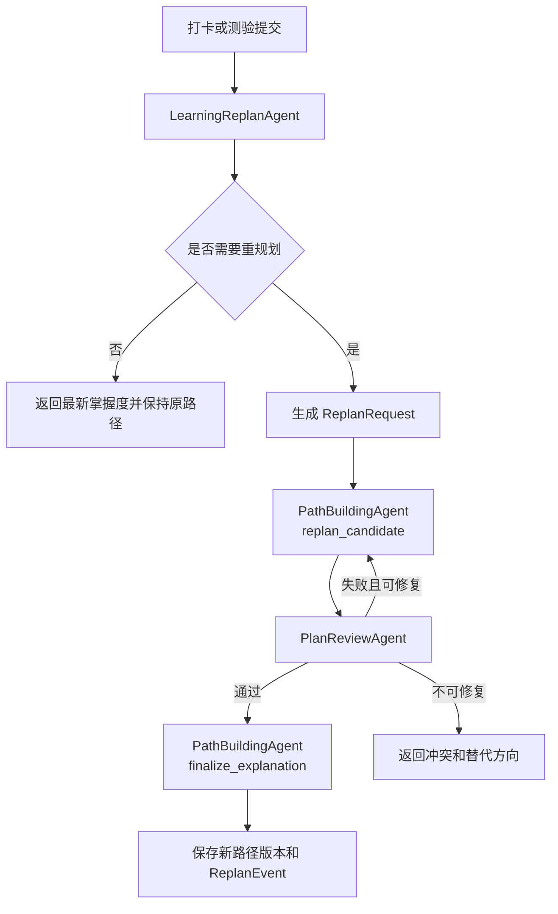

# 智能学习规划助手技术设计说明书

> 文档状态：四智能体与教师平台技术基线
>
> 文档版本：v3.0
>
> 日期：2026-10-27
>
> 项目周期：约 10 周
>
> 团队规模：2 人
>
> 需求基线：`docs/superpowers/specs/2026-09-30-smart-learning-planner-requirements-spec.md` v3.0
>
> 设计方案：`docs/superpowers/specs/2026-09-30-smart-learning-planner-design.md` v3.0
>
> 核心验收：学生 AI 闭环与教师班级/任务/进度闭环在同一次现场演示中连续可用

## 1. 文档目的

本文档将产品设计方案和需求规格转换为可开发、可测试、可部署的技术设计。它重点回答：

- 系统由哪些模块组成，各模块负责什么。
- 模块之间通过什么数据结构、接口和事务边界协作。
- 目标诊断、路径构建、质量审查和学习重规划 4 个 Agent 如何共享状态并受控协作。
- RAG、知识图谱、路径规划、规则校验和 BKT 如何共同保证结果可信。
- 两名开发者如何在不频繁冲突的前提下并行实现并完成现场闭环。

本文档不替代 SRS。用户可见行为以 SRS 为准，代码实现以本文档的模块边界和接口契约为准。

## 2. 技术目标与约束

### 2.1 技术目标

- 在 Windows 11 单机环境中运行前端、FastAPI、SQLite 和 Chroma，并通过联网调用千问云端模型。
- 现场由真实请求触发六阶段闭环，不依赖固定响应或人工改库。
- LLM 只负责理解、生成候选和解释，路径可行性由确定性算法判断。
- 所有引用可回溯到真实文档片段，所有掌握度变化可回溯到证据和参数版本。
- 所有联网引用可回溯到 URL、发布时间、抓取时间和内容哈希。
- 生成前必须先通过知识覆盖门控；本地完整时不调用联网，缺失或时效性查询才补充 Web 证据。
- 核心链路可恢复、可重试、可观察，并支持三次连续演示。
- 云端模型配置与业务代码解耦，可在不修改业务逻辑的情况下切换模型和搜索参数。
- 支持单学校、多教师、多班级、管理员/教师/学生角色和对象级权限。
- 教师可查看本人班级进度并向全班或指定学生布置独立任务。
- 教师任务计入学习负荷，但不直接修改 AI 路径。

### 2.2 关键约束

| 约束 | 技术决策 |
| --- | --- |
| 10 周、2 人 | 采用模块化单体，不引入微服务、消息队列和独立认证服务 |
| 单学校多用户 | 本地账号密码登录；管理员、教师、学生角色；不做跨学校租户 |
| 多教师多班级 | 一个班级只有一个负责教师；教师可负责多个班级，学生可加入多个班级 |
| 教师任务边界 | 独立任务表；只影响负荷和重规划建议，不写入 AI 路径节点 |
| 数据隔离 | 服务端同时校验角色和班级/学生对象归属 |
| 云端推理依赖 | 通过阿里云百炼/DashScope 调用千问，必须联网并配置有效 API Key |
| 本地数据 | SQLite、Chroma、课程资料和 Web 证据快照保存在本地 |
| 时效要求 | 最新信息查询必须本次联网搜索，时效性来源不超过 30 天 |
| 数据策略 | 数据库和本地 RAG 优先，缺失项触发联网，联网合并后必须重查 |
| 隐私边界 | 只向云端发送生成所需的最小数据，API Key 仅在服务端使用 |
| 现场无缓存结果 | 核心请求必须创建新的 `agent_runs`、`agent_steps` 和业务版本记录 |
| LLM 输出不稳定 | 固定 JSON Schema、有限修复重试和确定性校验 |
| 文档可信性 | `verified` 与 `draft` 两级内容状态，`draft` 不进入正式路径 |
| 2 人协作 | 按首次计划和重规划两条业务主线分工，共享 Schema、API 和数据契约 |

## 3. 总体技术架构

### 3.1 架构选择

系统采用前后端分离的模块化单体：

- React 前端只通过 REST API 访问后端。
- FastAPI 负责请求校验、业务用例、事务和长操作状态。
- Auth/RBAC 负责登录会话、角色判断和班级对象级授权。
- Classroom、Teacher Task 和 Progress Services 负责多教师多班级平台能力。
- LangGraph Coordinator 负责四智能体的有状态路由，每个 Agent 在权限范围内调用确定性服务或 LLM Gateway。
- SQLite 保存业务状态、轨迹、Web 证据和云端模型配置。
- Chroma 保存文档向量，SQLite FTS5 保存全文检索索引。
- DashScope 千问 API 提供模型生成和原生联网搜索。
- 本系统不训练、微调或部署生成模型权重。

不采用微服务的原因：

- 两名开发者无法承担服务治理、网络容错和跨服务事务成本。
- SQLite 和 Chroma 已能覆盖课程项目数据规模。
- 单机部署更容易保证现场稳定和问题定位。

### 3.2 运行拓扑



### 3.3 进程和端口

| 进程 | 默认端口 | 职责 |
| --- | --- | --- |
| FastAPI | `127.0.0.1:8000` | API、Agent 启动和静态前端托管 |
| Vite | `127.0.0.1:5173` | 开发模式前端 |
| DashScope API | HTTPS 外部服务 | 千问生成、原生联网搜索和嵌入 |
| Admin CLI/API | 无独立监听端口 | 课程导入、模型配置和评估 |

服务只绑定回环地址。启动脚本必须进行以下检查：

1. Python 和 Node.js 是否可执行。
2. DashScope API Key 是否存在且未过期。
3. 目标千问模型和联网搜索是否可调用。
4. 端口是否被其他进程占用。
5. 数据库和 Chroma 目录是否可读写。
6. 当前激活模型配置是否通过评估。
7. 是否存在可用管理员账号；首次启动时由初始化脚本从环境变量创建，不设默认密码。

## 4. 代码组织

### 4.1 目标目录结构

当前仓库尚无应用代码，建议按以下结构建立首个可运行版本：

```text
backend/
  app/
    main.py
    api/
      v1/
        auth.py
        classes.py
        teacher.py
        goals.py
        diagnostics.py
        content.py
        paths.py
        learning.py
        replans.py
        traces.py
        admin.py
        models.py
    core/
      config.py
      errors.py
      logging.py
      idempotency.py
      time.py
    db/
      session.py
      models.py
      migrations/
      repositories/
    schemas/
      goal.py
      diagnostic.py
      content.py
      path.py
      learning.py
      replan.py
      search.py
      coverage.py
      auth.py
      classroom.py
      teacher_task.py
      progress.py
      model_config.py
    services/
      goals/
      auth/
      classrooms/
      teacher_tasks/
      progress/
      audit/
      diagnostics/
      rag/
      graph/
      coverage/
      planning/
      validation/
      bkt/
      replan/
      search/
      web_evidence/
      models/
    agent/
      state.py
      graph.py
      coordinator.py
      contracts.py
      agents/
        goal_diagnosis.py
        path_building.py
        plan_review.py
        learning_replan.py
      prompts/
    llm/
      gateway.py
      search.py
      schemas.py
  tests/
    unit/
    integration/
    api/
    e2e/

frontend/
  src/
    app/
    pages/
    features/
      goals/
      auth/
      admin/
      teacher/
      classes/
      diagnostics/
      content/
      paths/
      tasks/
      assessments/
      replans/
      models/
      traces/
    api/
    components/
    styles/
  tests/

infra/
  scripts/
  configs/
  demo-data/

docs/
```

### 4.2 分层规则

| 层 | 可以做 | 不可以做 |
| --- | --- | --- |
| API | 解析请求、调用用例、序列化响应、映射错误 | 直接拼接 SQL、直接调用 DashScope、直接规划路径 |
| Auth/RBAC | 登录、会话、角色和对象级授权 | 信任前端隐藏菜单、绕过班级归属检查 |
| Service | 执行业务规则、事务、领域计算 | 读取 HTTP 请求对象、直接返回数据库 ORM 对象 |
| Classroom/Teacher Task | 班级成员、邀请码、教师任务和提交状态 | 修改 AI 路径节点或直接提升学习掌握度 |
| Repository | 封装查询、锁、事务和持久化 | 包含用户可见业务决策 |
| LangGraph Coordinator | 选择下一个 Agent、执行条件边、限制重试、写调度轨迹 | 生成业务内容或绕过规则 |
| Professional Agent | 组装本 Agent 上下文、调用授权工具、提交结构化状态补丁 | 直接调用其他 Agent、越权写状态、自行批准路径 |
| LLM Gateway | 统一千问模型调用、联网搜索、超时、重试和 JSON 解析 | 修改业务表、决定路径是否可行、向前端暴露 API Key |
| Web Evidence Service | 保存搜索查询、来源元数据、时效判断和内容哈希 | 宣称网页天然权威、决定路径顺序 |
| Admin CLI/API | 课程导入、模型配置、搜索评估和密钥检查 | 直接服务普通学生请求 |

业务模块之间通过 Python 接口和 Pydantic Schema 通信，不共享可变的全局状态。

## 5. 领域模型与数据设计

### 5.1 聚合边界

| 聚合 | 核心实体 | 一致性边界 |
| --- | --- | --- |
| 学习目标 | `goals`、`goal_specs` | 目标字段、版本和状态 |
| 平台账号 | `users`、`sessions`、`audit_logs` | 角色、账号状态、会话和关键操作 |
| 班级协作 | `classrooms`、`class_memberships`、`class_invites` | 班级归属、成员和邀请码 |
| 教师任务 | `teacher_tasks`、`teacher_task_assignments`、`teacher_task_submissions` | 任务定义、学生分配和提交 |
| 学习者 | `learner_profiles`、`mastery_snapshots` | 画像、掌握度和证据引用 |
| 课程知识 | `course_documents`、`document_chunks`、`knowledge_nodes` | 图谱和课程索引 |
| 诊断与证据 | `assessment_items`、`assessment_attempts`、`evidence` | 作答、评分和证据 |
| 学习路径 | `learning_paths`、`path_items`、`learning_tasks` | 路径发布和任务排期 |
| 学习执行 | `checkins` | 打卡和按打卡计算的执行偏差 |
| 重规划 | `replan_events` | 原路径、新路径、原因和接受状态 |
| Agent 运行 | `agent_runs`、`agent_steps`、`generated_contents` | 单次运行和可追踪输出 |
| 知识覆盖 | `coverage_checks` | 生成前完整性判定、缺失项和搜索轮次 |
| 联网证据 | `web_search_runs`、`web_evidence` | 搜索查询、来源、时效和快照 |
| 云端配置 | `model_configs` | 千问模型、搜索策略、评估和激活 |

### 5.2 核心表

#### 5.2.1 目标与画像

| 表 | 主要字段 | 关键约束 |
| --- | --- | --- |
| `users` | `id, username, display_name, password_hash, role, status, created_at` | 管理员、教师、学生；密码只存哈希 |
| `goals` | `id, user_id, target_skill_id, raw_text, deadline, weekly_hours, daily_hours, status, version, created_at, updated_at` | 时间预算大于零；归档不删除历史 |
| `goal_specs` | `id, goal_id, version, spec_json, parse_status, created_at` | 每版不可修改；新解析生成新版本 |
| `learner_profiles` | `id, user_id, preferences_json, version, updated_at` | 每用户一条有效画像 |
| `mastery_snapshots` | `id, user_id, knowledge_node_id, previous_probability, new_probability, evidence_id, parameter_version, created_at` | 概率在 `[0,1]` |

#### 5.2.2 平台账号与班级

| 表 | 主要字段 | 关键约束 |
| --- | --- | --- |
| `sessions` | `id, user_id, token_hash, expires_at, revoked_at, created_at` | 每次登录创建；退出后立即撤销 |
| `classrooms` | `id, name, description, owner_teacher_id, status, created_at` | 每个班级只有一个负责教师 |
| `class_memberships` | `id, class_id, user_id, member_role, status, joined_at` | 同一班级内学生关系唯一 |
| `class_invites` | `id, class_id, code_hash, expires_at, max_uses, used_count, status, created_by` | 邀请码只存哈希；限制有效期和次数 |
| `teacher_tasks` | `id, class_id, created_by, title, description, due_at, estimated_minutes, linked_knowledge_node_id, target_type, completion_mode, resource_urls_json, status, published_at, revoked_at` | 只允许本班负责教师创建和发布 |
| `teacher_task_assignments` | `id, teacher_task_id, student_id, status, assigned_at` | 只分配给班级有效学生 |
| `teacher_task_submissions` | `id, assignment_id, student_id, submission_type, content, resource_url, submitted_at, status` | 学生只能提交自己的分配 |
| `audit_logs` | `id, actor_user_id, action, target_type, target_id, payload_json, created_at` | 不保存密码、Cookie 或 API Key |

#### 5.2.3 课程、知识图谱与题库

| 表 | 主要字段 | 关键约束 |
| --- | --- | --- |
| `course_documents` | `id, title, course_id, version, source_path, content_hash, status` | 同课程同版本不可重复导入 |
| `document_chunks` | `id, document_id, section, page, content, token_count, fts_rowid` | `chunk_id` 稳定且全局唯一 |
| `knowledge_nodes` | `id, canonical_name, domain, difficulty, estimated_hours, mastery_threshold, evidence_required, version` | 预计学时大于零 |
| `skill_nodes` | `id, name, description, level` | 名称规范化后唯一 |
| `prerequisite_edges` | `id, source_id, target_id, edge_type, weight, reason, version` | 同一有向边不重复；硬先修必须无环 |
| `knowledge_skill_map` | `knowledge_node_id, skill_node_id` | 复合主键 |
| `assessment_items` | `id, knowledge_node_id, item_type, difficulty, answer_schema, scoring_rule, status` | 每题必须映射知识节点 |

#### 5.2.4 路径与学习执行

| 表 | 主要字段 | 关键约束 |
| --- | --- | --- |
| `learning_paths` | `id, goal_id, parent_path_id, status, version, total_hours, risk_score, content_status, model_config_id, created_at` | 发布后只读 |
| `path_items` | `id, path_id, knowledge_node_id, sequence, planned_hours, state, unlock_rule` | 同一路径无重复节点 |
| `learning_tasks` | `id, path_item_id, title, task_type, planned_minutes, due_date, status` | 分钟数大于零 |
| `checkins` | `id, task_id, actual_minutes, completion_ratio, difficulty_feedback, note, planned_minutes_snapshot, schedule_delta_minutes, completion_delta, idempotency_key, created_at` | 幂等键唯一；偏差由本次打卡计算 |
| `assessment_attempts` | `id, item_id, user_id, answer_json, score, idempotency_key, submitted_at` | 同一幂等键返回原结果 |
| `evidence` | `id, user_id, knowledge_node_id, source_type, source_id, score, payload_json, created_at` | 来源记录必须存在 |
| `replan_events` | `id, path_id, new_path_id, trigger_type, before_json, after_json, reason, accepted, created_at` | 每次调整必须可比较前后路径 |

#### 5.2.5 Agent、联网搜索与云端配置

| 表 | 主要字段 | 关键约束 |
| --- | --- | --- |
| `agent_runs` | `id, user_id, goal_id, workflow_type, graph_version, state_version, model_config_id, search_enabled, prompt_version, status, started_at, finished_at, request_hash, cloud_data_scope_json` | 每次现场核心请求创建新记录 |
| `agent_steps` | `id, run_id, sequence, agent_name, node_name, action, input_json, output_json, duration_ms, status, error_json` | 同一运行内序号唯一 |
| `coverage_checks` | `id, run_id, goal_id, input_version, is_complete, time_sensitive, search_allowed, search_required, search_round, gaps_json, checked_at` | 每次生成或修复前必须有记录 |
| `generated_contents` | `id, run_id, goal_id, model_config_id, content_type, status, payload_json, citations_json` | `draft` 不可作为正式路径输入 |
| `idempotency_records` | `scope, idempotency_key, request_hash, response_json, created_at` | 主键为 `scope + idempotency_key` |
| `web_search_runs` | `id, agent_run_id, query, provider, search_enabled, status, result_count, queried_at, error_json` | 每次搜索记录新查询和状态 |
| `web_evidence` | `id, search_run_id, title, url, domain, snippet, published_at, fetched_at, content_hash, source_rank, trust_level, status` | URL 与内容哈希不可无记录覆盖 |
| `model_configs` | `id, provider, model_name, search_enabled, parameters_json, prompt_version, secret_ref, evaluation_json, status, activated_at` | 未通过评估不得激活；不保存密钥明文 |

### 5.3 SQLite 配置

- 启用外键约束、WAL 日志和 `busy_timeout`。
- 单进程内使用短事务，不在 LLM 调用期间持有写事务。
- 所有写操作通过 Repository 执行。
- 时间统一保存为 UTC ISO 8601 字符串。
- JSON 字段保存前经过 Pydantic Schema 校验。
- 路径、BKT 参数、图谱和模型配置采用不可变版本记录。
- 数据库迁移使用版本化 SQL 或 Alembic，不在应用启动时静默破坏性重建。

### 5.4 数据不变量

1. `draft` 内容不得关联正式 `learning_paths`。
2. 发布路径必须引用通过 VR-001 至 VR-008 的校验结果。
3. 硬先修边组成的子图必须是无环图。
4. 每份证据必须能追溯到测验作答、打卡或人工确认记录。
5. 每次 BKT 更新必须引用参数版本和证据 ID。
6. 每次重规划必须生成新路径版本和 `ReplanEvent`。
7. 每个现场核心请求必须创建新的 `agent_run`。
8. 激活模型配置必须具有评估记录和通过的评估状态。
9. Agent 只能写字段所有权表内的字段，状态补丁必须引用当前 `state_version`。
10. 正式路径必须存在 `PlanReviewAgent` 的通过结果。
11. 重规划候选路径必须复用 `PathBuildingAgent` 和 `PlanReviewAgent`。
12. 最新或时效性声明必须引用本次搜索产生的 Web 证据。
13. Web 引用必须具有 URL、抓取时间和内容哈希。
14. API Key 不得写入任何业务表或 Agent 轨迹。
15. 正式路径必须引用一次 `is_complete = true` 的覆盖检查。
16. 非时效性且本地完整时，不允许产生联网搜索调用记录。
17. 用户角色只能是 `admin`、`teacher` 或 `student`，账号停用后不得建立新会话。
18. 一个班级只有一个负责教师；教师只能操作本人班级。
19. 教师任务不得写入 `path_items`，任务分配只允许指向班级有效学生。
20. 学生只能读取和提交自己的教师任务分配。
21. 账号停用、任务发布、任务撤回和越权尝试必须写入审计日志。

## 6. 核心组件设计

### 6.1 Goal Service

职责：

- 创建、读取、修改和归档目标。
- 将自然语言目标提交给 Agent 解析。
- 保存 `GoalSpec` 版本并校验时间字段。
- 在目标时间预算变化时触发重规划评估。

关键接口：

```python
class GoalService:
    def create_goal(self, request: GoalCreate) -> GoalDetail: ...
    def revise_goal(self, goal_id: str, request: GoalRevise) -> GoalDetail: ...
    def archive_goal(self, goal_id: str) -> None: ...
```

`GoalSpec` 至少包含：

```json
{
  "goal_text": "学习后端开发并掌握数据结构与算法",
  "target_skill_ids": ["skill-backend-basic"],
  "deadline": "2026-12-31",
  "weekly_hours": 10,
  "daily_hours": 2,
  "preferred_modes": ["reading", "coding"],
  "constraints": {
    "avoid_weekends": false,
    "max_session_minutes": 90
  },
  "completion_criteria": []
}
```

无法映射目标技能时，服务保存 `parse_status = needs_revision`，向前端返回可修改字段，不创建正式路径。

### 6.2 Diagnostic Service

职责：

- 根据目标技能的反向先修子图选择知识节点。
- 按关键节点覆盖、难度和已有证据生成诊断题。
- 将作答映射到知识节点并生成初始掌握度。
- 标记未覆盖或低置信度节点。

诊断题选择规则：

1. 目标关键节点优先于扩展节点。
2. 每个关键节点至少有一个诊断证据或显式低置信度标记。
3. 已有有效证据且未过期的节点可减少题量。
4. 同一知识点避免超过两道同难度题。
5. 题目总预计耗时显示在开始诊断前。

评分输出：

```json
{
  "diagnostic_id": "diag-001",
  "node_results": [
    {
      "knowledge_node_id": "python-function",
      "score": 0.5,
      "mastery": 0.42,
      "confidence": 0.7,
      "evidence_ids": ["ev-diag-001"]
    }
  ]
}
```

### 6.3 LLM Gateway 与联网搜索

职责：

- 生成请求并调用阿里云百炼/DashScope 千问 API。
- 启用原生联网搜索并标准化返回来源。
- 应用提示词模板、模型配置、搜索策略、温度和超时。
- 对 JSON 输出执行 Schema 校验。
- 在格式失败时执行最多两次修复重试。
- 处理鉴权失败、限流、配额不足和搜索不可用。

接口：

```python
class LLMGateway:
    async def generate_json(
        self,
        task_type: str,
        prompt_version: str,
        payload: dict,
        schema: type[BaseModel],
        model_config_id: str,
        enable_search: bool,
        timeout_seconds: int = 90,
    ) -> LLMResult: ...
```

`LLMResult` 包含：

- `data`：通过 Schema 的结构化结果。
- `raw_text`：仅用于诊断，不写入业务表。
- `model_config_id`、`prompt_version`、`search_enabled`、`duration_ms`。
- `search_results`：标准化 Web 证据列表。
- `repair_attempts`。

约束：

- 业务服务不得直接调用 DashScope。
- API Key 只能由服务端从环境变量或本地密钥文件读取。
- 校验失败且超过重试上限时抛出 `LLM_SCHEMA_INVALID`。
- LLM 不得接收或返回数据库连接、文件路径或未授权资料。
- 最新或时效性声明必须带有本次请求的 Web 证据。
- 搜索结果缺少发布时间且涉及时效性声明时，内容只能标记 `draft`。
- API Key 不得出现在日志、异常详情、前端响应或 `agent_steps`。

Web 证据处理：

1. 将搜索查询、结果标题、URL、摘要和来源域名写入 `web_search_runs` 与 `web_evidence`。
2. 记录检索时间和内容哈希。
3. 校验 URL 协议、域名和可访问性。
4. 时效性声明按 30 天规则计算 `freshness_status`。
5. 将来源标记为 `official`、`professional`、`community` 或 `unknown`。
6. 只有通过来源和时效校验的证据可支撑 `verified` 内容。

### 6.4 Knowledge Coverage Checker

职责：

- 在调用生成模型前检查本地数据库、图谱和 RAG 是否足够生成完整计划。
- 判断查询是否具有时效性，决定是否必须联网。
- 输出结构化缺失项，驱动搜索查询和后续修复。
- 在 Web 证据合并后再次检查，最多允许 2 轮。

接口：

```python
class KnowledgeCoverageChecker:
    def check(
        self,
        goal_spec: GoalSpec,
        graph_snapshot: GraphSnapshot,
        evidence_items: list[EvidenceItem],
        time_sensitive: bool,
        search_allowed: bool,
    ) -> CoverageResult: ...
```

覆盖结果：

```json
{
  "coverage_id": "coverage-001",
  "goal_id": "goal-001",
  "is_complete": false,
  "time_sensitive": false,
  "search_allowed": true,
  "search_required": true,
  "search_round": 0,
  "missing_items": [
    {
      "gap_type": "MISSING_EVIDENCE",
      "node_id": "algo-complexity",
      "reason": "本地 RAG 未找到可引用材料"
    }
  ],
  "checked_at": "2026-10-27T08:00:00Z"
}
```

检查规则：

1. 目标技能至少映射一个知识节点。
2. 硬先修闭包节点全部存在且无环。
3. 每个可规划节点具有预计学时。
4. 每个节点至少有一个可映射验收题。
5. 每个待生成节点至少有一条可引用证据。
6. 时效性内容至少有一条第 30 天内的来源。
7. `is_complete = true` 且 `time_sensitive = false` 时设置 `search_required = false`。
8. 除 `search_allowed = false` 外，任一缺失项或 `time_sensitive = true` 时设置 `search_required = true`。
9. `search_allowed = false` 时，即使存在缺失或时效性要求也设置 `search_required = false`，并强制相关内容为 `draft`。

`gap_type` 固定枚举：

- `MISSING_SKILL_MAPPING`
- `MISSING_NODE`
- `MISSING_PREREQUISITE`
- `MISSING_ESTIMATED_HOURS`
- `MISSING_ASSESSMENT`
- `MISSING_EVIDENCE`
- `STALE_EVIDENCE`
- `GRAPH_INVALID`

### 6.5 RAG Service

职责：

- 导入 Markdown、TXT 和文本型 PDF。
- 提取文档、章节、页码和版本元数据。
- 生成稳定 `chunk_id`，写入 Chroma 和 SQLite FTS5。
- 执行向量与关键词混合检索。
- 返回真实引用，不生成虚假来源。

导入流程：

1. 校验扩展名、文件大小、路径和内容哈希。
2. 解析文本，识别标题和章节。
3. 按标题和 token 上限切分，保留页码。
4. 生成 `document_id / chunk_id`。
5. 通过嵌入模型生成向量并写入 Chroma。
6. 将文本和检索元数据写入 SQLite。
7. 校验向量记录和全文记录数量一致。
8. 事务失败时删除本次临时索引并回滚元数据。

混合检索：

```text
vector_score_normalized = normalize(vector_distance)
final_score = 0.65 * vector_score_normalized
            + 0.35 * normalized_bm25_score
```

默认流程：

- 候选召回 8 个片段。
- 应用课程、知识域、文档版本和软删除过滤。
- 按 `final_score` 排序，返回前 5 个。
- 低于最低阈值时返回 `evidence_insufficient`。

引用对象：

```json
{
  "document_id": "doc-python-001",
  "chunk_id": "doc-python-001-c03",
  "title": "Python 程序设计课程大纲",
  "section": "函数与模块",
  "page": 12,
  "score": 0.82
}
```

引用校验规则：

- `chunk_id` 必须存在于当前可用索引。
- `document_id` 必须与片段记录一致。
- 软删除文档只能展示历史引用，不得作为新生成依据。
- Citation Validator 删除模型虚构引用，并降低内容可信级别。

### 6.6 Knowledge Graph Service

职责：

- 管理知识节点、技能节点、先修边和题目映射。
- 提取目标技能的反向先修子图。
- 合并模型候选节点并进行实体归一化。
- 校验 DAG、孤立节点和必须映射关系。

边类型：

- `HARD_PREREQUISITE`
- `SOFT_PREREQUISITE`
- `MAPS_TO_SKILL`
- `COVERED_BY_COURSE`
- `ASSESSED_BY`

实体归一化顺序：

1. ID 精确匹配。
2. 规范化名称精确匹配。
3. 别名表匹配。
4. 去除空白、大小写和常见标点后的名称匹配。
5. 无法匹配时创建候选节点，不自动合并到高影响节点。

图写入规则：

- 写入硬先修边前执行环路检测。
- 检测到环时返回完整环路和冲突边。
- 已发布路径不重新绑定节点版本。
- 图版本变化后，新规划使用新版本，历史解释保留旧版本。

### 6.7 Planning Service

职责：

- 从目标技能提取必需知识子图。
- 根据有效掌握度删除已掌握节点。
- 对未掌握节点执行拓扑排序。
- 将节点分配到可用时间窗口。
- 生成主路径和候选替代顺序。

算法步骤：

1. 从 `target_skill_ids` 反向遍历 `HARD_PREREQUISITE`，得到硬先修闭包。
2. 加入软先修节点作为可选候选。
3. 过滤掌握概率达到阈值且证据有效的节点。
4. 合并模型候选节点，但以图谱现有节点优先。
5. 对剩余子图执行 Kahn 拓扑排序。
6. 使用风险函数对同层可排序节点排序。
7. 按每日最大时长和每周时间预算生成时间窗口。
8. 生成主路径和至多两个替代顺序。
9. 交给 Constraint Validator 校验。
10. 校验失败时根据 `repair_hint` 执行有限修复。

风险函数：

```text
risk = 0.50 * prerequisite_gap
     + 0.25 * schedule_pressure
     + 0.15 * difficulty_jump
     + 0.10 * context_switch
```

排序规则必须确定性可复现：

- 同风险值按先修层级、难度和节点 ID稳定排序。
- 不因随机种子不同改变主路径。
- 模型候选顺序只作为软先修排序输入，不覆盖硬先修。

时间分配：

- 每节点按预计学时拆分为不超过每日最大时长的任务。
- 不跨日拆分短任务，除非单节点超过每日上限。
- 周末限制和偏好影响时间窗口，不改变硬先修顺序。
- 剩余时间不足时返回 `PLAN_INFEASIBLE` 和替代方向。

### 6.8 Constraint Validator

校验器是纯函数式规则层，不调用 LLM。

| 规则 | 校验 | 失败结果 |
| --- | --- | --- |
| VR-001 | 硬先修已掌握或排在目标节点前 | `missing_prerequisite` |
| VR-002 | 总学时不超过预算 | `time_budget_exceeded` |
| VR-003 | 每日和每周负荷不超上限 | `load_limit_exceeded` |
| VR-004 | 路径节点不重复 | `duplicate_node` |
| VR-005 | `verified` 节点有真实引用 | `missing_citation` |
| VR-006 | 验收任务映射有效知识点 | `invalid_assessment_mapping` |
| VR-007 | 已完成节点状态正确锁定 | `completed_node_unlocked` |
| VR-008 | 重规划不破坏未完成硬先修 | `replan_prerequisite_conflict` |

统一输出：

```json
{
  "is_valid": false,
  "errors": [
    {
      "rule_id": "VR-001",
      "node_id": "algo-recursion",
      "message": "递归需要函数与调用栈基础",
      "related_node_ids": ["python-function"]
    }
  ],
  "repair_hint": "insert_before",
  "checked_at": "2026-10-20T08:00:00Z"
}
```

规则实现必须覆盖：

- 输入不可变，校验不修改候选路径。
- 错误顺序稳定，便于前端和测试比较。
- 每条错误可映射到至少一个节点或全局字段。
- LLM 解释不能覆盖 `is_valid = false`。

### 6.9 BKT Service

职责：

- 按知识节点读取版本化 BKT 参数。
- 从有效证据计算掌握度后验概率。
- 保存更新前后的快照。
- 判断是否达到掌握阈值。

参数：

| 参数 | 默认范围 |
| --- | --- |
| `p_init` | 由诊断结果初始化 |
| `p_learn` | `0.15` 至 `0.30` |
| `p_slip` | `0.05` 至 `0.15` |
| `p_guess` | 根据题型配置 |

更新公式：

```text
P(L_t | correct) = P(L_t)(1 - p_slip)
                 / [P(L_t)(1 - p_slip) + (1 - P(L_t))p_guess]

P(L_t | wrong) = P(L_t)p_slip
               / [P(L_t)p_slip + (1 - P(L_t))(1 - p_guess)]

P(L_{t+1}) = P(L_t | evidence)
           + (1 - P(L_t | evidence)) * p_learn
```

实现要求：

- 输入概率和参数先做范围校验。
- 分母为零或非法参数时返回 `BKT_PARAMETER_INVALID`，不得静默使用 NaN。
- 同一证据 ID 只能应用一次。
- 缺失参数时使用带版本的默认参数，并在快照中记录回退原因。

### 6.10 Evidence Evaluation

题型处理：

| 题型 | 评分方式 |
| --- | --- |
| 单选、多选、判断 | 按 `answer_schema` 确定性评分 |
| 填空 | 规范化文本与可接受答案集合匹配 |
| 简答 | 规则评分或 LLM 生成建议，最终分数需规则确认 |
| 代码题 | 本期不执行代码，按答案 Schema、评分规则或人工确认生成证据 |

LLM 评分约束：

- LLM 返回值必须包含 `score`、`rationale` 和 `confidence`。
- 业务分数必须由版本化评分规则截断和确认。
- 评分失败不创建证据，不触发 BKT。
- 原始答案按隐私要求处理，日志只保存摘要或哈希。

### 6.11 Replan Service

职责：

- 计算执行偏差。
- 判断是否触发局部或全局重规划。
- 生成新路径版本和前后差异。
- 支持学生接受或拒绝。

触发条件：

- 掌握度低于 `0.45`。
- 同一任务连续两次未完成。
- 学习时间或截止日期变化。
- 新证据与高掌握度冲突。
- 目标范围变化。

决策矩阵：

| 条件 | 动作 |
| --- | --- |
| 单节点低于阈值 | 插入补强节点并顺延后续 |
| 连续两次未完成 | 降低任务粒度或重排时间窗口 |
| 时间预算变化不超过 30% | 优先局部重排 |
| 时间预算变化超过 30% | 全局重规划 |
| 目标技能或范围变化 | 全局重规划 |
| 多个关键节点持续不达标 | 全局重规划 |

重规划必须由 `LearningReplanAgent` 生成结构化 `ReplanRequest`，再经 Coordinator 调度 `PathBuildingAgent.replan_candidate` 复用 GraphPlanner，并由 `PlanReviewAgent` 复用 Constraint Validator。不允许存在“绕过校验”的路径。

### 6.12 Cloud Model Config Registry

职责：

- 注册 DashScope 模型名、搜索开关、生成参数和提示词版本。
- 保存固定问题集的搜索与生成评估指标。
- 控制配置激活和回退。

状态：

```text
registered -> evaluating -> approved -> active
                         \-> rejected
active -> inactive
```

激活规则：

- 状态必须为 `approved`。
- 搜索与生成评估结果必须存在。
- 记录激活时间和前一个激活配置。
- API Key 或模型连接检查失败时恢复前一配置。

### 6.13 Auth and RBAC

职责：

- 用户名/密码登录、退出和当前身份查询。
- 使用 Argon2 或 bcrypt 校验密码哈希。
- 签发 HttpOnly 安全会话 Cookie，服务端保存会话哈希。
- 统一执行角色和对象级权限判断。

接口：

```python
class AuthorizationService:
    def require_role(self, user: User, roles: set[str]) -> None: ...
    def require_class_access(self, user: User, class_id: str) -> Classroom: ...
    def require_student_access(self, user: User, class_id: str, student_id: str) -> None: ...
    def require_assignment_owner(self, user: User, assignment_id: str) -> None: ...
```

权限矩阵：

| 操作 | 管理员 | 教师 | 学生 |
| --- | --- | --- | --- |
| 创建/停用教师与学生账号 | 允许 | 拒绝 | 拒绝 |
| 创建班级 | 拒绝 | 允许 | 拒绝 |
| 查看班级进度 | 默认拒绝 | 仅本人班级 | 仅本人 |
| 发布教师任务 | 拒绝 | 仅本人班级 | 拒绝 |
| 查看任务提交 | 拒绝 | 仅本人班级 | 仅本人提交 |
| 提交教师任务 | 拒绝 | 拒绝 | 仅本人分配 |

修改数据的请求必须校验 CSRF 或使用严格同源策略。

### 6.14 Classroom Service

职责：

- 教师创建、查看和归档本人班级。
- 生成、撤回和校验班级邀请码。
- 学生通过邀请码加入班级。
- 查询班级成员和负责教师。

规则：

- 教师只能创建自己负责的班级。
- 邀请码保存哈希，校验有效期、使用次数和状态。
- 学生重复加入同一班级时返回幂等结果。
- 班级归档后禁止新增成员和教师任务。
- 教师跨班访问必须在 Service 层拒绝，不依赖前端隐藏。

### 6.15 Teacher Task Service

职责：

- 创建一次性教师任务。
- 按全班或指定学生生成任务分配。
- 发布、撤回任务并处理学生提交。
- 计算教师任务对每日/每周学习负荷的影响。

任务状态：

```text
draft -> published -> revoked
published -> closed
```

学生分配状态：

```text
not_started -> in_progress -> completed
not_started/in_progress -> overdue
```

学生成功提交打卡、文本或链接时写入 `teacher_task_submissions`，并在同一事务中将分配状态更新为 `completed`。本期不要求教师审批或评分。

约束：

- 教师任务不得写入 `path_items`。
- 任务目标和成员必须属于同一班级。
- 全班任务在发布时生成当前有效学生的分配记录。
- 指定学生任务只允许选择该班成员。
- 教师任务时长计入负荷检查；冲突时只返回重规划建议。
- 学生只能提交自己的分配，重复提交使用幂等键或版本控制。

### 6.16 Progress Analytics Service

职责：

- 聚合教师班级总览和学生详情。
- 统计任务完成率、按时率、逾期人数、学习时长、掌握度分布和风险学生。
- 将 AI 路径任务与教师任务分开展示，再计算合并负荷。

查询原则：

- 教师查询必须包含 `owner_teacher_id = current_user.id` 或班级归属校验。
- 只聚合与本班课程或教师任务相关的数据。
- 不返回学生未关联本班的私人目标和隐藏备注。
- 聚合结果可按班级和日期范围缓存，但不得缓存越权数据。
- 班级进度查询目标小于 1 秒。

## 7. 四智能体工作流设计

### 7.1 设计原则

系统采用 `1 个 LangGraph Coordinator + 4 个专业 Agent` 的受控协作模式。

- Coordinator 是确定性调度器，负责读取共享状态、选择下一个 Agent、执行条件边和限制重试。
- Coordinator 不是第 5 个自治 Agent，不生成目标、内容、路径或解释。
- 四个专业 Agent 共享 `AgentState`，彼此不直接调用，也不进行自由文本协商。
- Agent 只能调用权限表内的工具，只能写入自己拥有的状态字段。
- 正式路径必须由 `PlanReviewAgent` 调用确定性校验工具后批准。
- 重规划候选路径必须复用 `PathBuildingAgent` 和 `PlanReviewAgent`。

### 7.2 Agent 职责与工具权限

| Agent | 输入 | 核心处理 | 允许工具 | 输出 | 禁止事项 |
| --- | --- | --- | --- | --- | --- |
| `GoalDiagnosisAgent` | 原始目标、学生基础、历史画像 | 目标解析、诊断规划、诊断评估、画像初始化 | LLM Gateway、题库、诊断评估、BKT 初始化 | `GoalSpec`、`diagnostic_plan`、`learner_snapshot` | 不生成路径，不写正式内容 |
| `PathBuildingAgent` | `GoalSpec`、`LearnerSnapshot`、可选 `ReplanRequest` | 本地查询、覆盖检查、按需联网、知识拆解、图谱合并、图搜索、任务拆解、计划解释 | LLM Gateway、KnowledgeCoverageChecker、Web Search、RAG、Knowledge Graph、Planning Service | `coverage_result`、`evidence_chunks`、`web_evidence`、`candidate_content`、`candidate_path`、`explanation` | 不自行批准路径，不在本地完整时无故联网 |
| `PlanReviewAgent` | 候选内容、候选路径、本地/联网证据和规则上下文 | Schema 审查、引用与时效审查、可信级别、路径约束校验 | Schema/Citation/Content/Constraint Validators、LLM Gateway（仅审查说明） | `review_result`、`content_status`、错误和 `repair_hint` | 不使用 LLM 覆盖规则结论，不生成或修改候选内容 |
| `LearningReplanAgent` | 打卡、测验答案、原路径和掌握度 | 执行偏差、证据评分、BKT 更新、重规划判断和差异说明 | ExecutionMonitor、EvidenceEvaluator、BKTUpdater、ReplanDecider、ReplanNarrator | `execution_snapshot`、`mastery_updates`、`replan_request` | 不直接发布新路径，不跳过 BKT |

`PathBuildingAgent` 支持以下动作：

- `initial_candidate`：首次候选路径。
- `repair_candidate`：根据 `PlanReviewAgent` 的规则错误修复候选路径。
- `replan_candidate`：根据 `ReplanRequest` 生成调整后的候选路径。
- `finalize_explanation`：审核通过后生成最终路径解释。

### 7.3 AgentState

```text
AgentState
  run_id
  user_id
  goal_id
  workflow_type
  active_agent
  state_version
  model_config_id
  search_enabled
  prompt_version
  goal_spec
  diagnostic_plan
  diagnostic_answers
  learner_snapshot
  planning_mode
  coverage_result
  missing_items
  search_round
  evidence_chunks
  candidate_content
  content_status
  graph_subgraph
  candidate_path
  review_result
  explanation
  execution_snapshot
  mastery_updates
  replan_request
  new_path
  agent_retry_counts
  errors
  trace_refs
```

`workflow_type` 取值：

- `initial_plan`：首次目标、诊断和计划。
- `content_review`：内容与路径独立审核。
- `learning_update`：打卡或测验证据处理。
- `replan`：时间、执行或证据触发重规划。
- `finalize_explanation`：审核通过后的解释生成。

### 7.4 状态字段所有权

| 写入方 | 可写字段 |
| --- | --- |
| Coordinator | `active_agent`、`state_version`、`agent_retry_counts`、`errors`、`trace_refs` |
| GoalDiagnosisAgent | `goal_spec`、`diagnostic_plan`、`diagnostic_answers`、`learner_snapshot` |
| PathBuildingAgent | `planning_mode`、`coverage_result`、`missing_items`、`search_round`、`evidence_chunks`、`candidate_content`、`graph_subgraph`、`candidate_path`、`explanation`、`new_path`（审核通过后的最终引用） |
| PlanReviewAgent | `content_status`、`review_result` |
| LearningReplanAgent | `execution_snapshot`、`mastery_updates`、`replan_request` |

状态写入采用乐观版本控制。Agent 返回的 `state_patch.base_version` 必须等于当前 `state_version`，否则 Coordinator 返回 `STATE_VERSION_CONFLICT`，不得覆盖其他 Agent 的结果。

### 7.5 Agent 交接契约

每个 Agent 接收统一任务信封，并返回统一结果：

```json
{
  "agent": "PathBuildingAgent",
  "action": "initial_candidate",
  "run_id": "run-20261020-001",
  "state_version": 4,
  "input_refs": ["goal_spec", "learner_snapshot"],
  "constraints": {
    "max_retries": 3,
    "timeout_seconds": 120
  },
  "trace_id": "trace-20261020-001"
}
```

```json
{
  "status": "completed",
  "next_action": "review_candidate_path",
  "state_patch": {
    "base_version": 4,
    "candidate_path": {},
    "candidate_content": {},
    "evidence_chunks": []
  },
  "output_refs": ["candidate_path"],
  "errors": [],
  "metrics": {
    "duration_ms": 1820,
    "llm_calls": 2,
    "tool_calls": 3
  }
}
```

交接要求：

- Agent 不直接调用另一个 Agent。
- Agent 返回 `next_action` 建议，最终路由由 Coordinator 决定。
- Agent 不直接提交数据库事务，持久化由业务 Service 根据已验证的状态补丁执行。
- 每次交接必须记录 `from_agent`、`to_agent`、`action`、状态版本、输入引用和耗时。
- 自然语言解释与结构化字段分开保存。

### 7.6 首次计划流程



路由规则：

- GoalDiagnosisAgent 失败：返回目标或诊断补充请求。
- 覆盖检查 `is_complete = true` 且 `time_sensitive = false` 时，直接进入 `initial_candidate`，不得调用 Web Search。
- 覆盖检查发现缺失或 `time_sensitive = true` 且 `search_allowed = true` 时，立即进入 Web Search，并在合并后重查。
- 搜索轮次最多 2 轮，仍未闭合时返回 `draft` 和未解决缺口。
- PlanReviewAgent 返回 `draft`：允许保存草稿，不允许发布路径。
- PlanReviewAgent 返回 `repair_required`：Coordinator 携带 `review_result` 进入 `repair_candidate`。
- 计划修复最多 3 次，访问同一 `run_id` 下的 `agent_retry_counts.path_repair`。
- 审核通过后，PathBuildingAgent 只生成解释，不得修改已审核的 `candidate_path`。

### 7.7 学习后重规划流程



约束：

- LearningReplanAgent 不得直接修改 `learning_paths`。
- 重规划候选路径必须通过同一 `ConstraintValidator`。
- BKT 更新和证据写入必须在重规划请求前提交到本次运行状态。
- 用户接受前只保存 `preview` 状态的新路径。
- 同一测验幂等键不得重复触发 BKT 或重规划。

### 7.8 幂等、重试与故障恢复

- 每个 Agent 执行前记录 `run_id + sequence + agent_name + action`。
- LLM JSON 修复只重试当前 Agent 的格式修复动作，最多 2 次。
- 路径修复重试上限为 3 次，超出后返回不可行和替代方向。
- Agent 超时后标记 `failed`，保留最近一次有效 `state_version`。
- Coordinator 只能从最近成功 Agent 的状态恢复，不重跑已持久化的 BKT 更新。
- 现场请求必须创建新 `agent_run`，但同一次运行内部允许断点恢复。

### 7.9 轨迹记录

每次 Agent 步骤写入：

- `run_id`
- `sequence`
- `agent_name`
- `node_name`
- `action`
- `state_version`
- `input_json`
- `output_json`
- `duration_ms`
- `status`
- `error_json`

轨迹要求：

- 不记录完整密钥和敏感原始答案。
- 引用只记录真实 `chunk_id`。
- 前端按顺序展示 Agent、工具、状态、耗时和校验结果。
- 相同 `run_id` 的步骤序号唯一。
- `PlanReviewAgent` 的规则错误和 `repair_hint` 必须可查询。

## 8. API 技术契约

### 8.1 通用约定

- 基础路径：`/api/v1`
- JSON 字段使用 `snake_case`，与设计方案中的 API 示例保持一致。
- 时间使用 ISO 8601。
- 幂等请求使用 `Idempotency-Key` 请求头。
- 每个错误响应包含：

```json
{
  "error": {
    "code": "PLAN_INFEASIBLE",
    "message": "当前时间预算无法完成目标",
    "details": {
      "rule_id": "VR-002"
    },
    "trace_id": "run-20261020-001"
  }
}
```

### 8.2 状态码

| 状态码 | 使用场景 |
| --- | --- |
| 200 | 查询成功或幂等重放 |
| 201 | 创建目标、证据或路径成功 |
| 202 | 长操作已接受但未完成 |
| 400 | 请求字段或业务输入非法 |
| 401 | 未登录或会话失效 |
| 403 | 角色或班级/学生对象权限不足 |
| 404 | 目标、路径或运行不存在 |
| 409 | 版本冲突、重复接受或状态不允许 |
| 422 | Schema 不匹配 |
| 429 | 云端模型或搜索服务限流 |
| 500 | 未预期内部错误 |
| 503 | DashScope 不可用、API Key 无效或模型配置未激活 |

### 8.3 关键接口

#### 认证、账号与班级

| 方法 | 路径 | 技术说明 |
| --- | --- | --- |
| `POST` | `/auth/login` | 校验用户名密码并签发 HttpOnly 会话 |
| `POST` | `/auth/logout` | 撤销当前会话 |
| `GET` | `/auth/me` | 返回身份、角色和可见班级范围 |
| `POST` | `/admin/users` | 管理员创建教师或学生账号 |
| `PATCH` | `/admin/users/{user_id}` | 停用账号或重置密码 |
| `POST` | `/classes` | 教师创建本人班级 |
| `GET` | `/classes` | 查询当前用户可见班级 |
| `GET` | `/classes/{class_id}` | 查询班级和成员，执行对象级权限 |
| `POST` | `/classes/{class_id}/invites` | 生成邀请码 |
| `POST` | `/class-invites/{code}/join` | 学生加入班级 |

#### 教师任务与进度

| 方法 | 路径 | 技术说明 |
| --- | --- | --- |
| `GET` | `/teacher/classes/{class_id}/progress` | 班级进度总览 |
| `GET` | `/teacher/classes/{class_id}/students/{student_id}/progress` | 本班学生详情 |
| `POST` | `/teacher/classes/{class_id}/tasks` | 创建教师任务 |
| `POST` | `/teacher/tasks/{task_id}/publish` | 生成学生分配并发布 |
| `POST` | `/teacher/tasks/{task_id}/revoke` | 撤回任务 |
| `GET` | `/teacher/tasks/{task_id}/submissions` | 查看本班任务提交 |
| `GET` | `/student/teacher-tasks` | 查询当前学生任务分配 |
| `POST` | `/student/teacher-tasks/{assignment_id}/submit` | 提交当前学生任务 |

#### 目标

| 方法 | 路径 | 技术说明 |
| --- | --- | --- |
| `POST` | `/goals` | 创建目标并启动解析，返回 `goal_id` 和 `run_id` |
| `GET` | `/goals/{goal_id}` | 返回目标、最新 `GoalSpec` 和状态 |
| `PATCH` | `/goals/{goal_id}` | 修改目标；已生效路径不原地修改 |
| `POST` | `/goals/{goal_id}/archive` | 归档目标 |

#### 诊断

| 方法 | 路径 | 技术说明 |
| --- | --- | --- |
| `POST` | `/diagnostics` | 根据 `goal_id` 生成诊断集 |
| `POST` | `/diagnostics/{diagnostic_id}/submit` | 提交答案并生成证据与初始掌握度 |

#### 内容与路径

| 方法 | 路径 | 技术说明 |
| --- | --- | --- |
| `POST` | `/content/generate` | 生成候选知识、任务和题目 |
| `POST` | `/paths/generate` | 生成并校验候选路径 |
| `GET` | `/paths/{path_id}` | 返回路径、引用、锁定原因和校验结果 |
| `POST` | `/paths/{path_id}/accept` | 接受路径；使用乐观版本检查 |

#### 学习执行

| 方法 | 路径 | 技术说明 |
| --- | --- | --- |
| `GET` | `/tasks/today` | 按本地日期查询当日任务 |
| `POST` | `/tasks/{task_id}/check-in` | 保存打卡并计算执行偏差 |
| `POST` | `/assessments/{item_id}/submit` | 评分、生成证据、更新 BKT |

#### 重规划与轨迹

| 方法 | 路径 | 技术说明 |
| --- | --- | --- |
| `GET` | `/paths/{path_id}/replans/preview` | 预览重规划结果，不替换当前路径 |
| `POST` | `/replans/{replan_id}/accept` | 接受新路径版本 |
| `GET` | `/traces/{run_id}` | 查询 Agent 运行状态、最终资源 ID 和步骤 |

#### 云端模型与联网搜索

| 方法 | 路径 | 技术说明 |
| --- | --- | --- |
| `POST` | `/admin/import` | 导入课程、图谱和题库 |
| `GET` | `/web-evidence/{evidence_id}` | 查询网页标题、URL、发布时间、抓取时间和校验状态 |
| `GET` | `/models` | 查询千问模型与搜索配置 |
| `POST` | `/models/{model_id}/evaluate` | 运行模型与搜索质量评估 |
| `POST` | `/models/{model_id}/activate` | 激活已批准云端配置 |
| `POST` | `/admin/reset-demo` | 重置业务演示数据 |

### 8.4 长操作流程

目标解析、诊断生成、内容生成、路径生成和重规划预览可能多次调用千问云端模型并执行联网搜索，属于长操作。技术实现采用“创建运行 + 查询状态”的流程：

1. 前端提交业务请求并携带幂等键。
2. API 创建业务草稿记录和新的 `agent_run`。
3. API 返回 `202 Accepted`，包含 `run_id` 和 `trace_url`。
4. 前端轮询 `/traces/{run_id}`，展示当前 Agent、步骤和状态。
5. 运行成功后，轨迹响应返回 `result_type` 和 `result_id`。
6. 前端再通过对应资源接口获取完整结果。
7. 运行失败时，轨迹响应返回稳定错误码、搜索状态和是否可重试。

该流程不缓存旧业务结果。每次 POST 都创建新的运行记录；运行内部断点恢复只复用本次运行已完成节点的结构化输出。

### 8.5 目标创建示例

请求：

```json
{
  "goal_text": "我想在两个月内学习数据结构与算法，并具备后端开发入门能力",
  "target_skill_id": "skill-backend-basic",
  "deadline": "2026-12-31",
  "weekly_hours": 10,
  "daily_hours": 2,
  "preferred_modes": ["reading", "coding"],
  "constraints": {
    "avoid_weekends": false,
    "max_session_minutes": 90
  }
}
```

响应：

```json
{
  "goal_id": "goal-001",
  "run_id": "run-20261020-001",
  "status": "parsing",
  "trace_url": "/api/v1/traces/run-20261020-001"
}
```

### 8.6 路径生成响应

```json
{
  "path_id": "path-001",
  "run_id": "run-20261020-003",
  "status": "valid",
  "content_status": "verified",
  "model_config": "qwen-plus-search-v1",
  "search_enabled": true,
  "coverage": {
    "is_complete": true,
    "time_sensitive": false,
    "search_allowed": true,
    "search_required": false,
    "search_round": 0
  },
  "total_hours": 72,
  "risk_score": 0.31,
  "items": [
    {
      "sequence": 1,
      "knowledge_node_id": "python-function",
      "name": "函数与模块",
      "planned_hours": 6,
      "mastery": 0.35,
      "state": "ready",
      "evidence": ["doc-python-001-c03", "web-001"],
      "web_evidence": [
        {
          "evidence_id": "web-001",
          "url": "https://example.edu/python-backend",
          "published_at": "2026-10-01",
          "fetched_at": "2026-10-23T08:00:00Z"
        }
      ]
    }
  ],
  "validation": {
    "is_valid": true,
    "errors": []
  },
  "explanation": "先补强函数和模块，再进入递归与复杂度分析。"
}
```

### 8.7 测验提交响应

```json
{
  "evidence_id": "ev-001",
  "knowledge_node_id": "algo-recursion",
  "score": 0.4,
  "mastery": {
    "previous": 0.62,
    "current": 0.54,
    "threshold": 0.75
  },
  "replan_required": true,
  "replan_reason": "递归掌握度低于 0.45 的补强阈值"
}
```

## 9. 事务、幂等与并发

### 9.1 事务边界

| 操作 | 事务内容 |
| --- | --- |
| 创建目标 | 写目标、初始 `GoalSpec` 状态和运行记录 |
| 提交诊断 | 写作答、评分、证据和掌握度快照 |
| 接受路径 | 校验版本、更新当前路径、记录接受时间 |
| 提交打卡 | 写打卡、更新任务状态和执行偏差 |
| 提交测验 | 写作答、证据、BKT 快照和重规划判断 |
| 接受重规划 | 写 `ReplanEvent`、新路径状态和旧路径状态 |

LLM 调用、向量生成和联网搜索不放在长写事务中。先生成候选结果和证据快照，再使用短事务校验并写入。

### 9.2 幂等策略

- 客户端为打卡、测验和接受重规划生成 `Idempotency-Key`。
- 服务端计算 `scope + key` 并保存响应副本。
- 重复请求返回原响应，不重复更新任务、证据或 BKT。
- 同一键但请求体哈希不同返回 `409 IDEMPOTENCY_CONFLICT`。

### 9.3 乐观并发

- 目标和路径具有 `version`。
- 接受路径、修改目标和接受重规划必须提交当前版本。
- 版本不匹配返回 `409 VERSION_CONFLICT`，前端重新拉取最新状态。

## 10. 前端技术设计

### 10.1 技术栈

- React、TypeScript、Vite。
- React Router 负责页面路由。
- TanStack Query 管理 API 缓存和请求状态。
- 不引入全局状态库，跨页面状态通过服务器数据和路由参数恢复。
- 路径图使用 React Flow 或等价节点图组件。

### 10.2 路由

| 路由 | 页面 |
| --- | --- |
| `/login` | 登录 |
| `/admin/users` | 管理员账号管理 |
| `/teacher/classes` | 教师班级总览 |
| `/teacher/classes/:class_id` | 班级学生和进度 |
| `/teacher/classes/:class_id/students/:student_id` | 学生详情 |
| `/teacher/classes/:class_id/tasks/new` | 创建教师任务 |
| `/teacher/tasks/:task_id` | 任务详情和提交 |
| `/goals/new` | 目标设置 |
| `/goals/:goal_id/diagnostics` | 基础诊断 |
| `/goals/:goal_id/content` | 内容生成 |
| `/paths/:path_id` | 学习路径 |
| `/tasks/today` | 今日任务 |
| `/teacher-tasks` | 学生教师任务 |
| `/assessments/:item_id` | 证据验收 |
| `/paths/:path_id/replans/:replan_id` | 重规划预览 |
| `/models` | 模型管理 |
| `/traces/:run_id` | AI 轨迹 |

### 10.3 数据请求

- Query key 使用业务实体和版本，例如 `["path", path_id, version]`。
- 长耗时操作显示当前阶段，并将 `run_id` 保存在路由或 Query 缓存。
- 应用启动时调用 `/auth/me` 恢复身份和角色；401 清理状态并跳转登录。
- 403 显示无权限页面并停止请求，不把隐藏菜单当作权限控制。
- 教师班级总览支持按班级、日期范围和风险状态筛选。
- 操作成功后只失效相关查询，不全量刷新页面。
- 409 冲突时展示最新版本和差异，不自动覆盖。
- `draft` 内容禁止触发“发布路径”操作。

### 10.4 路径图

节点数据：

```text
pathItemId
knowledge_node_id
name
sequence
planned_hours
mastery
state
citations
unlockRule
```

视觉状态：

- 绿色：已达到掌握阈值。
- 蓝色：当前可学习。
- 灰色：受硬先修锁定。
- 橙色：需要补强。
- 红色：校验错误或延期风险。

颜色必须配合文本标签，不能作为唯一状态信号。

## 11. 千问模型、联网搜索与云端部署

### 11.1 云端模型配置

```json
{
  "model_config_id": "qwen-plus-search-v1",
  "provider": "dashscope",
  "model_name": "qwen-plus",
  "secret_ref": "DASHSCOPE_API_KEY",
  "search_enabled": true,
  "search_options": {
    "max_results": 5,
    "freshness_days": 30
  },
  "generation_options": {
    "temperature": 0.2,
    "timeout_seconds": 90
  },
  "prompt_version": "prompt-v1"
}
```

配置校验：

- 供应商必须为已支持的 DashScope 接口。
- 模型名必须存在于云端。
- 搜索开关和参数必须被当前模型支持。
- API Key 不存入配置表，只保存引用名称。
- 相同配置版本不可原地修改。

### 11.2 联网搜索流程

1. Agent 生成搜索查询和查询目的。
2. Gateway 调用千问原生搜索。
3. 标准化返回 URL、标题、摘要和发布时间。
4. Web Evidence Service 计算内容哈希并写入数据库。
5. Citation Validator 校验引用和来源等级。
6. Freshness Validator 对时效性声明执行 30 天规则。
7. 失效或缺失来源的内容标记 `draft`。

证据复用规则：

- 当前请求优先使用本地数据库和本地 RAG。
- 只有覆盖检查要求搜索，或查询本身具有时效性时才调用联网搜索。
- 已验证的 Web 证据可在时效有效且来源可访问时复用，不重复抓取相同内容。
- 复用前仍要重新计算覆盖和时效状态。
- 社区来源默认不提升为长期课程证据。

### 11.3 搜索结果结构

```json
{
  "search_run_id": "sr-001",
  "query": "2026 Python 后端开发课程",
  "status": "success",
  "result_count": 5,
  "queried_at": "2026-10-23T08:00:00Z",
  "results": [
    {
      "evidence_id": "web-001",
      "title": "Python 后端开发课程大纲",
      "url": "https://example.edu/python-backend",
      "domain": "example.edu",
      "published_at": "2026-10-01",
      "fetched_at": "2026-10-23T08:00:00Z",
      "content_hash": "sha256:...",
      "trust_level": "official"
    }
  ]
}
```

### 11.4 搜索与模型评估

固定问题集至少覆盖：

- 最新技术版本查询。
- 课程大纲与先修关系查询。
- 官方来源优先场景。
- 来源发布时间过旧场景。
- 搜索无结果场景。
- 模型返回非法 JSON 场景。
- 云端超时、限流和鉴权失败场景。

评估报告至少包含：

- JSON Schema 合法率。
- 联网引用存在率。
- 来源可访问率。
- 30 天时效合规率。
- 官方来源命中率。
- 硬先修冲突率和路径规则通过率。
- 搜索查询、模型配置和问题集版本。

### 11.5 云端部署与回退

- 服务启动时检查 DashScope API Key 和网络连接。
- Gateway 在首次请求前验证目标模型与联网搜索可用。
- 当前激活模型配置 ID 写入每次 `agent_runs`。
- 新配置未通过评估时不得激活。
- 激活失败时恢复上一个可用配置。
- 不部署本地生成模型、适配器或 GGUF。

## 12. 安全与隐私实现

- 服务只绑定 `127.0.0.1`。
- 密码只保存 Argon2 或 bcrypt 哈希，不记录明文密码。
- 会话 Cookie 设置 HttpOnly、SameSite 和安全过期时间；修改数据请求校验 CSRF 或严格同源。
- 所有受保护接口先执行角色授权，再执行班级/学生对象级授权。
- 教师只能访问 `owner_teacher_id = current_user.id` 的班级。
- 学生只能读取和提交自己的教师任务分配。
- 登录失败、账号停用、任务发布/撤回和越权尝试写入 `audit_logs`。
- 上传文件经过扩展名、MIME、大小和规范化路径校验。
- 禁止返回服务器绝对路径。
- 日志对答案使用摘要或哈希。
- API 错误返回用户可读信息，完整堆栈只写本地日志。
- 课程资料、Web 证据和云端模型配置均记录来源与版本。
- API Key 仅通过环境变量或本地密钥文件加载，不写入数据库、日志或轨迹。
- 不在提示词中发送未授权文档和完整用户隐私。
- 首次调用云端模型前展示数据发送说明和供应商信息。
- `admin` 接口只在本地开发或演示模式启用。

## 13. 可观测性与故障处理

### 13.1 日志

结构化日志字段：

- `timestamp`
- `level`
- `trace_id`
- `run_id`
- `goal_id`
- `agent_name`
- `node_name`
- `duration_ms`
- `error_code`

### 13.2 错误码

| 错误码 | 含义 | 用户动作 |
| --- | --- | --- |
| `MODEL_UNAVAILABLE` | DashScope 或千问模型不可用 | 检查网络和服务状态后重试 |
| `MODEL_AUTH_FAILED` | API Key 无效或过期 | 更新服务端 API Key |
| `MODEL_RATE_LIMITED` | 云端限流或配额不足 | 等待配额恢复或降低并发 |
| `LLM_SCHEMA_INVALID` | 模型输出多次修复仍非法 | 重试当前节点 |
| `SEARCH_UNAVAILABLE` | 联网搜索不可用 | 检查网络和搜索配置后重试 |
| `SOURCE_STALE` | 时效性来源超过 30 天 | 补充最新来源或保留 `draft` |
| `SOURCE_UNREACHABLE` | 网页来源无法访问 | 重新搜索或降低可信级别 |
| `RAG_EVIDENCE_INSUFFICIENT` | 无足够证据 | 补充课程资料 |
| `GRAPH_CYCLE_DETECTED` | 硬先修存在环 | 修正知识图谱 |
| `PLAN_INFEASIBLE` | 时间预算不足 | 调整时间或目标范围 |
| `VERSION_CONFLICT` | 数据已被其他操作更新 | 刷新后重试 |
| `IDEMPOTENCY_CONFLICT` | 同一幂等键请求体不同 | 使用新键 |
| `MODEL_NOT_APPROVED` | 模型配置未通过评估 | 选择已批准配置 |
| `STATE_VERSION_CONFLICT` | Agent 状态补丁基于旧版本 | 刷新状态并从最近成功步骤重试 |
| `AGENT_TOOL_FORBIDDEN` | Agent 调用了权限外工具 | 检查 Agent 工具白名单 |
| `AUTH_REQUIRED` | 未登录或会话失效 | 重新登录 |
| `FORBIDDEN` | 角色或班级/学生对象权限不足 | 返回可访问页面 |
| `INVITE_INVALID` | 邀请码过期、撤回或达到次数上限 | 向教师申请新邀请码 |
| `TASK_NOT_ASSIGNED` | 任务不属于当前学生 | 刷新任务列表 |
| `TASK_STATE_INVALID` | 任务状态不允许发布、撤回或提交 | 刷新任务状态 |

### 13.3 恢复策略

- 应用重启后读取已提交业务数据。
- Agent 从中断节点重试时，复用已完成节点的结构化输出。
- 现场闭环不允许复用旧路径，但允许一次运行内部断点恢复。
- 导入失败时回滚本次 SQLite 记录和临时 Chroma 索引。
- 模型配置激活失败恢复前一激活配置。

## 14. 测试策略

### 14.1 单元测试

| 模块 | 必测内容 |
| --- | --- |
| Goal | 字段校验、版本更新、解析失败保存 |
| Auth/RBAC | 密码哈希、会话、角色矩阵和对象级权限 |
| Classroom | 班级归属、邀请码有效期/次数和重复加入 |
| Teacher Task | 全班/指定学生分配、发布/撤回和提交权限 |
| Progress | 完成率、时长、掌握度、风险和班级过滤 |
| Diagnostic | 节点覆盖、评分映射、低置信度标记 |
| RAG | 切分、混合分数、过滤、引用存在性 |
| Coverage | 目标映射、缺口枚举、时效判定、搜索门控和重查 |
| Graph | DAG、拓扑排序、实体归一化、环路拒绝 |
| Planning | 缺失知识计算、时间分配、确定性排序 |
| Validator | VR-001 至 VR-008 每条规则 |
| BKT | 正确、错误、非法参数、幂等 |
| Replan | 触发条件、局部和全局选择 |
| Web Evidence | 去重、时效、来源等级和哈希 |
| Cloud Model Config | 激活门槛和回退 |

### 14.2 集成测试

- FastAPI 与 SQLite Repository。
- 登录会话、RBAC、班级邀请、教师任务分配、学生提交和进度聚合。
- 审计日志覆盖登录失败、任务发布/撤回和越权尝试。
- Chroma 与 SQLite FTS5 混合检索。
- 千问 Gateway 超时、限流、鉴权和 JSON 修复。
- Web Search 查询、来源标准化、失败重试和 30 天时效判断。
- KnowledgeCoverageChecker 在本地完整时跳过搜索，在缺失时触发搜索并在合并后重查。
- LangGraph Coordinator 的四智能体路由、状态版本和重试计数。
- 四个 Agent 的工具权限、状态字段所有权和交接契约。
- PlanReviewAgent 的失败结果能够驱动 PathBuildingAgent 修复。
- LearningReplanAgent 的重规划请求能够复用 PathBuildingAgent 和 PlanReviewAgent。

### 14.3 API 测试

- 请求和响应 Schema。
- 幂等重放和冲突。
- 乐观并发冲突。
- 错误码和 `trace_id`。
- 未批准模型配置激活被拒绝。
- 未登录返回 401，错误角色或跨班访问返回 403。
- 教师任务不能修改 `path_items`，学生不能提交他人分配。

### 14.4 端到端测试

Playwright 主流程：

1. 创建目标。
2. 完成诊断。
3. 触发联网搜索并查看 Web 证据。
4. 生成并接受路径。
5. 提交打卡。
6. 提交未达标测验。
7. 查看 BKT 变化和重规划预览。
8. 接受重规划并查看差异。
9. 打开 Agent 轨迹和搜索来源。
10. 分别验证本地完整时零联网调用，以及缺失时联网后重新生成。
11. 管理员创建教师/学生账号。
12. 教师创建班级、生成邀请码，学生加入班级。
13. 教师向全班或指定学生发布任务，学生提交后教师看到进度变化。
14. 验证跨班级访问被拒绝。

### 14.5 现场验收

- 连续执行 AT-001 至 AT-022。
- 至少一次关闭外部网络，验证明确错误和状态恢复。
- 至少截图或记录一次失败恢复。
- 验证每次核心运行具有新 `run_id`、时间戳和步骤轨迹。

## 15. 性能设计

| 指标 | 技术措施 |
| --- | --- |
| RAG 小于 2 秒 | 预建索引、限制召回数、SQLite FTS5 与 Chroma 复用连接 |
| 联网搜索小于 15 秒 | 限制搜索结果数、并行查询和搜索超时 |
| 图搜索小于 1 秒 | 图谱常驻内存或短事务读取，限制子图规模 |
| 规则校验小于 500 毫秒 | 纯 Python 确定性规则，无 LLM 调用 |
| 知识覆盖检查小于 200 毫秒 | 复用本地图谱快照和证据索引，不调用 LLM |
| BKT 小于 100 毫秒 | 单节点参数缓存和短事务 |
| 千问首次输出小于 10 秒 | 限制提示词长度、流式状态和节点超时 |
| 完整路径小于 150 秒 | 搜索与生成并行、复用证据、限制重试 |
| 教师班级进度小于 1 秒 | 聚合查询索引、班级/日期范围过滤和短时缓存 |
| API 查询小于 500 毫秒 | 必要索引、分页和避免 N+1 查询 |

SQLite 必要索引：

- `goals(user_id, status)`
- `learning_paths(goal_id, version)`
- `path_items(path_id, sequence)`
- `learning_tasks(path_item_id, due_date, status)`
- `assessment_attempts(item_id, user_id, submitted_at)`
- `mastery_snapshots(user_id, knowledge_node_id, created_at)`
- `agent_steps(run_id, sequence)`
- `web_search_runs(agent_run_id, queried_at)`
- `web_evidence(search_run_id, published_at, trust_level)`
- `coverage_checks(run_id, search_round, checked_at)`
- `classrooms(owner_teacher_id, status)`
- `class_memberships(class_id, user_id, status)`
- `teacher_tasks(class_id, status, due_at)`
- `teacher_task_assignments(student_id, status)`
- `teacher_task_submissions(assignment_id, status)`

## 16. 双人协作与交付

### 16.1 责任边界

| 成员 | 首次学习计划 | 学习后重规划 | 共享 |
| --- | --- | --- | --- |
| A | 目标解析、诊断、千问网关、联网搜索、内容生成、RAG、知识图谱、首次规划、校验、任务拆解和教师任务负荷接入 | 提供路径、节点和负荷接口 | API/Schema、搜索来源审核、师生端联调 |
| B | 提供证据和掌握度接口 | 账号、RBAC、班级、邀请码、教师任务、提交、进度、BKT 和重规划 | 数据迁移、权限审计、现场演练、测试 |

### 16.2 共享契约

先冻结以下内容，再并行开发：

- `GoalSpec`
- `LearnerSnapshot`
- `LearningPath`
- `PathItem`
- `ValidationResult`
- `Evidence`
- `MasterySnapshot`
- `ReplanEvent`
- `UserRole`、`Classroom`、`TeacherTask`、`TeacherTaskAssignment`
- 教师任务与负荷接口
- 错误码和幂等键格式

契约变化必须同时更新：

1. Pydantic Schema。
2. OpenAPI。
3. 数据库迁移。
4. 前端 TypeScript 类型。
5. 本技术文档。
6. 相关测试。

### 16.3 周里程碑

| 周次 | A 的主要交付 | B 的主要交付 | 共同检查 |
| --- | --- | --- | --- |
| 1 | 目标、图谱、路径与任务负荷接口设计 | 账号、RBAC、班级、教师任务和进度接口设计 | 角色/权限、DashScope/联网环境与契约冻结 |
| 2 | 图谱 v1、目标解析 | 班级、邀请码、教师任务、BKT 和证据基础 | 平台/知识 Schema 与单测 |
| 3 | 覆盖门控、RAG、Web 证据与内容生成 | 打卡、执行偏差 | 搜索门控、来源质量、引用与时效 |
| 4 | 千问网关与联网搜索 | 重规划预览 | 云端模型与搜索质量评估 |
| 5 | GoalDiagnosisAgent、PathBuildingAgent、PlanReviewAgent | LearningReplanAgent、BKT 与重规划 | 四智能体后端六阶段联调 |
| 6 | 路径与内容 API | 学习与重规划 API | OpenAPI 冻结 |
| 7 | 目标、诊断、路径和教师任务学生端页面 | 登录、管理员、教师总览、学生详情、任务和提交页面 | 学生闭环与教师布置/查看流程 |
| 8 | 轨迹、云端模型配置与来源审计 | RBAC、数据隔离、审计、异常与重试 | API Key、权限和性能 |
| 9 | 首次计划与教师任务演练 | 重规划、班级进度和越权拒绝演练 | AT-001 至 AT-022、三轮现场闭环 |
| 10 | 演示材料 A 部分 | 演示材料 B 部分 | 最终彩排与冻结 |

## 17. 技术风险与缓解

| 风险 | 影响 | 技术缓解 |
| --- | --- | --- |
| 千问模型 JSON 不稳定 | 节点失败或路径不完整 | 固定 Schema、修复重试、确定性校验 |
| DashScope 网络或限流异常 | 现场请求超时或失败 | 超时、指数退避、有限重试和稳定错误码 |
| 搜索结果过旧或来源不可信 | 实时信息错误 | 30 天时效规则、来源等级和 `draft` 降级 |
| API Key 泄露 | 账号与费用风险 | 服务端密钥文件、权限最小化和日志脱敏 |
| SQLite 写入竞争 | 长运行导致锁等待 | 短事务、WAL、LLM 调用不持有事务 |
| Chroma 与 SQLite 索引不一致 | 引用失效 | 导入后数量校验、统一文档状态 |
| 图谱生成错误 | 路径顺序错误 | DAG 校验、人工审核、规则单测 |
| BKT 参数不合理 | 掌握度异常 | 版本化参数、范围校验、回退记录 |
| 两人接口漂移 | 联调阻塞 | 第 1 周冻结核心 Schema，第 6 周冻结 API |
| 四个 Agent 职责重叠 | 状态冲突或重复生成 | 字段所有权、工具白名单、Coordinator 统一路由 |
| 重规划与首次规划重复实现 | 行为不一致 | PathBuildingAgent 复用图搜索，PlanReviewAgent 复用规则校验 |
| 现场使用缓存结果 | 验收失败 | 每次请求新 `run_id`、时间戳和 Agent 轨迹 |
| 教师端扩大十周范围 | 学生闭环与教师端均延期 | 教师任务只做一次性任务；不做协同授课、家长端和正式成绩单 |
| 对象级权限遗漏 | 跨班数据泄露 | 统一 AuthorizationService，所有班级/学生接口强制归属检查 |
| 教师任务破坏 AI 路径 | 路径状态不一致 | 独立任务表，只影响负荷和重规划建议 |
| 邀请码滥用 | 非目标学生入班 | 哈希存储、有效期、次数上限和撤回 |

## 18. 需求追踪

| 功能需求 | 主要模块 | 主要数据 | API | 验收 |
| --- | --- | --- | --- | --- |
| FR-001 至 FR-005 | Goal、Diagnostic、Profile | `goals`、`goal_specs`、`mastery_snapshots` | `/goals`、`/diagnostics` | AT-001、AT-002、AT-005 |
| FR-006 至 FR-012 | RAG、Graph、Planning、Validator、Explainer | `course_documents`、`document_chunks`、`knowledge_nodes`、`learning_paths` | `/admin/import`、`/content/generate`、`/paths/generate` | AT-001、AT-003、AT-004、AT-010 |
| FR-013 至 FR-017 | Planning、Learning、BKT、Replan | `learning_tasks`、`checkins`、`evidence`、`replan_events` | `/tasks`、`/assessments`、`/replans` | AT-005、AT-006、AT-007 |
| FR-018 至 FR-021 | 4 Agents、Coordinator、Gateway、Recovery | `agent_runs`、`agent_steps` | `/traces/{run_id}` | AT-008、AT-009、AT-010 |
| FR-022 至 FR-023 | Demo、Content、RAG、Graph | 演示数据、生成内容、索引 | `/admin/reset-demo`、`/content/generate` | AT-011、AT-013、AT-015 |
| FR-024 至 FR-028 | Web Search、Web Evidence、Cloud Model Config、Gateway | `web_search_runs`、`web_evidence`、`model_configs` | `/web-evidence/{evidence_id}`、`/models` | AT-012、AT-014 |
| FR-029 | ContentValidator、Planning、Validator | `generated_contents`、路径状态 | `/paths/generate` | AT-013 |
| FR-030 | 4 Agents、Coordinator、Tracing、API | `agent_runs`、`agent_steps`、时间戳 | 全部核心 POST 接口 | AT-015 |
| FR-031 | Coverage、PathBuilding、Web Search、RAG | `coverage_checks`、`web_evidence`、`agent_steps` | `/paths/generate`、`/traces/{run_id}` | AT-016 |
| FR-032 至 FR-035 | Auth、School Account、Classroom | `users`、`sessions`、`classrooms`、`class_memberships`、`class_invites` | `/auth`、`/admin/users`、`/classes` | AT-017、AT-020、AT-022 |
| FR-036 至 FR-041 | Progress、Teacher Task、Auth/RBAC、Audit | `teacher_tasks`、`teacher_task_assignments`、`teacher_task_submissions`、`audit_logs` | `/teacher`、`/student/teacher-tasks` | AT-018、AT-019、AT-020、AT-021、AT-022 |

| 非功能需求 | 技术实现 | 验证方式 |
| --- | --- | --- |
| NFR-PERF-001 至 NFR-PERF-009 | 索引、搜索超时、限制重试、短事务 | 性能测试 |
| 可靠性 | 幂等、覆盖门控、模型配置回退、断点恢复 | 故障注入 |
| 可解释性 | 本地/联网引用、来源时间、规则 ID、Agent 轨迹 | AT-010、AT-012、AT-015 |
| 安全与隐私 | 回环监听、密码哈希、RBAC、对象级权限、API Key 保护、审计 | 安全测试 |
| 可维护性 | 分层、Schema、版本化、单测 | 代码审查与 CI |

## 19. 技术验收结论

技术基线采用模块化单体而非微服务。LangGraph Coordinator 受控调度 GoalDiagnosisAgent、PathBuildingAgent、PlanReviewAgent 和 LearningReplanAgent。千问云端模型负责候选内容和自然语言解释，原生联网搜索提供最新公开资料。Auth/RBAC、班级、教师任务和进度服务提供单学校多教师多班级平台能力，教师任务通过负荷接口影响重规划建议，但不直接修改 AI 路径节点。

现场闭环的技术证据链为：

```text
浏览器请求
  -> Auth/RBAC
  -> 学生 AI 学习闭环 / 教师任务与进度链路
  -> 新建 agent_run
  -> GoalDiagnosisAgent
  -> PathBuildingAgent
  -> Qwen Cloud API + Native Search
  -> web_search_runs / web_evidence
  -> PlanReviewAgent
  -> LearningReplanAgent
  -> Agent 步骤、工具调用和状态补丁
  -> 真实本地 RAG 与联网引用
  -> 图谱与规则校验
  -> 路径版本
  -> 打卡/证据
  -> BKT 快照
  -> 新路径版本与 ReplanEvent
  -> 可查询的完整轨迹
```

只有学生 AI 学习闭环和教师任务/进度链路都产生真实、隔离且可审计的记录，技术实现才满足 AT-015 至 AT-022 的现场验收要求。
