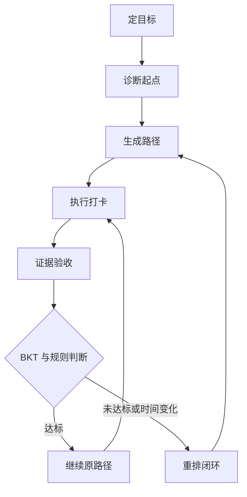
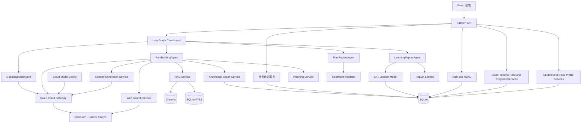
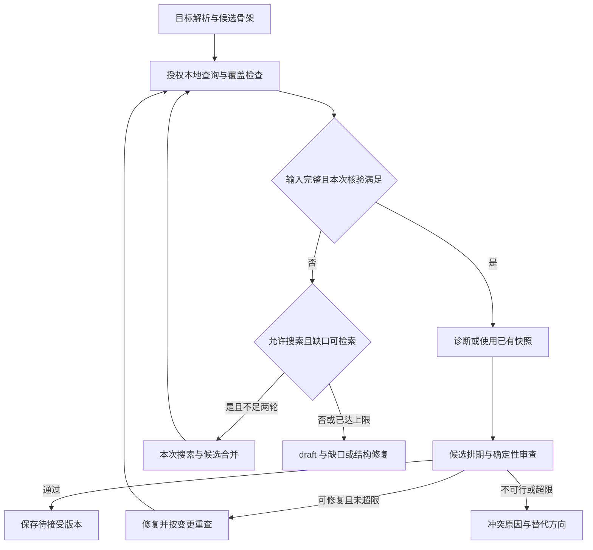
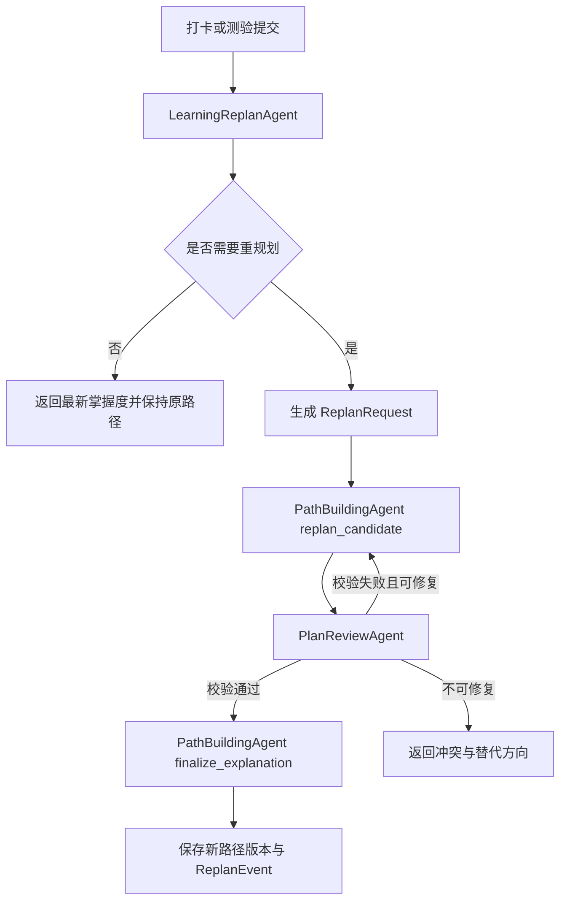
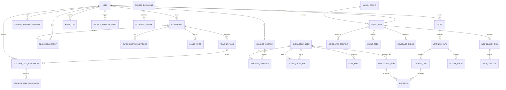

# 智能学习规划助手项目设计方案

> 当前实现对照更新 2026-11-06。REG、KB、EXT增补已进入源码，最新验证和环境缺口见文末及功能清单。旧完成度和早期“未实现”描述保留为历史记录。

**账号流程修订（2026-11-03）**：学生和教师可从登录页自助注册，设置自己的密码后返回登录。公开注册仅允许student或teacher，管理员身份通过受控初始化取得。管理员仍可管理账号并重置密码；临时密码须首次修改。此修订取代旧版关于账号仅由管理员创建的描述。


> 当前修订：2026-10-31 v3.3；新增末尾“功能模块与子功能细化基线”，共14个模块、127项子功能；旧FR/AT编号保留。

> 文档状态：完整平台与画像能力修订建议，实际实现待核验
>
> 文档版本：v3.3
>
> 日期：2026-10-27
>
> 项目类型：课程项目
>
> 开发周期：保留十周总预算，核心交付前移至第 8 实践周；第 9 至 10 周仅作验收后维护
>
> 团队规模：2 人
>
> 核心用户：计算机专业大一、大二学生与任课教师
>
> 平台形态：单学校部署、多教师、多班级
>
> 目标技能主线：Python 基础 -> 数据结构与算法 -> 后端开发
>
> 模型方案：阿里云百炼/DashScope 千问云端模型 + 原生联网搜索
>
> 验收方式：现场师生平台与 AI 学习闭环，正常及相关异常验证
>
> 交付物：设计方案、需求规格说明书、可运行源码、演示与答辩材料

> 修订说明：2026-10-27 文档审查修订版。保留原有教师平台、云端 AI、四 Agent 和完整闭环范围；新增 FR-042 至 FR-047、AT-023 至 AT-030。本文是设计方案，不是实现或测试通过证明。未提供源码、运行版本和测试报告，完成状态均待核验。新增业务默认值属于修订建议，不冒充用户或教师已确认。

> 画像修订说明：2026-10-28 将原有零散画像字段和教师进度指标提升为统一的学生画像快照、教师班级画像快照和刷新机制，新增 FR-048 至 FR-050、AT-031 至 AT-033。画像中的数值事实由确定性聚合产生，LLM 只可基于已生成事实进行解释。

> 契约示例约定：example.edu、示意ID、sha256:...、演示日期与数值均为结构占位，不是真实来源或测试证据。网页日期可为null，字段定义以SRS 5.12与技术设计20.4为准。

## 1. 文档目的

本文档定义“智能学习规划助手”的产品目标、业务边界、平台角色、系统架构、云端联网 AI 内核、教师端、数据模型、接口、非功能要求、测试方案和实践周实施计划。

本文档是需求规格说明书、详细设计、代码实现和课程答辩的共同基线。产品行为和验收以需求规格说明书 v3.2 为准；实现细节以技术设计 v3.2 为准。本文提供产品与架构概览，三者变更须同步。

## 2. 项目概述

### 2.1 项目背景

计算机专业低年级学生通常已经学习部分程序设计基础，也拥有明确的学习目标，例如掌握数据结构与算法、完成一个后端项目或准备进阶课程。但学生往往不清楚：

- 当前掌握的知识与目标技能之间缺少哪些知识。
- 多个知识主题之间有哪些先修依赖。
- 在每周时间预算内，应该先学什么、后学什么。
- 某个学习计划是否真的可以完成。
- 学习过程中掌握度变化后，计划应如何调整。

传统课程表或通用学习资源库只能提供内容列表，无法基于个人基础、先修约束和时间预算生成可执行的个性化路径。

### 2.2 目标用户

产品包含学生和教师两类核心用户，学校管理员负责账号与平台配置。本期采用单学校部署，不实现跨学校租户。

学生的典型特征如下：

- 已学习一门程序设计语言的基础语法。
- 能够完成简单程序，但没有形成系统的知识结构。
- 有明确技能目标，却难以判断目标所需的前置知识。
- 每周可投入的学习时间有限，希望按时间预算拆解任务。
- 需要看到计划依据、学习进度和调整原因。

教师的典型特征如下：

- 同时负责一个或多个班级。
- 需要查看班级整体和学生个体的学习进度、掌握度与风险。
- 需要向整个班级或指定学生布置新任务。
- 需要查看班级整体画像、共性薄弱知识点和风险分布，而不只是单名学生列表。
- 需要区分教师任务与 AI 生成路径，避免直接破坏系统规划结果。

### 2.3 核心问题

给定一个技能目标、用户当前基础和时间预算，系统需要回答：

1. 达到目标需要学习哪些知识和技能。
2. 这些知识之间存在何种先修关系。
3. 用户已经掌握什么，还缺什么。
4. 在时间限制内是否存在可行学习路径。
5. 推荐顺序及每条依据从何而来。
6. 用户执行和测验后，路径应该如何变化。
7. 教师如何观察班级与个人进度，并在必要时补充任务。

### 2.4 AI 内核概述

系统采用“千问云端模型 + 原生联网搜索 + 本地课程 RAG + 四智能体编排”。联网搜索负责获取最新公开信息，本地 RAG 负责课程大纲、知识材料、知识到技能映射及个人自测证据，确定性图谱与规则校验负责判断学习路径可行性。

- 千问云端模型负责理解用户意图、生成候选知识内容、拆解任务和解释路径。
- 千问原生联网搜索根据 Agent 查询自动获取最新公开资料，并返回可保存的来源信息。
- 本地 RAG 提供课程专属和用户授权资料的稳定依据。
- 知识图谱表达先修关系和技能映射。
- 图约束搜索生成满足依赖关系的候选路径。
- 规则校验器决定路径是否满足先修与学时约束。
- LLM 负责理解目标、规划诊断、拆解任务和自然语言解释。
- BKT 根据测验证据更新知识掌握度。
- 重规划器根据掌握度、执行状态和时间预算调整路径。

LLM 不负责最终可行性判断。路径是否可行由确定性算法和规则校验器决定。

### 2.5 产品主线

学生端围绕以下完整闭环构建：

`定目标 -> 诊断起点 -> 生成路径 -> 执行打卡 -> 证据验收 -> 重排闭环`

每个环节都必须具有结构化输出、持久化状态、错误处理和可检查的通过条件。课程验收采用单次现场连续演示：从新目标输入开始，经过诊断、规划和首次打卡，使用现场提交的未达标测验证据触发 BKT 更新与重规划，再展示调整后的路径。核心闭环不得依赖预生成路径、缓存规划结果或预先录制视频。

教师端围绕以下干预闭环构建：

`登录 -> 查看班级进度 -> 全班或指定学生布置任务 -> 学生执行 -> 查看提交与风险`

教师任务不直接修改 AI 路径。教师任务计入学习负荷；当任务导致时间冲突时，系统生成重规划建议，由学生确认后生效。

## 3. 目标与范围

### 3.1 项目目标

- 为指定技能目标生成满足先修关系和时间预算的个性化学习路径。
- 根据用户输入的学习目标生成知识内容、任务、验收题和候选路径。
- 让每个知识点和计划调整都可以追溯到课程材料或用户证据。
- 通过自测、打卡和验收形成持续更新的学习者模型。
- 真实调用千问云端模型和联网搜索，并结合本地 RAG、知识图谱、BKT、Agent 编排和规则校验。
- 保存模型配置、搜索查询、网页来源、抓取时间、引用和运行轨迹，支持复现与审计。
- 在联网环境中完成现场 AI 演示，断网时明确失败而不是伪造实时结果。
- 支持单学校管理员、教师和学生登录，并执行服务端角色与数据权限校验。
- 支持多教师、多班级；教师可创建自己负责的班级，学生可通过邀请码加入多个班级。
- 支持教师查看本班学生学习进度、任务完成情况、掌握度和风险。
- 支持学生查看跨目标统一画像，并向本人提供掌握度、学习行为、证据覆盖、薄弱点和风险原因。
- 支持教师查看本班班级画像，包括完成率、按时率、实际学习时长、掌握度分布、共性薄弱点和风险学生。
- 支持教师向全班或指定学生布置一次性任务，并查看提交与完成状态。
- 提供可运行源码、设计文档、需求规格说明和答辩演示。

### 3.2 成功标准

- 在单次现场演示中连续完成“目标、诊断、规划、打卡、验收、重规划”闭环，且路径和重规划结果由现场输入触发。
- 现场演示允许预先配置云端模型、预置已审核课程资料和已建立索引，不允许使用预生成路径、缓存规划响应、缓存搜索结果或预先录制的交互结果代替核心步骤。
- 对预先判定可行的输入，规划成功率目标不低于95%；发布路径必须100%通过规则。
- 所有正式学习节点均引用真实且有权访问的证据；图谱记录必须继续追溯到来源，不以无来源图谱替代证据。
- 路径中不存在硬先修冲突和重复节点。
- 当路径不可行时，系统能够说明原因并给出可执行替代方案。
- 至少复现一次“测验未达标 -> BKT 更新 -> 插入补强任务 -> 后续任务顺延”的重规划流程。
- 对未预先配置的新计算机学习目标生成结构化内容和候选路径。
- 答辩现场能够展示千问联网搜索结果，并证明路径使用了本次请求获得的最新来源。
- 云端模型的 JSON 合法率、引用存在率和路径规则通过率不低于设定阈值。
- 在可访问千问 API 和互联网的环境中完成现场闭环，断网、鉴权失败或搜索失败时返回明确错误。
- 教师能够创建班级、生成邀请码、布置新任务，并在学生完成后看到进度变化。
- 学生在诊断、打卡、资源学习、任务提交或评分后，画像刷新并显示新的版本与数据时间。
- 班级画像能够按固定口径聚合本班学生数据，且不混入学生私人目标或其他班级证据。
- 教师无法访问非本人班级或其他教师的班级数据。

### 3.3 本期范围

- 支持用户输入未预先配置且在可支持知识域内的计算机学习目标，并根据输入生成内容与路径。
- 将 Python 基础 -> 数据结构与算法 -> 后端开发作为完整验收和演示主线。
- 在约 10 周开发周期内完成云端模型接入、联网搜索、系统联调、现场闭环演练、文档定稿和答辩交付。
- 支持上传课程资料，为任意新目标建立可追溯的 RAG 证据。
- 支持千问云端模型结合本地 RAG 和联网搜索生成知识节点、任务、题目、路径解释和重规划建议。
- 支持自动联网检索最新公开资料，并保存搜索查询、来源、摘要、发布时间和抓取时间。
- 支持保存云端模型配置、搜索策略、提示词版本、评估结果和运行记录。
- 支持单学校内的管理员、教师和学生账号，以及学生多个学习目标和多个班级。
- 支持课程文档、知识节点、技能映射、题库和先修关系导入。
- 支持目标解析、自测诊断、学习画像、路径生成、路径解释和路径调整。
- 支持学习打卡、测验提交、BKT 更新和重规划。
- 支持 Agent 执行轨迹展示，便于课程答辩说明 AI 内核。
- 支持本地业务数据、课程 RAG 数据和联网搜索证据的本地持久化。
- 支持单学校管理员、教师和学生的账号与角色管理。
- 支持教师创建多个班级、生成邀请码和学生加入班级。
- 支持教师班级总览、学生详情、进度指标和风险提示。
- 支持学生画像快照、班级画像快照、画像刷新、版本历史和数据质量说明。
- 支持教师班级画像中的任务完成率、按时率、学习时长、掌握度分布、共性薄弱点和风险学生。
- 支持教师向全班或指定学生发布一次性任务，并查看提交状态。
- 支持教师任务计入学习负荷并触发重规划建议，但不直接修改 AI 路径节点。

### 3.4 非目标

- 不接入真实教务系统或学校统一身份认证。
- 不实现跨学校多租户、教育集团或 SaaS 计费体系。
- 不实现同一班级的多教师协同授课。
- 不实现家长端、学生社交和公开排行。
- 不自动抓取互联网大规模课程资料。
- 不保证在无课程资料时生成的内容具有正式课程级权威性。
- 不自建或微调基础模型，模型能力由千问云端 API 提供。
- 不保证互联网搜索结果本身的权威性，系统必须执行来源校验和可信级别判定。
- 不在断网环境中提供核心 AI 闭环。
- 不使用手工编排的假数据、预生成路径或缓存响应代替现场规划的六阶段闭环。
- 不实现生产级云部署、集群和高可用架构。
- 不提供正式学分、成绩单或学校教务认证。

### 3.5 约束与假设

- 团队规模固定为 2 人，开发周期约 10 周。
- 平台采用单学校部署，支持多教师、多班级，不实现跨学校租户。
- 学校管理员负责教师和学生账号；教师负责创建班级、发布课程资源和教师任务。
- 首个管理员账号由初始化脚本从环境变量创建，不设置硬编码默认密码。
- 教师只能访问自己负责的班级；学生只能访问自己的学习数据和已加入班级的数据。
- 同一班级采用单负责教师模型，不做多教师协同授课。
- 教师任务为一次性任务，可关联知识节点，但不直接修改 AI 路径节点。
- 第 7 实践周前必须完成至少三轮完整现场闭环演练，最后一轮用于验收冻结。
- 演示环境为 Windows 11，64 位 x64 系统。
- 默认云端模型为千问商业 API 中的 `qwen-plus`，具体模型名、搜索开关和生成参数通过版本化配置管理。
- 现场演示设备必须能够访问阿里云百炼/DashScope API 和互联网搜索服务。
- API Key 只通过服务端环境变量或本地密钥文件加载，不写入前端、日志或源码。
- 用户学习数据采用最小必要原则发送到云端模型；课程资料、答案和画像只在生成所需范围内传递。
- Web 证据默认保存搜索查询、URL、标题、摘要、发布时间、抓取时间和内容哈希。
- 对时效性声明按类型执行新鲜度核验；近期事件默认 30 天，当前版本用本次检索的官方版本文档，固定知识无统一发布时间门槛。
- 课程资料应为具有使用权限的 Markdown、TXT 或 PDF 文件。
- 当目标在时间预算内不可行时，系统返回冲突原因和替代选项，不伪造可行路径。
- 无本地 RAG 或联网搜索证据的内容标记为 `draft`，不得进入 `verified` 路径。

## 4. 用户与使用场景

### 4.1 核心用户画像

**姓名：小林**

**背景：** 计算机专业大一学生，学习过 Python 语法，能完成基础程序设计题。

**目标：** 两个月内掌握数据结构与算法，并具备后端开发入门能力。

**时间：** 每周 10 小时。

**困难：** 不知道是否需要先补 Python 进阶、面向对象、复杂度分析、数据库和网络基础。

**教师画像：**

- 同时负责一个或多个计算机课程班级。
- 希望快速识别未开始、逾期、掌握度偏低或频繁触发重规划的学生。
- 需要针对班级共性问题或个人薄弱点布置补充任务。
- 只能查看自己班级的学生学习数据。

### 4.2 主要场景

1. 用户输入目标、当前基础、每周时间和截止日期。
2. 系统生成诊断题，估计各知识节点的初始掌握度。
3. 系统检索本地课程依据和最新公开资料，并提取目标所需的先修子图。
4. 系统生成候选路径，校验先修、学时和截止日期。
5. 系统展示路径、预计学时、掌握度、锁定原因、资料来源、发布时间和抓取时间。
6. 用户每天打卡并提交测验证据。
7. BKT 更新掌握度，触发局部重规划。
8. 系统说明路径变化原因，用户接受或拒绝调整。
9. 教师登录后查看班级进度和学生风险。
10. 教师向全班或指定学生布置新任务。
11. 学生完成任务并提交，教师查看完成状态和进度变化。

### 4.3 核心用户故事

- 作为学生，我希望输入技能目标后看到完整学习路径，以便知道从何开始。
- 作为学生，我希望输入任何新的学习主题后，系统能够生成知识框架、任务和候选路径。
- 作为学生，我希望系统依据我的现有基础跳过已掌握内容，以减少重复学习。
- 作为学生，我希望知道每个知识点的先修原因和资料出处，以便信任计划。
- 作为学生，我希望系统能联网获取最新课程和技术信息，并明确显示来源时间。
- 作为学生，我希望看到每周和每天的任务负荷，以便判断计划是否可执行。
- 作为学生，我希望测验失败后系统自动补强，而不是继续推进后续内容。
- 作为教师，我希望查看多个班级的任务完成率、学习时长和掌握度分布。
- 作为教师，我希望对全班或个别学生布置新任务并查看完成情况。
- 作为教师，我希望只看到自己班级的数据，保护学生隐私。
- 作为答辩评审，我希望看到 Agent、联网搜索、本地 RAG、知识图谱、BKT 和规则校验的真实执行轨迹。

## 5. 业务流程



### 5.1 定目标

输入包括用户自由描述的学习内容、当前基础、期望完成日期、每周可投入时间、每日最大学习时间、偏好学习方式和可选课程材料。

输出为结构化 `GoalSpec`，包含目标技能 ID、目标类型、时间预算、约束条件和可验证完成标准。

通过条件：目标可映射到至少一个已有或已校验的候选技能节点，时间和约束字段格式合法。

### 5.2 诊断起点

系统根据目标的先修子图选择诊断题，覆盖关键知识节点。题目区分难度和知识点，避免全部集中在入门内容。

输出为诊断作答记录和初始掌握度向量。

通过条件：所有目标关键节点至少有一个先验估计，低置信度节点被明确标记。

### 5.3 生成路径

系统先查询有权访问的本地数据库、知识图谱和本地RAG，执行知识完整性检查。非时效性目标在本地数据完整时直接由千问模型生成候选计划；存在缺失项或查询涉及时效性时，才调用千问联网搜索补充证据，合并后重新检查并生成或修复计划。

输出为包含知识覆盖结果、缺失项、生成内容可信级别、路径节点、预计学时、先修关系、掌握阈值、本地与联网依据引用、搜索时间和锁定原因的 `LearningPath`。

通过条件：`verified` 内容具有真实本地或联网引用，时效性声明使用本次搜索获得的来源，路径满足硬先修、时间预算和负荷上限要求；`draft` 内容不能发布为正式路径。

### 5.4 执行打卡

用户对任务提交实际学习时长、完成状态、困难程度和可选备注。

输出为任务打卡记录，并更新计划执行偏差。

通过条件：单次时长合法，任务状态和用户反馈成功保存。

### 5.5 证据验收

用户通过选择题、简答题或代码任务提供掌握证据。系统根据题目映射的知识节点和评分结果触发 BKT。

输出为验收结果、掌握度变化、薄弱知识点和重规划判断。

通过条件：答题记录能够映射到知识节点，评分结果可重复计算。

### 5.6 重排闭环

系统根据掌握度阈值、计划偏差、时间预算变化和证据冲突决定是否重规划。

输出为原路径与调整后路径的差异、触发原因和证据引用。

通过条件：重规划不会破坏未完成的硬先修，也不会超出更新后的时间预算。

### 5.7 教师干预闭环

教师登录后进入本人负责的班级，查看班级总览或学生详情，并根据进度创建一次性教师任务。

教师任务输入包括：

- 任务标题与说明。
- 截止时间和预计学习时长。
- 全班或指定学生。
- 可选知识节点关联。
- 可选资料链接。
- 完成方式：打卡确认、文本提交或链接提交。

输出为教师任务、学生任务分配、学生提交和教师查看状态。

通过条件：

- 教师只能操作自己负责的班级。
- 任务可以按班级或指定学生分配。
- 教师任务独立于 AI 路径节点，不直接修改路径。
- 任务时长计入学习负荷；产生冲突时生成重规划建议，不自动替换路径。
- 学生只能看到分配给自己的教师任务。
- 教师只能看到本班学生的进度和与班级任务相关的提交。

### 5.8 学生画像与班级画像刷新闭环

画像由领域事件触发的确定性聚合生成，不允许由 LLM 直接填写掌握度、学习时长、完成率或风险事实。

刷新触发事件：

- 目标创建、目标班级关联或取消关联。
- 诊断提交与掌握度初始化。
- 打卡、教师任务提交、资源学习记录。
- 客观题评分、教师评分或评分更正。
- BKT 更新、重规划接受或拒绝。
- 学生加入、退出或移除班级。

学生画像输出包括：

- 基本信息与学习上下文：学习目标、班级关系、时间预算和学习偏好。
- 学习行为：实际学习时长、完成率、按时率和近期活动。
- 掌握状态：已掌握、进行中、薄弱和未知知识节点。
- 证据质量：有效证据数、来源覆盖、待复核项和最后更新时间。
- 风险与建议：具体风险原因、建议发力知识点和画像完整度。

班级画像输出包括：

- 班级范围与统计窗口。
- 活跃学生数、任务完成率、按时率和逾期学生数。
- 实际学习时长汇总、掌握度分布和共性薄弱知识点。
- 风险学生数量及原因列表。
- 数据覆盖率和“证据不足”标记。

通过条件：

- 学生只能查看本人完整画像。
- 教师只能查看本班授权投影，不包含私人目标或其他班级证据。
- 画像快照保存版本、生成时间、统计窗口和数据水位。
- 输入事件变化后读取接口能够识别快照过期并生成新版本。
- 数值指标可由同一输入与规则版本重复计算。

## 6. 功能需求

| 编号 | 功能 | 需求说明 | 优先级 |
| --- | --- | --- | --- |
| FR-001 | 目标管理 | 创建、读取、更新和归档学习目标 | 必须 |
| FR-002 | 目标解析 | 将自然语言目标转换为结构化技能目标和约束 | 必须 |
| FR-003 | 诊断生成 | 根据目标子图生成个性化诊断题 | 必须 |
| FR-004 | 诊断评估 | 根据答题结果初始化各知识节点掌握度 | 必须 |
| FR-005 | 学习者画像输入 | 汇总基础、时间、偏好、目标、掌握度和证据，作为画像快照的事实输入 | 必须 |
| FR-006 | 文档导入 | 导入并解析课程大纲和知识材料 | 必须 |
| FR-007 | RAG 检索 | 使用关键词与向量混合检索返回带引用的证据 | 必须 |
| FR-008 | 知识图谱 | 管理知识节点、技能节点和先修边 | 必须 |
| FR-009 | 缺失知识计算 | 根据目标与掌握度计算待学习节点 | 必须 |
| FR-010 | 路径生成 | 使用图约束搜索生成候选学习顺序 | 必须 |
| FR-011 | 路径校验 | 校验硬先修、学时、截止日期、负荷和引用 | 必须 |
| FR-012 | 路径解释 | 使用 LLM 解释路径、先修原因和资料依据 | 必须 |
| FR-013 | 任务拆解 | 将知识节点拆分为可执行学习任务 | 必须 |
| FR-014 | 打卡记录 | 保存学习时长、完成度和困难反馈 | 必须 |
| FR-015 | 测验验收 | 提交题目答案并生成掌握证据 | 必须 |
| FR-016 | BKT 更新 | 根据作答结果更新知识节点掌握度 | 必须 |
| FR-017 | 重规划 | 根据掌握度和执行偏差局部调整路径 | 必须 |
| FR-018 | 四智能体协作 | 使用 LangGraph 协调目标诊断、路径构建、质量审查和学习重规划 4 个专业 Agent | 必须 |
| FR-019 | 千问云端模型 | 通过服务端安全调用千问云端模型，并记录模型和配置版本 | 必须 |
| FR-020 | 执行追踪 | 保存并展示 Agent 步骤输入、输出、状态补丁和工具调用 | 必须 |
| FR-021 | 异常恢复 | 处理模型超时、非法 JSON、无检索结果和不可行计划 | 必须 |
| FR-022 | 演示数据管理 | 支持可重复导入和重置课程数据与演示账户 | 应当 |
| FR-023 | 任意目标生成 | 对未预先配置的计算机主题生成知识框架、任务、题目和候选路径 | 必须 |
| FR-024 | 实时联网搜索 | 对门控要求的缺失或时效性查询调用千问联网搜索，并保存查询和来源 | 必须 |
| FR-025 | Web 证据管理 | 保存网页标题、URL、摘要、来源域名、发布时间、抓取时间和内容哈希 | 必须 |
| FR-026 | 来源与时效校验 | 校验联网引用真实存在、可追溯，并检查时效性声明是否满足新鲜度要求 | 必须 |
| FR-027 | 云端模型配置 | 管理模型名称、搜索开关、生成参数、超时、提示词和激活状态 | 必须 |
| FR-028 | 在线服务可用性 | 处理云端模型鉴权失败、超时、限流和联网搜索失败，不伪造实时结果 | 必须 |
| FR-029 | 内容可信级别 | 区分带证据的 `verified` 内容和待核验的 `draft` 内容 | 必须 |
| FR-030 | 现场闭环可验证性 | 现场核心请求生成新的运行记录和 Agent 轨迹，可证明未复用预生成路径、缓存规划结果或缓存搜索结果 | 必须 |
| FR-031 | 知识覆盖门控 | 生成计划前检查本地目标映射、节点、先修、学时、题目和证据覆盖；非时效性目标仅在缺失时触发联网补充，联网合并后必须重新检查 | 必须 |
| FR-032 | 登录与会话 | 支持管理员、教师和学生登录、退出和当前身份查询 | 必须 |
| FR-033 | 学校账号管理 | 管理员可创建、停用和重置教师与学生账号 | 必须 |
| FR-034 | 班级管理 | 教师可创建、查看和归档自己负责的班级，并查看成员 | 必须 |
| FR-035 | 班级邀请 | 教师可生成邀请码，学生可通过邀请码加入班级 | 必须 |
| FR-036 | 教师班级画像 | 教师可查看本人多个班级的任务完成率、按时率、学习时长、掌握度分布、共性薄弱点和风险学生 | 必须 |
| FR-037 | 班级学生画像投影 | 教师可查看本班学生的班级授权画像投影，但不得查看私人目标、其他班证据或隐藏备注 | 必须 |
| FR-038 | 教师任务管理 | 教师可为全班或指定学生创建、发布和撤回一次性任务 | 必须 |
| FR-039 | 教师任务提交 | 学生可查看分配给自己的任务并提交打卡、文本或链接，教师可查看状态 | 必须 |
| FR-040 | 教师任务负荷联动 | 教师任务计入学习和排期负荷，冲突时生成重规划建议，不直接修改 AI 路径 | 必须 |
| FR-041 | 授权隔离与审计 | 服务端强制执行角色、班级归属和数据权限，并记录教师关键操作 | 必须 |
| FR-048 | 学生画像快照 | 系统应生成包含学习上下文、行为、掌握状态、证据质量、风险和建议的学生画像快照 | 必须 |
| FR-049 | 班级画像快照 | 系统应按统计窗口聚合本班学生授权数据，生成完成率、时长、掌握度分布、薄弱点和风险画像 | 必须 |
| FR-050 | 画像刷新与历史 | 系统应在相关领域事件变化后识别过期画像，生成新版本并保留历史，不使用陈旧快照冒充最新状态 | 必须 |
| FR-042 | 课程资源发布 | 教师上传 Markdown、TXT、文本型 PDF，填写来源和班级可见范围，发布、下架并保留历史引用 | 必须 |
| FR-043 | 资源学习记录 | 学生阅读已授权资源，主动记录学习时长和阅读完成；刷新与重启后可查询 | 必须 |
| FR-044 | 练习结果反馈 | 客观题即时反馈得分、正确答案与解析；待复核主观题显式标记且不更新 BKT | 必须 |
| FR-045 | 课程关联与隐私 | 目标可显式关联一个本人班级；教师只见班级授权投影，私有资源和云端发送权限独立校验 | 必须 |
| FR-046 | 全局负荷与统计 | 所有活动目标和班级任务共用学生日/周预算，确定性统计分母并去重 | 必须 |
| FR-047 | 交接与证据交付 | 提供备份恢复、安装使用、逐项测试、周报、个人贡献和 AI 使用记录 | 必须 |

## 7. 系统架构

### 7.1 架构风格

系统采用前后端分离的模块化单体架构。业务模块在部署上运行于同一台本地设备，但在代码、接口和数据职责上保持明确边界。

选择模块化单体而非微服务的原因：

- 十周课程项目内避免服务发现、消息队列和跨服务一致性成本。
- 便于一名开发者独立调试完整 AI 链路。
- 保留清晰的组件边界，方便后续拆分。
- 降低 Windows 本地演示的部署风险。

### 7.2 逻辑架构



### 7.3 组件职责

| 组件 | 技术 | 职责 | 不负责 |
| --- | --- | --- | --- |
| 前端应用 | React、TypeScript、Vite | 学生端、教师端、管理员登录态和角色页面路由 | 不直接访问模型或数据库 |
| API 服务 | FastAPI | 请求校验、业务接口、统一错误、事务边界 | 不实现 LLM 推理逻辑 |
| Auth and RBAC | FastAPI、密码哈希、会话 | 登录、退出、角色判断、班级对象级授权 | 不决定学习路径质量 |
| School Account Service | FastAPI、SQLite | 管理员创建、停用和重置账号 | 不允许教师创建管理员账号 |
| Classroom Service | FastAPI、SQLite | 班级创建、邀请码、成员关系和学生加入 | 不修改学习路径 |
| Teacher Task Service | FastAPI、SQLite | 教师任务定义、全班/指定学生分配、发布、撤回和提交 | 不直接修改 AI 路径节点 |
| Student Profile Service | Python、SQLite 查询 | 汇总学生目标、行为、掌握度、证据质量、风险和建议，生成版本化画像 | 不让 LLM 计算事实指标 |
| Class Profile Service | Python、SQLite 查询 | 按窗口聚合班级完成率、时长、掌握度分布、薄弱点和风险学生 | 不混入私人目标或其他班级证据 |
| Profile Refresh Service | 领域事件、SQLite 水位 | 检测画像过期、生成新快照、保留版本和数据质量 | 不在权限失效后复用旧缓存 |
| Audit Log Service | SQLite | 记录登录失败、任务发布、撤回、账号停用等关键操作 | 不保存明文密码或 API Key |
| LangGraph Coordinator | LangGraph | 读取共享状态、选择下一个 Agent、控制条件边和有限重试 | 不作为第 5 个自治 Agent，不生成业务内容 |
| GoalDiagnosisAgent | LLM、诊断与 BKT 工具 | 解析目标、生成并评估诊断、初始化学习者画像 | 不生成正式路径，不发布内容 |
| PathBuildingAgent | LLM、RAG、图谱与规划工具 | 生成候选知识、任务、题目、候选路径和解释 | 不自行宣布路径通过审核 |
| PlanReviewAgent | 规则、Schema 与引用校验工具 | 审查内容可信级别、引用、先修、预算、负荷和重复节点 | 不生成或修改正式路径 |
| LearningReplanAgent | 规则、BKT 与重规划工具 | 处理打卡和测验证据，更新掌握度并判断是否重规划 | 不直接发布新路径 |
| LLM Gateway | DashScope/OpenAI-compatible API | 调用千问云端模型、启用联网搜索、结构化输出、超时和重试 | 不修改持久化状态，不向前端暴露 API Key |
| Content Generation Service | Python、LLM Gateway | 生成知识框架、任务、题目、内容摘要和候选路径 | 不决定最终路径可行性 |
| Web Search Service | 千问原生联网搜索封装 | 发起搜索查询、保存来源快照、抓取时间和引用证据 | 不宣称搜索结果天然权威，不决定路径顺序 |
| Cloud Model Config Registry | SQLite | 记录模型名称、搜索开关、生成参数、提示词和激活状态 | 不保存模型权重 |
| RAG Service | Chroma、SQLite FTS5 | 文档导入、切分、向量化、混合检索、引用生成 | 不决定学习顺序 |
| Knowledge Graph Service | SQLite、NetworkX | 知识节点、技能映射、先修边、DAG 校验、子图提取 | 不生成自然语言解释 |
| Planning Service | Python | 拓扑约束、候选路径搜索、学时分配、局部重排 | 不绕过规则校验 |
| Constraint Validator | 确定性 Python 规则 | 先修、预算、截止日期、负荷、重复和引用校验 | 不接受 LLM 覆盖失败结果 |
| Learner Model | Python、SQLite | 学习者画像、证据记录、BKT 参数和掌握度快照 | 不直接执行规划 |
| Replanner | 规则与 LangGraph 节点 | 判断局部调整或全局重排，生成差异 | 不伪造缺失证据 |
| 本地数据层 | SQLite、Chroma、本地文件 | 业务数据、课程索引、Web 证据快照和运行记录 | 不保存 API Key 明文或未授权云端数据 |

### 7.4 部署拓扑

本地运行两个主要进程，并依赖一个外部云端服务：

1. `FastAPI`：默认监听 `127.0.0.1:8000`，负责 API、Agent 和本地数据访问。
2. `React`：开发时使用 Vite，生产演示可构建为静态文件并由 FastAPI 托管。
3. `Qwen Cloud API`：通过阿里云百炼/DashScope 访问，负责模型生成和原生联网搜索。

启动脚本负责检查 Python、Node.js、本地课程索引、API Key 是否存在，以及 Qwen API 是否可达。模型、搜索配置或 API Key 缺失时给出明确提示，不自动切换到本地模型或伪造搜索结果。

### 7.5 架构规则

- 前端只通过 REST API 访问后端。
- 所有受保护接口必须在服务端校验身份、角色和对象级权限。
- 教师数据访问必须限定为本人负责班级；学生只能访问本人数据和已加入班级。
- 管理员账号只能由学校管理员创建，教师不得提升自身或其他账号权限。
- LLM 只能通过 LLM Gateway 调用。
- Agent 工具调用必须产生结构化记录。
- 只有 LangGraph Coordinator 可以决定下一个 Agent。
- 四个专业 Agent 只能通过共享 `AgentState` 和结构化 `AgentHandoff` 交接。
- 正式路径必须经过 `PlanReviewAgent` 和确定性规则校验。
- `LearningReplanAgent` 产生重规划请求后，必须复用 `PathBuildingAgent` 和 `PlanReviewAgent`。
- LLM 输出不得直接写入 SQLite。
- 模型生成的知识节点必须经过内容可信级别判定。
- 路径生成结果必须经过 Constraint Validator。
- 所有掌握度更新必须通过 BKT Learner Model。
- 所有路径修改必须形成 `ReplanEvent`。
- API 响应中的引用必须来自真实检索结果。
- 每次生成必须记录使用的云端模型、搜索开关、提示词版本、请求时间和数据版本。
- Web 引用必须保存 URL、标题、抓取时间和内容哈希，并经过来源校验。
- API Key 只允许由服务端读取，不得出现在前端响应、日志或 Agent 轨迹中。
- 教师任务不得写入 `path_items`，只能通过独立的教师任务表和负荷计算影响规划建议。
- 教师关键操作必须写入审计日志。

## 8. AI 内核设计

### 8.1 千问云端模型与联网搜索

默认配置：

| 项目 | 配置 |
| --- | --- |
| 推理服务 | 阿里云百炼/DashScope 云端 API |
| 默认生成模型 | `qwen-plus` |
| 联网搜索 | 支持按门控启用千问原生搜索能力 |
| 联网参数 | 区分应用策略与供应商参数；原生参数以实际端点能力为准 |
| 嵌入服务 | DashScope 文本嵌入服务，模型名版本化配置 |
| 调用方式 | 服务端 HTTPS API，密钥只从环境变量读取 |
| 结构化输出 | 按模型能力使用 JSON Object 或 JSON Schema，均需应用层校验 |
| 最大重试 | 2 次格式修复重试 |
| 推理超时 | 单节点默认 90 秒，路径生成总超时 180 秒 |

千问云端模型负责领域表达、结构化生成和路径候选；千问联网搜索负责获取最新公开信息；本地课程 RAG 负责课程专属材料；最终路径可行性仍由确定性算法判断。

联网请求流程：

1. Agent 判断问题是否需要最新公开资料，并生成搜索查询。
2. LLM Gateway 通过 DashScope 调用千问，并启用原生搜索。
3. Web Search Service 将返回的标题、URL、摘要、发布时间和抓取时间标准化为 Web 证据。
4. Citation Validator 校验来源存在性、域名和时效性。
5. 时效性声明未通过声明级新鲜度核验时，相关内容保持 `draft`。
6. 搜索查询、来源快照、模型配置和运行 ID 写入本地数据库。

系统不包含本地生成模型、模型权重或微调适配器。云端模型不可用时，只能返回明确错误或基于已有本地资料生成不含时效性声明的草稿，不得声称已获得最新信息。

### 8.2 内容生成设计

内容生成不是让模型自由编写学习计划，而是执行“本地查询、覆盖检查、按需联网补充、构建图谱、约束搜索、规则校验”的受控流程。

输入包括：

- 用户输入的学习目标。
- 当前基础诊断结果。
- 每周、每日时间和截止日期。
- 课程文档或用户上传资料。
- 学习者已有掌握度与历史证据。

生成流程：

1. GoalDiagnosisAgent 先生成 GoalSpec；新主题先由 PathBuildingAgent 构建候选知识/题目子图并校验，再返回 GoalDiagnosisAgent 生成诊断与画像。
2. PathBuildingAgent 将目标技能展开为本地知识查询和 RAG 查询。
3. 本地数据库、知识图谱和 RAG Service 返回已知技能、节点、先修、学时、题目和引用。
4. KnowledgeCoverageChecker 检查目标所需数据是否完整，并标记缺失原因。
5. 数据完整且不属于时效性查询时，PathBuildingAgent 直接生成任务、验收题和候选路径，不调用联网搜索。
6. 数据缺失或属于时效性查询时，PathBuildingAgent 根据缺口生成搜索查询，Web Search Service 获取最新公开资料。
7. Web 证据经过结构标准化、URL 校验和时效校验后写入本地证据存储。
8. PathBuildingAgent 合并本地与 Web 证据，KnowledgeCoverageChecker 重新检查；仍不完整时返回 `draft` 和明确缺口。
9. PathBuildingAgent 基于通过覆盖检查的证据生成任务、说明、验收题和候选路径。
10. PlanReviewAgent 使用 Schema、Citation、Content 和 Constraint Validator 审查候选路径。
11. 审核通过后，PathBuildingAgent 生成路径依据和调整说明。

模型输出必须包含：

```json
{
  "goal_spec": {},
  "candidate_skills": [],
  "candidate_knowledge_nodes": [],
  "candidate_prerequisites": [],
  "learning_tasks": [],
  "assessment_items": [],
  "candidate_path": [],
  "citations": [],
  "confidence": 0.0
}
```

内容可信级别：

- `verified`：关键节点具有真实本地或联网证据，时效性声明满足来源日期要求，图谱和规则校验通过，可生成正式路径。
- `draft`：模型可生成内容，但缺少足够资料，只能作为待核验草案，不能进入正式路径。

LLM 可以提出知识节点和先修关系，但不能把 `draft` 内容提升为 `verified`。该决定由证据覆盖率和规则校验器共同完成。

### 8.3 联网搜索与证据治理

#### 8.3.1 知识完整性门控

KnowledgeCoverageChecker 在生成计划前执行，输入为目标技能、本地图谱子图、RAG 证据、题目映射和时间约束，输出统一的覆盖结果：

```json
{
  "coverage_id": "coverage-001",
  "goal_id": "goal-001",
  "is_complete": false,
  "time_sensitive": false,
  "search_allowed": true,
  "search_required": true,
  "missing_items": [
    {
      "gap_type": "MISSING_EVIDENCE",
      "node_id": "algo-complexity",
      "reason": "本地 RAG 未找到可引用的复杂度分析材料"
    },
    {
      "gap_type": "MISSING_NODE",
      "node_id": "backend-api-testing",
      "reason": "目标技能缺少 API 测试节点"
    }
  ],
  "checked_at": "2026-10-27T08:00:00Z"
}
```

`gap_type` 至少包含：

- `MISSING_SKILL_MAPPING`：目标无法映射到技能节点。
- `MISSING_NODE`：目标闭包缺少必需知识节点。
- `MISSING_PREREQUISITE`：节点缺少先修关系。
- `MISSING_ESTIMATED_HOURS`：节点无法参与时间规划。
- `MISSING_ASSESSMENT`：节点缺少可验收题目。
- `MISSING_EVIDENCE`：节点没有任何可引用证据。
- `STALE_EVIDENCE`：时效性声明未通过声明级新鲜度核验。
- `GRAPH_INVALID`：硬先修图存在环或结构冲突。

判定规则：

- `local_complete` 表示本地授权数据是否足够，`is_complete` 表示当前输入版本的目标映射、图结构、学时、题目与证据是否齐全。
- 目标解析允许先生成不发布的候选技能/知识骨架；新主题在候选区完成本地查询、按需搜索、候选节点/题目/学时构建与确定性校验，再生成诊断。不要求未知目标先有正式图谱 ID。
- 完成诊断后按最新掌握度再次检查并排期。覆盖检查是规划门槛，不是禁止生成缺失候选内容的门槛。
- `needs_current_search = time_sensitive and not current_search_satisfied`，其中满足条件须包含本 run 搜索记录及对应声明核验；不能仅凭模型声称已搜索。
- `search_required = search_allowed and not structural_blocked and search_round < 2 and (has_searchable_gap or needs_current_search)`。
- `GRAPH_INVALID`、非法学时和预算不足直接进入修复/不可行分支，不把结构或预算问题误当作网页搜索可解决的问题。叶子基础节点可显式标记无先修。
- 非时效性且本地完整时 `search_required=false`；仅上传资料模式下本地完整的非时效性内容仍可通过，只有确有缺失或无法核验的声明保持 `draft`。
- 每轮“搜索→构建/合并候选→复查”后递增 `search_round`；最多 2 轮。不完整且不允许搜索时立即返回 `draft`，不得悬挂。
- 本次搜索已满足时效核验且 `is_complete=true` 后进入规划，不因 `time_sensitive=true` 再次搜索。校验修复只有输入版本改变时重查。

#### 8.3.2 搜索触发

除非用户明确选择“仅使用上传资料”，以下情况必须使用联网搜索：

- 用户明确要求最新、当前、今年或近期资料。
- 课程目标涉及快速变化的工具、框架或版本。
- KnowledgeCoverageChecker返回可通过资料检索解决的缺口；结构环与非法约束走修复分支。
- Agent 需要核验课程材料是否过期。

以下情况可只使用本地 RAG：

- KnowledgeCoverageChecker 返回 `is_complete = true` 且 `time_sensitive = false`。
- 查询针对已审核课程大纲、内部讲义或固定知识概念。
- 用户明确要求只依据上传资料回答；此模式下即使发现缺失或时效性要求也不得联网；确有缺失或无法核验的相关内容标记 `draft`，本地证据充分的固定知识可verified。

#### 8.3.3 Web 证据结构

```json
{
  "search_run_id": "sr-001",
  "query": "2026 Python 后端开发入门课程大纲",
  "title": "Python 后端开发课程大纲",
  "url": "https://example.edu/course/python-backend",
  "domain": "example.edu",
  "snippet": "课程涵盖 API、数据库和测试基础……",
  "published_at": "2026-10-01",
  "fetched_at": "2026-10-23T08:00:00Z",
  "content_hash": "sha256:...",
  "source_rank": 1
}
```

#### 8.3.4 来源优先级

1. 官方文档、学校课程页和标准组织资料。
2. 有明确作者和发布时间的专业课程或技术文档。
3. 技术社区文章仅作为补充，不作为唯一 `verified` 依据。
4. 无法访问或来源不明的页面不得支撑正式声明；无发布时间的官方滚动文档按版本与本次检索核验。

#### 8.3.5 证据合并

- 本地 RAG 与 Web 证据统一映射为 `EvidenceItem`。
- 每条证据具有稳定 `evidence_id`、来源类型和抓取时间。
- 模型只能引用本次传入的 `evidence_id`。
- 相同 URL 的重复搜索结果按内容哈希和抓取时间去重。
- 时效性声明优先使用发布时间较新的官方来源。
- Web 证据写入 `web_evidence` 后可参与本次生成，并在满足时效和可访问条件时供后续请求复用。
- 官方文档和学校资料通过校验后可进入可复用的 RAG 证据池；社区文章默认只作为单次补充证据。
- 合并后必须重新调用 KnowledgeCoverageChecker，确认原缺失项已闭合。

#### 8.3.6 搜索失败

- API 超时或限流时允许有限重试，超过上限返回 `SEARCH_UNAVAILABLE`。
- 搜索无结果时允许扩展查询；仍无结果时使用本地 RAG 生成明确标注的非实时草稿。
- 不允许用模型记忆冒充实时搜索结果。
- 来源网页无法访问时不得作为新的verified声明唯一依据，并保留失败记录。

### 8.4 RAG 设计

RAG 的目标是为知识点、生成内容、路径解释和调整原因提供可追溯依据。

#### 8.4.1 数据来源

- 课程教学大纲。
- 教材目录和章节摘要。
- 教师讲义或自建知识材料。
- 用户上传且具有使用权限的学习资料。
- 课程知识点与技能映射表。
- 题目与知识节点映射。

#### 8.4.2 导入流程

1. 读取 Markdown、TXT 或 PDF。
2. 提取文档元数据，包括课程、章节、版本和来源。
3. 按标题、段落和 token 上限进行语义切分。
4. 为每个片段生成稳定 `chunk_id`。
5. 使用嵌入模型生成向量并写入 Chroma。
6. 将原始文本和检索元数据写入 SQLite FTS5。
7. 校验文档引用链完整性。

#### 8.4.3 混合检索

检索同时使用向量相似度和关键词匹配，避免纯向量检索丢失精确术语。

```text
final_score = 0.65 * vector_score + 0.35 * normalized_bm25_score
```

默认召回 8 个片段，过滤课程、知识域和文档版本后返回前 5 个片段。若没有达到最低分数，RAG 节点返回“证据不足”，不能由 LLM 编造引用。

#### 8.4.4 引用格式

```json
{
  "document_id": "doc-python-001",
  "chunk_id": "doc-python-001-c03",
  "title": "Python 程序设计课程大纲",
  "section": "函数与模块",
  "page": 12,
  "score": 0.82
}
```

### 8.5 知识图谱设计

知识图谱表达“学什么、先后关系是什么、属于哪项技能”。

#### 8.5.1 节点

- 知识节点：变量、控制流、函数、递归、复杂度分析、数组、链表、树、图、数据库基础等。
- 技能节点：Python 程序设计、数据结构与算法、后端开发基础等。
- 课程节点：课程或资料来源。
- 题目节点：诊断题、练习题和验收题。

#### 8.5.2 边

| 边类型 | 含义 | 是否阻断 |
| --- | --- | --- |
| `HARD_PREREQUISITE` | source是先修，target是后继；source达标后才允许执行target | 是 |
| `SOFT_PREREQUISITE` | 有助于理解但可不先完成的软先修 | 否 |
| `MAPS_TO_SKILL` | 知识节点映射到技能目标 | 是 |
| `COVERED_BY_COURSE` | 知识节点被课程或文档覆盖 | 否 |
| `ASSESSED_BY` | 知识节点由题目验收 | 是 |

#### 8.5.3 图谱不变量

- 硬先修子图必须是 DAG。
- 每个目标技能至少映射一个知识节点。
- 每个可规划知识节点必须有预计学习时间。
- 每个 `verified` 可规划知识节点至少有一条证据来源。
- 每个验收题必须映射到至少一个知识节点。

### 8.6 路径规划算法

LLM 根据用户输入生成候选知识结构和候选路径，确定性算法负责重建依赖、搜索可行顺序并给出最终路径。LLM 的候选结果不能绕过图谱和规则校验。

#### 8.6.1 输入

- 目标技能节点。
- 学习者各知识节点掌握度。
- 硬先修和软先修边。
- 每节点预计学时。
- 每周和每日时间预算。
- 截止日期。
- 节点证据引用。
- 千问云端模型生成的候选节点、先修边和候选顺序。

#### 8.6.2 步骤

1. 从目标技能反向提取必需知识子图。
2. 将模型候选节点与已有图谱进行实体归一化，在本次候选图快照合并，不自动污染共享主图。
3. 删除掌握度达到解封阈值且证据有效的节点。
4. 保留未掌握节点及其硬先修依赖。
5. 对剩余子图执行 Kahn 拓扑排序。
6. 根据节点难度、掌握度和软先修计算推荐优先级。
7. 将节点分配到可用学习时间窗口。
8. 生成一个主候选路径和若干可替代顺序。
9. 调用 Constraint Validator 校验候选路径。
10. 校验失败时将具体错误返回模型或规划器进行局部修复。

#### 8.6.3 目标函数

在所有可行路径中选择综合风险最低的方案：

```text
risk = 0.50 * prerequisite_gap
     + 0.25 * schedule_pressure
     + 0.15 * difficulty_jump
     + 0.10 * context_switch
```

- `prerequisite_gap`：软先修未满足程度。
- `schedule_pressure`：剩余学时与剩余时间的比值。
- `difficulty_jump`：相邻节点难度变化。
- `context_switch`：频繁切换知识领域的惩罚。

### 8.7 规则校验器

| 规则 | 校验内容 | 失败处理 |
| --- | --- | --- |
| VR-001 | 所有硬先修已掌握或排在目标节点前 | 返回缺失先修并阻止发布 |
| VR-002 | 总预计学时不超过剩余时间预算 | 返回超时量和压缩方案 |
| VR-003 | 每日和每周任务不超负荷上限 | 重新分配时间窗口 |
| VR-004 | 路径无重复知识节点 | 去重并记录修复 |
| VR-005 | 每个节点至少有一条真实证据引用 | 触发重新检索或标记资料缺失 |
| VR-006 | 每个验收任务映射有效知识节点 | 拒绝任务发布 |
| VR-007 | 已完成任务与旧计划结构保持只读，新薄弱证据通过新补强任务处理 | 拒绝覆盖历史事实 |
| VR-008 | 重规划不破坏未完成硬先修 | 回退并重新规划 |

校验器输出统一结构：

```json
{
  "is_valid": false,
  "errors": [
    {
      "rule_id": "VR-001",
      "node_id": "algo-recursion",
      "message": "递归需要函数与调用栈基础",
      "related_node_ids": ["python-function"]
    }
  ],
  "repair_hint": "insert_before"
}
```

### 8.8 BKT 学习者模型

每个知识节点维护一组 BKT 参数：

| 参数 | 含义 | 初始范围 |
| --- | --- | --- |
| `p_init` | 学习前掌握概率 | 由诊断结果初始化 |
| `p_learn` | 一次学习后从未掌握到掌握的概率 | 0.15 至 0.30 |
| `p_slip` | 已掌握但答错的概率 | 0.05 至 0.15 |
| `p_guess` | 未掌握但答对的概率 | 根据题型计算 |

正确作答后的后验概率：

```text
P(L_t | correct) = P(L_t)(1 - p_slip) /
                   [P(L_t)(1 - p_slip) + (1 - P(L_t))p_guess]
```

错误作答后的后验概率：

```text
P(L_t | wrong) = P(L_t)p_slip /
                 [P(L_t)p_slip + (1 - P(L_t))(1 - p_guess)]
```

下一状态的掌握概率：

```text
P(L_{t+1}) = P(L_t | evidence) +
             (1 - P(L_t | evidence)) * p_learn
```

默认阈值：

- 低于 `0.45`：薄弱，必须补强。
- `0.45` 至 `0.75`：进行中，需要继续练习。
- 达到 `0.75`：解锁后续硬先修依赖。

每次更新生成 `MasterySnapshot`，记录旧值、新值、证据、参数版本和时间。

### 8.9 四智能体协作工作流

系统包含 4 个专业 Agent。LangGraph Coordinator 是确定性协调层，不是额外的自治 Agent，也不生成业务内容。

#### 8.9.1 Agent 职责

| Agent | 核心任务 | 允许调用的工具 | 输出 | 明确禁止 |
| --- | --- | --- | --- | --- |
| GoalDiagnosisAgent | 理解学习目标、生成并评估诊断、初始化学习者画像 | LLM Gateway、题库、诊断评估、BKT 初始化 | `GoalSpec`、诊断题、作答结果、`LearnerSnapshot` | 不生成正式路径 |
| PathBuildingAgent | 查询本地知识、执行覆盖检查、按需联网补充，并构建候选知识、任务、题目、路径和解释 | LLM Gateway、KnowledgeCoverageChecker、RAG、Web Search、知识图谱、图搜索、任务拆解 | 覆盖结果、候选内容、证据、候选路径、路径解释 | 不自行宣布路径通过审核 |
| PlanReviewAgent | 审查内容可信级别、引用和路径约束，返回修复建议 | Schema Validator、Citation Validator、Content Validator、Constraint Validator、LLM Gateway（仅生成审查说明） | `ReviewResult`、`verified/draft`、规则错误和 `repair_hint` | 不使用 LLM 覆盖规则结论，不生成或修改路径 |
| LearningReplanAgent | 处理打卡和测验证据，更新掌握度，判断是否重规划 | ExecutionMonitor、EvidenceEvaluator、BKTUpdater、ReplanDecider、ReplanNarrator | 执行偏差、掌握度快照、重规划请求和差异说明 | 不直接发布新路径 |

`PathBuildingAgent` 有两种工作模式：

- `initial_candidate`：生成首次候选路径。
- `replan_candidate`：接收 `LearningReplanAgent` 的重规划请求，生成调整后的候选路径。

两种模式都必须复用同一套图谱、规划器和规则校验，不允许维护两套路径生成逻辑。

#### 8.9.2 共享状态

```text
AgentState
  run_id
  user_id
  goal_id
  workflow_type
  active_agent
  state_version
  model_config_id
  search_enabled
  goal_spec
  diagnostic_plan
  diagnostic_answers
  learner_snapshot
  planning_mode
  coverage_result
  missing_items
  search_round
  evidence_chunks
  candidate_content
  content_status
  graph_subgraph
  candidate_path
  review_result
  explanation
  execution_snapshot
  mastery_updates
  replan_request
  new_path
  agent_retry_counts
  errors
  trace_refs
```

所有 Agent 读取同一份状态，但只能通过 `state_patch` 写入自己拥有的字段，避免互相覆盖。

#### 8.9.3 Agent 交接协议

```json
{
  "run_id": "run-20261020-001",
  "from_agent": "PathBuildingAgent",
  "to_agent": "PlanReviewAgent",
  "action": "review_candidate_path",
  "state_version": 7,
  "input_ref": "candidate_path",
  "output_schema": "ReviewResult",
  "retry_count": 0,
  "trace_id": "trace-20261020-001"
}
```

- Agent 之间不进行自由文本对话。
- Coordinator 根据 `workflow_type`、`action`、`agent_retry_counts` 和校验状态选择下一个 Agent。
- 每次交接生成新的 `agent_steps` 记录，并保存输入、状态补丁和输出。
- Agent 不得直接调用另一个 Agent；需要协作时返回 `next_action` 给 Coordinator。
- Agent 不得绕过 Schema、引用、图谱和规则校验写入正式路径。

#### 8.9.4 首次计划流程



首次计划中，GoalDiagnosisAgent 负责形成学习者起点；PathBuildingAgent 负责本地查询、覆盖检查和按需联网补充；PlanReviewAgent 负责证明候选内容是否可信和可行。

#### 8.9.5 学习后重规划流程



LearningReplanAgent 不直接修改路径。它只根据证据决定是否重规划，并把结构化请求交给 Coordinator，再由 PathBuildingAgent 和 PlanReviewAgent 完成新路径生成与审核。

#### 8.9.6 失败修复与重试

- 非法 JSON：当前 Agent 将 Schema 错误返回 LLM Gateway 修复，最多 2 次。
- 检索无结果：PathBuildingAgent 扩大检索词、降低阈值或标记证据缺失。
- 内容为 `draft`：允许保存和查看，但阻止进入正式路径。
- 路径校验失败：PlanReviewAgent 返回规则编号和 `repair_hint`，Coordinator 调用 PathBuildingAgent 的 `repair_candidate`。
- 初次规划及最多3次修复仍失败：停止自动修复，返回冲突原因和替代方案。
- 模型超时：保留最近一次有效状态，允许从当前 Agent 重试。
- LearningReplanAgent 的重规划请求必须幂等，重复请求不得重复更新 BKT。

### 8.10 重规划策略

重规划触发条件：

- 知识节点 BKT 低于 0.45。
- 连续两个计划任务到期未完成。
- 用户修改每周时间预算或截止日期。
- 验收证据与已有高掌握度冲突。
- 目标范围发生变化。

默认策略：

- 在原知识节点下新增补强任务。
- 降低任务粒度。
- 将后续节点顺延。
- 调整软先修节点顺序。
- 在必要时减少非核心扩展内容。

全局重规划条件：

- 目标技能发生变化。
- 总时间预算变化超过 30%。
- 多个关键节点持续不达标。
- 当前路径已无法通过局部调整满足硬约束。

每次重规划输出：

- 触发事件。
- 原路径与新路径的节点差异。
- 变更原因。
- 涉及的证据或规则。
- 新的预计完成日期。
- 对用户的影响。

### 8.11 提示词与结构化输出

- 提示词以版本化模板文件保存。
- 每次 Agent 运行记录提示词版本、云端模型配置 ID、搜索开关和推理参数。
- 所有 LLM 业务输出必须满足 JSON Schema。
- 解析失败时不得把原始文本写入业务表。
- LLM只能引用本次EvidenceItem集合中存在的本地chunk或Web evidence ID。
- 解释文本与结构化路径分开存储。

## 9. 数据设计

### 9.1 数据模型



### 9.2 数据表

| 表 | 关键字段 | 说明 |
| --- | --- | --- |
| `users` | `id, username, display_name, password_hash, role, status, created_at` | 管理员、教师和学生账号 |
| `classrooms` | `id, name, description, owner_teacher_id, status, created_at` | 教师负责的班级 |
| `class_memberships` | `id, class_id, user_id, member_role, status, joined_at` | 班级成员关系；本期主要为学生 |
| `class_invites` | `id, class_id, code_hash, expires_at, max_uses, used_count, status, created_by` | 班级邀请码 |
| `teacher_tasks` | `id, class_id, created_by, title, description, due_at, estimated_minutes, linked_knowledge_node_id, target_type, completion_mode, resource_urls_json, status, published_at, revoked_at` | 教师一次性任务定义 |
| `teacher_task_assignments` | `id, teacher_task_id, student_id, status, assigned_at` | 任务接收人和执行状态 |
| `teacher_task_submissions` | `id, assignment_id, student_id, submission_type, content, resource_url, submitted_at, review_comment, status` | 学生提交和教师查看结果 |
| `audit_logs` | `id, actor_user_id, action, target_type, target_id, payload_json, created_at` | 登录、任务发布、撤回和权限变更审计 |
| `goals` | `id, user_id, target_skill_id, deadline, weekly_hours, daily_hours, status` | 学习目标 |
| `learner_profiles` | `id, user_id, preferences_json, version` | 学习者画像 |
| `student_profile_snapshots` | `id, student_id, scope_type, class_id nullable, version, stats_window_start, stats_window_end, source_watermark_json, payload_json, data_quality_json, generated_at` | 学生画像的不可变版本快照 |
| `class_profile_snapshots` | `id, class_id, owner_teacher_id, version, stats_window_start, stats_window_end, source_watermark_json, payload_json, data_quality_json, generated_at` | 教师班级画像的不可变版本快照 |
| `profile_refresh_events` | `id, scope_type, scope_id, trigger_type, source_event_id, status, snapshot_id, error_json, created_at, processed_at` | 画像刷新任务和事件水位 |
| `knowledge_nodes` | `id, name, domain, difficulty, estimated_hours, mastery_threshold, evidence_required` | 知识节点 |
| `skill_nodes` | `id, name, description, level` | 技能节点 |
| `prerequisite_edges` | `source_id, target_id, edge_type, weight, reason` | 先修关系 |
| `course_documents` | `id, title, course_id, version, source_path, status` | 课程资料 |
| `document_chunks` | `id, document_id, section, page, content, token_count` | 文档片段 |
| `assessment_items` | `id, knowledge_node_id, item_type, difficulty, answer_schema, scoring_rule` | 题目 |
| `assessment_attempts` | `id, item_id, user_id, answer_json, score, submitted_at` | 作答记录 |
| `learning_paths` | `id, goal_id, status, version, total_hours, risk_score, created_at` | 学习路径 |
| `path_items` | `id, path_id, knowledge_node_id, sequence, planned_hours, state, unlock_rule` | 路径节点 |
| `learning_tasks` | `id, path_item_id, title, task_type, planned_minutes, due_date, status` | 可执行任务 |
| `checkins` | `id, task_id, actual_minutes, completion_ratio, difficulty_feedback, note` | 打卡记录 |
| `evidence` | `id, user_id, knowledge_node_id, source_type, source_id, score, payload_json` | 学习证据 |
| `mastery_snapshots` | `id, user_id, knowledge_node_id, previous_probability, new_probability, evidence_id` | 掌握度快照 |
| `bkt_parameters` | `knowledge_node_id, p_init, p_learn, p_slip, p_guess, version` | BKT 参数 |
| `replan_events` | `id, path_id, trigger_type, before_json, after_json, reason, accepted` | 重规划事件 |
| `agent_runs` | `id, user_id, goal_id, workflow_type, graph_version, state_version, model_config_id, search_enabled, status, started_at, finished_at` | 四智能体协同运行 |
| `agent_steps` | `id, run_id, sequence, agent_name, node_name, action, input_json, output_json, duration_ms, status, error_json` | Agent 步骤和工具调用轨迹 |
| `coverage_checks` | `id, run_id, goal_id, input_version, is_complete, time_sensitive, search_allowed, search_required, search_round, gaps_json, checked_at` | 生成前的数据完整性门控 |
| `generated_contents` | `id, run_id, goal_id, model_config_id, content_type, status, payload_json, citations_json` | 模型生成内容及可信级别 |
| `web_search_runs` | `id, agent_run_id, query, provider, search_enabled, status, result_count, queried_at, error_json` | 一次联网搜索请求 |
| `web_evidence` | `id, search_run_id, title, url, domain, snippet, published_at, fetched_at, content_hash, source_rank, trust_level, status` | 可追溯的网页证据快照 |
| `model_configs` | `id, provider, model_name, search_enabled, parameters_json, prompt_version, secret_ref, evaluation_json, status, activated_at` | 千问云端模型与搜索配置；不保存密钥明文 |

### 9.3 数据完整性

- 所有主键使用可排序字符串或 UUID。
- 所有时间使用 UTC ISO 8601 保存，界面转换为本地时区。
- 知识节点、路径和 BKT 参数使用版本号，避免规则变化影响历史解释。
- 删除课程文档时采用软删除，已有路径引用继续可读。
- 路径发布后不允许原地修改，重规划创建新路径版本。
- JSON 字段必须通过应用层 Schema 校验。
- Web 证据必须记录查询、URL、抓取时间和内容哈希，来源不可访问时保留失败状态。
- 模型配置必须关联提示词版本和评估结果，未通过评估的配置不得激活。
- 发送到云端模型的数据必须记录数据类别和最小化范围。
- 每个 Agent 只能提交本人拥有的状态字段补丁，且 `base_version` 必须与当前 `state_version` 一致。
- 正式路径必须具有 `PlanReviewAgent` 的通过记录。
- 重规划候选路径必须复用 `PathBuildingAgent` 与 `PlanReviewAgent`，不得绕过审核直接发布。
- 每次规划或修复前必须引用输入版本一致的 `coverage_checks` 记录；正式路径必须来自 `is_complete = true` 的检查结果。
- 用户角色只能是 `admin`、`teacher` 或 `student`，密码只保存哈希。
- 一个班级只有一个负责教师；本期不支持同一班级多教师协同管理。
- 教师只能管理自己创建的班级和该班级的教师任务。
- 教师任务不得写入 `path_items`；教师任务变更不得直接修改 AI 路径版本。
- 教师任务分配必须指向该班级的有效学生成员。
- 教师只能查看本班学生的进度数据和与班级任务相关的提交。
- 账号停用、班级归档、任务发布、任务撤回和权限变更必须写入审计日志。
- 画像快照生成后不可原地修改；任何刷新都创建新的版本。
- 学生画像必须保存统计窗口、数据水位和完整度；班级画像必须保存相同的聚合依据。
- 班级画像只能聚合本班授权投影，不包含学生私人目标、其他班级证据或隐藏备注。
- 领域事件变化后旧画像标记 `stale`，读取接口不得把过期快照当作最新画像返回。

## 10. API 设计

### 10.1 通用约定

- 基础路径：`/api/v1`
- 数据格式：JSON
- 时间格式：ISO 8601
- 错误格式：

```json
{
  "error": {
    "code": "PLAN_INFEASIBLE",
    "message": "当前时间预算无法完成目标",
    "details": {},
    "trace_id": "run-20260930-001"
  }
}
```

### 10.2 接口列表

| 方法 | 路径 | 用途 |
| --- | --- | --- |
| `POST` | `/auth/login` | 登录并建立会话 |
| `POST` | `/auth/logout` | 退出并失效当前会话 |
| `GET` | `/auth/me` | 查询当前身份、角色和班级范围 |
| `POST` | `/admin/users` | 管理员创建教师或学生账号 |
| `PATCH` | `/admin/users/{user_id}` | 停用账号或重置密码 |
| `POST` | `/classes` | 教师创建班级 |
| `GET` | `/classes` | 查询当前用户可见班级 |
| `GET` | `/classes/{class_id}` | 查询班级和成员 |
| `POST` | `/classes/{class_id}/invites` | 生成班级邀请码 |
| `POST` | `/class-invites/{code}/join` | 学生通过邀请码加入班级 |
| `GET` | `/teacher/classes/{class_id}/profile` | 查看本班班级画像快照 |
| `GET` | `/teacher/classes/{class_id}/profile/history` | 查看本班画像历史版本 |
| `GET` | `/teacher/classes/{class_id}/students/{student_id}/profile` | 查看本班学生画像授权投影 |
| `POST` | `/teacher/classes/{class_id}/tasks` | 创建教师任务 |
| `POST` | `/teacher/tasks/{task_id}/publish` | 发布教师任务 |
| `POST` | `/teacher/tasks/{task_id}/revoke` | 撤回教师任务 |
| `GET` | `/teacher/tasks/{task_id}/submissions` | 查看任务提交 |
| `GET` | `/student/teacher-tasks` | 查询分配给当前学生的任务 |
| `POST` | `/student/teacher-tasks/{assignment_id}/submit` | 提交教师任务 |
| `POST` | `/goals` | 创建并解析学习目标 |
| `GET` | `/goals/{goal_id}` | 查询目标 |
| `POST` | `/diagnostics` | 生成诊断题 |
| `POST` | `/diagnostics/{diagnostic_id}/submit` | 提交诊断答案 |
| `GET` | `/learners/me/profile` | 获取本人完整学生画像 |
| `GET` | `/learners/me/profile/history` | 获取本人画像历史版本 |
| `POST` | `/content/generate` | 根据用户输入生成知识、任务、题目和候选路径 |
| `POST` | `/paths/generate` | 生成并校验学习路径 |
| `GET` | `/paths/{path_id}` | 获取路径、引用和锁定原因 |
| `POST` | `/paths/{path_id}/accept` | 接受路径 |
| `GET` | `/tasks/today` | 获取当前任务 |
| `POST` | `/tasks/{task_id}/check-in` | 提交打卡 |
| `POST` | `/assessments/{item_id}/submit` | 提交测验证据 |
| `GET` | `/paths/{path_id}/replans/preview` | 预览重规划 |
| `POST` | `/replans/{replan_id}/accept` | 接受重规划 |
| `GET` | `/traces/{run_id}` | 查看 Agent 执行轨迹 |
| `POST` | `/admin/import` | 导入课程资料和知识图谱数据 |
| `GET` | `/models` | 查询千问模型与搜索配置 |
| `POST` | `/models/{model_id}/activate` | 切换到已通过评估的云端模型配置 |
| `POST` | `/models/{model_id}/evaluate` | 运行云端模型和搜索质量评估 |
| `GET` | `/web-evidence/{evidence_id}` | 查看网页证据快照和来源状态 |
| `POST` | `/admin/reset-demo` | 重置演示数据 |

### 10.3 路径生成请求示例

本节所有 ID、日期和数值仅为契约示意，非已运行结果。路径生成 POST 只接收 goal_id、goal_spec_version 和预算版本；以下字段属于目标规格，不能覆盖已保存目标。

```json
{
  "goal_id": "goal-001",
  "goal_spec_version": 1,
  "mastery_version": 2,
  "budget_version": 1
}
```

### 10.4 路径响应示例

```json
{
  "path_id": "path-001",
  "status": "pending_acceptance",
  "content_status": "verified",
  "model_config": "qwen-plus-search-v1",
  "search_enabled": false,
  "coverage": {
    "is_complete": true,
    "time_sensitive": false,
    "search_allowed": true,
    "search_required": false,
    "search_round": 0
  },
  "total_hours": 72,
  "risk_score": 0.31,
  "items": [
    {
      "sequence": 1,
      "knowledge_node_id": "python-function",
      "name": "函数与模块",
      "planned_hours": 6,
      "mastery": 0.35,
      "state": "ready",
      "evidence": ["doc-python-001-c03"],
      "web_evidence": []
    }
  ],
  "validation": {
    "is_valid": true,
    "errors": []
  },
  "explanation": "先补强函数和模块，再进入递归与复杂度分析。"
}
```

### 10.5 测验提交响应示例

```json
{
  "evidence_id": "ev-001",
  "knowledge_node_id": "algo-recursion",
  "score": 0.0,
  "observation": "wrong",
  "parameter_version": "bkt-default-v1",
  "mastery": {
    "previous": 0.62,
    "current": 0.342939,
    "threshold": 0.75
  },
  "replan_required": true,
  "replan_reason": "递归掌握度低于 0.45 补强阈值"
}
```

## 11. 前端设计

### 11.1 页面结构

| 页面 | 核心内容 | 主要操作 |
| --- | --- | --- |
| 登录 | 用户名、密码、角色提示 | 登录与退出 |
| 管理员账号管理 | 教师和学生账号、状态、重置密码 | 创建账号、停用账号 |
| 教师班级画像 | 多个班级、统计窗口、完成率、按时率、学习时长、掌握度分布、共性薄弱点和风险学生 | 进入班级、查看学生 |
| 教师任务管理 | 任务定义、全班/指定学生、截止时间、预计时长 | 创建、发布、撤回 |
| 教师学生画像投影 | 本班目标、路径进度、任务、掌握度、成绩、风险、证据覆盖和提交 | 查看提交、布置补充任务 |
| 学生画像 | 学习上下文、时间预算、行为、掌握状态、证据质量、风险和最近更新 | 查看本人完整画像 |
| 目标设置 | 目标技能、基础描述、时间预算、截止日期 | 创建目标 |
| 基础诊断 | 个性化题目、答题进度、预计耗时 | 提交诊断 |
| 内容生成 | 生成知识框架、任务、题目、候选路径、内容可信级别 | 编辑并确认生成内容 |
| 学习路径 | 节点图、学时、掌握度、先修、引用、锁定原因 | 接受路径 |
| 今日任务 | 当日任务、预计时长、关联知识、资料引用 | 打卡 |
| 教师任务（学生端） | 教师任务、截止时间、资料链接和提交状态 | 打卡确认、文本或链接提交 |
| 证据验收 | 题目、作答、评分、掌握度变化 | 提交答案 |
| 重规划 | 原路径、新路径、差异、原因和影响 | 接受或拒绝调整 |
| 云端模型管理 | 千问模型名、搜索开关、提示词版本、限流状态和评估指标 | 激活配置、查看搜索质量 |
| AI 轨迹 | Agent、云端调用、联网搜索、Web 证据、耗时和校验结果 | 展开查看 |

补充必做页面：班级资源管理（教师上传/发布/下架）、班级资源学习（学生正文/下载/阅读记录）、个人学习记录（阅读/任务/练习/反馈）、全局时间预算、班级加入/邀请管理。所有页面覆盖空态、无权限、失败重试与成功保存后刷新恢复。主观题待复核入口位于教师提交详情，客观反馈位于作答结果页。

### 11.2 路径可视化

路径使用节点和连线展示：

- 绿色：已达到掌握阈值。
- 蓝色：当前可学习。
- 灰色：受硬先修锁定。
- 橙色：需要补强。
- 红色：校验冲突或延期风险。

点击节点后展示预计学时、掌握度、先修原因、任务列表、本地资料和联网资料来源。联网来源必须显示发布时间与抓取时间。

### 11.3 交互原则

- 长耗时 Agent 操作显示当前节点和处理状态。
- 联网搜索期间显示“正在检索最新资料”，搜索失败时显示可重试原因。
- 所有生成结果保留“重新生成”和“查看原因”入口。
- `draft` 内容必须显示醒目标识，并禁止直接发布为正式路径。
- 重规划必须显示前后差异，不只展示新计划。
- 错误信息说明用户可采取的动作。
- 演示模式提供一键重置，保证流程可重复。

## 12. 非功能需求

### 12.1 性能

在目标演示设备、网络正常且课程数据已建立索引的条件下：

| 指标 | 目标 |
| --- | --- |
| RAG 检索响应 | 小于 2 秒 |
| 千问联网搜索响应 | 小于 15 秒 |
| 图约束搜索 | 小于 1 秒 |
| 规则校验 | 小于 500 毫秒 |
| BKT 单次更新 | 小于 100 毫秒 |
| 千问模型首次可见输出 | 小于 10 秒 |
| 完整路径生成 | 小于 150 秒 |
| 学生画像查询 | 小于 500 毫秒 |
| 教师班级画像查询 | 小于 1 秒 |
| 画像增量刷新 | 小于 2 秒 |
| API 普通查询 | 小于 500 毫秒 |

用户端性能统计包含排队、网络与修复等待；供应商处理时间仅作附加诊断。超时或失败不得从成功率分母剔除。搜索超过15秒目标时显示仍在等待的真实状态；是否终止由剩余总时限和明确错误决定。

### 12.2 可靠性

- Agent 每个节点具有超时和失败状态。
- 路径生成支持从最近成功节点重试。
- 重复提交测验使用幂等键避免重复更新 BKT。
- 数据导入事务失败时回滚。
- 应用退出后不丢失已提交打卡与证据。
- 登录会话失效后清理前端身份状态，受保护接口返回 `AUTH_REQUIRED`。
- 云端模型超时、限流和搜索失败时保留最近成功状态并允许重试。
- 云端模型配置切换失败时回退到上一个已通过评估的配置。

### 12.3 可解释性

- 每个 `verified` 知识节点显示至少一个资料来源，`draft` 节点显示待核验标识。
- 每个路径限制显示对应规则编号。
- 每次重规划显示触发原因与变更差异。
- Agent 轨迹展示模型节点、联网搜索、Web 证据、工具节点和校验结果。
- 画像必须显示生成时间、统计窗口、数据水位、完整度和规则版本。
- 画像数值不得由 LLM 生成或覆盖，LLM 解释必须引用画像事实。
- LLM 不得生成不存在的引用。

### 12.4 安全与隐私

- 默认只监听本地回环地址。
- 密码只保存 Argon2 或 bcrypt 哈希，不保存明文。
- 登录会话使用 HttpOnly Cookie 或等价安全会话；修改数据的请求必须校验 CSRF 或同源策略。
- 所有受保护接口必须在服务端执行角色和对象级权限校验，前端隐藏菜单不能替代后端授权。
- 教师只能访问本人负责班级的学生数据；学生只能访问本人数据和已加入班级。
- 班级画像只可聚合本班授权投影，不得披露私人目标、其他班级证据或隐藏备注。
- 管理员、教师和学生登录失败、角色变更、任务发布/撤回和账号停用必须进入审计日志。
- 千问云端调用只发送完成任务所需的最小数据，不上传无关信息；API Key 仅用于服务端鉴权。
- 学生首次使用云端功能前应看到数据发送说明；不上传未授权课程资料或完整答题原文。
- API Key 只保存在服务端环境变量或本地密钥文件中。
- 上传文档限制类型、大小和路径，防止目录穿越。
- 日志不记录完整用户答案时，可使用摘要或哈希代替。
- Web 证据和课程数据来源需在项目材料中说明。
- Web 证据使用 URL、抓取时间和内容哈希，避免不可追溯覆盖。

### 12.5 可维护性

- 前端、API、Agent、算法和数据访问分层。
- 核心算法具有单元测试。
- 提示词、云端模型配置和搜索策略独立于业务代码并版本化。
- API 依赖版本锁定，重新运行评估时可复现配置和来源。
- 数据导入脚本可重复执行。
- 所有业务接口具有请求和响应 Schema。

## 13. 异常与边界处理

| 场景 | 系统行为 |
| --- | --- |
| Qwen API 不可达 | 返回 `MODEL_UNAVAILABLE`，保留当前状态并提示检查网络 |
| API Key 无效或过期 | 返回 `MODEL_AUTH_FAILED`，不重试无限次 |
| 云端模型限流或配额不足 | 返回 `MODEL_RATE_LIMITED`，显示预估重试时间 |
| 联网搜索不可用 | 返回 `SEARCH_UNAVAILABLE`，不得伪造最新资料 |
| 时效性声明无法核实 | 标记 `draft` 并显示来源时间不足 |
| 云端模型配置未通过评估 | 保持上一配置激活，不允许切换 |
| LLM 返回非法 JSON | 自动修复两次，仍失败则终止当前节点 |
| RAG 无有效结果 | 标记证据不足，生成内容只能保存为 `draft` |
| 生成内容缺少证据 | 标记为 `draft`，仅允许查看和编辑 |
| 图谱存在环 | 拒绝发布规划数据并指出环路 |
| 路径时间超出预算 | 禁止发布，返回压缩范围和替代方案 |
| 用户修改目标 | 同一目标创建新 GoalSpec 版本并重新评估，不覆盖历史路径 |
| 重复打卡或测验 | 使用幂等键返回原结果 |
| BKT 参数缺失 | 使用版本化默认参数并记录回退 |
| 用户拒绝重规划 | 保留原路径并显示延期风险 |

## 14. 测试与验收

### 14.1 测试层次

| 层次 | 范围 | 工具建议 |
| --- | --- | --- |
| 单元测试 | BKT、校验器、图搜索、评分规则 | pytest |
| 集成测试 | RAG、SQLite、Qwen Gateway、Web Search、LangGraph 节点 | pytest、FastAPI TestClient |
| 搜索质量测试 | 查询扩展、URL 可验证、来源时效和引用去重 | 固定查询集与网络回放 |
| 权限与平台测试 | 登录、RBAC、班级归属、邀请码、任务分配和审计 | pytest、FastAPI TestClient |
| 画像测试 | 学生画像聚合、班级画像口径、快照水位、隐私投影和过期刷新 | pytest、固定样例数据 |
| API 测试 | 请求 Schema、错误码、事务、幂等 | pytest |
| 端到端测试 | 学生六阶段闭环、教师布置与进度查看 | Playwright |
| AI 评测 | 结构化输出率、搜索引用有效率、时效合规率、路径规则通过率和修复率 | 固定问题集与多轮联网运行 |

### 14.2 验收用例

| 编号 | 场景 | 预期结果 |
| --- | --- | --- |
| AT-015 | 单次现场连续演示完整闭环 | 现场完成目标创建、联网搜索、诊断、路径生成与接受、打卡、未达标测验、BKT 更新和重规划，无预生成路径、缓存规划或缓存搜索结果 |
| AT-016 | 本地数据完整与缺失两种生成路径 | 本地完整且非时效性时不联网直接生成；存在缺失项时联网补充、重新检查后再生成 |
| AT-017 | 多教师多班级与邀请码 | 管理员创建教师和学生账号；教师创建多个班级；学生通过邀请码加入班级 |
| AT-018 | 教师布置新任务 | 教师向全班或指定学生发布任务，只有目标学生看到并收到任务 |
| AT-019 | 教师查看进度 | 学生提交教师任务后，教师班级总览和该生详情更新完成状态与进度 |
| AT-020 | 跨班级数据隔离 | 教师访问非本人班级或学生提交他人任务时返回拒绝，不泄露数据 |
| AT-021 | 教师任务负荷联动 | 教师任务造成时间冲突时生成重规划建议，学生确认前 AI 路径不变 |
| AT-022 | 单次现场师生平台闭环 | 管理员/教师账号、班级邀请、教师任务、学生提交、教师进度与 AI 学习闭环在同一现场演示中连续可用 |
| AT-023 | 课程资源完整链 | 教师发布授权资源/关联练习→学生阅读与作答→反馈→学习记录保存→师生查看；重启仍可见 |
| AT-024 | 资源与学习数据隔离 | 另一教师/另一班/私有目标访问被拒绝；检索、引用详情、下载、轨迹和云端发送都执行相同授权 |
| AT-025 | 评分与 BKT 一致 | 客观题分数和解析正确；主观题 pending_review 不更新 BKT；同 attempt 换幂等键仍不重复计入 |
| AT-026 | 跨目标跨班预算 | 两个目标加两个班任务联合排期仍不超日/周上限；接受陈旧方案返回 409 |
| AT-027 | 进度口径 | 按固定样例计算完成率/按时率/逾期数/实际时长，撤回与未作答不误计 0；重复提交不重复统计 |
| AT-028 | 退出停用与重启恢复 | 停用/重置密码使旧会话失效；重启恢复学习记录；中断任务可查询/重试且不重复 BKT |
| AT-029 | 新环境部署与恢复 | 他人按说明在干净环境运行，备份恢复后业务和索引一致，外部模型不可用时给出提示 |
| AT-030 | 逐项证据与个人贡献 | FR-001 至 FR-050 有设计/接口/数据/用例映射；未测试不写通过；每人有周成果及 AI 辅助修改和验证记录 |
| AT-031 | 学生画像全链路 | 诊断、打卡、任务、资源学习、评分或 BKT 更新后，本人画像刷新并显示新版本、证据覆盖和薄弱点 |
| AT-032 | 教师班级画像 | 按固定班级样例生成完成率、按时率、逾期人数、学习时长、掌握度分布和风险学生，且不混入私人目标 |
| AT-033 | 画像过期与隐私投影 | 领域事件变化后旧快照识别为过期并生成新版本；教师跨班读取和私人目标访问被拒绝 |
| AT-001 | 输入可完成目标 | 生成满足先修和预算的有效路径 |
| AT-002 | 缺少函数基础 | 路径在递归前插入函数节点 |
| AT-003 | 总学时超出预算 | 不发布路径，返回可验证的替代方案，不凑足固定数量 |
| AT-004 | RAG 无相关证据 | 标记资料缺失，不编造引用 |
| AT-005 | 测验未达到阈值 | BKT 下降并触发补强任务 |
| AT-006 | 连续两个计划任务到期未完成 | 触发局部重规划并顺延后续节点 |
| AT-007 | 修改每周时间 | 新路径时间预算与用户输入一致 |
| AT-008 | 模型返回非法 JSON | 自动修复或明确失败，不写入脏数据 |
| AT-009 | 关闭外部网络 | 返回明确联网错误，保留已保存状态，不伪造最新资料 |
| AT-010 | 查看 Agent 轨迹 | 可看到节点、工具、耗时和校验结果 |
| AT-011 | 输入未预先配置的新主题 | 通过本地 RAG 与联网搜索生成结构化知识框架和候选路径 |
| AT-012 | 询问最新技术变化 | 启用联网搜索，返回带 URL、发布时间和抓取时间的来源 |
| AT-013 | 新主题同时缺少本地 RAG 与联网证据 | 内容标记为 `draft`，不能发布为正式路径 |
| AT-014 | 使用无效 API Key 或未评估配置 | 系统拒绝运行或切换，并保留上一可用配置 |

### 14.3 画像质量指标

- 相同输入、统计窗口和规则版本必须产生相同画像指标。
- 学生画像必须显示数据水位、完整度、生成时间和版本。
- 班级画像必须显示统计窗口、数据覆盖率和“暂无数据/证据不足”状态。
- 任一新领域事件改变数据水位后，当前画像必须标记过期并可按需生成新快照。
- 班级画像不得包含学生私人目标、其他班级证据或隐藏备注。

### 14.4 AI 质量指标

- 结构化输出成功率不低于 95%。
- 联网回答的引用存在率必须为 100%。
- 时效性声明的新鲜度合规率必须为 100%，不合格内容只能为 `draft`。
- 搜索来源可访问率不低于 95%；不可访问来源必须显示失败状态。
- 路径硬先修冲突率必须为 0。
- 在 20 个未预先配置的目标中，至少 80% 可生成通过规则校验的路径。
- 在本地数据完整的非时效性测试目标中，联网搜索调用次数必须为 0。
- 在缺失数据测试目标中，覆盖检查必须识别缺口、触发搜索并在合并后重新检查。
- 不可行计划必须返回明确冲突，不得伪造成功。

## 15. 实践周实施计划

本次以参考说明中的第 2 至 8 实践周组织交付，日历日期与当前所在实践周需按课堂安排登记，不能按文档文件名推断。原十周为总预算：准备工作可在实践周前完成，第 9 至 10 周仅作验收后维护，不承担任何必做功能首次交付。以下为修订计划，不代表已经完成，也不声称教师已确认。

| 实践周 | 平台与智能能力交付 | A 的可定位成果 | B 的可定位成果 | 检查与证据 |
| --- | --- | --- | --- | --- |
| 第 2 周 | 确认必做范围、原型、账号与数据契约 | 目标/资源/路径原型，云端能力试验方案 | 账号/班级/教师任务/反馈原型 | 功能清单、需求到验收映射、每人流程示例 |
| 第 3 周 | 首条真实流程与技术验证 | 资源上传发布、阅读记录、千问与来源返回试验 | 登录、入班、教师任务提交、进度查询 | 发布→学习/练习→反馈→保存→师生查看；同时验证一次 AI 请求 |
| 第 4 周 | 中期集成，六阶段 AI 闭环初版 | 诊断、RAG、图谱、覆盖门控、规划与画像事实输入 | BKT、重规划、教师任务、班级进度与学生/班级画像快照接入 | 同一界面集成版本，已完成/部分/未完成清单 |
| 第 5 周 | 必做功能全部接入 | 资源权限、引用、预算、画像解释与新主题异常 | 提交反馈、权限、画像刷新、幂等、拒绝重规划与异常 | AT-001 至 AT-033 可执行；每人正常/异常验证与改进对照 |
| 第 6 周 | 系统验证与智能输出评价 | 固定集 AI 评价、路径与引用测试 | 越权、状态、重复提交、并发与恢复测试 | 输入/预期/实际/缺陷/复测；严重缺陷关闭 |
| 第 7 周 | 部署交接、三轮闭环演练 | 安装配置、资料与云端检查、A 模块交接 | 账号初始化、恢复、B 模块交接 | 他人新环境试用；版本、配置、耗时、问题记录 |
| 第 8 周 | 完整平台验收与冻结 | 展示首次计划、资源与验证贡献 | 展示教师平台、证据与重规划贡献 | 完整演示、逐项结论、源代码、测试、安装使用、周报与个人/AI记录 |

核心 Schema 在第 2 周初定，第 3 周首条流程后冻结首版 API；后续变更必须同时更新 Schema、前端类型、迁移、测试和文档。第 4 周完成中期集成，第 5 周不得留有未接入的必做模块，第 7 周完成交接。延期时先减少装饰、非核心筛选和候选方案展示，不自行删除已确认必做功能。

### 15.1 双人团队分工

| 成员 | 责任主线 | 具体职责 |
| --- | --- | --- |
| A | 首次学习计划与教师任务联动 | 负责目标解析、诊断、千问云端网关、联网搜索、内容生成、RAG、知识图谱、首次路径规划、任务拆解、路径解释，以及教师任务的负荷/节点关联接口 |
| B | 平台权限、画像与学习后重规划 | 负责账号、RBAC、班级、邀请码、教师任务、进度统计、学生与班级画像快照、画像刷新、学生提交、BKT 更新、执行偏差和重规划 |
| 共同 | 集成与验收 | 共同维护 API 与数据结构契约、师生端联调、权限审计、搜索来源审核、三轮现场演练、文档和答辩材料 |

## 16. 风险与缓解

| 风险 | 影响 | 缓解措施 |
| --- | --- | --- |
| DashScope API 不可用或网络波动 | 现场闭环中断 | 第 3 实践周前完成连接验证；设置超时、有限重试和明确错误提示 |
| API Key 泄露或权限过大 | 账号和数据风险 | 仅使用服务端环境变量，限制权限，不写入前端和日志 |
| 限流或调用配额不足 | 生成失败或延迟 | 第 3 实践周前检查配额；限制并发；显示 `MODEL_RATE_LIMITED` |
| 联网搜索结果质量不稳定 | 最新信息错误 | 来源优先级、交叉验证、引用校验和 `draft` 降级 |
| 来源无法支持声明或版本不匹配 | 无法证明实时性 | 强制记录抓取时间；声明无法核实时标记 `draft` |
| 第三方搜索服务变更 | 搜索能力下降 | 统一封装 Web Search Service，保留原始证据和失败日志 |
| 用户数据发送到云端 | 隐私和合规风险 | 最小化数据、使用前提示、明确供应商和隐私说明 |
| 教师端增加导致十周范围过大 | 学生闭环或教师端任一方不完整 | 教师任务只做一次性任务；不做协同授课、家长端和正式成绩单 |
| 对象级权限实现错误 | 教师越权查看其他班级数据 | 每个班级/学生接口统一走 RBAC 和班级归属检查，加入越权测试 |
| 教师任务直接改路径 | 破坏 AI 路径和规则校验 | 教师任务独立建表，只参与负荷计算和重规划建议 |
| 邀请码泄露或滥用 | 非目标学生加入班级 | 邀请码设置有效期、次数上限，并支持撤回 |
| 课程数据准备量过大 | 无法在十周内形成真实 RAG | 完整验收固定为一条技能主线，其他主题作为泛化测试 |
| Agent 流程过于复杂 | 联调时间不足 | 先实现确定性主路径，再增加条件修复 |
| LLM 输出不稳定 | 无法写入业务数据 | JSON Schema、固定参数、修复重试和确定性校验 |
| 图谱先修关系错误 | 推荐路径错误 | 数据审核、DAG 校验、单元测试和样例验收 |
| 前后端联调占用过多时间 | 演示不完整 | 第 3 周冻结首版 API 契约，使用 Mock 并行开发 |
| 现场闭环依赖缓存或人工操作 | 答辩无法证明真实闭环 | 第 7 周完成三轮无缓存演练，核心步骤禁止直接写库或返回固定响应 |
| 四个 Agent 职责重叠 | 状态冲突或重复生成 | 每个 Agent 只写自己拥有的状态字段，Coordinator 统一路由，路径必须由 ReviewAgent 校验 |
| 时间不足导致功能蔓延 | 核心闭环延期 | 以本文档 MVP 为唯一范围，非关键功能延期 |

## 17. 交付清单

课程最终交付包括：

1. 项目设计方案。
2. 需求规格说明书。
3. 软件架构与数据库说明。
4. 可运行的前端、后端和 Agent 源代码。
5. 千问模型配置、搜索策略、提示词和数据 Schema。
6. 联网搜索质量、引用存在率和时效合规报告。
7. API Key、云服务、隐私和数据最小化说明。
8. 本地运行、联网依赖和故障排查说明。
9. 测试用例和测试结果。
10. 演示数据和一键重置脚本。
11. 演示脚本、PPT 和答辩材料。
12. 管理员、教师、学生角色权限矩阵和数据隔离说明。
13. 多教师多班级与教师任务演示脚本。

## 18. 后续演进

在课程 MVP 完成后，可进一步增加：

- 更大规模的动态知识图谱和跨课程规划。
- 更多学科课程资料。
- 代码题自动评测与沙箱执行。
- 更细粒度的自然语言证据分析。
- 跨学校多租户和教育集团管理。
- 同一班级多教师协同授课与审批流。
- 基于真实学习数据的 BKT 参数估计。
- 多搜索供应商切换和来源可信度评分。
- 用户自定义课程资料与云端搜索的优先级策略。
- 学习提醒和日历集成。
- 可选的离线本地模型降级模式。

## 19. 术语表

| 术语 | 定义 |
| --- | --- |
| RAG | 检索增强生成，先检索真实资料再生成回答 |
| Agent | 在授权工具和状态边界内完成专业任务的智能执行体 |
| LangGraph | 用于构建有状态 Agent 工作流的图执行框架 |
| BKT | 贝叶斯知识追踪，根据答题证据估计知识掌握概率 |
| 千问云端模型 | 通过阿里云百炼/DashScope 调用的 Qwen 商业模型 |
| 原生联网搜索 | 由千问模型服务在生成过程中自动检索公开网页的能力 |
| Web Evidence | 保存 URL、标题、摘要、发布时间、抓取时间和哈希的网页证据 |
| KnowledgeCoverageChecker | 在生成前检查目标、节点、先修、学时、题目和证据是否完整的确定性门控 |
| Student Profile Snapshot | 基于学生授权事实生成的版本化学习画像，包含行为、掌握状态、证据质量、风险和刷新水位 |
| Class Profile Snapshot | 基于本班授权投影生成的版本化班级画像，包含完成率、时长、掌握度分布、薄弱点和风险学生 |
| Source Watermark | 画像所依赖的领域事件版本集合，用于判断快照是否过期和能否复算 |
| RBAC | 基于角色的访问控制；接口同时校验角色和班级/学生对象归属 |
| Classroom | 单学校内由一名负责教师管理的班级 |
| Teacher Task | 教师创建的一次性任务，独立于 AI 路径节点并可计入学习负荷 |
| 对象级权限 | 除角色外，还检查用户是否有权访问某个具体班级、学生或任务 |
| 时效合规 | 时效性声明满足本次检索与声明级新鲜度规则，30 天作为近期事件默认窗口 |
| `verified` | 有真实本地或联网证据，并通过来源、图谱与规则校验的内容 |
| `draft` | 缺少充分证据、只能作为待核验草案的内容 |
| 知识图谱 | 由知识节点、技能节点和先修边组成的结构化网络 |
| 硬先修 | 未满足时会阻断后续学习的必要条件 |
| 软先修 | 建议先学习但不强制阻断的关系 |
| 规则校验器 | 使用确定性规则判断路径是否可行的组件 |
| 掌握阈值 | 解锁后续知识所需的 BKT 概率 |
| 重规划 | 根据新证据或约束变化调整现有路径 |

## 20. 设计结论

本项目以一条可验证的计算机技能主线为切入点，并将范围扩展为单学校、多教师、多班级的学习规划平台。系统将千问云端模型、原生联网搜索、本地课程 RAG、知识图谱、约束搜索、规则校验、四智能体协作、BKT、教师任务和班级进度观察组合成完整闭环。

设计的核心边界是：4 个专业 Agent 分别负责目标诊断、路径构建、质量审查和学习重规划，LangGraph Coordinator 负责受控路由；KnowledgeCoverageChecker 决定何时使用本地数据或触发联网搜索，千问云端模型负责理解和内容生成，原生联网搜索补充缺失或时效性资料，本地 RAG 提供课程依据，确定性算法负责可行性，BKT 负责掌握度更新。学生画像与教师班级画像由确定性事实聚合生成版本化快照，LLM 只解释已计算事实；教师端通过 RBAC、班级归属和独立教师任务表观察本班画像并布置任务，不直接修改 AI 路径。第 8 实践周前完成学生闭环、教师平台、画像能力、云端模型接入、权限隔离、系统联调和现场演练。

## 21. 本次审查后的业务补齐

本次保留 FR-001 至 FR-041，新增 FR-042 至 FR-047，验收扩展至 AT-030。详细规范集中于[需求规格说明书](2026-10-27-smart-learning-planner-requirements-spec.md) 5.8 至 5.12，以及[技术设计](2026-10-27-smart-learning-planner-technical-design.md)第 20 节，避免在概览重复维护不同公式。

- 教师可上传发布班级课程资源、关联任务与练习；学生阅读、练习、反馈、记录及师生进度查询形成基础平台闭环。
- 资料 scope、课程关联与云端发送授权贯穿检索、下载、引用、轨迹；班级教师不读取学生全量私人画像。
- 所有目标和班级任务共享一份日/周预算；接受路径时重新校验跨目标负荷，教师任务不能直接覆盖 AI 路径。
- 阅读完成、提交完成、测验达标分开；主观题无可靠规则时待人工复核，客观题构成必做自动反馈链。
- 补强增加原知识点下的任务，保留节点唯一与历史不可变；执行解锁依据当前有效掌握度。
- 新主题先生成候选骨架再诊断，搜索门控具有明确退出条件；近期事件、当前版本和固定知识分开核验。
- 原十周计划的必做交付前移至第 8 实践周，提供每周 30 分钟汇报与个人证据模板。

这些是文档层面的补齐，不表示功能已经编码或验收通过。

## 课程周汇报与证据要求

每周准备平台完成表、本周运行版本、每人成果卡与下周任务表。30 分钟汇报安排、可直接讲述文本与空白证据模板见本包汇报设计稿及演讲稿。A/B 必须分别展示，组长不能代讲；共同成果记录各自的设计、代码、测试贡献，AI 辅助记录输入用途、本人修改与验证结论。提交渠道与24小时建议以课堂实际安排为准。

完成状态采用“已完成/部分完成/未完成/未核验”，设计文档齐全不等于平台功能已实现。第8周交付包含周报、个人贡献及AI使用记录，不能只交演示文稿。

## 实现契约补充索引

资源与运行状态、权限数据、接口、BKT/评分去重、预算接受事务、云端能力限制、统计与评测分母，统一见[技术设计第20节](2026-10-27-smart-learning-planner-technical-design.md)。其中20.8补齐新主题候选→诊断路由与持久事件，20.9给出资源链、重复作答、统计与预算手算测试规格。这些是待执行的验证条件，不是运行结果。

搜索策略：仅可检索的资料/知识缺口触发搜索；结构错误先修复、预算不足返回冲突。普通非时效性生成可使用已授权本地资料（包括已审核Web快照）；时效性和现场指定联网场景必须产生本次来源，不能将历史快照冒充新搜索。用户选择仅上传资料时，有充分本地固定知识依据仍可verified，缺失部分draft。

核心字段统一为 target_skill_ids；候选生成可先于覆盖完整，正式排期与发布不得先于完整覆盖和规则通过。EvidenceItem统一引用本地chunk或Web evidence ID，不强制所有网页伪装chunk_id。已完成任务与已发布结构只读，执行状态由事件投影，新补强用独立任务保存。

<!-- MODULE-DECOMPOSITION-V3.3 -->
## 功能模块与子功能细化基线（v3.3，2026-10-31）

本次依据课程精炼版、现有需求/设计/技术文档及最新 `zhixing-prototype_1.1.html` 补充编码前分析。原FR-001～050与AT-001～033不改号；SF-模块-序号为稳定子功能标识，细化而非替换父需求。下列描述是待实现设计，不代表实现或验收通过。新细节由本次文档修订提出，不冒充课堂逐项确认。

范围规则：本地账号由管理员创建，支持学生和教师自助注册，手机绑定及短信验证改密纳入2026-11-09增补；邮箱验证码、第三方登录、人脸识别或支付仍属于后续扩展。首次改密、本人改密、失败冷却、跨标签页退出等补齐基础账号安全行为。默认不新增“永久记住登录”，会话时限采用可配置策略。原型角色切换只保留在归档原型，正式系统按服务器身份导航。

资源补充：音视频、图片及网址保留原型已有附件能力；自动转写、OCR、DOCX/PPT正文解析不在本次承诺范围。正文资源发布仍须完成解析索引；无正文附件允许单独发布但标记不可用于正文RAG。沿用SRS 5.8上传限制，原型10/100MB限制不作为正式需求；音视频若需更大配额另作显式配置和决策记录。取消原型式静默降级。

### AUTH 登录与会话

父需求：FR-032、FR-041。

页面与主流程：login → 首次改密/原访问页 → 角色工作台；过期保留非敏感输入并提示重新登录。

| 子功能编号 | 设计动作与状态 | 用户可见结果及边界 |
| --- | --- | --- |
| SF-AUTH-01 | 账号密码登录；使用所属模块流程，显式呈现加载、空值、成功、失败与禁用状态 | 有效账号和正确密码登录后进入对应工作台；无效凭据统一提示，不暴露账号是否存在。 |
| SF-AUTH-02 | 输入检查；使用所属模块流程，显式呈现加载、空值、成功、失败与禁用状态 | 账号去除首尾空白；密码不裁剪；空字段阻止提交，服务端再次检查。 |
| SF-AUTH-03 | 密码显隐；使用所属模块流程，显式呈现加载、空值、成功、失败与禁用状态 | 默认隐藏，可切换显示；切换不改变输入内容。 |
| SF-AUTH-04 | 提交防重与反馈；使用所属模块流程，显式呈现加载、空值、成功、失败与禁用状态 | 请求中禁用重复提交，失败解除禁用并保留账号，密码不写入日志或浏览器持久存储。 |
| SF-AUTH-05 | 首次登录改密；使用所属模块流程，显式呈现加载、空值、成功、失败与禁用状态 | 管理员设置临时密码后须先修改密码，完成前不能访问普通业务。 |
| SF-AUTH-06 | 本人修改密码；使用所属模块流程，显式呈现加载、空值、成功、失败与禁用状态 | 验证旧密码与两次新密码一致，成功后撤销全部旧会话并要求重新登录。 |
| SF-AUTH-07 | 忘记密码处理；使用所属模块流程，显式呈现加载、空值、成功、失败与禁用状态 | 提供联系管理员入口；管理员重置临时密码，系统不展示旧密码，不宣称提供邮件自助找回。 |
| SF-AUTH-08 | 当前身份与角色导航；使用所属模块流程，显式呈现加载、空值、成功、失败与禁用状态 | 刷新后由服务端查询当前身份生成导航，客户端不能通过切换角色取得权限。 |
| SF-AUTH-09 | 会话过期；使用所属模块流程，显式呈现加载、空值、成功、失败与禁用状态 | 失效请求返回401，页面提示重新登录，登录后仅跳转到该身份有权访问的站内地址。 |
| SF-AUTH-10 | 安全退出；使用所属模块流程，显式呈现加载、空值、成功、失败与禁用状态 | 退出撤销服务端会话并清理前端用户数据，浏览器后退不能读取受保护数据。 |
| SF-AUTH-11 | 停用与重置即时失效；使用所属模块流程，显式呈现加载、空值、成功、失败与禁用状态 | 账号停用或管理员重置密码后，所有旧会话下次请求立即失败。 |
| SF-AUTH-12 | 失败限流与恢复；使用所属模块流程，显式呈现加载、空值、成功、失败与禁用状态 | 多次失败进入可配置冷却，返回可重试时间，成功登录或冷却结束按规则恢复。 |
| SF-AUTH-13 | 跨标签页退出同步；使用所属模块流程，显式呈现加载、空值、成功、失败与禁用状态 | 一个标签页退出后其他标签页清理身份，服务器仍逐请求验证。 |
| SF-AUTH-14 | 认证审计；使用所属模块流程，显式呈现加载、空值、成功、失败与禁用状态 | 登录成功/失败、退出、改密、重置与越权记录时间和安全摘要，排除密码及原始token。 |

### ACCOUNT 账号与个人资料

父需求：FR-033、FR-041。

页面与主流程：账号列表 → 筛选 → 新建/编辑/停用/重置；个人资料 → 保存。

| 子功能编号 | 设计动作与状态 | 用户可见结果及边界 |
| --- | --- | --- |
| SF-ACCOUNT-01 | 管理员初始化；使用所属模块流程，显式呈现加载、空值、成功、失败与禁用状态 | 仅受控初始化命令创建首个管理员，不开放公开管理员注册。 |
| SF-ACCOUNT-02 | 创建账号；使用所属模块流程，显式呈现加载、空值、成功、失败与禁用状态 | 管理员创建教师/学生，账号唯一，临时密码仅在创建或重置成功时交付。 |
| SF-ACCOUNT-03 | 列表与筛选；使用所属模块流程，显式呈现加载、空值、成功、失败与禁用状态 | 按角色、状态和账号查询，分页不泄露密码哈希。 |
| SF-ACCOUNT-04 | 资料编辑；使用所属模块流程，显式呈现加载、空值、成功、失败与禁用状态 | 本人修改展示名和允许的学习信息；账号标识、角色不允许自行修改。 |
| SF-ACCOUNT-05 | 停用与恢复；使用所属模块流程，显式呈现加载、空值、成功、失败与禁用状态 | 停用保留历史成果并撤销会话；恢复不恢复旧会话。 |
| SF-ACCOUNT-06 | 密码重置；使用所属模块流程，显式呈现加载、空值、成功、失败与禁用状态 | 管理员确认对象后重置，强制下次改密并留审计。 |
| SF-ACCOUNT-07 | 角色保护；使用所属模块流程，显式呈现加载、空值、成功、失败与禁用状态 | 不开放已有业务账号直接改角色，避免班级、任务归属失效。 |
| SF-ACCOUNT-08 | 误操作防护；使用所属模块流程，显式呈现加载、空值、成功、失败与禁用状态 | 停用和重置显示目标及影响并二次确认；初始化管理员恢复走受控操作而非公开接口。 |

### CLASS 班级与成员

父需求：FR-034、FR-035、FR-041。

页面与主流程：班级列表 → 新建/详情 → 邀请与成员 → 归档；学生邀请码入班。

| 子功能编号 | 设计动作与状态 | 用户可见结果及边界 |
| --- | --- | --- |
| SF-CLASS-01 | 新建与编辑班级；使用所属模块流程，显式呈现加载、空值、成功、失败与禁用状态 | 教师设置名称说明，仅能编辑本人活动班级，保存检查版本。 |
| SF-CLASS-02 | 班级列表与详情；使用所属模块流程，显式呈现加载、空值、成功、失败与禁用状态 | 教师仅见负责班级；学生仅见已加入班级概况及本人关系。 |
| SF-CLASS-03 | 邀请码生成；使用所属模块流程，显式呈现加载、空值、成功、失败与禁用状态 | 设置有效期和使用上限，创建成功展示明文并支持复制。 |
| SF-CLASS-04 | 邀请码校验；使用所属模块流程，显式呈现加载、空值、成功、失败与禁用状态 | 无效、到期、撤销、耗尽或归档班级拒绝加入，提供明确提示。 |
| SF-CLASS-05 | 重复入班；使用所属模块流程，显式呈现加载、空值、成功、失败与禁用状态 | 同一学生重复加入返回原成员关系，不重复消耗邀请码。 |
| SF-CLASS-06 | 成员查询；使用所属模块流程，显式呈现加载、空值、成功、失败与禁用状态 | 教师查看本人班级有效成员和状态，学生不能浏览他人私密详情。 |
| SF-CLASS-07 | 退班与移除；使用所属模块流程，显式呈现加载、空值、成功、失败与禁用状态 | 退出或移除后取消未完成分配和未来预约；保留已完成历史但停止新增访问权限。 |
| SF-CLASS-08 | 班级归档；使用所属模块流程，显式呈现加载、空值、成功、失败与禁用状态 | 确认后转只读，撤销邀请码并禁止新发布和提交，保留历史查询。 |
| SF-CLASS-09 | 晚入班补发；使用所属模块流程，显式呈现加载、空值、成功、失败与禁用状态 | 不自动分配历史任务，教师可新建关联补发任务并明确接收人。 |

### RESOURCE 资源与课程知识库

父需求：FR-006、FR-042、FR-043、FR-045。

页面与主流程：沿用publish/resources/kbdetail/read；上传 → 草稿 → 解析状态 → 发布 → 阅读。

| 子功能编号 | 设计动作与状态 | 用户可见结果及边界 |
| --- | --- | --- |
| SF-RESOURCE-01 | 分类列表与筛选；使用所属模块流程，显式呈现加载、空值、成功、失败与禁用状态 | 按班级、类型、标签、标题、发布及解析状态查看授权资源。 |
| SF-RESOURCE-02 | 上传信息；使用所属模块流程，显式呈现加载、空值、成功、失败与禁用状态 | 填写标题、说明、标签、来源与使用权限、所属班级和云端授权。 |
| SF-RESOURCE-03 | 单批上传与失败反馈；使用所属模块流程，显式呈现加载、空值、成功、失败与禁用状态 | 逐文件显示成功失败；文本基线20MiB/文件、10文件/批、100MiB/批，超限拒绝且不发布半成品。 |
| SF-RESOURCE-04 | 格式校验；使用所属模块流程，显式呈现加载、空值、成功、失败与禁用状态 | 核对扩展名、MIME和内容；Markdown/TXT/文本PDF可解析，扫描PDF提示当前不支持。 |
| SF-RESOURCE-05 | 解析状态与重试；使用所属模块流程，显式呈现加载、空值、成功、失败与禁用状态 | 区分文件已保存、解析中、成功、失败，重试不产生重复版本或重复索引。 |
| SF-RESOURCE-06 | 版本与元数据编辑；使用所属模块流程，显式呈现加载、空值、成功、失败与禁用状态 | 正文修改创建新版本；引用绑定旧版本；元数据修改保留审计。 |
| SF-RESOURCE-07 | 发布与下架；使用所属模块流程，显式呈现加载、空值、成功、失败与禁用状态 | 仅所有者教师发布本班资料；正文检索型资源须索引成功；下架停止新访问与召回，历史引用按原授权快照读取。 |
| SF-RESOURCE-08 | 正文与下载；使用所属模块流程，显式呈现加载、空值、成功、失败与禁用状态 | 授权后阅读、下载，Markdown不执行脚本，文件真实路径不返回给用户。 |
| SF-RESOURCE-09 | 音视频与字幕；使用所属模块流程，显式呈现加载、空值、成功、失败与禁用状态 | 保留原型播放和字幕关联交互，字幕绑定版本；无字幕标待转写，不虚构自动识别结果。 |
| SF-RESOURCE-10 | 图片及其他附件；使用所属模块流程，显式呈现加载、空值、成功、失败与禁用状态 | 可作为授权附件存储预览或下载，未实现OCR/解析的资料标正文不可检索。 |
| SF-RESOURCE-11 | 网址登记审核；使用所属模块流程，显式呈现加载、空值、成功、失败与禁用状态 | 校验HTTP/HTTPS和标题理由，教师审核后发布；仅链接不算已验证正文。 |
| SF-RESOURCE-12 | 学生私有资料；使用所属模块流程，显式呈现加载、空值、成功、失败与禁用状态 | 学生上传私有资料用于本人学习；可见范围与云端发送权限分别设置。 |
| SF-RESOURCE-13 | 主动阅读记录；使用所属模块流程，显式呈现加载、空值、成功、失败与禁用状态 | 记录学习会话、实际分钟与完成状态；重复保存更新同一会话，不累计两次。 |
| SF-RESOURCE-14 | 附件发布边界；使用所属模块流程，显式呈现加载、空值、成功、失败与禁用状态 | 无正文的音视频/图片可作为附件发布；索引状态为不可用，不能进入正文RAG证据或伪装完成解析。 |

### SEARCH 检索与证据

父需求：FR-007、FR-024、FR-025、FR-026、FR-029、FR-031。

页面与主流程：search → 本地结果 → 缺口说明 → 联网补充 → 来源详情。

| 子功能编号 | 设计动作与状态 | 用户可见结果及边界 |
| --- | --- | --- |
| SF-SEARCH-01 | 授权检索；使用所属模块流程，显式呈现加载、空值、成功、失败与禁用状态 | 召回前过滤班级/私有范围，查看来源及发送云端前再次检查授权。 |
| SF-SEARCH-02 | 混合召回；使用所属模块流程，显式呈现加载、空值、成功、失败与禁用状态 | 组合关键词与向量检索，返回真实chunk及页码/字幕时间定位。 |
| SF-SEARCH-03 | 结果解释；使用所属模块流程，显式呈现加载、空值、成功、失败与禁用状态 | 区分正文命中、仅元数据命中、无结果和证据不足，不把命中数量当覆盖结论。 |
| SF-SEARCH-04 | 覆盖检查；使用所属模块流程，显式呈现加载、空值、成功、失败与禁用状态 | 检查目标映射、节点、先修、学时、题目、证据，输出缺口类型。 |
| SF-SEARCH-05 | 联网开关与触发；使用所属模块流程，显式呈现加载、空值、成功、失败与禁用状态 | 本地完整且非时效不联网；仅上传资料模式有缺口时保留草稿。 |
| SF-SEARCH-06 | 来源验证；使用所属模块流程，显式呈现加载、空值、成功、失败与禁用状态 | 保存URL、标题、域名、支持片段、获取时间；未知日期用null，不伪造。 |
| SF-SEARCH-07 | 时效检查；使用所属模块流程，显式呈现加载、空值、成功、失败与禁用状态 | 固定概念与当前版本/近期事件分别验证；失败声明保留draft。 |
| SF-SEARCH-08 | 去重与补齐退出；使用所属模块流程，显式呈现加载、空值、成功、失败与禁用状态 | 相同来源合并并保留版本，最多两轮补齐，结构或预算错误不靠搜索解决。 |
| SF-SEARCH-09 | 无结果及外部失败；使用所属模块流程，显式呈现加载、空值、成功、失败与禁用状态 | 提示补充材料或重试，不将预置链接和模型记忆当实时搜索成果。 |

### GOAL 目标与预算设置

父需求：FR-001、FR-002、FR-005、FR-045、FR-046。

页面与主流程：goal → 输入 → 结构化确认 → 诊断；修改活动目标 → 版本差异。

| 子功能编号 | 设计动作与状态 | 用户可见结果及边界 |
| --- | --- | --- |
| SF-GOAL-01 | 目标增查改归档；使用所属模块流程，显式呈现加载、空值、成功、失败与禁用状态 | 多目标独立列表与详情，归档保留路径、作答和历史。 |
| SF-GOAL-02 | 结构化修正；使用所属模块流程，显式呈现加载、空值、成功、失败与禁用状态 | 自然语言解析为技能、截止、时间与偏好，学生可修正后确认。 |
| SF-GOAL-03 | 输入校验；使用所属模块流程，显式呈现加载、空值、成功、失败与禁用状态 | 拒绝空目标、非正预算和无效日期，无法理解时请求补充信息。 |
| SF-GOAL-04 | 全局时间设置；使用所属模块流程，显式呈现加载、空值、成功、失败与禁用状态 | 设置时区、可学习日、日周上限，目标预算不得重复占用全局额度。 |
| SF-GOAL-05 | 班级显式关联；使用所属模块流程，显式呈现加载、空值、成功、失败与禁用状态 | 目标默认私有，可关联本人一个班级，取消后不再展示教师详情投影。 |
| SF-GOAL-06 | 活动目标变更；使用所属模块流程，显式呈现加载、空值、成功、失败与禁用状态 | 时间或技能变化创建新版本并评估重规划，不覆盖当前路径历史。 |
| SF-GOAL-07 | 不可行说明；使用所属模块流程，显式呈现加载、空值、成功、失败与禁用状态 | 返回范围、时间、证据等冲突与可计算替代方向，不能虚报生成成功。 |

### DIAG 诊断与题库

父需求：FR-003、FR-004、FR-008、FR-015。

页面与主流程：诊断说明 → 答题 → 检查未答 → 提交 → 结果与薄弱点。

| 子功能编号 | 设计动作与状态 | 用户可见结果及边界 |
| --- | --- | --- |
| SF-DIAG-01 | 题库与知识映射；使用所属模块流程，显式呈现加载、空值、成功、失败与禁用状态 | 题目包含题型、知识点、答案规则、解析、来源和不可变版本。 |
| SF-DIAG-02 | 诊断创建；使用所属模块流程，显式呈现加载、空值、成功、失败与禁用状态 | 默认6至12题，覆盖关键先修；不足节点显示低置信度。 |
| SF-DIAG-03 | 答题与暂存；使用所属模块流程，显式呈现加载、空值、成功、失败与禁用状态 | 显示进度和未答提示，草稿保存不产生评分证据。 |
| SF-DIAG-04 | 提交确认；使用所属模块流程，显式呈现加载、空值、成功、失败与禁用状态 | 按题目版本校验答案，防重复点击；答案在正式提交前不返回。 |
| SF-DIAG-05 | 结果反馈；使用所属模块流程，显式呈现加载、空值、成功、失败与禁用状态 | 显示正确错误、解析、知识点与初始化掌握度，保留诊断记录。 |
| SF-DIAG-06 | 重测与等价题；使用所属模块流程，显式呈现加载、空值、成功、失败与禁用状态 | 新建attempt并保留历史，使用等价题或先补强，避免背答案刷掌握度。 |
| SF-DIAG-07 | 无题或生成失败；使用所属模块流程，显式呈现加载、空值、成功、失败与禁用状态 | 明确缺口并保留可重试状态，不用占位题完成正式诊断。 |

### PATH 图谱与学习路径

父需求：FR-008、FR-009、FR-010、FR-011、FR-012、FR-013。

页面与主流程：path → 生成状态 → 路径解释/来源 → 接受 → 任务详情。

| 子功能编号 | 设计动作与状态 | 用户可见结果及边界 |
| --- | --- | --- |
| SF-PATH-01 | 图谱维护；使用所属模块流程，显式呈现加载、空值、成功、失败与禁用状态 | 节点、技能、先修边和题目来源版本化，硬先修有环拒绝生效。 |
| SF-PATH-02 | 生成与运行恢复；使用所属模块流程，显式呈现加载、空值、成功、失败与禁用状态 | 创建新run，显示阶段、失败原因和重试入口，刷新可恢复查询。 |
| SF-PATH-03 | 候选与正式隔离；使用所属模块流程，显式呈现加载、空值、成功、失败与禁用状态 | 模型候选先校验；draft无法激活为正式路径。 |
| SF-PATH-04 | 先修与掌握度筛选；使用所属模块流程，显式呈现加载、空值、成功、失败与禁用状态 | 按目标闭包和有效掌握度生成待学节点，不因打卡自动跳过先修。 |
| SF-PATH-05 | 全局排期；使用所属模块流程，显式呈现加载、空值、成功、失败与禁用状态 | 所有目标和教师任务共用日周容量，按整数分钟计算，超限显示冲突。 |
| SF-PATH-06 | 路径规则审查；使用所属模块流程，显式呈现加载、空值、成功、失败与禁用状态 | 校验先修、时间、截止、负荷、重复节点和来源，保存规则结果。 |
| SF-PATH-07 | 解释与引用；使用所属模块流程，显式呈现加载、空值、成功、失败与禁用状态 | 展示为什么这样排序、学什么、多久、如何验收及来源定位。 |
| SF-PATH-08 | 路径接受与历史；使用所属模块流程，显式呈现加载、空值、成功、失败与禁用状态 | 确认后原子切换活动路径，每目标最多一条，旧路径只读。 |
| SF-PATH-09 | 任务拆解与解锁；使用所属模块流程，显式呈现加载、空值、成功、失败与禁用状态 | 任务带时长、日期、材料和验收方式，执行解锁取决于有效掌握证据。 |

### TASK 教师任务与分配

父需求：FR-038、FR-039、FR-040、FR-046。

页面与主流程：assign → 草稿编辑 → 接收人预览 → 发布；tasks → 提交 → 反馈。

| 子功能编号 | 设计动作与状态 | 用户可见结果及边界 |
| --- | --- | --- |
| SF-TASK-01 | 草稿创建编辑；使用所属模块流程，显式呈现加载、空值、成功、失败与禁用状态 | 包含标题、说明、截止、预计分钟、完成方式及关联资源，草稿可修改。 |
| SF-TASK-02 | 接收人选择；使用所属模块流程，显式呈现加载、空值、成功、失败与禁用状态 | 全班或指定本班有效学生，发布前预览分配范围。 |
| SF-TASK-03 | 发布冻结；使用所属模块流程，显式呈现加载、空值、成功、失败与禁用状态 | 发布时冻结内容及成员快照，不能原地修改答案、时长和截止。 |
| SF-TASK-04 | 学生待办筛选；使用所属模块流程，显式呈现加载、空值、成功、失败与禁用状态 | 显示未开始、进行中、完成、逾期和撤销状态，按截止排序。 |
| SF-TASK-05 | 文本链接打卡提交；使用所属模块流程，显式呈现加载、空值、成功、失败与禁用状态 | 学生只提交本人分配，成功即完成普通任务，主观测验评分状态独立。 |
| SF-TASK-06 | 逾期补交；使用所属模块流程，显式呈现加载、空值、成功、失败与禁用状态 | 允许补交，保存late和首次完成时间，完成不等于按时。 |
| SF-TASK-07 | 撤回与关闭；使用所属模块流程，显式呈现加载、空值、成功、失败与禁用状态 | 撤回取消未完成分配并释放未来负荷，关闭停止新提交，历史保留。 |
| SF-TASK-08 | 变更重发；使用所属模块流程，显式呈现加载、空值、成功、失败与禁用状态 | 发布后修改通过撤回再建新任务，保留前后关联，不能重写历史。 |
| SF-TASK-09 | 教师查看提交；使用所属模块流程，显式呈现加载、空值、成功、失败与禁用状态 | 仅本人班级可查看内容、状态和反馈，不能访问私人目标。 |
| SF-TASK-10 | 负荷联动；使用所属模块流程，显式呈现加载、空值、成功、失败与禁用状态 | 发布后占用截止前可用窗口，冲突产生重规划建议，不能直接改AI路径。 |

### ASSESS 评分、反馈与掌握度

父需求：FR-014、FR-015、FR-016、FR-043、FR-044。

页面与主流程：quiz → 提交 → 即时反馈/待复核；教师复核 → 更正历史。

| 子功能编号 | 设计动作与状态 | 用户可见结果及边界 |
| --- | --- | --- |
| SF-ASSESS-01 | 客观规则评分；使用所属模块流程，显式呈现加载、空值、成功、失败与禁用状态 | 单选判断填空按版本化规则，多选默认全对得1其余0。 |
| SF-ASSESS-02 | 即时结果反馈；使用所属模块流程，显式呈现加载、空值、成功、失败与禁用状态 | 提交后展示得分、答案、解析、相关知识点和建议，反馈可历史查询。 |
| SF-ASSESS-03 | 主观待复核；使用所属模块流程，显式呈现加载、空值、成功、失败与禁用状态 | 简答/代码文本无确定性评分时pending_review，不伪装已判分。 |
| SF-ASSESS-04 | 教师rubric复核；使用所属模块流程，显式呈现加载、空值、成功、失败与禁用状态 | 教师对本班提交按公开rubric评分并备注，不执行用户代码。 |
| SF-ASSESS-05 | 评分更正；使用所属模块流程，显式呈现加载、空值、成功、失败与禁用状态 | 生成新评分版本与原因，重放有效观察序列，不重复增加掌握度。 |
| SF-ASSESS-06 | 证据去重；使用所属模块流程，显式呈现加载、空值、成功、失败与禁用状态 | 同attempt多次重试或更换幂等键仍只产生一次有效观察。 |
| SF-ASSESS-07 | BKT更新与解释；使用所属模块流程，显式呈现加载、空值、成功、失败与禁用状态 | 记录前后概率、证据、参数版本和阈值，未测不等于薄弱。 |
| SF-ASSESS-08 | 打卡边界；使用所属模块流程，显式呈现加载、空值、成功、失败与禁用状态 | 时长正数、比例0至1，困难反馈与备注可存；阅读打卡不直接增加掌握度。 |

### REPLAN 重规划与预算协调

父需求：FR-017、FR-040、FR-046。

页面与主流程：replan → 原因与差异 → 接受/拒绝 → 历史。

| 子功能编号 | 设计动作与状态 | 用户可见结果及边界 |
| --- | --- | --- |
| SF-REPLAN-01 | 触发评估；使用所属模块流程，显式呈现加载、空值、成功、失败与禁用状态 | 掌握薄弱、连续两个任务到期未完成、预算/目标变化或证据冲突触发判断。 |
| SF-REPLAN-02 | 局部全局选择；使用所属模块流程，显式呈现加载、空值、成功、失败与禁用状态 | 范围变动、预算变化超过30%或局部不可行时按既有规则全局重排。 |
| SF-REPLAN-03 | 差异预览；使用所属模块流程，显式呈现加载、空值、成功、失败与禁用状态 | 展示原新节点、排期、补强任务、风险、依据和规则结果。 |
| SF-REPLAN-04 | 接受原子切换；使用所属模块流程，显式呈现加载、空值、成功、失败与禁用状态 | 重新核对目标、掌握度、成员和预算版本，仅替换本目标预约。 |
| SF-REPLAN-05 | 拒绝与风险保留；使用所属模块流程，显式呈现加载、空值、成功、失败与禁用状态 | 拒绝不改变原路径，保留风险提醒和先修执行限制。 |
| SF-REPLAN-06 | 陈旧预览拒绝；使用所属模块流程，显式呈现加载、空值、成功、失败与禁用状态 | 输入变化返回409并提示重新生成，不接受过期方案。 |
| SF-REPLAN-07 | 补强保留历史；使用所属模块流程，显式呈现加载、空值、成功、失败与禁用状态 | 创建独立补强task，不重复插入相同路径知识节点，不删除已完成事实。 |

### PROFILE 记录、进度与画像

父需求：FR-036、FR-037、FR-048、FR-049、FR-050。

页面与主流程：records/home → 本人画像历史；progress/students → 本班画像投影。

| 子功能编号 | 设计动作与状态 | 用户可见结果及边界 |
| --- | --- | --- |
| SF-PROFILE-01 | 本人记录筛选；使用所属模块流程，显式呈现加载、空值、成功、失败与禁用状态 | 按时间、目标、班级、资源和任务查看本人阅读、作答、反馈与路径记录。 |
| SF-PROFILE-02 | 进度分层；使用所属模块流程，显式呈现加载、空值、成功、失败与禁用状态 | 阅读完成、任务提交、知识掌握分别显示，不互相替代。 |
| SF-PROFILE-03 | 确定性统计；使用所属模块流程，显式呈现加载、空值、成功、失败与禁用状态 | 实际时长源事件去重，完成率和按时率使用既有分母，分母0显示暂无数据。 |
| SF-PROFILE-04 | 学生完整画像；使用所属模块流程，显式呈现加载、空值、成功、失败与禁用状态 | 展示上下文、行为、掌握、证据、风险及数据质量，仅本人可访问。 |
| SF-PROFILE-05 | 班级画像；使用所属模块流程，显式呈现加载、空值、成功、失败与禁用状态 | 统计授权班级完成率、时长、掌握分布、共性薄弱和风险原因。 |
| SF-PROFILE-06 | 学生授权投影；使用所属模块流程，显式呈现加载、空值、成功、失败与禁用状态 | 教师仅看本班证据和显式关联目标，排除私人目标与隐藏备注。 |
| SF-PROFILE-07 | 刷新与水位；使用所属模块流程，显式呈现加载、空值、成功、失败与禁用状态 | 事件变化生成新不可变快照，同水位不重复生成，失败保留旧快照标stale。 |
| SF-PROFILE-08 | 画像历史；使用所属模块流程，显式呈现加载、空值、成功、失败与禁用状态 | 查询窗口、版本、生成时间和依据，旧版本不被刷新覆盖。 |
| SF-PROFILE-09 | 解释与无数据；使用所属模块流程，显式呈现加载、空值、成功、失败与禁用状态 | 风险附原因与观测时间，LLM只能解释确定性数字，未知不写成薄弱。 |

### AI 模型配置与执行编排

父需求：FR-018、FR-019、FR-020、FR-021、FR-027、FR-028、FR-030。

页面与主流程：settings → 保存 → 能力评估 → 激活；运行详情 → 轨迹/取消/重试。

| 子功能编号 | 设计动作与状态 | 用户可见结果及边界 |
| --- | --- | --- |
| SF-AI-01 | 配置版本；使用所属模块流程，显式呈现加载、空值、成功、失败与禁用状态 | 保存模型端点、名称、生成搜索参数、超时及提示词版本；界面不返回密钥。 |
| SF-AI-02 | 能力试验；使用所属模块流程，显式呈现加载、空值、成功、失败与禁用状态 | 检查认证、结构化输出和实际搜索能力，保存真实结果，不假定供应商支持。 |
| SF-AI-03 | 评估后激活；使用所属模块流程，显式呈现加载、空值、成功、失败与禁用状态 | 只有评估通过配置可激活，失败回退上一有效配置。 |
| SF-AI-04 | 四Agent路由；使用所属模块流程，显式呈现加载、空值、成功、失败与禁用状态 | 诊断、路径、审查、重规划职责明确，工具调用经过业务服务与授权。 |
| SF-AI-05 | 执行追踪；使用所属模块流程，显式呈现加载、空值、成功、失败与禁用状态 | 保存run/step、输入版本、脱敏输出、工具调用、时间及错误。 |
| SF-AI-06 | 有限修复；使用所属模块流程，显式呈现加载、空值、成功、失败与禁用状态 | 非法JSON最多修复2次，规划最多修复3次且受总时限约束，失败不写半成品正式业务。 |
| SF-AI-07 | 取消重试恢复；使用所属模块流程，显式呈现加载、空值、成功、失败与禁用状态 | 保存检查点，中断可重试；取消阻止后续步骤和最终业务提交，已提交事务不假称回滚。 |
| SF-AI-08 | 云端隐私授权；使用所属模块流程，显式呈现加载、空值、成功、失败与禁用状态 | 发送文本/嵌入前检查cloud_allowed，未授权使用本地处理或提示缺口。 |
| SF-AI-09 | 服务异常；使用所属模块流程，显式呈现加载、空值、成功、失败与禁用状态 | 区分密钥无效、配额、限流、超时和搜索失败，基础学习链仍可用。 |

### OPS 审计、演示与交付

父需求：FR-022、FR-041、FR-047。

页面与主流程：审计只读入口/受控运维命令 → 结果与证据。

| 子功能编号 | 设计动作与状态 | 用户可见结果及边界 |
| --- | --- | --- |
| SF-OPS-01 | 审计筛选；使用所属模块流程，显式呈现加载、空值、成功、失败与禁用状态 | 按操作人、对象、时间和结果分页，普通用户不能改删审计。 |
| SF-OPS-02 | 演示初始化与重置；使用所属模块流程，显式呈现加载、空值、成功、失败与禁用状态 | 受控命令可重复执行，危险重置确认并留审计，不开放学生一键清库。 |
| SF-OPS-03 | 健康与配置检查；使用所属模块流程，显式呈现加载、空值、成功、失败与禁用状态 | 报告数据库、文件目录与模型配置状态，不输出秘密。 |
| SF-OPS-04 | 备份一致性；使用所属模块流程，显式呈现加载、空值、成功、失败与禁用状态 | 备份数据库、附件、配置引用及版本清单，索引可重建，秘密另行受控交接。 |
| SF-OPS-05 | 恢复与验证；使用所属模块流程，显式呈现加载、空值、成功、失败与禁用状态 | 在隔离目标恢复并核对记录、附件及索引，不直接覆盖正在运行数据。 |
| SF-OPS-06 | 安装使用说明；使用所属模块流程，显式呈现加载、空值、成功、失败与禁用状态 | 提供初始化、启动、角色账号交接和故障排查，他人可按说明运行。 |
| SF-OPS-07 | 验收证据与贡献；使用所属模块流程，显式呈现加载、空值、成功、失败与禁用状态 | 记录输入、预期、实际、版本、失败复测、个人贡献和AI使用，不将计划写成完成。 |

### 共用交互和跨模块设计

所有列表支持分页、基础筛选、空数据提示和刷新；所有表单有字段错误、提交中、提交失败和成功反馈。发布、撤回、归档、停用、重置和接受重规划显示目标及影响并确认；版本冲突保留用户输入，加载最新状态后重新确认，不自动覆盖。无权限数据不先加载再隐藏。

首次登录改密：登录成功若must_change_password为真，跳转改密页，只开放本人信息、改密和退出；改密成功撤销会话，重新登录。忘记密码引导联系管理员，不新增无身份验证的重置接口。到期重登仅恢复非敏感草稿，草稿不能自动提交。

资源学习、普通任务提交、测验评分是三个独立完成维度。附件发布不代表证据可用；教师看本班投影，学生看本人全量。撤回任务释放未完成负荷，退班移除访问与未来预约，历史在授权范围保留。


## 127项详细设计追踪补充（2026-11-03）

127项逐项编码契约位于[后续任务编码前分析与技术设计第11节](2026-11-02-zhixing-followup-preimplementation-technical-design.md#11-127项逐项编码设计2026-11-03修订)。本补充保留既有FR/AT/SF编号。新增设计约束的实际落地与验收结论使用独立台账。

| 子功能 | 名称 | 设计契约摘要 |
| --- | --- | --- |
| SF-AUTH-01 | 账号密码登录 | username/password→public_user和HttpOnly会话；Argon2验证，令牌只存哈希 |
| SF-AUTH-02 | 输入检查 | username.trim与原始password分别校验；密码长度10～128，空值422 |
| SF-AUTH-03 | 密码显隐 | passwordVisible为组件内布尔状态；切换input.type，值及光标位置保留 |
| SF-AUTH-04 | 提交防重与反馈 | 同步提交锁覆盖请求全过程；网络失败释放锁，账号保留，错误显示在表单旁 |
| SF-AUTH-05 | 首次登录改密 | must_change=1只允许me、改密和退出；改密成功递增auth_version并重新认证 |
| SF-AUTH-06 | 本人修改密码 | old_password/new_password/confirm_password；旧密验证通过才更新哈希和撤销会话 |
| SF-AUTH-07 | 忘记密码处理 | 忘记密码弹层展示管理员联系路径；重置后交付临时密码并设置must_change |
| SF-AUTH-08 | 当前身份与角色导航 | GET me返回id/name/role/status/must_change；导航由role映射，接口独立鉴权 |
| SF-AUTH-09 | 会话过期 | expires_at按服务器UTC判定；401清理所有私密视图，returnTo只允许站内授权路由 |
| SF-AUTH-10 | 安全退出 | POST logout删除当前令牌会话并清cookie；随后读取受保护接口401 |
| SF-AUTH-11 | 停用与重置即时失效 | users.status和auth_version参与每次会话查询；停用/重置事务内递增版本 |
| SF-AUTH-12 | 失败限流与恢复 | login_attempts保存失败次数和cooldown_until；429返回Retry-After和剩余秒数 |
| SF-AUTH-13 | 跨标签页退出同步 | BroadcastChannel或storage事件传播logout；收到后清除身份和缓存 |
| SF-AUTH-14 | 认证审计 | 审计字段actor/action/target/result/time/request_id；失败登录采用安全账号摘要 |
| SF-ACCOUNT-01 | 管理员初始化 | CLI初始化管理员，username唯一；重复执行返回已有账号，不覆盖密码或真实数据 |
| SF-ACCOUNT-02 | 创建账号 | username/name/role/temporary_password；只允许teacher/student，重复账号409 |
| SF-ACCOUNT-03 | 列表与筛选 | q/account_role/status/page；每页50条，返回公开字段，created_at/id稳定排序 |
| SF-ACCOUNT-04 | 资料编辑 | PATCH users/me仅允许name；拒绝空白与超长，保存后更新页头姓名 |
| SF-ACCOUNT-05 | 停用与恢复 | 目标账号active↔disabled；状态变化与auth_version递增同事务，恢复需重新登录 |
| SF-ACCOUNT-06 | 密码重置 | 生成随机临时密码，仅本次受控交付；password_hash、must_change与auth_version原子更新 |
| SF-ACCOUNT-07 | 角色保护 | 角色由初始化/建号入口决定；本人资料接口字段白名单，保护管理员不被普通管理动作修改 |
| SF-ACCOUNT-08 | 误操作防护 | 停用/重置先展示账号、影响及确认按钮；取消时零写请求，成功后刷新列表 |
| SF-CLASS-01 | 新建与编辑班级 | name/description/version；仅owner可改active班级，版本不符409 |
| SF-CLASS-02 | 班级列表与详情 | 列表限定owner或active membership；详情返回本人关系，教师附成员状态 |
| SF-CLASS-03 | 邀请码生成 | expires_in_hours/max_uses；随机原码仅创建响应展示，持久化hash，提供复制反馈 |
| SF-CLASS-04 | 邀请码校验 | 先校验码、归档、撤销及有效期，再校验使用上限；加入和计数同事务 |
| SF-CLASS-05 | 重复入班 | (class_id,user_id)唯一；有效成员重复加入返回already_joined且used不增长 |
| SF-CLASS-06 | 成员查询 | 成员列表只含公开资料和成员状态；教师学生投影接口再次校验班级所有权 |
| SF-CLASS-07 | 退班与移除 | 成员变left；取消未完成assignments与活动teacher reservations，保留attempts |
| SF-CLASS-08 | 班级归档 | 归档事务撤销邀请、取消待办与预约并touch学生；恢复也不复活旧邀请和旧分配 |
| SF-CLASS-09 | 晚入班补发 | student_ids/expected_version；复制原题目为关联补发draft，相同接收人待发布草稿复用 |
| SF-RESOURCE-01 | 分类列表与筛选 | class_id/kind/tag/q/status/parse_status/page组合；先授权再分页，不泄漏隐私数量 |
| SF-RESOURCE-02 | 上传信息 | 标题、说明、标签、source_license、class_id、cloud_allowed分别存储，范围和云端授权独立 |
| SF-RESOURCE-03 | 单批上传与失败反馈 | 逐文件返回id或error；20MiB/文件、10文件/批、100MiB/批，失败清理临时附件 |
| SF-RESOURCE-04 | 格式校验 | 扩展名/MIME/文件头联合检查；文本UTF-8、PDF可抽取正文，扫描件failed并给修正建议 |
| SF-RESOURCE-05 | 解析状态与重试 | parse_jobs按version唯一；queued/running/ready/failed，最多3次和租约恢复，重复重试复用任务 |
| SF-RESOURCE-06 | 版本与元数据编辑 | 候选版本expected_version；解析索引成功后核版本切draft，失败保留现版，旧引用绑定version_id |
| SF-RESOURCE-07 | 发布与下架 | owner教师与active班级校验；正文须ready且indexed；下架禁止新召回，历史证据走快照权限 |
| SF-RESOURCE-08 | 正文与下载 | 详情DTO隐去storage_key；下载重新授权；Markdown采用安全渲染，拒绝可执行HTML和脚本协议 |
| SF-RESOURCE-09 | 音视频与字幕 | 播放器只请求授权附件URL；字幕绑定resource_version_id及时间范围，字幕失败不标正文成功 |
| SF-RESOURCE-10 | 图片及其他附件 | image/attachment允许预览下载；parse_status=not_applicable，OCR能力单独标记 |
| SF-RESOURCE-11 | 网址登记审核 | url/title/description/review_status；HTTP(S)校验，审核发布与正文抓取验证分开记录 |
| SF-RESOURCE-12 | 学生私有资料 | student owner且scope=private；教师查询不可见；cloud_allowed单独切换并在发送时重查 |
| SF-RESOURCE-13 | 主动阅读记录 | (student_id,session_id)唯一；更新minutes/proportion而非累加，来源授权及正数时长校验 |
| SF-RESOURCE-14 | 附件发布边界 | 附件发布允许not_applicable，正文RAG仅召回ready/indexed片段，UI显示附件不可检索 |
| SF-SEARCH-01 | 授权检索 | query/scope/top_k；SQL授权ID限定召回候选，展示和云端发送前回查权限 |
| SF-SEARCH-02 | 混合召回 | 关键词与向量各取候选后RRF融合；chunk_id/version_id/page/time定位真实片段 |
| SF-SEARCH-03 | 结果解释 | 返回match_type/excerpt/score/source/coverage_status；元数据命中不冒充正文支持 |
| SF-SEARCH-04 | 覆盖检查 | 按目标节点生成missing_mapping/prerequisite/duration/question/evidence结构化缺口 |
| SF-SEARCH-05 | 联网开关与触发 | 联网许可、上传资料模式及freshness共同决定触发；禁止联网时保留缺口草稿 |
| SF-SEARCH-06 | 来源验证 | source_snapshot保存规范URL、标题、域名、支持片段、fetched_at/published_at/hash |
| SF-SEARCH-07 | 时效检查 | 节点标stable或time_sensitive；按声明时间窗核对发布日期，未知日期保存null |
| SF-SEARCH-08 | 去重与补齐退出 | 规范URL和内容hash去重；最多2轮，缺口无变化则退出并保留失败原因 |
| SF-SEARCH-09 | 无结果及外部失败 | 空结果/配额/网络/解析失败分码返回，提示上传补充，保留已核实结果 |
| SF-GOAL-01 | 目标增查改归档 | title/target_skill_ids/due_date/weekly_minutes/class_id/version；归档释放本目标未来预约 |
| SF-GOAL-02 | 结构化修正 | goal_spec含范围、先修、截止、难度与资源模式；用户确认后冻结spec_version |
| SF-GOAL-03 | 输入校验 | 校验标题、日期、知识点存在性、正数预算及目标范围，字段级错误返回422 |
| SF-GOAL-04 | 全局时间设置 | daily_minutes/weekly_minutes/timezone/weekdays/version；ZoneInfo计算学习日，UTC存事件 |
| SF-GOAL-05 | 班级显式关联 | class_id默认null；关联时校验有效成员，关联变动不能泄漏旧私人备注 |
| SF-GOAL-06 | 活动目标变更 | 活动目标修改生成影响说明和新输入版本；原路径需重评估，不能覆盖已完成事实 |
| SF-GOAL-07 | 不可行说明 | 返回available/required/conflicts/reasons；区分预算证实不足与搜索未找到 |
| SF-DIAG-01 | 题库与知识映射 | 题库question_id/version/skill_id/options/answer/rubric；每个目标节点至少一个有效题 |
| SF-DIAG-02 | 诊断创建 | 冻结goal_spec、question_snapshot和创建时间；未提交诊断重复创建复用 |
| SF-DIAG-03 | 答题与暂存 | answers按题号存草稿；未知题号/非法选项422，草稿无评分与掌握度副作用 |
| SF-DIAG-04 | 提交确认 | 交卷显示未答清单和确认；提交携带diagnosis_id，完整性服务端校验 |
| SF-DIAG-05 | 结果反馈 | 结果含逐题正确性、解析、知识点与证据质量；历史读取同一快照 |
| SF-DIAG-06 | 重测与等价题 | 学习后才领等价卷；新题快照隔离，未交重测复用，题库耗尽409 |
| SF-DIAG-07 | 无题或生成失败 | 缺映射或生成失败返回missing_skills和可重试原因，不能生成空卷成功状态 |
| SF-PATH-01 | 图谱维护 | graph_version含nodes/edges与来源；保存时拓扑检查、自环和不存在端点拒绝 |
| SF-PATH-02 | 生成与运行恢复 | POST创建run_id；GET轮询，持久步骤及输入指纹，中断标记可重试 |
| SF-PATH-03 | 候选与正式隔离 | candidate/pending_acceptance/active分离；草稿不计预约，不进入正式执行 |
| SF-PATH-04 | 先修与掌握度筛选 | 先修拓扑和mastery阈值筛选；跳过节点记录证据，保留所有目标覆盖 |
| SF-PATH-05 | 全局排期 | 排期联合所有目标与教师预约，按用户时区学习日计算；预约原子写入 |
| SF-PATH-06 | 路径规则审查 | VR-001～008逐条返回rule_id/pass/reason；任何硬规则失败阻止接受 |
| SF-PATH-07 | 解释与引用 | 解释绑定节点、资源版本、片段与规则；无来源说明缺口，点击后重新鉴权 |
| SF-PATH-08 | 路径接受与历史 | accept携带版本指纹；版本状态与预约同事务，旧路径superseded并保留 |
| SF-PATH-09 | 任务拆解与解锁 | path item映射skill/task/source，解锁依赖先修完成与掌握门槛，越序409 |
| SF-TASK-01 | 草稿创建编辑 | TaskInput冻结mode/resource/questions；draft编辑需version并重新校验截止 |
| SF-TASK-02 | 接收人选择 | recipients空数组表示发布时全班；显式选择去重校验本班active成员 |
| SF-TASK-03 | 发布冻结 | 发布冻结题目/资源版本/接收人；tasks状态和assignments同事务提交 |
| SF-TASK-04 | 学生待办筛选 | 按due_at排序，状态筛选覆盖not_started/in_progress/completed/overdue/cancelled |
| SF-TASK-05 | 文本链接打卡提交 | assignment归本人；text/link/checkin分别校验，普通完成与评分状态独立 |
| SF-TASK-06 | 逾期补交 | 比较服务器提交时间和due_at保存late；first_completed_at首次写入不被重试覆盖 |
| SF-TASK-07 | 撤回与关闭 | withdraw取消未完成分配和活动预约；close阻止新提交，两者保留历史 |
| SF-TASK-08 | 变更重发 | previous_task_id关联修订draft；旧题目、分配和成绩不更新 |
| SF-TASK-09 | 教师查看提交 | teacher owner限定提交查询，输出作答/状态/版本反馈，排除私人目标 |
| SF-TASK-10 | 负荷联动 | 截止前窗口预约teacher负荷；冲突显式返回学生和分钟，生成重评估提示 |
| SF-ASSESS-01 | 客观规则评分 | rule_version冻结评分规范；多选按集合严格相等，填空按明确大小写空白规则 |
| SF-ASSESS-02 | 即时结果反馈 | 提交后返回score/answer/explanation/skill/recommendations，历史同attempt返回 |
| SF-ASSESS-03 | 主观待复核 | subjective提交pending_review且score=null，未复核不写掌握证据 |
| SF-ASSESS-04 | 教师rubric复核 | 复核携带rubric_version/score/comment；校验owner和分数0～1 |
| SF-ASSESS-05 | 评分更正 | 评分版本追加reason/reviewer/time；停用旧观察后按有效证据时间序重放BKT |
| SF-ASSESS-06 | 证据去重 | (attempt_id,question_id,rule_version)有效观察唯一，业务键胜于客户端幂等键 |
| SF-ASSESS-07 | BKT更新与解释 | 存prior/posterior/parameter_version/evidence_id，默认初值标未测，阈值可解释 |
| SF-ASSESS-08 | 打卡边界 | minutes>0、proportion在0～1；difficulty/notes保存，checkin不写mastery observation |
| SF-REPLAN-01 | 触发评估 | 触发快照记录低掌握、连续2项逾期、预算目标变化和证据冲突，返回依据 |
| SF-REPLAN-02 | 局部全局选择 | 预算相对变化>30%、范围变动或局部失败时global，其他local，记录decision_reason |
| SF-REPLAN-03 | 差异预览 | diff按稳定节点ID比较新增/删除/保留、日期分钟变化、风险与规则结果 |
| SF-REPLAN-04 | 接受原子切换 | 事务内重查目标、掌握度、成员、预算与资源版本，仅切本目标未来预约 |
| SF-REPLAN-05 | 拒绝与风险保留 | reject仅改preview状态，旧path与预约继续；保留风险和先修阻断 |
| SF-REPLAN-06 | 陈旧预览拒绝 | fingerprint比较所有输入版本，任一变化409并给重新生成入口 |
| SF-REPLAN-07 | 补强保留历史 | remediation独立task及关联skill/path，去重业务键，旧完成事实保留 |
| SF-PROFILE-01 | 本人记录筛选 | from/to/class/goal/resource/task/type/page，所有查询先限定本人事实 |
| SF-PROFILE-02 | 进度分层 | 独立read_progress/submission_progress/mastery，不用阅读比例替代掌握 |
| SF-PROFILE-03 | 确定性统计 | 事件唯一键去重；完成率completed/assigned，按时率on_time/completed，分母0为null |
| SF-PROFILE-04 | 学生完整画像 | 六段context/behavior/mastery/evidence/risk/data_quality仅本人完整获取 |
| SF-PROFILE-05 | 班级画像 | 先圈定本班授权事实再聚合，返回分母、统计窗、分布及风险依据 |
| SF-PROFILE-06 | 学生授权投影 | teacher owner及active membership控制投影，只有显式class_id目标和本班证据 |
| SF-PROFILE-07 | 刷新与水位 | 事实与refresh_event同事务；同watermark复用，不可变新快照，失败返回旧版stale |
| SF-PROFILE-08 | 画像历史 | snapshot_id/version/window/generated_at/watermark可查，保留旧内容及规则版本 |
| SF-PROFILE-09 | 解释与无数据 | risk附evidence_ids/observed_at，解释只引用已有数值，无数据返回unknown |
| SF-AI-01 | 配置版本 | config版本保存endpoint/model/generation/search/timeout/prompt_version及secret_env引用 |
| SF-AI-02 | 能力试验 | 真实认证、JSON及搜索分别记录tested/passed/error，未测试能力显示unknown |
| SF-AI-03 | 评估后激活 | 只有全项必要评价通过才active，切换事务保证唯一活动版，失败保留上一版 |
| SF-AI-04 | 四Agent路由 | 诊断/路径/审查/重规划按状态路由，各节点经授权服务调用工具，规则审查独立 |
| SF-AI-05 | 执行追踪 | run/step记录输入版本、tool、时间、错误和脱敏结构化输出，去除密钥原文 |
| SF-AI-06 | 有限修复 | JSON最多2次修复、规划最多3次，统一180秒deadline；失败候选不发布 |
| SF-AI-07 | 取消重试恢复 | checkpoint持久，取消令牌每步与提交前重查；重试保留parent_run_id和新输入指纹 |
| SF-AI-08 | 云端隐私授权 | 正文及embedding发送前逐资源检查cloud_allowed和当前访问权，撤销即时生效 |
| SF-AI-09 | 服务异常 | 认证/余额/429/超时/搜索错误映射独立code，基础作答不依赖网关可用性 |
| SF-OPS-01 | 审计筛选 | actor/target/action/result/start/end/page；管理员只读，时间必须含时区，稳定排序 |
| SF-OPS-02 | 演示初始化与重置 | CLI初始化幂等；危险重置仅显式演示目录及确认令牌，审计记录操作者和范围 |
| SF-OPS-03 | 健康与配置检查 | 数据库实际查询、附件临时读写、active配置和密钥存在布尔；故障503且隐藏路径秘密 |
| SF-OPS-04 | 备份一致性 | SQLite一致性备份+附件hash清单+schema/app/config版本，包含完整性校验 |
| SF-OPS-05 | 恢复与验证 | 目标目录须不存在，恢复后核外键、数量、hash和授权检索；失败目录隔离 |
| SF-OPS-06 | 安装使用说明 | 锁定依赖、迁移、初始化、启动、账号交付和排障按步骤给出，独立电脑复现 |
| SF-OPS-07 | 验收证据与贡献 | SF→版本→输入/预期/实际→证据→结论；贡献/AI使用署名，失败和复测记录追加 |


## 2026年11月6日功能增补同步

本节将实施计划v1.2及2026年11月4日REG、KB、EXT增补纳入当前基线。当前完成状态按新版逐项复测，旧107/127属于历史记录。完整旧功能和增补对应关系见[当前功能清单与增补映射](../docs/evidence/implementation/current-function-inventory.md)。

| 编号 | 模块 | 当前补充要求 |
| --- | --- | --- |
| REG-01 | AUTH/ACCOUNT | 学生与教师自助注册、密码确认、重复账号、注册后登录、禁止自选管理员 |
| KB-01 | RESOURCE | TXT/MD/PDF/DOCX/PPTX批量上传、标签、草稿、发布及逐文件反馈 |
| KB-02 | RESOURCE | 文档提取、课件备注、图片和扫描PDF OCR、音视频自动转写、低置信度人工复核 |
| KB-03 | RESOURCE/SEARCH | 下载与预览、PDF页码、课件页号、DOCX段落和字幕时间定位 |
| KB-04 | SEARCH | 授权正文检索、知识点覆盖判断、缺失节点及原因 |
| KB-05 | SEARCH | 缺资料时实时搜索真实网址、来源、理由、获取时间与未核实标识 |
| KB-06 | RESOURCE/SEARCH | 教师审核外部网址、授权抓取、正文解析索引及正式RAG准入 |
| EXT-01 | RESOURCE | 分阶段状态、版本、字幕、班级发布范围、失败原因 |
| EXT-02 | SEARCH | 关键词与向量混合召回、来源片段定位、覆盖缺口和可核验网址 |
| EXT-03 | PROFILE/ACCOUNT | 画像证据、历史快照、更新时间、偏好修正 |
| EXT-04 | TASK/ASSESS | 自动评分、待批改、已批改、退回补交、评分更正与审计 |
| EXT-05 | REPLAN/GOAL | 重规划差异、证据解释、先修校验及统一预算预览 |
| EXT-06 | PROFILE/CLASS | 班级薄弱点、逾期原因和授权学生下钻 |
| EXT-07 | OPS/RESOURCE | 失败重试、在线索引重建、恢复结果与审计查询 |
| EXT-08 | ASSESS/OPS | 代码题隔离执行、自动判题、CPU内存时间及网络限制 |

教师上传的课程资料与学生私有资料分别授权。正文提取、索引和发布独立记录；DOCX按段落、PPTX按实际演示顺序与备注、PDF按页、字幕按有效时间段保留来源。仅有附件时不得宣称OCR/转写完成，未知媒体时长不得宣称已检查字幕超长。在线索引重建只限资源所有者、检查资料版本、仅操作当前就绪正文并事务提交及留审计。

当前实现尚未覆盖全部新增功能，具体缺口及验证以清单和测试记录为准。EXT-08作为后期独立范围。


## 2026年11月6日剩余功能编码落地

本次按REG、KB和EXT增补推进源码，当前功能范围与状态以[完整功能清单](../docs/evidence/implementation/current-function-inventory.md)及[本轮验收记录](../docs/evidence/implementation/remaining-functions-acceptance.md)为准。旧107/127仅保留为历史验收快照。

已接入本地图片与扫描PDF OCR、音视频离线转写、低置信度复核、媒体处理取消/重试、重复上传去重、PDF预览和字幕定位；新增本地中文向量、知识结构与题库映射检查、时效窗口、真实供应商搜索适配器和教师授权网页导入；新增云端四智能体、新主题图谱与三套独立题库、隔离代码判题、审计结果筛选、独立演示归档重置及60场景评价命令。

实现选择采用RapidOCR、faster-whisper、FastEmbed与SQLite向量片段存储。云端四智能体使用现有LangGraph并经确定性业务服务核验，模型配置随运行冻结。代码执行要求预置Docker镜像，宿主进程不执行学生代码。

模型与搜索密钥按用户选择暂不申请，相关供应商真实调用与60场景评价尚未执行。本机无Docker，真实容器验收待部署。独立电脑试用和人工语义评价仍需真实证据。这些状态均不得写为已验收通过。

### 模型激活的质量复核门槛

迁移0017新增持久质量报告。模型配置先完成JSON能力试验，再由评价命令记录60个场景的真实输出及硬判据。全部硬判据通过后，管理员逐例勾选确认教学语义并填写依据，才可批准报告和激活对应配置。不同配置不能复用报告，已复核报告不能原位改写。

升级时，旧active配置转为approved待质量复核，已有路径历史保留。尚无真实密钥时只能进行接口契约验证，不得登记真实质量评价通过。


## 2026年11月8日OpenAI GPT接入

模型配置支持OpenAI官方Base URL https://api.openai.com/v1，默认密钥环境变量为OPENAI_API_KEY。管理员页面可选择OpenAI GPT，再填写账号实际可用且支持Chat Completions与JSON输出的模型ID。

GPT请求使用max_completion_tokens和模型默认采样参数。模型配置、授权正文、四Agent编排、60场景质量报告与逐例人工复核沿用现有流程。千问配置继续使用原参数。

本次完成接口配置与响应契约验证，尚未配置真实OpenAI密钥或发起供应商调用。运行服务需重启后加载新接口代码。

接口依据见[OpenAI官方Chat Completions文档](https://developers.openai.com/api/reference/resources/chat/subresources/completions/methods/create)。


## 2026年11月8日DeepSeek配置支持

管理员的云端模型配置新增DeepSeek选项，默认Base URL为https://api.deepseek.com，模型预设为deepseek-flash，密钥环境变量为DEEPSEEK_API_KEY。模型名称仍可按账号实际权限修改。

本轮默认采用非思考模式、JSON对象输出、max_tokens长度上限及可配置温度。空白或非法JSON沿用最多两次格式修复；四Agent、资料授权、60场景质量评价及人工复核门槛沿用现有流程。

模型接入不自动切换联网搜索服务。当前代码支持千问、OpenAI GPT与DeepSeek三种配置。运行服务重启后加载新增选项，尚未设置真实DeepSeek密钥或执行供应商调用。

接口依据见[DeepSeek官方接入说明](https://api-docs.deepseek.com/)与[JSON输出说明](https://api-docs.deepseek.com/guides/json_mode/)。


## 2026-11-09 登录安全增补：手机绑定与短信验证码

- 登录页显示密码文字同一行最右侧设置“修改密码”按钮；打开后可选当前密码验证或短信验证码验证。登录页另提供“绑定手机号”。
- 绑定必须验证账号当前密码，再向新手机号发送短信。仅支持大陆11位手机号，一账号一号码、一号码一账号；当前不开放换绑，需管理员核实处理。
- 短信验证码为随机6位，5分钟有效、一次使用、最多错误5次；手机号或账号维度60秒间隔、每小时5次。仅存储验证码Argon2摘要，不回传或记录明文验证码。
- 短信验证改密必须匹配账号已绑定号码，成功后清除该账号全部会话。当前密码改密方式保留。
- 新增0018迁移：user_phones、sms_codes；GET /auth/phone，POST /auth/phone/send、/bind、/reset/send、/reset（统一/api/v1前缀）。
- 服务端配置SMS_GATEWAY_URL（HTTPS）及SMS_GATEWAY_TOKEN。网关接收Bearer认证及JSON phone/code/expires_in，必须HTTP200返回accepted=true才视为受理。此为项目短信适配协议，需要运营方网关对接真实短信服务商及已审核签名模板；不是直接配置任意服务商原生API地址。
- 未配置返回503 SMS_NOT_CONFIGURED，发送异常返回502。不会显示模拟发送成功；当前无真实短信凭据，不宣称真实短信已发送。
- 部署前备份数据库、执行0018迁移并重启后端。保留既有账号、密码、课程及资料。8000旧进程不自动加载新接口。


### 2026-11-09 目标诊断页面修复

目标与诊断新增模型状态刷新及激活说明，明确管理员在模型配置中完成密钥配置、真实能力试验、60场景评价、逐例人工批准后激活；学生不获得管理权限。GET /planning/model-status仅返回active/ready/model/reason，不返回密钥或环境变量名称。

题库目录GET /curriculum/skills增加逐知识点diagnostic_available；页面提供重新获取题库按钮、连接或接口失败提示、无题库知识点禁选；目录失败/空选时禁止保存。诊断使用本地或审核题库，不以云端激活为前提。

验收：前端构建通过；2项新增后端测试通过，原test_batch4.py的22项诊断相关回归通过；独立浏览器验收目录3项、创建目标并显示诊断试卷、模型激活说明可见且无脚本错误。检测到8000服务停止后已恢复并加载本次代码，未执行数据库迁移、重置或新增真实模型调用。截图见docs/evidence/implementation/form-layout/goal-readiness.png。
