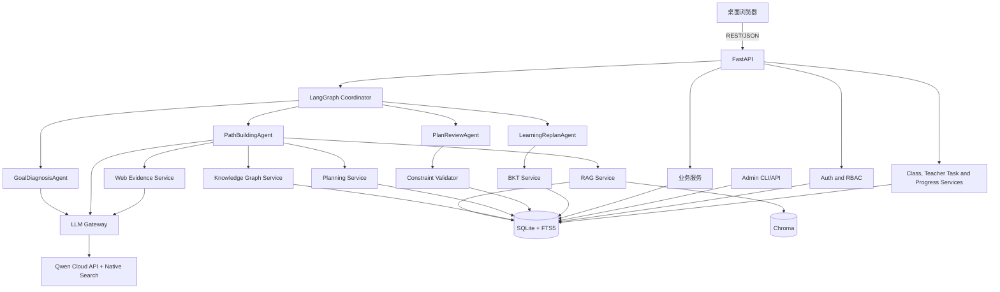
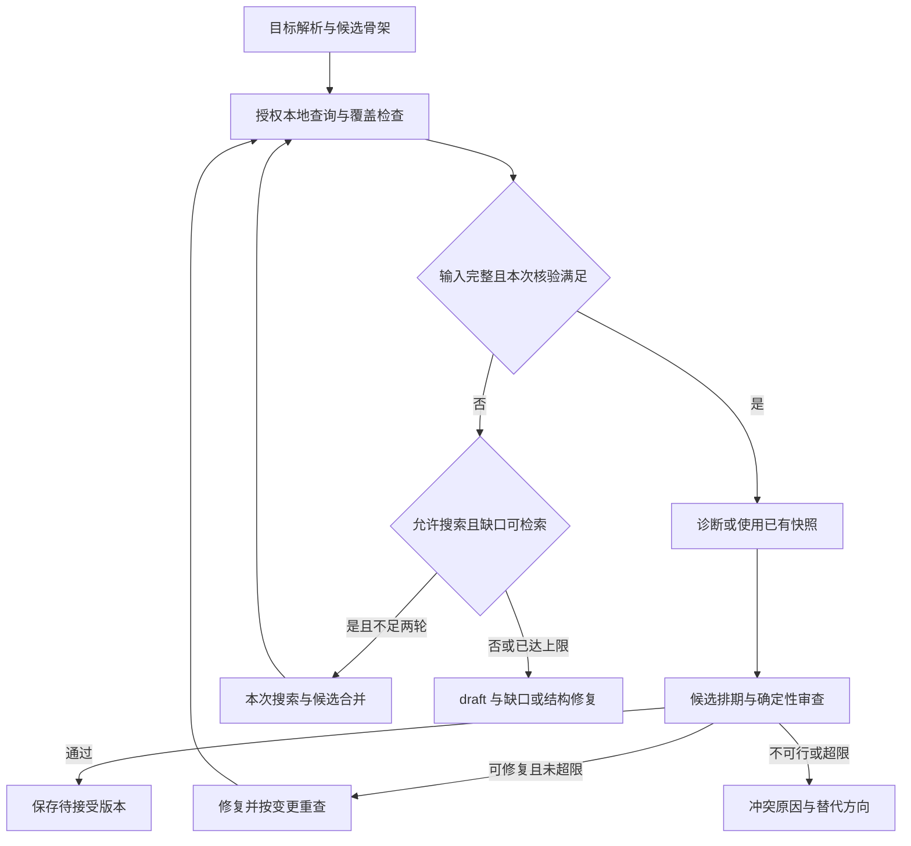
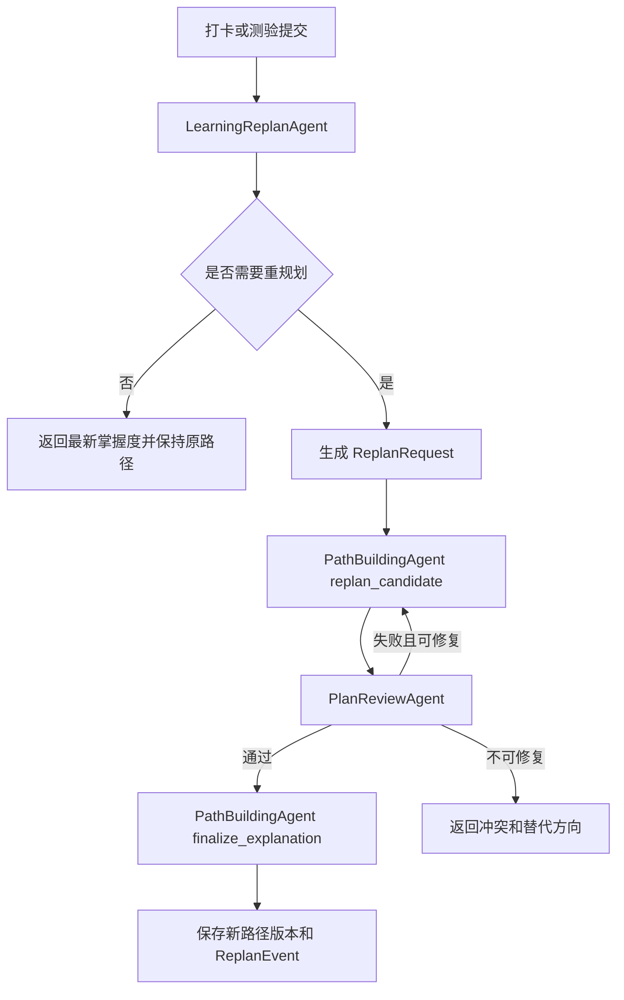

> 当前云端规划运行规则以文末“2026-11-17 审查可靠性与运行诊断修订”为准；前文180秒、90秒单调用及节点两次格式修复的旧约束已被本次修订覆盖。底层非法JSON解析修复仍共享单次调用时限，不能重置节点或总预算。

> 模块化修改入口：[13个模块技术方案与实施顺序](modules/00-index.md)。本索引补充当前技术分工，不代表全部模块已经完成改造。

# 智能学习规划助手技术设计说明书

## 当前实现基线（2026-11-17，v4.0）

> 当前基线：2026-11-17，v4.0（源码实现对照修订）；数据库迁移0030，发布标识project-delivery-2026.11.17。
> 本节为当前状态与后续验收依据；下方旧版章节保留需求编号和历史决策，发生冲突时以本节为准。127项是早期子功能基线，不再用107/127等旧计数表示当前完成度；新增能力另行追踪。
> “已实现”指存在对应源码，不等于当前8000服务已加载，也不等于真实模型、所有课程或全部工程场景均已验收。

### 当前功能范围与状态

| 功能域 | 当前已实现能力 | 使用条件与验收边界 |
| --- | --- | --- |
| 身份与班级 | 学生/教师注册登录、账号管理、班级与成员管理、角色隔离；密码及手机验证相关页面/接口 | 管理员不通过公开注册获得；短信真实发送依赖服务配置 |
| 课程与知识库 | 课程、章节、知识点、先修、题目版本、学习资料关联；学生个人资料与班级/学校资料分域 | 目录存在不代表每门课题量充足；网址不等于已授权教学正文 |
| 检索与资源处理 | 授权正文检索、索引/解析处理、外部搜索接口、资料版本与审核发布 | 向量/OCR/ASR/外搜需环境配置；个人范围搜索不返回全校资料 |
| 学习与测验 | 课程测验、题目快照、作答评分、逐知识点评价、BKT证据桥接、学习记录 | 学习分钟、观看和工程验收不直接增加知识掌握度；模型草稿题不直接充当正式已审核题 |
| 统一目标设定 | 自然语言由真实激活模型识别课程/知识点/工程，匹配真实目录与知识点，校验范围后保存 | 未覆盖能力应提示补充；OpenGL不得只匹配Python函数/递归/栈；旧目标不静默重映射 |
| 首次诊断 | 目标保存后在诊断区开始/继续作答，提交后作为规划证据 | 当前范围需要可用已审核题；不能以模型猜测代替正式答题统计 |
| 学习规划 | 四智能体诊断→构建→审查→解释保存；本地规则或云端；先修、正文、预算与版本校验 | 云端各节点应展示实际调用；本地节点明确标识确定性业务处理 |
| 路径生效与重规划 | 候选预览、差异、学生接受、版本复核、预约；手动及配置后的自动候选；保留完成历史 | 候选不自动生效；拒绝/失败保留原路径；删除候选直接操作 |
| 学习辅导 | 独立LearningTutorAgent相关接口与页面，以课程知识和证据提供帮助 | 不属于四节点规划流水线，不替代服务端判分、BKT或最终人工工程验收 |
| 工程实施 | 工程规格、最多12个总阶段、依赖/知识门控、每日排期、共享预算、阶段交付与修订 | 先完成诊断；弱知识须有已接受学习计划；OpenGL提供七阶段起步模板而非完整可执行渲染器 |
| 工程验收 | 教师/管理员逐项量规核验，冻结文件与提交哈希，退回重交，进度驱动重排 | 教师仅处理本人班级；私有工程由管理员处理；不自动执行GPU程序，不以模型自评通过 |
| 画像与运维 | 学习画像/证据快照、模型配置与管理员启用、备份迁移、运行检查点与排障报告 | 管理员允许质量未满分启用，分数仍保留；需要区分磁盘版本和服务进程实际加载版本 |

### 当前证据与未关闭问题

- 工程相关回归曾63项通过；后续工程/每日排期增量11项通过；格式修复与审查8项通过。不同批次含重叠，不相加为全部功能数量。
- 前端TypeScript/Vite构建通过，工程页面使用模拟接口跑通过学生提交→教师验收链；不代表真实模型或真实GPU执行通过。
- 数据库0030升级前已有本地备份，升级后外键检查无错误；不把数据库、密钥或个人附件当作源码发布物。
- 用户反馈运行7f7196f8a6仍使用stack runtime-v2并被审查阻断；当前源码为runtime-v3并有planning-diagnostics-v1。该现场问题未关闭，需重启后新建运行，以新标记和实际报告核验，不能仅凭health读取到release.json就认定新代码已加载。
- 该运行“基于讲义代码”实际引用原创示例存在来源表述问题，应归instructions可修复；已明确7快照的重复措辞要求应归非阻断建议。不能把全部审查意见忽略后强行通过。

### 当前技术结构与数据契约

后端沿用FastAPI/SQLite，前端React/TypeScript；四节点使用LangGraph执行，服务端业务服务拥有判分、BKT、先修、预算、权限及原子激活权。模型只输出有界提案，不直接写成绩、预约或固定材料。

| 责任 | 现有源码 |
| --- | --- |
| 统一目标解析/服务端提案 | backend/app/services/goal_interpretation.py；frontend/src/GoalCreator.tsx |
| 四节点/真实模型/契约 | services/planning.py、cloud_planning.py、cloud_contracts.py |
| 审查证据/原创示例 | services/planning_review.py、teaching_examples.py、teaching_packets.py |
| 工程规格/进度/时间分配 | services/project_delivery.py；api/projects.py；frontend/src/ProjectWorkspace.tsx |
| 全局时间/清理 | services/learning.py、goal_deletion.py；api/goals.py |
| 运行详情/报告 | api/models.py；frontend/src/RunHistory.tsx |
| 学习辅导 | api/tutor.py及对应辅导服务；独立于四节点编排 |

数据关系：课程→章节、课程知识点；题目稳定ID→题目版本→试卷项目快照→作答→知识点评价；知识点→资料关联→正文版本；课程知识点经审核映射与唯一证据桥接到目标规划知识图谱。学习时长仅记活动；有效评分观察参与掌握度。工程阶段验收另存，不污染BKT。

0030新增project_workspaces、project_delivery_plans、project_milestones、project_deliveries、project_delivery_reviews、project_worklogs。goal_id关联工程工作区/计划/阶段，提交冻结量规与证据，review关联提交；独立worklog删除目标后保留去关联分钟。活动工程计划唯一；spec version和progress_version分别跟踪，接受检查fingerprint及base active plan。

主要工程接口（前缀/api/v1）：GET/PUT /engineering-goals/{id}/workspace；POST /engineering-goals/{id}/delivery-plans；POST /engineering-goals/{id}/delivery-plans/{plan}/accept；DELETE /engineering-goals/{id}/delivery-plans/{plan}；POST .../milestones/{milestone}/submissions；GET /project-deliveries/review-inbox；POST /project-deliveries/{id}/review；GET /project-deliveries/{id}/artifacts/{resource}/download。下载逐次检查权限和冻结版本/哈希，不开放整个个人资料目录。

排期将工程预约归入project:<goal_id>，替换时只排除自身旧工程预约，仍计课程、其他目标及实际活动；同时约束全局每日/每周与根目标每周预算。阶段按依赖顺序和相关弱知识学习日期分配，接受时重算；知识掌握概率需达到0.75才能解锁相关提交，排期日期经过不代替门控。

模型返回契约校验失败最多追加两次格式修复，180秒共享截止时间；保留实际响应和请求追踪，不能通过改写approved掩盖语义问题。fixed_material须提供真实evidence_path、actual、expected；正确states和定义顺序不构成错误；instructions/citations走构建修复，suggestions不阻断。

运行checkpoint新增diagnostic_contract=planning-diagnostics-v1，GET /runs/{id}按本人权限返回diagnostics，含failed_agent、error_code、format_errors、精简model_calls、serving_runtime与legacy提示。下载报告不含原始响应、API密钥或资料正文；历史运行无法追溯未保存字段。serving_runtime来自release.json，仅作环境参考；不能据此证明进程已重新导入源码。

工程源码附件只作文本/文件证据，不执行用户代码；仓库引用需固定哈希，不自动拉取含凭证URL。图形构建、GPU执行及真实性由真实机器演示与人工量规验收，当前没有自动OpenGL执行承诺。

## 历史基线与追踪记录

> 以下保留原需求编号、设计演进和阶段验证记录，其中日期、完成率和未实现描述仅代表对应历史阶段。

**账号流程修订（2026-11-03）**：学生和教师可从登录页自助注册，设置自己的密码后返回登录。公开注册仅允许student或teacher，管理员身份通过受控初始化取得。管理员仍可管理账号并重置密码；临时密码须首次修改。此修订取代旧版关于账号仅由管理员创建的描述。


> 当前修订：2026-10-31 v3.3；新增末尾“功能模块与子功能细化基线”，共14个模块、127项子功能；旧FR/AT编号保留。

> 文档状态：四智能体、教师平台与画像技术基线
>
> 文档版本：v3.3
>
> 日期：2026-10-27
>
> 项目周期：保留十周总预算，核心交付前移至第 8 实践周；第 9 至 10 周仅作验收后维护
>
> 团队规模：2 人
>
> 需求基线：`2026-10-27-smart-learning-planner-requirements-spec.md` v3.2
>
> 设计方案：`2026-10-27-smart-learning-planner-design.md` v3.2
>
> 核心验收：学生 AI 闭环与教师班级/任务/进度闭环在同一次现场演示中连续可用

> 修订说明：2026-10-27 文档审查修订版。保留原有教师平台、云端 AI、四 Agent 和完整闭环范围；新增 FR-042 至 FR-047、AT-023 至 AT-030。本文是设计方案，不是实现或测试通过证明。未提供源码、运行版本和测试报告，完成状态均待核验。新增业务默认值属于修订建议，不冒充用户或教师已确认。

> 画像修订说明：2026-10-28 新增学生画像快照、教师班级画像快照、刷新水位和数据质量契约，新增 FR-048 至 FR-050、AT-031 至 AT-033。画像数值由确定性 SQL/Python 聚合产生，LLM 只负责解释。

> 契约示例约定：example.edu、示意ID、sha256:...、演示日期与数值均为结构占位，不是真实来源或测试证据。网页日期可为null，字段定义以SRS 5.12与技术设计20.4为准。

## 1. 文档目的

本文档将产品设计方案和需求规格转换为可开发、可测试、可部署的技术设计。它重点回答：

- 系统由哪些模块组成，各模块负责什么。
- 模块之间通过什么数据结构、接口和事务边界协作。
- 目标诊断、路径构建、质量审查和学习重规划 4 个 Agent 如何共享状态并受控协作。
- RAG、知识图谱、路径规划、规则校验和 BKT 如何共同保证结果可信。
- 两名开发者如何在不频繁冲突的前提下并行实现并完成现场闭环。

本文档不替代 SRS。用户可见行为以 SRS 为准，代码实现以本文档的模块边界和接口契约为准。

## 2. 技术目标与约束

### 2.1 技术目标

- 在 Windows 11 单机环境中运行前端、FastAPI、SQLite 和 Chroma，并通过联网调用千问云端模型。
- 现场由真实请求触发六阶段闭环，不依赖固定响应或人工改库。
- LLM 只负责理解、生成候选和解释，路径可行性由确定性算法判断。
- 所有引用可回溯到真实文档片段，所有掌握度变化可回溯到证据和参数版本。
- 所有联网引用可回溯到 URL、发布时间、抓取时间和内容哈希。
- 规划前执行覆盖门控；候选骨架可先构建，本地完整且非时效性时不联网，可搜索缺失或时效性查询才补充Web证据。
- 核心链路可恢复、可重试、可观察，并支持三次连续演示。
- 云端模型配置与业务代码解耦，可在不修改业务逻辑的情况下切换模型和搜索参数。
- 支持单学校、多教师、多班级、管理员/教师/学生角色和对象级权限。
- 教师可查看本人班级进度并向全班或指定学生布置独立任务。
- 学生可查看本人跨目标画像，教师可查看本班班级画像和班级授权学生投影。
- 教师任务计入学习负荷，但不直接修改 AI 路径。

### 2.2 关键约束

| 约束 | 技术决策 |
| --- | --- |
| 10 周、2 人 | 采用模块化单体，不引入微服务、消息队列和独立认证服务 |
| 单学校多用户 | 本地账号密码登录；管理员、教师、学生角色；不做跨学校租户 |
| 多教师多班级 | 一个班级只有一个负责教师；教师可负责多个班级，学生可加入多个班级 |
| 教师任务边界 | 独立任务表；只影响负荷和重规划建议，不写入 AI 路径节点 |
| 数据隔离 | 服务端同时校验角色和班级/学生对象归属 |
| 云端推理依赖 | 通过阿里云百炼/DashScope 调用千问，必须联网并配置有效 API Key |
| 本地数据 | SQLite、Chroma、课程资料和 Web 证据快照保存在本地 |
| 时效要求 | 最新信息查询必须本次联网搜索，按声明类型核验新鲜度，近期事件默认 30 天 |
| 数据策略 | 数据库和本地 RAG 优先，缺失项触发联网，联网合并后必须重查 |
| 隐私边界 | 只向云端发送生成所需的最小数据，API Key 仅在服务端使用 |
| 现场无缓存结果 | 核心请求必须创建新的 `agent_runs`、`agent_steps` 和业务版本记录 |
| LLM 输出不稳定 | 固定 JSON Schema、有限修复重试和确定性校验 |
| 文档可信性 | `verified` 与 `draft` 两级内容状态，`draft` 不进入正式路径 |
| 2 人协作 | 按首次计划和重规划两条业务主线分工，共享 Schema、API 和数据契约 |

## 3. 总体技术架构

### 3.1 架构选择

系统采用前后端分离的模块化单体：

- React 前端只通过 REST API 访问后端。
- FastAPI 负责请求校验、业务用例、事务和长操作状态。
- Auth/RBAC 负责登录会话、角色判断和班级对象级授权。
- Classroom、Teacher Task 和 Progress Services 负责多教师多班级平台能力。
- LangGraph Coordinator 负责四智能体的有状态路由，每个 Agent 在权限范围内调用确定性服务或 LLM Gateway。
- SQLite 保存业务状态、轨迹、Web 证据和云端模型配置。
- Chroma 保存文档向量，SQLite FTS5 保存全文检索索引。
- DashScope 千问 API 提供模型生成和原生联网搜索。
- 本系统不训练、微调或部署生成模型权重。

不采用微服务的原因：

- 两名开发者无法承担服务治理、网络容错和跨服务事务成本。
- SQLite 和 Chroma 已能覆盖课程项目数据规模。
- 单机部署更容易保证现场稳定和问题定位。

### 3.2 运行拓扑



### 3.3 进程和端口

| 进程 | 默认端口 | 职责 |
| --- | --- | --- |
| FastAPI | `127.0.0.1:8000` | API、Agent 启动和静态前端托管 |
| Vite | `127.0.0.1:5173` | 开发模式前端 |
| DashScope API | HTTPS 外部服务 | 千问生成、原生联网搜索和嵌入 |
| Admin CLI/API | 无独立监听端口 | 课程导入、模型配置和评估 |

服务只绑定回环地址。启动脚本必须进行以下检查：

1. Python 和 Node.js 是否可执行。
2. DashScope API Key 是否存在且未过期。
3. 目标千问模型和联网搜索是否可调用。
4. 端口是否被其他进程占用。
5. 数据库和 Chroma 目录是否可读写。
6. 当前激活模型配置是否通过评估。
7. 是否存在可用管理员账号；首次启动时由初始化脚本从环境变量创建，不设默认密码。

## 4. 代码组织

### 4.1 目标目录结构

本次提供的材料不含应用源码，实际仓库进度未核验。以下是目标目录结构，不代表这些模块已经存在：

```text
backend/
  app/
    main.py
    api/
      v1/
        auth.py
        classes.py
        teacher.py
        profiles.py
        goals.py
        diagnostics.py
        content.py
        paths.py
        learning.py
        replans.py
        traces.py
        admin.py
        models.py
    core/
      config.py
      errors.py
      logging.py
      idempotency.py
      time.py
    db/
      session.py
      models.py
      migrations/
      repositories/
    schemas/
      goal.py
      diagnostic.py
      content.py
      path.py
      learning.py
      replan.py
      search.py
      coverage.py
      auth.py
      classroom.py
      teacher_task.py
      progress.py
      profile.py
      model_config.py
    services/
      goals/
      auth/
      classrooms/
      teacher_tasks/
      progress/
      profiles/
      audit/
      diagnostics/
      rag/
      graph/
      coverage/
      planning/
      validation/
      bkt/
      replan/
      search/
      web_evidence/
      models/
    agent/
      state.py
      graph.py
      coordinator.py
      contracts.py
      agents/
        goal_diagnosis.py
        path_building.py
        plan_review.py
        learning_replan.py
      prompts/
    llm/
      gateway.py
      search.py
      schemas.py
  tests/
    unit/
    integration/
    api/
    e2e/

frontend/
  src/
    app/
    pages/
    features/
      goals/
      auth/
      admin/
      teacher/
      profile/
      classes/
      diagnostics/
      content/
      paths/
      tasks/
      assessments/
      replans/
      models/
      traces/
    api/
    components/
    styles/
  tests/

infra/
  scripts/
  configs/
  demo-data/

docs/
```

### 4.2 分层规则

| 层 | 可以做 | 不可以做 |
| --- | --- | --- |
| API | 解析请求、调用用例、序列化响应、映射错误 | 直接拼接 SQL、直接调用 DashScope、直接规划路径 |
| Auth/RBAC | 登录、会话、角色和对象级授权 | 信任前端隐藏菜单、绕过班级归属检查 |
| Service | 执行业务规则、事务、领域计算 | 读取 HTTP 请求对象、直接返回数据库 ORM 对象 |
| Classroom/Teacher Task | 班级成员、邀请码、教师任务和提交状态 | 修改 AI 路径节点或直接提升学习掌握度 |
| Repository | 封装查询、锁、事务和持久化 | 包含用户可见业务决策 |
| LangGraph Coordinator | 选择下一个 Agent、执行条件边、限制重试、写调度轨迹 | 生成业务内容或绕过规则 |
| Professional Agent | 组装本 Agent 上下文、调用授权工具、提交结构化状态补丁 | 直接调用其他 Agent、越权写状态、自行批准路径 |
| LLM Gateway | 统一千问模型调用、联网搜索、超时、重试和 JSON 解析 | 修改业务表、决定路径是否可行、向前端暴露 API Key |
| Web Evidence Service | 保存搜索查询、来源元数据、时效判断和内容哈希 | 宣称网页天然权威、决定路径顺序 |
| Admin CLI/API | 课程导入、模型配置、搜索评估和密钥检查 | 直接服务普通学生请求 |

业务模块之间通过 Python 接口和 Pydantic Schema 通信，不共享可变的全局状态。

## 5. 领域模型与数据设计

### 5.1 聚合边界

| 聚合 | 核心实体 | 一致性边界 |
| --- | --- | --- |
| 学习目标 | `goals`、`goal_specs` | 目标字段、版本和状态 |
| 平台账号 | `users`、`sessions`、`audit_logs` | 角色、账号状态、会话和关键操作 |
| 班级协作 | `classrooms`、`class_memberships`、`class_invites` | 班级归属、成员和邀请码 |
| 教师任务 | `teacher_tasks`、`teacher_task_assignments`、`teacher_task_submissions` | 任务定义、学生分配和提交 |
| 学习者 | `learner_profiles`、`mastery_snapshots` | 画像、掌握度和证据引用 |
| 画像快照 | `student_profile_snapshots`、`class_profile_snapshots`、`profile_refresh_events` | 统计窗口、水位、聚合版本和刷新历史 |
| 课程知识 | `course_documents`、`document_chunks`、`knowledge_nodes` | 图谱和课程索引 |
| 诊断与证据 | `assessment_items`、`assessment_attempts`、`evidence` | 作答、评分和证据 |
| 学习路径 | `learning_paths`、`path_items`、`learning_tasks` | 路径发布和任务排期 |
| 学习执行 | `checkins` | 打卡和按打卡计算的执行偏差 |
| 重规划 | `replan_events` | 原路径、新路径、原因和接受状态 |
| Agent 运行 | `agent_runs`、`agent_steps`、`generated_contents` | 单次运行和可追踪输出 |
| 知识覆盖 | `coverage_checks` | 生成前完整性判定、缺失项和搜索轮次 |
| 联网证据 | `web_search_runs`、`web_evidence` | 搜索查询、来源、时效和快照 |
| 云端配置 | `model_configs` | 千问模型、搜索策略、评估和激活 |

### 5.2 核心表

#### 5.2.1 目标与画像

| 表 | 主要字段 | 关键约束 |
| --- | --- | --- |
| `users` | `id, username, display_name, password_hash, role, status, created_at` | 管理员、教师、学生；密码只存哈希 |
| `goals` | `id, user_id, target_skill_id, raw_text, deadline, weekly_hours, daily_hours, status, version, created_at, updated_at` | 时间预算大于零；归档不删除历史 |
| `goal_specs` | `id, goal_id, version, spec_json, parse_status, created_at` | 每版不可修改；新解析生成新版本 |
| `learner_profiles` | `id, user_id, preferences_json, version, updated_at` | 每用户一条有效画像 |
| `mastery_snapshots` | `id, user_id, knowledge_node_id, previous_probability, new_probability, evidence_id, parameter_version, created_at` | 概率在 `[0,1]` |
| `student_profile_snapshots` | `id, student_id, scope_type, class_id nullable, version, stats_window_start, stats_window_end, source_watermark_json, payload_json, data_quality_json, generated_at` | 快照不可变；同一水位不重复生成相同版本 |
| `class_profile_snapshots` | `id, class_id, owner_teacher_id, version, stats_window_start, stats_window_end, source_watermark_json, payload_json, data_quality_json, generated_at` | 只聚合本班授权投影 |
| `profile_refresh_events` | `id, scope_type, scope_id, trigger_type, source_event_id, status, snapshot_id, error_json, created_at, processed_at` | 源事件唯一；失败保留错误和水位 |

#### 5.2.2 平台账号与班级

| 表 | 主要字段 | 关键约束 |
| --- | --- | --- |
| `sessions` | `id, user_id, token_hash, expires_at, revoked_at, created_at` | 每次登录创建；退出后立即撤销 |
| `classrooms` | `id, name, description, owner_teacher_id, status, created_at` | 每个班级只有一个负责教师 |
| `class_memberships` | `id, class_id, user_id, member_role, status, joined_at` | 同一班级内学生关系唯一 |
| `class_invites` | `id, class_id, code_hash, expires_at, max_uses, used_count, status, created_by` | 邀请码只存哈希；限制有效期和次数 |
| `teacher_tasks` | `id, class_id, created_by, title, description, due_at, estimated_minutes, linked_knowledge_node_id, target_type, completion_mode, resource_urls_json, status, published_at, revoked_at` | 只允许本班负责教师创建和发布 |
| `teacher_task_assignments` | `id, teacher_task_id, student_id, status, assigned_at` | 只分配给班级有效学生 |
| `teacher_task_submissions` | `id, assignment_id, student_id, submission_type, content, resource_url, submitted_at, status` | 学生只能提交自己的分配 |
| `audit_logs` | `id, actor_user_id, action, target_type, target_id, payload_json, created_at` | 不保存密码、Cookie 或 API Key |

#### 5.2.3 课程、知识图谱与题库

| 表 | 主要字段 | 关键约束 |
| --- | --- | --- |
| `course_documents` | `id, title, course_id, version, source_path, content_hash, status` | 同课程同版本不可重复导入 |
| `document_chunks` | `id, document_id, section, page, content, token_count, fts_rowid` | `chunk_id` 稳定且全局唯一 |
| `knowledge_nodes` | `id, canonical_name, domain, difficulty, estimated_hours, mastery_threshold, evidence_required, version` | 预计学时大于零 |
| `skill_nodes` | `id, name, description, level` | 名称规范化后唯一 |
| `prerequisite_edges` | `id, source_id, target_id, edge_type, weight, reason, version` | 同一有向边不重复；硬先修必须无环 |
| `knowledge_skill_map` | `knowledge_node_id, skill_node_id` | 复合主键 |
| `assessment_items` | `id, knowledge_node_id, item_type, difficulty, answer_schema, scoring_rule, status` | 每题必须映射知识节点 |

#### 5.2.4 路径与学习执行

| 表 | 主要字段 | 关键约束 |
| --- | --- | --- |
| `learning_paths` | `id, goal_id, parent_path_id, status, version, total_hours, risk_score, content_status, model_config_id, created_at` | 发布后只读 |
| `path_items` | `id, path_id, knowledge_node_id, sequence, planned_hours, state, unlock_rule` | 同一路径无重复节点 |
| `learning_tasks` | `id, path_item_id, title, task_type, planned_minutes, due_date, status` | 分钟数大于零 |
| `checkins` | `id, task_id, actual_minutes, completion_ratio, difficulty_feedback, note, planned_minutes_snapshot, schedule_delta_minutes, completion_delta, idempotency_key, created_at` | 幂等键唯一；偏差由本次打卡计算 |
| `assessment_attempts` | `id, item_id, user_id, answer_json, score, idempotency_key, submitted_at` | 同一幂等键返回原结果 |
| `evidence` | `id, user_id, knowledge_node_id, source_type, source_id, score, payload_json, created_at` | 来源记录必须存在 |
| `replan_events` | `id, path_id, new_path_id, trigger_type, before_json, after_json, reason, accepted, created_at` | 每次调整必须可比较前后路径 |

#### 5.2.5 Agent、联网搜索与云端配置

| 表 | 主要字段 | 关键约束 |
| --- | --- | --- |
| `agent_runs` | `id, user_id, goal_id, workflow_type, graph_version, state_version, model_config_id, search_enabled, prompt_version, status, started_at, finished_at, request_hash, cloud_data_scope_json` | 每次现场核心请求创建新记录 |
| `agent_steps` | `id, run_id, sequence, agent_name, node_name, action, input_json, output_json, duration_ms, status, error_json` | 同一运行内序号唯一 |
| `coverage_checks` | `id, run_id, goal_id, input_version, is_complete, time_sensitive, search_allowed, search_required, search_round, gaps_json, checked_at` | 每次规划或修复前必须引用输入版本一致的检查记录 |
| `generated_contents` | `id, run_id, goal_id, model_config_id, content_type, status, payload_json, citations_json` | `draft` 不可作为正式路径输入 |
| `idempotency_records` | `scope, idempotency_key, request_hash, response_json, created_at` | 主键为 `scope + idempotency_key` |
| `web_search_runs` | `id, agent_run_id, query, provider, search_enabled, status, result_count, queried_at, error_json` | 每次搜索记录新查询和状态 |
| `web_evidence` | `id, search_run_id, title, url, domain, snippet, published_at, fetched_at, content_hash, source_rank, trust_level, status` | URL 与内容哈希不可无记录覆盖 |
| `model_configs` | `id, provider, model_name, search_enabled, parameters_json, prompt_version, secret_ref, evaluation_json, status, activated_at` | 未通过评估不得激活；不保存密钥明文 |

### 5.3 SQLite 配置

- 启用外键约束、WAL 日志和 `busy_timeout`。
- 单进程内使用短事务，不在 LLM 调用期间持有写事务。
- 所有写操作通过 Repository 执行。
- 时间统一保存为 UTC ISO 8601 字符串。
- JSON 字段保存前经过 Pydantic Schema 校验。
- 路径、BKT 参数、图谱和模型配置采用不可变版本记录。
- 数据库迁移使用版本化 SQL 或 Alembic，不在应用启动时静默破坏性重建。

### 5.4 数据不变量

1. draft内容不得进入active正式路径；允许draft路径对象供编辑。
2. 发布路径必须引用通过 VR-001 至 VR-008 的校验结果。
3. 硬先修边组成的子图必须是无环图。
4. 每份证据必须能追溯到测验作答、打卡或人工确认记录。
5. 每次 BKT 更新必须引用参数版本和证据 ID。
6. 每次重规划必须生成新路径版本和 `ReplanEvent`。
7. 每个新的现场核心业务请求创建 `agent_run`；同键重试复用原运行。普通账号、打卡等确定性操作保留业务/审计记录，无需强制调用 Agent。
8. 激活模型配置必须具有评估记录和通过的评估状态。
9. Agent 只能写字段所有权表内的字段，状态补丁必须引用当前 `state_version`。
10. 正式路径必须存在 `PlanReviewAgent` 的通过结果。
11. 重规划候选路径必须复用 `PathBuildingAgent` 和 `PlanReviewAgent`。
12. 最新或时效性声明必须引用本次搜索产生的 Web 证据。
13. Web 引用必须具有 URL、抓取时间和内容哈希。
14. API Key 不得写入任何业务表或 Agent 轨迹。
15. 正式路径必须引用一次 `is_complete = true` 的覆盖检查。
16. 非时效性且本地完整时，不允许产生联网搜索调用记录。
17. 用户角色只能是 `admin`、`teacher` 或 `student`，账号停用后不得建立新会话。
18. 一个班级只有一个负责教师；教师只能操作本人班级。
19. 教师任务不得写入 `path_items`，任务分配只允许指向班级有效学生。
20. 学生只能读取和提交自己的教师任务分配。
21. 账号停用、任务发布、任务撤回和越权尝试必须写入审计日志。
22. 画像快照不可原地修改，刷新必须创建新版本。
23. 每个画像快照必须保存统计窗口、源事件水位、数据质量和规则版本。
24. 班级画像只能聚合本班授权投影，不得引用私人目标、其他班级证据或隐藏备注。
25. 任一新画像事件改变水位后，旧快照标记 `stale`，读取路径不得把它当作最新状态。
26. 画像数值和风险事实必须由确定性聚合生成，LLM 只能解释已计算字段。

## 6. 核心组件设计

### 6.1 Goal Service

职责：

- 创建、读取、修改和归档目标。
- 将自然语言目标提交给 Agent 解析。
- 保存 `GoalSpec` 版本并校验时间字段。
- 在目标时间预算变化时触发重规划评估。

关键接口：

```python
class GoalService:
    def create_goal(self, request: GoalCreate) -> GoalDetail: ...
    def revise_goal(self, goal_id: str, request: GoalRevise) -> GoalDetail: ...
    def archive_goal(self, goal_id: str) -> None: ...
```

`GoalSpec` 至少包含：

```json
{
  "goal_text": "学习后端开发并掌握数据结构与算法",
  "target_skill_ids": ["skill-backend-basic"],
  "deadline": "2026-12-31",
  "weekly_hours": 10,
  "daily_hours": 2,
  "preferred_modes": ["reading", "coding"],
  "constraints": {
    "avoid_weekends": false,
    "max_session_minutes": 90
  },
  "completion_criteria": []
}
```

无法映射已有或已校验候选目标技能时，服务保存 `parse_status = needs_revision`，向前端返回可修改字段，不创建正式路径。

### 6.2 Diagnostic Service

职责：

- 根据目标技能的反向先修子图选择知识节点。
- 按关键节点覆盖、难度和已有证据生成诊断题。
- 将作答映射到知识节点并生成初始掌握度。
- 标记未覆盖或低置信度节点。

诊断题选择规则：

1. 目标关键节点优先于扩展节点。
2. 每个关键节点至少有一个诊断证据或显式低置信度标记。
3. 已有有效证据且未过期的节点可减少题量。
4. 同一知识点避免超过两道同难度题。
5. 题目总预计耗时显示在开始诊断前。

评分输出：

```json
{
  "diagnostic_id": "diag-001",
  "node_results": [
    {
      "knowledge_node_id": "python-function",
      "score": 0.5,
      "mastery": 0.42,
      "confidence": 0.7,
      "evidence_ids": ["ev-diag-001"]
    }
  ]
}
```

### 6.3 LLM Gateway 与联网搜索

职责：

- 生成请求并调用阿里云百炼/DashScope 千问 API。
- 启用原生联网搜索并标准化返回来源。
- 应用提示词模板、模型配置、搜索策略、温度和超时。
- 对 JSON 输出执行 Schema 校验。
- 在格式失败时执行最多两次修复重试。
- 处理鉴权失败、限流、配额不足和搜索不可用。

接口：

```python
class LLMGateway:
    async def generate_json(
        self,
        task_type: str,
        prompt_version: str,
        payload: dict,
        schema: type[BaseModel],
        model_config_id: str,
        enable_search: bool,
        timeout_seconds: int = 90,
    ) -> LLMResult: ...
```

`LLMResult` 包含：

- `data`：通过 Schema 的结构化结果。
- `raw_text`：仅用于诊断，不写入业务表。
- `model_config_id`、`prompt_version`、`search_enabled`、`duration_ms`。
- `search_results`：标准化 Web 证据列表。
- `repair_attempts`。

约束：

- 业务服务不得直接调用 DashScope。
- API Key 只能由服务端从环境变量或本地密钥文件读取。
- 校验失败且超过重试上限时抛出 `LLM_SCHEMA_INVALID`。
- LLM 不得接收或返回数据库连接、文件路径或未授权资料。
- 最新或时效性声明必须带有本次请求的 Web 证据。
- 搜索结果缺少发布时间且无法核验版本或声明时，内容只能标记 `draft`。
- API Key 不得出现在日志、异常详情、前端响应或 `agent_steps`。

Web 证据处理：

1. 将搜索查询、结果标题、URL、摘要和来源域名写入 `web_search_runs` 与 `web_evidence`。
2. 记录检索时间和内容哈希。
3. 校验 URL 协议、域名和可访问性。
4. 时效性声明按声明类型计算 `freshness_status`。
5. 将来源标记为 `official`、`professional`、`community` 或 `unknown`。
6. 只有通过授权、来源、声明支持与适用新鲜度核验的证据可支撑verified内容。

### 6.4 Knowledge Coverage Checker

职责：

- 在调用生成模型前检查本地数据库、图谱和 RAG 是否足够生成完整计划。
- 判断查询是否具有时效性，决定是否必须联网。
- 输出结构化缺失项，驱动搜索查询和后续修复。
- 在 Web 证据合并后再次检查，最多允许 2 轮。

接口：

```python
class KnowledgeCoverageChecker:
    def check(
        self,
        goal_spec: GoalSpec,
        graph_snapshot: GraphSnapshot,
        evidence_items: list[EvidenceItem],
        time_sensitive: bool,
        search_allowed: bool,
    ) -> CoverageResult: ...
```

覆盖结果：

```json
{
  "coverage_id": "coverage-001",
  "goal_id": "goal-001",
  "is_complete": false,
  "time_sensitive": false,
  "search_allowed": true,
  "search_required": true,
  "search_round": 0,
  "missing_items": [
    {
      "gap_type": "MISSING_EVIDENCE",
      "node_id": "algo-complexity",
      "reason": "本地 RAG 未找到可引用材料"
    }
  ],
  "checked_at": "2026-10-27T08:00:00Z"
}
```

检查规则：

- `local_complete` 表示本地授权数据是否足够，`is_complete` 表示当前输入版本的目标映射、图结构、学时、题目与证据是否齐全。
- 目标解析允许先生成不发布的候选技能/知识骨架；新主题在候选区完成本地查询、按需搜索、候选节点/题目/学时构建与确定性校验，再生成诊断。不要求未知目标先有正式图谱 ID。
- 完成诊断后按最新掌握度再次检查并排期。覆盖检查是规划门槛，不是禁止生成缺失候选内容的门槛。
- `needs_current_search = time_sensitive and not current_search_satisfied`，其中满足条件须包含本 run 搜索记录及对应声明核验；不能仅凭模型声称已搜索。
- `search_required = search_allowed and not structural_blocked and search_round < 2 and (has_searchable_gap or needs_current_search)`。
- `GRAPH_INVALID`、非法学时和预算不足直接进入修复/不可行分支，不把结构或预算问题误当作网页搜索可解决的问题。叶子基础节点可显式标记无先修。
- 非时效性且本地完整时 `search_required=false`；仅上传资料模式下本地完整的非时效性内容仍可通过，只有确有缺失或无法核验的声明保持 `draft`。
- 每轮“搜索→构建/合并候选→复查”后递增 `search_round`；最多 2 轮。不完整且不允许搜索时立即返回 `draft`，不得悬挂。
- 本次搜索已满足时效核验且 `is_complete=true` 后进入规划，不因 `time_sensitive=true` 再次搜索。校验修复只有输入版本改变时重查。

`gap_type` 固定枚举：

- `MISSING_SKILL_MAPPING`
- `MISSING_NODE`
- `MISSING_PREREQUISITE`
- `MISSING_ESTIMATED_HOURS`
- `MISSING_ASSESSMENT`
- `MISSING_EVIDENCE`
- `STALE_EVIDENCE`
- `GRAPH_INVALID`

### 6.5 RAG Service

职责：

- 导入 Markdown、TXT 和文本型 PDF。
- 提取文档、章节、页码和版本元数据。
- 生成稳定 `chunk_id`，写入 Chroma 和 SQLite FTS5。
- 执行向量与关键词混合检索。
- 返回真实引用，不生成虚假来源。

导入流程：

1. 校验扩展名、文件大小、路径和内容哈希。
2. 解析文本，识别标题和章节。
3. 按标题和 token 上限切分，保留页码。
4. 生成 `document_id / chunk_id`。
5. 通过嵌入模型生成向量并写入 Chroma。
6. 将文本和检索元数据写入 SQLite。
7. 校验向量记录和全文记录数量一致。
8. 事务失败时删除本次临时索引并回滚元数据。

混合检索：

```text
vector_score_normalized = normalize(vector_distance)
final_score = 0.65 * vector_score_normalized
            + 0.35 * normalized_bm25_score
```

默认流程：

- 候选召回 8 个片段。
- 应用课程、知识域、文档版本和软删除过滤。
- 按 `final_score` 排序，返回前 5 个。
- 低于最低阈值时返回 `evidence_insufficient`。

引用对象：

```json
{
  "document_id": "doc-python-001",
  "chunk_id": "doc-python-001-c03",
  "title": "Python 程序设计课程大纲",
  "section": "函数与模块",
  "page": 12,
  "score": 0.82
}
```

引用校验规则：

- `chunk_id` 必须存在于当前可用索引。
- `document_id` 必须与片段记录一致。
- 软删除文档只能展示历史引用，不得作为新生成依据。
- Citation Validator 删除模型虚构引用，并降低内容可信级别。

### 6.6 Knowledge Graph Service

职责：

- 管理知识节点、技能节点、先修边和题目映射。
- 提取目标技能的反向先修子图。
- 合并模型候选节点并进行实体归一化。
- 校验 DAG、孤立节点和必须映射关系。

边类型：

- `HARD_PREREQUISITE`
- `SOFT_PREREQUISITE`
- `MAPS_TO_SKILL`
- `COVERED_BY_COURSE`
- `ASSESSED_BY`

实体归一化顺序：

1. ID 精确匹配。
2. 规范化名称精确匹配。
3. 别名表匹配。
4. 去除空白、大小写和常见标点后的名称匹配。
5. 无法匹配时创建候选节点，不自动合并到高影响节点。

图写入规则：

- 写入硬先修边前执行环路检测。
- 检测到环时返回完整环路和冲突边。
- 已发布路径不重新绑定节点版本。
- 图版本变化后，新规划使用新版本，历史解释保留旧版本。

### 6.7 Planning Service

职责：

- 从目标技能提取必需知识子图。
- 根据有效掌握度删除已掌握节点。
- 对未掌握节点执行拓扑排序。
- 将节点分配到可用时间窗口。
- 生成主路径和候选替代顺序。

算法步骤：

1. 先通过knowledge_skill_map定位target_skill_ids对应知识节点，再沿source→target硬先修边反向遍历，得到硬先修闭包。
2. 加入软先修节点作为可选候选。
3. 过滤掌握概率达到阈值且证据有效的节点。
4. 合并模型候选节点，但以图谱现有节点优先。
5. 对剩余子图执行 Kahn 拓扑排序。
6. 使用风险函数对同层可排序节点排序。
7. 按每日最大时长和每周时间预算生成时间窗口。
8. 生成主路径和至多两个替代顺序。
9. 交给 Constraint Validator 校验。
10. 校验失败时根据 `repair_hint` 执行有限修复。

风险函数：

```text
risk = 0.50 * prerequisite_gap
     + 0.25 * schedule_pressure
     + 0.15 * difficulty_jump
     + 0.10 * context_switch
```

排序规则必须确定性可复现：

- 同风险值按先修层级、难度和节点 ID稳定排序。
- 不因随机种子不同改变主路径。
- 模型候选顺序只作为软先修排序输入，不覆盖硬先修。

时间分配：

- 每节点按预计学时拆分为不超过每日最大时长的任务。
- 不跨日拆分短任务，除非单节点超过每日上限。
- 周末限制和偏好影响时间窗口，不改变硬先修顺序。
- 剩余时间不足时返回 `PLAN_INFEASIBLE` 和替代方向。

### 6.8 Constraint Validator

校验器是纯函数式规则层，不调用 LLM。

| 规则 | 校验 | 失败结果 |
| --- | --- | --- |
| VR-001 | 硬先修已掌握或排在目标节点前 | `missing_prerequisite` |
| VR-002 | 总学时不超过预算 | `time_budget_exceeded` |
| VR-003 | 每日和每周负荷不超上限 | `load_limit_exceeded` |
| VR-004 | 路径节点不重复 | `duplicate_node` |
| VR-005 | `verified` 节点有真实引用 | `missing_citation` |
| VR-006 | 验收任务映射有效知识点 | `invalid_assessment_mapping` |
| VR-007 | 已完成任务与旧计划结构只读，补强创建新任务 | `completed_history_modified` |
| VR-008 | 重规划不破坏未完成硬先修 | `replan_prerequisite_conflict` |

统一输出：

```json
{
  "is_valid": false,
  "errors": [
    {
      "rule_id": "VR-001",
      "node_id": "algo-recursion",
      "message": "递归需要函数与调用栈基础",
      "related_node_ids": ["python-function"]
    }
  ],
  "repair_hint": "insert_before",
  "checked_at": "2026-10-20T08:00:00Z"
}
```

规则实现必须覆盖：

- 输入不可变，校验不修改候选路径。
- 错误顺序稳定，便于前端和测试比较。
- 每条错误可映射到至少一个节点或全局字段。
- LLM 解释不能覆盖 `is_valid = false`。

### 6.9 BKT Service

职责：

- 按知识节点读取版本化 BKT 参数。
- 从有效证据计算掌握度后验概率。
- 保存更新前后的快照。
- 判断是否达到掌握阈值。

参数：

| 参数 | 默认范围 |
| --- | --- |
| `p_init` | 由诊断结果初始化 |
| `p_learn` | `0.15` 至 `0.30` |
| `p_slip` | `0.05` 至 `0.15` |
| `p_guess` | 根据题型配置 |

更新公式：

```text
P(L_t | correct) = P(L_t)(1 - p_slip)
                 / [P(L_t)(1 - p_slip) + (1 - P(L_t))p_guess]

P(L_t | wrong) = P(L_t)p_slip
               / [P(L_t)p_slip + (1 - P(L_t))(1 - p_guess)]

P(L_{t+1}) = P(L_t | evidence)
           + (1 - P(L_t | evidence)) * p_learn
```

实现要求：

- 输入概率和参数先做范围校验。
- 分母为零或非法参数时返回 `BKT_PARAMETER_INVALID`，不得静默使用 NaN。
- 同一证据 ID 只能应用一次。
- 缺失参数时使用带版本的默认参数，并在快照中记录回退原因。

### 6.10 Evidence Evaluation

题型处理：

| 题型 | 评分方式 |
| --- | --- |
| 单选、多选、判断 | 按 `answer_schema` 确定性评分 |
| 填空 | 规范化文本与可接受答案集合匹配 |
| 简答 | 规则评分或 LLM 生成建议，最终分数需规则确认 |
| 代码题 | 本期不执行代码，按答案 Schema、评分规则或人工确认生成证据 |

LLM 评分约束：

- LLM 返回值必须包含 `score`、`rationale` 和 `confidence`。
- 业务分数必须由可重复执行的版本化rubric或有权教师确认；仅截断LLM分数范围不能证明评分正确。
- 评分失败不创建证据，不触发 BKT。
- 原始答案按隐私要求处理，日志只保存摘要或哈希。

### 6.11 Replan Service

职责：

- 计算执行偏差。
- 判断是否触发局部或全局重规划。
- 生成新路径版本和前后差异。
- 支持学生接受或拒绝。

触发条件：

- 掌握度低于 `0.45`。
- 连续两个计划任务到期未完成。
- 学习时间或截止日期变化。
- 新证据与高掌握度冲突。
- 目标范围变化。

决策矩阵：

| 条件 | 动作 |
| --- | --- |
| 单节点低于0.45补强阈值 | 在原节点下新增补强任务并顺延后续 |
| 连续两次未完成 | 降低任务粒度或重排时间窗口 |
| 时间预算变化不超过 30% | 优先局部重排 |
| 时间预算变化超过 30% | 全局重规划 |
| 目标技能或范围变化 | 全局重规划 |
| 多个关键节点持续不达标 | 全局重规划 |

重规划必须由 `LearningReplanAgent` 生成结构化 `ReplanRequest`，再经 Coordinator 调度 `PathBuildingAgent.replan_candidate` 复用 GraphPlanner，并由 `PlanReviewAgent` 复用 Constraint Validator。不允许存在“绕过校验”的路径。

### 6.12 Cloud Model Config Registry

职责：

- 注册 DashScope 模型名、搜索开关、生成参数和提示词版本。
- 保存固定问题集的搜索与生成评估指标。
- 控制配置激活和回退。

状态：

```text
registered -> evaluating -> approved -> active
                         \-> rejected
active -> inactive
```

激活规则：

- 状态必须为 `approved`。
- 搜索与生成评估结果必须存在。
- 记录激活时间和前一个激活配置。
- API Key 或模型连接检查失败时恢复前一配置。

### 6.13 Auth and RBAC

职责：

- 用户名/密码登录、退出和当前身份查询。
- 使用 Argon2 或 bcrypt 校验密码哈希。
- 签发 HttpOnly 安全会话 Cookie，服务端保存会话哈希。
- 统一执行角色和对象级权限判断。

接口：

```python
class AuthorizationService:
    def require_role(self, user: User, roles: set[str]) -> None: ...
    def require_class_access(self, user: User, class_id: str) -> Classroom: ...
    def require_student_access(self, user: User, class_id: str, student_id: str) -> None: ...
    def require_assignment_owner(self, user: User, assignment_id: str) -> None: ...
```

权限矩阵：

| 操作 | 管理员 | 教师 | 学生 |
| --- | --- | --- | --- |
| 创建/停用教师与学生账号 | 允许 | 拒绝 | 拒绝 |
| 创建班级 | 拒绝 | 允许 | 拒绝 |
| 查看班级进度 | 默认拒绝 | 仅本人班级 | 仅本人 |
| 发布教师任务 | 拒绝 | 仅本人班级 | 拒绝 |
| 查看任务提交 | 拒绝 | 仅本人班级 | 仅本人提交 |
| 提交教师任务 | 拒绝 | 拒绝 | 仅本人分配 |

修改数据的请求必须校验 CSRF 或使用严格同源策略。

### 6.14 Classroom Service

职责：

- 教师创建、查看和归档本人班级。
- 生成、撤回和校验班级邀请码。
- 学生通过邀请码加入班级。
- 查询班级成员和负责教师。

规则：

- 教师只能创建自己负责的班级。
- 邀请码保存哈希，校验有效期、使用次数和状态。
- 学生重复加入同一班级时返回幂等结果。
- 班级归档后禁止新增成员和教师任务。
- 教师跨班访问必须在 Service 层拒绝，不依赖前端隐藏。

### 6.15 Teacher Task Service

职责：

- 创建一次性教师任务。
- 按全班或指定学生生成任务分配。
- 发布、撤回任务并处理学生提交。
- 计算教师任务对每日/每周学习负荷的影响。

任务状态：

```text
draft -> published -> revoked
published -> closed
```

学生分配状态：

```text
not_started -> in_progress -> completed
not_started/in_progress -> overdue
```

学生成功提交打卡、文本或链接时写入 `teacher_task_submissions`，并在同一事务中将分配状态更新为 `completed`。普通打卡/文本/链接任务完成不以教师审批为前提；涉及主观测验掌握证据时须有有效rubric评分，待复核不更新BKT。

约束：

- 教师任务不得写入 `path_items`。
- 任务目标和成员必须属于同一班级。
- 全班任务在发布时生成当前有效学生的分配记录。
- 指定学生任务只允许选择该班成员。
- 教师任务时长计入负荷检查；冲突时只返回重规划建议。
- 学生只能提交自己的分配，重复提交使用幂等键或版本控制。

### 6.16 Student and Class Profile Services

#### 6.16.1 Student Profile Service

职责：

- 聚合学生本人授权事实并生成版本化画像快照。
- 计算学习上下文、行为、掌握状态、证据质量、风险和完整度。
- 按事件水位判断快照是否过期。
- 返回本人完整画像；教师端只能从班级投影接口读取。

接口：

```python
class StudentProfileService:
    def get_current(self, student_id: str, scope: ProfileScope) -> StudentProfileSnapshot: ...
    def refresh_if_stale(
        self, student_id: str, scope: ProfileScope, trigger_event_id: str
    ) -> StudentProfileSnapshot: ...
    def list_history(
        self, student_id: str, scope: ProfileScope, limit: int = 20
    ) -> list[StudentProfileSnapshot]: ...
```

学生画像载荷：

```json
{
  "learning_context": {
    "active_goal_count": 2,
    "joined_class_count": 1,
    "weekly_minutes": 600,
    "preferred_modes": ["reading", "coding"]
  },
  "learning_behavior": {
    "actual_minutes_7d": 180,
    "completion_rate": 0.75,
    "on_time_rate": 0.67,
    "last_active_at": "2026-10-28T08:00:00Z"
  },
  "mastery_state": {
    "mastered_nodes": ["python-function"],
    "weak_nodes": ["algo-recursion"],
    "unknown_nodes": ["algo-graph"]
  },
  "evidence_quality": {
    "valid_evidence_count": 12,
    "pending_review_count": 1,
    "coverage_ratio": 0.86
  },
  "risk_summary": {
    "level": "medium",
    "reasons": ["recent mastery below 0.45", "two overdue tasks"]
  },
  "data_quality": {
    "window_start": "2026-10-21T00:00:00Z",
    "window_end": "2026-10-28T00:00:00Z",
    "completeness": 0.91,
    "rule_version": "profile-rules-v1",
    "stale": false
  }
}
```

#### 6.16.2 Class Profile Service

职责：

- 聚合教师班级画像。
- 统计完成率、按时率、逾期学生数、学习时长、掌握度分布、共性薄弱点和风险学生。
- 只使用班级授权投影和本班证据来源。
- 保存统计窗口、数据水位、覆盖率及过期状态。

接口：

```python
class ClassProfileService:
    def get_current(
        self, class_id: str, teacher_id: str, window: ProfileWindow
    ) -> ClassProfileSnapshot: ...
    def refresh_if_stale(
        self, class_id: str, teacher_id: str, trigger_event_id: str
    ) -> ClassProfileSnapshot: ...
    def get_student_projection(
        self, class_id: str, teacher_id: str, student_id: str
    ) -> ClassStudentProjection: ...
    def list_history(
        self, class_id: str, teacher_id: str, limit: int = 20
    ) -> list[ClassProfileSnapshot]: ...
```

班级画像载荷：

```json
{
  "class_scope": {
    "class_id": "class-001",
    "owner_teacher_id": "teacher-001",
    "window_start": "2026-10-21T00:00:00Z",
    "window_end": "2026-10-28T00:00:00Z"
  },
  "participation": {
    "active_students": 28,
    "students_with_evidence": 24,
    "coverage_ratio": 0.857
  },
  "task_metrics": {
    "completion_rate": 0.68,
    "on_time_rate": 0.61,
    "overdue_students": 5
  },
  "learning_time": {
    "actual_minutes_total": 3240
  },
  "mastery_distribution": [
    {"knowledge_node_id": "algo-recursion", "weak": 6, "in_progress": 9, "mastered": 13}
  ],
  "common_weak_nodes": ["algo-recursion", "algo-graph"],
  "risk_students": [
    {"student_id": "student-007", "reasons": ["overdue_task"], "observed_at": "2026-10-28T08:00:00Z"}
  ],
  "data_quality": {
    "completeness": 0.92,
    "rule_version": "profile-rules-v1",
    "stale": false
  }
}
```

#### 6.16.3 Refresh Rules

- 诊断提交、打卡、教师任务提交、资源学习、评分、BKT 更新、目标关联/取消、班级成员变化均写入领域事件。
- Profile Refresh Service 只根据事件 ID 幂等消费，并比较 `source_watermark_json`。
- 水位未变化时返回当前快照；水位变化时生成新版本，旧版本只读。
- 刷新失败保留上一有效快照并标记 `stale`，错误写入 `profile_refresh_events.error_json`。
- 统计指标由 SQL/Python 确定性计算；LLM 只能基于快照事实生成解释。
- 无分母显示“暂无数据”，不返回伪造的 0% 或 0 分钟。

## 7. 四智能体工作流设计

### 7.1 设计原则

系统采用 `1 个 LangGraph Coordinator + 4 个专业 Agent` 的受控协作模式。

- Coordinator 是确定性调度器，负责读取共享状态、选择下一个 Agent、执行条件边和限制重试。
- Coordinator 不是第 5 个自治 Agent，不生成目标、内容、路径或解释。
- 四个专业 Agent 共享 `AgentState`，彼此不直接调用，也不进行自由文本协商。
- Agent 只能调用权限表内的工具，只能写入自己拥有的状态字段。
- 正式路径必须由 `PlanReviewAgent` 调用确定性校验工具后批准。
- 重规划候选路径必须复用 `PathBuildingAgent` 和 `PlanReviewAgent`。

### 7.2 Agent 职责与工具权限

| Agent | 输入 | 核心处理 | 允许工具 | 输出 | 禁止事项 |
| --- | --- | --- | --- | --- | --- |
| `GoalDiagnosisAgent` | 原始目标、学生基础、历史画像 | 目标解析、诊断规划、诊断评估、画像初始化 | LLM Gateway、题库、诊断评估、BKT 初始化 | `GoalSpec`、`diagnostic_plan`、`learner_snapshot` | 不生成路径，不写正式内容 |
| `PathBuildingAgent` | `GoalSpec`、`LearnerSnapshot`、可选 `ReplanRequest` | 本地查询、覆盖检查、按需联网、知识拆解、图谱合并、图搜索、任务拆解、计划解释 | LLM Gateway、KnowledgeCoverageChecker、Web Search、RAG、Knowledge Graph、Planning Service | `coverage_result`、`evidence_chunks`、`web_evidence`、`candidate_content`、`candidate_path`、`explanation` | 不自行批准路径，不在本地完整时无故联网 |
| `PlanReviewAgent` | 候选内容、候选路径、本地/联网证据和规则上下文 | Schema 审查、引用与时效审查、可信级别、路径约束校验 | Schema/Citation/Content/Constraint Validators、LLM Gateway（仅审查说明） | `review_result`、`content_status`、错误和 `repair_hint` | 不使用 LLM 覆盖规则结论，不生成或修改候选内容 |
| `LearningReplanAgent` | 打卡、测验答案、原路径和掌握度 | 执行偏差、证据评分、BKT 更新、重规划判断和差异说明 | ExecutionMonitor、EvidenceEvaluator、BKTUpdater、ReplanDecider、ReplanNarrator | `execution_snapshot`、`mastery_updates`、`replan_request` | 不直接发布新路径，不跳过 BKT |

`PathBuildingAgent` 支持以下动作：

- `initial_candidate`：首次候选路径。
- `repair_candidate`：根据 `PlanReviewAgent` 的规则错误修复候选路径。
- `replan_candidate`：根据 `ReplanRequest` 生成调整后的候选路径。
- `finalize_explanation`：审核通过后生成最终路径解释。

### 7.3 AgentState

```text
AgentState
  run_id
  user_id
  goal_id
  workflow_type
  active_agent
  state_version
  model_config_id
  search_enabled
  prompt_version
  goal_spec
  diagnostic_plan
  diagnostic_answers
  learner_snapshot
  planning_mode
  coverage_result
  missing_items
  search_round
  evidence_chunks
  candidate_content
  content_status
  graph_subgraph
  candidate_path
  review_result
  explanation
  execution_snapshot
  mastery_updates
  replan_request
  new_path
  agent_retry_counts
  errors
  trace_refs
```

`workflow_type` 取值：

- `initial_plan`：首次目标、诊断和计划。
- `content_review`：内容与路径独立审核。
- `learning_update`：打卡或测验证据处理。
- `replan`：时间、执行或证据触发重规划。
- `finalize_explanation`：审核通过后的解释生成。

### 7.4 状态字段所有权

| 写入方 | 可写字段 |
| --- | --- |
| Coordinator | `active_agent`、`state_version`、`agent_retry_counts`、`errors`、`trace_refs` |
| GoalDiagnosisAgent | `goal_spec`、`diagnostic_plan`、`diagnostic_answers`、`learner_snapshot` |
| PathBuildingAgent | `planning_mode`、`coverage_result`、`missing_items`、`search_round`、`evidence_chunks`、`candidate_content`、`graph_subgraph`、`candidate_path`、`explanation`、`new_path`（审核通过后的最终引用） |
| PlanReviewAgent | `content_status`、`review_result` |
| LearningReplanAgent | `execution_snapshot`、`mastery_updates`、`replan_request` |

状态写入采用乐观版本控制。Agent 返回的 `state_patch.base_version` 必须等于当前 `state_version`，否则 Coordinator 返回 `STATE_VERSION_CONFLICT`，不得覆盖其他 Agent 的结果。

### 7.5 Agent 交接契约

每个 Agent 接收统一任务信封，并返回统一结果：

```json
{
  "agent": "PathBuildingAgent",
  "action": "initial_candidate",
  "run_id": "run-20261020-001",
  "state_version": 4,
  "input_refs": ["goal_spec", "learner_snapshot"],
  "constraints": {
    "max_retries": 3,
    "timeout_seconds": 120
  },
  "trace_id": "trace-20261020-001"
}
```

```json
{
  "status": "completed",
  "next_action": "review_candidate_path",
  "state_patch": {
    "base_version": 4,
    "candidate_path": {},
    "candidate_content": {},
    "evidence_chunks": []
  },
  "output_refs": ["candidate_path"],
  "errors": [],
  "metrics": {
    "duration_ms": 1820,
    "llm_calls": 2,
    "tool_calls": 3
  }
}
```

交接要求：

- Agent 不直接调用另一个 Agent。
- Agent 返回 `next_action` 建议，最终路由由 Coordinator 决定。
- Agent 不直接提交数据库事务，持久化由业务 Service 根据已验证的状态补丁执行。
- 每次交接必须记录 `from_agent`、`to_agent`、`action`、状态版本、输入引用和耗时。
- 自然语言解释与结构化字段分开保存。

### 7.6 首次计划流程



路由依据与搜索退出条件见 6.4。诊断等待用户输入时持久化为 `waiting_input`；提交诊断后恢复本次流程，使用更新后的掌握度生成计划。审查通过后只允许补充解释，不修改已审核候选路径；最多修复 3 次且受总时限约束。

### 7.7 学习后重规划流程



约束：

- LearningReplanAgent 不得直接修改 `learning_paths`。
- 重规划候选路径必须通过同一 `ConstraintValidator`。
- BKT 更新和证据写入必须在重规划请求前提交到本次运行状态。
- 用户接受前只保存 `preview` 状态的新路径。
- 同一测验幂等键不得重复触发 BKT 或重规划。

### 7.8 幂等、重试与故障恢复

- 每个 Agent 执行前记录 `run_id + sequence + agent_name + action`。
- LLM JSON 修复只重试当前 Agent 的格式修复动作，最多 2 次。
- 路径修复重试上限为 3 次，超出后返回不可行和替代方向。
- Agent 超时后标记 `failed`，保留最近一次有效 `state_version`。
- Coordinator 只能从最近成功 Agent 的状态恢复，不重跑已持久化的 BKT 更新。
- 现场请求必须创建新 `agent_run`，但同一次运行内部允许断点恢复。

### 7.9 轨迹记录

每次 Agent 步骤写入：

- `run_id`
- `sequence`
- `agent_name`
- `node_name`
- `action`
- `state_version`
- `input_json`
- `output_json`
- `duration_ms`
- `status`
- `error_json`

轨迹要求：

- 不记录完整密钥和敏感原始答案。
- 引用记录真实的本地chunk或Web evidence ID。
- 前端按顺序展示 Agent、工具、状态、耗时和校验结果。
- 相同 `run_id` 的步骤序号唯一。
- `PlanReviewAgent` 的规则错误和 `repair_hint` 必须可查询。

## 8. API 技术契约

### 8.1 通用约定

- 基础路径：`/api/v1`
- JSON 字段使用 `snake_case`，与设计方案中的 API 示例保持一致。
- 时间使用 ISO 8601。
- 幂等请求使用 `Idempotency-Key` 请求头。
- 每个错误响应包含：

```json
{
  "error": {
    "code": "PLAN_INFEASIBLE",
    "message": "当前时间预算无法完成目标",
    "details": {
      "rule_id": "VR-002"
    },
    "trace_id": "run-20261020-001"
  }
}
```

### 8.2 状态码

| 状态码 | 使用场景 |
| --- | --- |
| 200 | 查询成功或幂等重放 |
| 201 | 创建目标、证据或路径成功 |
| 202 | 长操作已接受但未完成 |
| 400 | 请求字段或业务输入非法 |
| 401 | 未登录或会话失效 |
| 403 | 角色或班级/学生对象权限不足 |
| 404 | 目标、路径或运行不存在 |
| 409 | 版本冲突、重复接受或状态不允许 |
| 422 | Schema 不匹配 |
| 429 | 云端模型或搜索服务限流 |
| 500 | 未预期内部错误 |
| 503 | DashScope 不可用、API Key 无效或模型配置未激活 |

### 8.3 关键接口

#### 认证、账号与班级

| 方法 | 路径 | 技术说明 |
| --- | --- | --- |
| `POST` | `/auth/login` | 校验用户名密码并签发 HttpOnly 会话 |
| `POST` | `/auth/logout` | 撤销当前会话 |
| `GET` | `/auth/me` | 返回身份、角色和可见班级范围 |
| `POST` | `/admin/users` | 管理员创建教师或学生账号 |
| `PATCH` | `/admin/users/{user_id}` | 停用账号或重置密码 |
| `POST` | `/classes` | 教师创建本人班级 |
| `GET` | `/classes` | 查询当前用户可见班级 |
| `GET` | `/classes/{class_id}` | 查询班级和成员，执行对象级权限 |
| `POST` | `/classes/{class_id}/invites` | 生成邀请码 |
| `POST` | `/class-invites/{code}/join` | 学生加入班级 |

#### 教师任务与进度

| 方法 | 路径 | 技术说明 |
| --- | --- | --- |
| `GET` | `/teacher/classes/{class_id}/profile` | 本班班级画像快照 |
| `GET` | `/teacher/classes/{class_id}/profile/history` | 本班班级画像历史版本 |
| `GET` | `/teacher/classes/{class_id}/students/{student_id}/profile` | 本班学生画像授权投影 |
| `POST` | `/teacher/classes/{class_id}/tasks` | 创建教师任务 |
| `POST` | `/teacher/tasks/{task_id}/publish` | 生成学生分配并发布 |
| `POST` | `/teacher/tasks/{task_id}/revoke` | 撤回任务 |
| `GET` | `/teacher/tasks/{task_id}/submissions` | 查看本班任务提交 |
| `GET` | `/student/teacher-tasks` | 查询当前学生任务分配 |
| `POST` | `/student/teacher-tasks/{assignment_id}/submit` | 提交当前学生任务 |

#### 目标

| 方法 | 路径 | 技术说明 |
| --- | --- | --- |
| `POST` | `/goals` | 创建目标并启动解析，返回 `goal_id` 和 `run_id` |
| `GET` | `/goals/{goal_id}` | 返回目标、最新 `GoalSpec` 和状态 |
| `PATCH` | `/goals/{goal_id}` | 修改目标；已生效路径不原地修改 |
| `POST` | `/goals/{goal_id}/archive` | 归档目标 |

#### 诊断

| 方法 | 路径 | 技术说明 |
| --- | --- | --- |
| `POST` | `/diagnostics` | 根据 `goal_id` 生成诊断集 |
| `POST` | `/diagnostics/{diagnostic_id}/submit` | 提交答案并生成证据与初始掌握度 |

#### 内容与路径

| 方法 | 路径 | 技术说明 |
| --- | --- | --- |
| `POST` | `/content/generate` | 生成候选知识、任务和题目 |
| `POST` | `/paths/generate` | 生成并校验候选路径 |
| `GET` | `/paths/{path_id}` | 返回路径、引用、锁定原因和校验结果 |
| `POST` | `/paths/{path_id}/accept` | 接受路径；使用乐观版本检查 |

#### 学习执行

| 方法 | 路径 | 技术说明 |
| --- | --- | --- |
| `GET` | `/tasks/today` | 按本地日期查询当日任务 |
| `POST` | `/tasks/{task_id}/check-in` | 保存打卡并计算执行偏差 |
| `POST` | `/assessments/{item_id}/submit` | 评分、生成证据、更新 BKT |

#### 重规划与轨迹

| 方法 | 路径 | 技术说明 |
| --- | --- | --- |
| `GET` | `/paths/{path_id}/replans/preview` | 预览重规划结果，不替换当前路径 |
| `POST` | `/replans/{replan_id}/accept` | 接受新路径版本 |
| `GET` | `/traces/{run_id}` | 查询 Agent 运行状态、最终资源 ID 和步骤 |
| `GET` | `/learners/me/profile` | 查询本人完整学生画像 |
| `GET` | `/learners/me/profile/history` | 查询本人画像历史版本 |

#### 云端模型与联网搜索

| 方法 | 路径 | 技术说明 |
| --- | --- | --- |
| `POST` | `/admin/import` | 导入课程、图谱和题库 |
| `GET` | `/web-evidence/{evidence_id}` | 查询网页标题、URL、发布时间、抓取时间和校验状态 |
| `GET` | `/models` | 查询千问模型与搜索配置 |
| `POST` | `/models/{model_id}/evaluate` | 运行模型与搜索质量评估 |
| `POST` | `/models/{model_id}/activate` | 激活已批准云端配置 |
| `POST` | `/admin/reset-demo` | 重置业务演示数据 |

### 8.4 长操作流程

目标解析、诊断生成、内容生成、路径生成和重规划预览可能多次调用千问云端模型并执行联网搜索，属于长操作。技术实现采用“创建运行 + 查询状态”的流程：

1. 前端提交业务请求并携带幂等键。
2. API 创建业务草稿记录和新的 `agent_run`。
3. API 返回 `202 Accepted`，包含 `run_id` 和 `trace_url`。
4. 前端轮询 `/traces/{run_id}`，展示当前 Agent、步骤和状态。
5. 运行成功后，轨迹响应返回 `result_type` 和 `result_id`。
6. 前端再通过对应资源接口获取完整结果。
7. 运行失败时，轨迹响应返回稳定错误码、搜索状态和是否可重试。

该流程不缓存旧业务结果。每次新的业务请求创建运行记录；相同主体、作用域和幂等键的重试返回原运行；运行内部断点恢复只复用本次运行已完成节点的结构化输出。

### 8.5 目标创建示例

请求：

```json
{
  "goal_text": "我想在两个月内学习数据结构与算法，并具备后端开发入门能力",
  "target_skill_ids": ["skill-backend-basic"],
  "deadline": "2026-12-31",
  "weekly_hours": 10,
  "daily_hours": 2,
  "preferred_modes": ["reading", "coding"],
  "constraints": {
    "avoid_weekends": false,
    "max_session_minutes": 90
  }
}
```

响应：

```json
{
  "goal_id": "goal-001",
  "run_id": "run-20261020-001",
  "status": "parsing",
  "trace_url": "/api/v1/traces/run-20261020-001"
}
```

### 8.6 路径生成响应

以下为异步运行成功后 GET 路径资源的示意，不是 POST 的即时返回，也不是实际测试结果。时长/概率以字段定义为准；本例未调用搜索。

```json
{
  "path_id": "path-001",
  "run_id": "run-20261020-003",
  "status": "pending_acceptance",
  "content_status": "verified",
  "model_config": "qwen-plus-search-v1",
  "search_enabled": false,
  "coverage": {
    "is_complete": true,
    "time_sensitive": false,
    "search_allowed": true,
    "search_required": false,
    "search_round": 0
  },
  "total_hours": 72,
  "risk_score": 0.31,
  "items": [
    {
      "sequence": 1,
      "knowledge_node_id": "python-function",
      "name": "函数与模块",
      "planned_hours": 6,
      "mastery": 0.35,
      "state": "ready",
      "evidence": ["doc-python-001-c03"],
      "web_evidence": []
    }
  ],
  "validation": {
    "is_valid": true,
    "errors": []
  },
  "explanation": "先补强函数和模块，再进入递归与复杂度分析。"
}
```

### 8.7 测验提交响应

```json
{
  "evidence_id": "ev-001",
  "knowledge_node_id": "algo-recursion",
  "score": 0.0,
  "observation": "wrong",
  "parameter_version": "bkt-default-v1",
  "mastery": {
    "previous": 0.62,
    "current": 0.342939,
    "threshold": 0.75
  },
  "replan_required": true,
  "replan_reason": "递归掌握度低于 0.45 的补强阈值"
}
```

## 9. 事务、幂等与并发

### 9.1 事务边界

| 操作 | 事务内容 |
| --- | --- |
| 创建目标 | 写目标、初始 `GoalSpec` 状态和运行记录 |
| 提交诊断 | 写作答、评分、证据和掌握度快照 |
| 接受路径 | 校验版本、更新当前路径、记录接受时间 |
| 提交打卡 | 写打卡、更新任务状态和执行偏差 |
| 提交测验 | 写作答、证据、BKT 快照和重规划判断 |
| 接受重规划 | 写 `ReplanEvent`、新路径状态和旧路径状态 |

LLM 调用、向量生成和联网搜索不放在长写事务中。先生成候选结果和证据快照，再使用短事务校验并写入。

### 9.2 幂等策略

- 客户端为打卡、测验和接受重规划生成 `Idempotency-Key`。
- 服务端计算 `scope + key` 并保存响应副本。
- 重复请求返回原响应，不重复更新任务、证据或 BKT。
- 同一键但请求体哈希不同返回 `409 IDEMPOTENCY_CONFLICT`。

### 9.3 乐观并发

- 目标和路径具有 `version`。
- 接受路径、修改目标和接受重规划必须提交当前版本。
- 版本不匹配返回 `409 VERSION_CONFLICT`，前端重新拉取最新状态。

## 10. 前端技术设计

### 10.1 技术栈

- React、TypeScript、Vite。
- React Router 负责页面路由。
- TanStack Query 管理 API 缓存和请求状态。
- 不引入全局状态库，跨页面状态通过服务器数据和路由参数恢复。
- 路径图使用 React Flow 或等价节点图组件。

### 10.2 路由

| 路由 | 页面 |
| --- | --- |
| `/login` | 登录 |
| `/admin/users` | 管理员账号管理 |
| `/teacher/classes` | 教师班级画像列表 |
| `/teacher/classes/:class_id` | 班级画像与学生画像入口 |
| `/teacher/classes/:class_id/students/:student_id` | 本班学生画像投影 |
| `/teacher/classes/:class_id/tasks/new` | 创建教师任务 |
| `/teacher/tasks/:task_id` | 任务详情和提交 |
| `/goals/new` | 目标设置 |
| `/goals/:goal_id/diagnostics` | 基础诊断 |
| `/goals/:goal_id/content` | 内容生成 |
| `/paths/:path_id` | 学习路径 |
| `/tasks/today` | 今日任务 |
| `/teacher-tasks` | 学生教师任务 |
| `/me/profile` | 学生本人画像与历史 |
| `/assessments/:item_id` | 证据验收 |
| `/paths/:path_id/replans/:replan_id` | 重规划预览 |
| `/models` | 模型管理 |
| `/traces/:run_id` | AI 轨迹 |

### 10.3 数据请求

- Query key 使用业务实体和版本，例如 `["path", path_id, version]`。
- 长耗时操作显示当前阶段，并将 `run_id` 保存在路由或 Query 缓存。
- 应用启动时调用 `/auth/me` 恢复身份和角色；401 清理状态并跳转登录。
- 403 显示无权限页面并停止请求，不把隐藏菜单当作权限控制。
- 教师班级总览支持按班级、日期范围和风险状态筛选。
- 学生画像查询使用本人授权上下文；教师画像查询必须在服务端验证班级归属。
- 画像响应显示版本、生成时间、统计窗口、数据完整度和 `stale` 状态。
- 操作成功后只失效相关查询，不全量刷新页面。
- 409 冲突时展示最新版本和差异，不自动覆盖。
- `draft` 内容禁止触发“发布路径”操作。

### 10.4 路径图

节点数据：

```text
pathItemId
knowledge_node_id
name
sequence
planned_hours
mastery
state
citations
unlockRule
```

视觉状态：

- 绿色：已达到掌握阈值。
- 蓝色：当前可学习。
- 灰色：受硬先修锁定。
- 橙色：需要补强。
- 红色：校验错误或延期风险。

颜色必须配合文本标签，不能作为唯一状态信号。

## 11. 千问模型、联网搜索与云端部署

### 11.1 云端模型配置

```json
{
  "model_config_id": "qwen-plus-search-v1",
  "provider": "dashscope",
  "model_name": "qwen-plus",
  "secret_ref": "DASHSCOPE_API_KEY",
  "search_allowed": true,
  "search_options": {
    "max_results": 5,
    "freshness_days": 30
  },
  "generation_options": {
    "temperature": 0.2,
    "timeout_seconds": 90
  },
  "prompt_version": "prompt-v1"
}
```

配置校验：

- 供应商必须为已支持的 DashScope 接口。
- 模型名必须存在于云端。
- 搜索开关和参数必须被当前模型支持。
- API Key 不存入配置表，只保存引用名称。
- 相同配置版本不可原地修改。

### 11.2 联网搜索流程

1. Agent 生成搜索查询和查询目的。
2. Gateway 调用千问原生搜索。
3. 标准化返回 URL、标题、摘要和发布时间。
4. Web Evidence Service 计算内容哈希并写入数据库。
5. Citation Validator 校验引用和来源等级。
6. Freshness Validator 对时效性声明执行声明级新鲜度规则。
7. 失效或缺失来源的内容标记 `draft`。

证据复用规则：

- 当前请求优先使用本地数据库和本地 RAG。
- 只有覆盖检查要求搜索，或查询本身具有时效性时才调用联网搜索。
- 已验证的 Web 证据可在时效有效且来源可访问时复用，不重复抓取相同内容。
- 复用前仍要重新计算覆盖和时效状态。
- 社区来源默认不提升为长期课程证据。

### 11.3 搜索结果结构

```json
{
  "search_run_id": "sr-001",
  "query": "2026 Python 后端开发课程",
  "status": "success",
  "result_count": 5,
  "queried_at": "2026-10-23T08:00:00Z",
  "results": [
    {
      "evidence_id": "web-001",
      "title": "Python 后端开发课程大纲",
      "url": "https://example.edu/python-backend",
      "domain": "example.edu",
      "published_at": "2026-10-01",
      "fetched_at": "2026-10-23T08:00:00Z",
      "content_hash": "sha256:...",
      "trust_level": "official"
    }
  ]
}
```

### 11.4 搜索与模型评估

固定问题集至少覆盖：

- 最新技术版本查询。
- 课程大纲与先修关系查询。
- 官方来源优先场景。
- 来源发布时间过旧场景。
- 搜索无结果场景。
- 模型返回非法 JSON 场景。
- 云端超时、限流和鉴权失败场景。

评估报告至少包含：

- JSON Schema 合法率。
- 联网引用存在率。
- 来源可访问率。
- 声明级新鲜度合规率。
- 官方来源命中率。
- 硬先修冲突率和路径规则通过率。
- 搜索查询、模型配置和问题集版本。

### 11.5 云端部署与回退

- 服务启动时检查 DashScope API Key 和网络连接。
- Gateway 在首次请求前验证目标模型与联网搜索可用。
- 当前激活模型配置 ID 写入每次 `agent_runs`。
- 新配置未通过评估时不得激活。
- 激活失败时恢复上一个可用配置。
- 不部署本地生成模型、适配器或 GGUF。

## 12. 安全与隐私实现

- 服务只绑定 `127.0.0.1`。
- 密码只保存 Argon2 或 bcrypt 哈希，不记录明文密码。
- 会话 Cookie 设置 HttpOnly、SameSite 和安全过期时间；修改数据请求校验 CSRF 或严格同源。
- 所有受保护接口先执行角色授权，再执行班级/学生对象级授权。
- 教师只能访问 `owner_teacher_id = current_user.id` 的班级。
- 学生只能读取和提交自己的教师任务分配。
- 学生只能读取本人完整画像；教师画像接口只能返回本班授权投影。
- 班级画像不得包含私人目标、其他班级证据、完整私人答题原文或隐藏备注。
- 画像数值只能来自确定性聚合，LLM 解释不能扩展字段或修改指标。
- 登录失败、账号停用、任务发布/撤回和越权尝试写入 `audit_logs`。
- 上传文件经过扩展名、MIME、大小和规范化路径校验。
- 禁止返回服务器绝对路径。
- 日志对答案使用摘要或哈希。
- API 错误返回用户可读信息，完整堆栈只写本地日志。
- 课程资料、Web 证据和云端模型配置均记录来源与版本。
- API Key 仅通过环境变量或本地密钥文件加载，不写入数据库、日志或轨迹。
- 不在提示词中发送未授权文档和完整用户隐私。
- 首次调用云端模型前展示数据发送说明和供应商信息。
- 账号、资源和配置管理接口在正式运行时保留并仅向管理员授权；仅演示重置接口要求 DEMO_MODE=true。

## 13. 可观测性与故障处理

### 13.1 日志

结构化日志字段：

- `timestamp`
- `level`
- `trace_id`
- `run_id`
- `goal_id`
- `agent_name`
- `node_name`
- `duration_ms`
- `error_code`

### 13.2 错误码

| 错误码 | 含义 | 用户动作 |
| --- | --- | --- |
| `MODEL_UNAVAILABLE` | DashScope 或千问模型不可用 | 检查网络和服务状态后重试 |
| `MODEL_AUTH_FAILED` | API Key 无效或过期 | 更新服务端 API Key |
| `MODEL_RATE_LIMITED` | 云端限流或配额不足 | 等待配额恢复或降低并发 |
| `LLM_SCHEMA_INVALID` | 模型输出多次修复仍非法 | 重试当前节点 |
| `SEARCH_UNAVAILABLE` | 联网搜索不可用 | 检查网络和搜索配置后重试 |
| `SOURCE_STALE` | 近期事件超过指定窗口或当前版本无法核实 | 补充最新来源或保留 `draft` |
| `SOURCE_UNREACHABLE` | 网页来源无法访问 | 重新搜索或降低可信级别 |
| `RAG_EVIDENCE_INSUFFICIENT` | 无足够证据 | 补充课程资料 |
| `GRAPH_CYCLE_DETECTED` | 硬先修存在环 | 修正知识图谱 |
| `PLAN_INFEASIBLE` | 时间预算不足 | 调整时间或目标范围 |
| `VERSION_CONFLICT` | 数据已被其他操作更新 | 刷新后重试 |
| `IDEMPOTENCY_CONFLICT` | 同一幂等键请求体不同 | 使用新键 |
| `MODEL_NOT_APPROVED` | 模型配置未通过评估 | 选择已批准配置 |
| `STATE_VERSION_CONFLICT` | Agent 状态补丁基于旧版本 | 刷新状态并从最近成功步骤重试 |
| `AGENT_TOOL_FORBIDDEN` | Agent 调用了权限外工具 | 检查 Agent 工具白名单 |
| `AUTH_REQUIRED` | 未登录或会话失效 | 重新登录 |
| `FORBIDDEN` | 角色或班级/学生对象权限不足 | 返回可访问页面 |
| `INVITE_INVALID` | 邀请码过期、撤回或达到次数上限 | 向教师申请新邀请码 |
| `TASK_NOT_ASSIGNED` | 任务不属于当前学生 | 刷新任务列表 |
| `TASK_STATE_INVALID` | 任务状态不允许发布、撤回或提交 | 刷新任务状态 |

### 13.3 恢复策略

- 应用重启后读取已提交业务数据。
- Agent 从中断节点重试时，复用已完成节点的结构化输出。
- 现场闭环不允许复用旧路径，但允许一次运行内部断点恢复。
- 导入失败时回滚本次 SQLite 记录和临时 Chroma 索引。
- 模型配置激活失败恢复前一激活配置。

## 14. 测试策略

### 14.1 单元测试

| 模块 | 必测内容 |
| --- | --- |
| Goal | 字段校验、版本更新、解析失败保存 |
| Auth/RBAC | 密码哈希、会话、角色矩阵和对象级权限 |
| Classroom | 班级归属、邀请码有效期/次数和重复加入 |
| Teacher Task | 全班/指定学生分配、发布/撤回和提交权限 |
| Progress | 完成率、时长、掌握度、风险和班级过滤 |
| Profile | 学生/班级聚合、水位、确定性复算、过期判断和隐私投影 |
| Diagnostic | 节点覆盖、评分映射、低置信度标记 |
| RAG | 切分、混合分数、过滤、引用存在性 |
| Coverage | 目标映射、缺口枚举、时效判定、搜索门控和重查 |
| Graph | DAG、拓扑排序、实体归一化、环路拒绝 |
| Planning | 缺失知识计算、时间分配、确定性排序 |
| Validator | VR-001 至 VR-008 每条规则 |
| BKT | 正确、错误、非法参数、幂等 |
| Replan | 触发条件、局部和全局选择 |
| Web Evidence | 去重、时效、来源等级和哈希 |
| Cloud Model Config | 激活门槛和回退 |

### 14.2 集成测试

- FastAPI 与 SQLite Repository。
- 登录会话、RBAC、班级邀请、教师任务分配、学生提交和进度聚合。
- 审计日志覆盖登录失败、任务发布/撤回和越权尝试。
- 画像刷新事件驱动学生和班级快照更新，水位不变时不重复生成版本。
- Chroma 与 SQLite FTS5 混合检索。
- 千问 Gateway 超时、限流、鉴权和 JSON 修复。
- Web Search 查询、来源标准化、失败重试和 声明级新鲜度判断。
- KnowledgeCoverageChecker 在本地完整时跳过搜索，在缺失时触发搜索并在合并后重查。
- LangGraph Coordinator 的四智能体路由、状态版本和重试计数。
- 四个 Agent 的工具权限、状态字段所有权和交接契约。
- PlanReviewAgent 的失败结果能够驱动 PathBuildingAgent 修复。
- LearningReplanAgent 的重规划请求能够复用 PathBuildingAgent 和 PlanReviewAgent。

### 14.3 API 测试

- 请求和响应 Schema。
- 幂等重放和冲突。
- 乐观并发冲突。
- 错误码和 `trace_id`。
- 未批准模型配置激活被拒绝。
- 未登录返回 401，错误角色或跨班访问返回 403。
- 教师任务不能修改 `path_items`，学生不能提交他人分配。
- 学生画像只返回本人完整数据；教师画像只返回本班授权投影。
- 相同输入、窗口和规则版本下画像指标可重复计算。

### 14.4 端到端测试

Playwright 主流程：

1. 创建目标。
2. 完成诊断。
3. 触发联网搜索并查看 Web 证据。
4. 生成并接受路径。
5. 提交打卡。
6. 提交未达标测验。
7. 查看 BKT 变化和重规划预览。
8. 接受重规划并查看差异。
9. 打开 Agent 轨迹和搜索来源。
10. 分别验证本地完整时零联网调用，以及缺失时联网后重新生成。
11. 管理员创建教师/学生账号。
12. 教师创建班级、生成邀请码，学生加入班级。
13. 教师向全班或指定学生发布任务，学生提交后教师看到进度变化。
14. 验证跨班级访问被拒绝。
15. 诊断或打卡后学生画像版本更新。
16. 教师班级画像按固定样例显示完成率、按时率、风险学生和共性薄弱点。
17. 事件水位变化后旧画像标记过期并刷新。

### 14.5 现场验收

- 连续执行 AT-001 至 AT-033。
- 至少一次关闭外部网络，验证明确错误和状态恢复。
- 至少截图或记录一次失败恢复。
- 验证每次核心运行具有新 `run_id`、时间戳和步骤轨迹。

## 15. 性能设计

| 指标 | 技术措施 |
| --- | --- |
| RAG 小于 2 秒 | 预建索引、限制召回数、SQLite FTS5 与 Chroma 复用连接 |
| 联网搜索小于 15 秒 | 限制搜索结果数、并行查询和搜索超时 |
| 图搜索小于 1 秒 | 图谱常驻内存或短事务读取，限制子图规模 |
| 规则校验小于 500 毫秒 | 纯 Python 确定性规则，无 LLM 调用 |
| 知识覆盖检查小于 200 毫秒 | 复用本地图谱快照和证据索引，不调用 LLM |
| BKT 小于 100 毫秒 | 单节点参数缓存和短事务 |
| 千问首次输出小于 10 秒 | 限制提示词长度、流式状态和节点超时 |
| 完整路径小于 150 秒 | 检索完成后再规划；独立检索可并行，统一截止时间并限制重试 |
| 学生画像查询小于 500 毫秒 | 快照索引、本人授权过滤和最近版本指针 |
| 教师班级画像小于 1 秒 | 聚合查询索引、班级/日期范围过滤和快照缓存 |
| 画像增量刷新小于 2 秒 | 领域事件水位、增量聚合和 2 教师/30 学生目标规模 |
| API 查询小于 500 毫秒 | 必要索引、分页和避免 N+1 查询 |

SQLite 必要索引：

- `goals(user_id, status)`
- `learning_paths(goal_id, version)`
- `path_items(path_id, sequence)`
- `learning_tasks(path_item_id, due_date, status)`
- `assessment_attempts(item_id, user_id, submitted_at)`
- `mastery_snapshots(user_id, knowledge_node_id, created_at)`
- `agent_steps(run_id, sequence)`
- `web_search_runs(agent_run_id, queried_at)`
- `web_evidence(search_run_id, published_at, trust_level)`
- `coverage_checks(run_id, search_round, checked_at)`
- `classrooms(owner_teacher_id, status)`
- `class_memberships(class_id, user_id, status)`
- `teacher_tasks(class_id, status, due_at)`
- `teacher_task_assignments(student_id, status)`
- `teacher_task_submissions(assignment_id, status)`
- `student_profile_snapshots(student_id, scope_type, version)`
- `class_profile_snapshots(class_id, version, generated_at)`
- `profile_refresh_events(scope_type, scope_id, status, source_event_id)`

## 16. 双人协作与交付

### 16.1 责任边界

| 成员 | 首次学习计划 | 学习后重规划 | 共享 |
| --- | --- | --- | --- |
| A | 目标解析、诊断、千问网关、联网搜索、内容生成、RAG、知识图谱、首次规划、校验、任务拆解和教师任务负荷接入 | 提供路径、节点和负荷接口 | API/Schema、搜索来源审核、师生端联调 |
| B | 提供证据和掌握度接口 | 账号、RBAC、班级、邀请码、教师任务、提交、学生/班级画像、刷新、BKT 和重规划 | 数据迁移、权限审计、画像口径、现场演练、测试 |

### 16.2 共享契约

先冻结以下内容，再并行开发：

- `GoalSpec`
- `LearnerSnapshot`
- `LearningPath`
- `PathItem`
- `ValidationResult`
- `Evidence`
- `MasterySnapshot`
- `ReplanEvent`
- `UserRole`、`Classroom`、`TeacherTask`、`TeacherTaskAssignment`
- `StudentProfileSnapshot`、`ClassProfileSnapshot`、`ProfileScope`、`ProfileRefreshEvent`
- 教师任务与负荷接口
- 错误码和幂等键格式

契约变化必须同时更新：

1. Pydantic Schema。
2. OpenAPI。
3. 数据库迁移。
4. 前端 TypeScript 类型。
5. 本技术文档。
6. 相关测试。

### 16.3 实践周里程碑

本次以参考说明中的第 2 至 8 实践周组织交付，日历日期与当前所在实践周需按课堂安排登记，不能按文档文件名推断。原十周为总预算：准备工作可在实践周前完成，第 9 至 10 周仅作验收后维护，不承担任何必做功能首次交付。以下为修订计划，不代表已经完成，也不声称教师已确认。

| 实践周 | 平台与智能能力交付 | A 的可定位成果 | B 的可定位成果 | 检查与证据 |
| --- | --- | --- | --- | --- |
| 第 2 周 | 确认必做范围、原型、账号与数据契约 | 目标/资源/路径原型，云端能力试验方案 | 账号/班级/教师任务/反馈原型 | 功能清单、需求到验收映射、每人流程示例 |
| 第 3 周 | 首条真实流程与技术验证 | 资源上传发布、阅读记录、千问与来源返回试验 | 登录、入班、教师任务提交、学生/班级画像首版 | 发布→学习/练习→反馈→保存→师生查看；同时验证一次 AI 请求 |
| 第 4 周 | 中期集成，六阶段 AI 闭环初版 | 诊断、RAG、图谱、覆盖门控、规划、画像事实输入与审查 | BKT、重规划、教师任务、画像刷新与班级画像接入 | 同一界面集成版本，已完成/部分/未完成清单 |
| 第 5 周 | 必做功能全部接入 | 资源权限、引用、预算、画像解释与新主题异常 | 提交反馈、权限、画像水位与刷新、幂等、拒绝重规划与异常 | AT-001 至 AT-033 可执行；每人正常/异常验证与改进对照 |
| 第 6 周 | 系统验证与智能输出评价 | 固定集 AI 评价、路径与引用测试 | 越权、画像口径、状态、重复提交、并发与恢复测试 | 输入/预期/实际/缺陷/复测；严重缺陷关闭 |
| 第 7 周 | 部署交接、三轮闭环演练 | 安装配置、资料与云端检查、A 模块交接 | 账号初始化、恢复、B 模块交接 | 他人新环境试用；版本、配置、耗时、问题记录 |
| 第 8 周 | 完整平台验收与冻结 | 展示首次计划、资源与验证贡献 | 展示教师平台、证据与重规划贡献 | 完整演示、逐项结论、源代码、测试、安装使用、周报与个人/AI记录 |

核心 Schema 在第 2 周初定，第 3 周首条流程后冻结首版 API；后续变更必须同时更新 Schema、前端类型、迁移、测试和文档。第 4 周完成中期集成，第 5 周不得留有未接入的必做模块，第 7 周完成交接。延期时先减少装饰、非核心筛选和候选方案展示，不自行删除已确认必做功能。

## 17. 技术风险与缓解

| 风险 | 影响 | 技术缓解 |
| --- | --- | --- |
| 千问模型 JSON 不稳定 | 节点失败或路径不完整 | 固定 Schema、修复重试、确定性校验 |
| DashScope 网络或限流异常 | 现场请求超时或失败 | 超时、指数退避、有限重试和稳定错误码 |
| 搜索结果过旧或来源不可信 | 实时信息错误 | 声明级新鲜度规则、来源等级和 `draft` 降级 |
| API Key 泄露 | 账号与费用风险 | 服务端密钥文件、权限最小化和日志脱敏 |
| SQLite 写入竞争 | 长运行导致锁等待 | 短事务、WAL、LLM 调用不持有事务 |
| Chroma 与 SQLite 索引不一致 | 引用失效 | 导入后数量校验、统一文档状态 |
| 图谱生成错误 | 路径顺序错误 | DAG 校验、人工审核、规则单测 |
| BKT 参数不合理 | 掌握度异常 | 版本化参数、范围校验、回退记录 |
| 两人接口漂移 | 联调阻塞 | 第 2 实践周初定核心 Schema，第 3 周冻结首版 API |
| 四个 Agent 职责重叠 | 状态冲突或重复生成 | 字段所有权、工具白名单、Coordinator 统一路由 |
| 重规划与首次规划重复实现 | 行为不一致 | PathBuildingAgent 复用图搜索，PlanReviewAgent 复用规则校验 |
| 现场使用缓存结果 | 验收失败 | 每次请求新 `run_id`、时间戳和 Agent 轨迹 |
| 教师端扩大十周范围 | 学生闭环与教师端均延期 | 教师任务只做一次性任务；不做协同授课、家长端和正式成绩单 |
| 对象级权限遗漏 | 跨班数据泄露 | 统一 AuthorizationService，所有班级/学生接口强制归属检查 |
| 教师任务破坏 AI 路径 | 路径状态不一致 | 独立任务表，只影响负荷和重规划建议 |
| 邀请码滥用 | 非目标学生入班 | 哈希存储、有效期、次数上限和撤回 |
| 画像快照过期或口径漂移 | 教师看到旧进度或错误风险 | 事件水位、规则版本、确定性复算和 `stale` 标记 |
| 班级画像混入私人数据 | 隐私泄露 | 班级投影查询、对象级授权和固定隐私测试 |

## 18. 需求追踪

| 功能需求 | 主要模块 | 主要数据 | API | 验收 |
| --- | --- | --- | --- | --- |
| FR-001 至 FR-005 | Goal、Diagnostic、Profile | `goals`、`goal_specs`、`mastery_snapshots` | `/goals`、`/diagnostics` | AT-001、AT-002、AT-005 |
| FR-006 至 FR-012 | RAG、Graph、Planning、Validator、Explainer | `course_documents`、`document_chunks`、`knowledge_nodes`、`learning_paths` | `/admin/import`、`/content/generate`、`/paths/generate` | AT-001、AT-003、AT-004、AT-010 |
| FR-013 至 FR-017 | Planning、Learning、BKT、Replan | `learning_tasks`、`checkins`、`evidence`、`replan_events` | `/tasks`、`/assessments`、`/replans` | AT-005、AT-006、AT-007 |
| FR-018 至 FR-021 | 4 Agents、Coordinator、Gateway、Recovery | `agent_runs`、`agent_steps` | `/traces/{run_id}` | AT-008、AT-009、AT-010 |
| FR-022 至 FR-023 | Demo、Content、RAG、Graph | 演示数据、生成内容、索引 | `/admin/reset-demo`、`/content/generate` | AT-011、AT-013、AT-015 |
| FR-024 至 FR-028 | Web Search、Web Evidence、Cloud Model Config、Gateway | `web_search_runs`、`web_evidence`、`model_configs` | `/web-evidence/{evidence_id}`、`/models` | AT-012、AT-014 |
| FR-029 | ContentValidator、Planning、Validator | `generated_contents`、路径状态 | `/paths/generate` | AT-013 |
| FR-030 | 4 Agents、Coordinator、Tracing、API | `agent_runs`、`agent_steps`、时间戳 | 全部核心 POST 接口 | AT-015 |
| FR-031 | Coverage、PathBuilding、Web Search、RAG | `coverage_checks`、`web_evidence`、`agent_steps` | `/paths/generate`、`/traces/{run_id}` | AT-016 |
| FR-032 至 FR-035 | Auth、School Account、Classroom | `users`、`sessions`、`classrooms`、`class_memberships`、`class_invites` | `/auth`、`/admin/users`、`/classes` | AT-017、AT-020、AT-022 |
| FR-036 至 FR-041 | Progress、Teacher Task、Auth/RBAC、Audit | `teacher_tasks`、`teacher_task_assignments`、`teacher_task_submissions`、`audit_logs` | `/teacher`、`/student/teacher-tasks` | AT-018、AT-019、AT-020、AT-021、AT-022 |
| FR-048 | Student Profile Service | `learner_profiles`、`student_profile_snapshots` | `/learners/me/profile` | AT-031、AT-033 |
| FR-049 | Class Profile Service | `class_profile_snapshots`、`class_memberships` | `/teacher/classes/{class_id}/profile` | AT-032、AT-033 |
| FR-050 | Profile Refresh Service | `profile_refresh_events`、画像水位 | 画像读取与刷新事件 | AT-031、AT-033 |

| 非功能需求 | 技术实现 | 验证方式 |
| --- | --- | --- |
| NFR-PERF-001 至 NFR-PERF-011 | 索引、搜索超时、限制重试、画像快照与短事务 | 性能测试 |
| 可靠性 | 幂等、覆盖门控、模型配置回退、断点恢复 | 故障注入 |
| 可解释性 | 本地/联网引用、来源时间、规则 ID、Agent 轨迹 | AT-010、AT-012、AT-015 |
| 安全与隐私 | 回环监听、密码哈希、RBAC、对象级权限、API Key 保护、审计 | 安全测试 |
| 可维护性 | 分层、Schema、版本化、单测 | 代码审查与 CI |

## 19. 技术验收结论

技术基线采用模块化单体而非微服务。LangGraph Coordinator 受控调度 GoalDiagnosisAgent、PathBuildingAgent、PlanReviewAgent 和 LearningReplanAgent。千问云端模型负责候选内容和自然语言解释，原生联网搜索提供最新公开资料。Auth/RBAC、班级、教师任务和画像服务提供单学校多教师多班级平台能力。学生画像与班级画像由学生授权事实和本班授权投影确定性聚合，保存版本、窗口、事件水位和数据质量；教师任务通过负荷接口影响重规划建议，但不直接修改 AI 路径节点。

现场闭环的技术证据链为：

```text
浏览器请求
  -> Auth/RBAC
  -> 学生 AI 学习闭环 / 教师任务与进度链路
  -> student_profile_snapshots / class_profile_snapshots
  -> profile_refresh_events
  -> 新建 agent_run
  -> GoalDiagnosisAgent
  -> PathBuildingAgent
  -> Qwen Cloud API + Native Search
  -> web_search_runs / web_evidence
  -> PlanReviewAgent
  -> LearningReplanAgent
  -> Agent 步骤、工具调用和状态补丁
  -> 真实本地 RAG 与联网引用
  -> 图谱与规则校验
  -> 路径版本
  -> 打卡/证据
  -> BKT 快照
  -> 新路径版本与 ReplanEvent
  -> 可查询的完整轨迹
```

只有学生 AI 学习闭环、教师任务链路和学生/班级画像都产生真实、隔离、可复算且可审计的记录，技术实现才满足 AT-015 至 AT-033 的现场验收要求。

## 20. 可实现性补充与统一技术契约

本节把本次审查发现的缺口落实为接口、数据和事务。业务规则以 SRS v3.2 的 5.8 至 5.13 为准；不是另起一套产品要求。

### 20.1 课程资源与权限数据

| 新增或补充表 | 字段 | 约束 |
| --- | --- | --- |
| `resources` | id、owner_user_id、class_id nullable、scope、title、description、document_version_id、status、source_license、cloud_allowed、published_at、withdrawn_at、version | scope=school/class/private；班级资源只由负责教师管理；引用定位不可变版本 |
| `resource_study_events` | id、resource_id、student_id、started_at、completed_at、actual_minutes、idempotency_key、source_event_id | 权限验证后记录；actual_minutes 为实际值，同源事件唯一 |
| `goal_class_links` | goal_id、class_id、student_id、linked_at、revoked_at | 同一目标至多一个有效班级关联；当前有效成员才能关联 |
| `diagnostics` | id、goal_id、goal_spec_version、item_versions_json、status、created_at | 固定题目版本，提交后历史只读 |
| `diagnostic_answers` | diagnostic_id、item_id、attempt_id | 防重复提交，同一次诊断同题唯一 |
| `assessment_grades` | id、attempt_id、rubric_version、grader_type、grader_user_id、score、observation、status、feedback_json、supersedes_grade_id、created_at | pending_review 不产生 BKT 更新；更正版本可重放 |
| `user_time_budgets` | user_id、timezone、daily_minutes、weekly_minutes、available_days_json、version | 所有活动目标和教师任务共用 |
| `schedule_reservations` | id、user_id、source_type、source_id、path_version、local_date、planned_minutes、remaining_minutes、status、version | 不给相同源工作重复预约；已完成预约释放，由实际事件记账 |
| `bkt_parameters` | knowledge_node_id、version、p_init、p_learn、p_slip、p_guess | 与 SRS 默认值一致，所有概率有效，缺失回退记版本 |
| `bkt_applications` | evidence_id、parameter_version、snapshot_id | evidence_id 唯一，防止更换请求幂等键重放同一事实 |
| `graph_snapshots` | id、version、nodes_json、edges_json、assessment_versions_json、source_refs_json、content_hash | 发布路径引用不可变快照，候选内容不直接覆盖共享图谱 |
| `validation_results` | id、run_id、candidate_hash、graph_snapshot_id、mastery_version、budget_version、rules_version、result_json | 路径必须绑定本次通过记录 |
| `agent_checkpoints` | run_id、sequence、state_version、state_json、status、updated_at | 恢复依据，不仅记录步骤日志 |
| `student_profile_snapshots` | id、student_id、scope_type、class_id nullable、version、window、source_watermark_json、payload_json、data_quality_json、generated_at | 快照不可变；相同水位不重复生成 |
| `class_profile_snapshots` | id、class_id、owner_teacher_id、version、window、source_watermark_json、payload_json、data_quality_json、generated_at | 只聚合本班授权投影 |
| `profile_refresh_events` | id、scope_type、scope_id、trigger_type、source_event_id、status、snapshot_id、error_json、created_at、processed_at | 源事件幂等，失败保留水位和错误 |

现有表补充：learning_paths 保存 goal_spec_version、graph_snapshot_id、validation_result_id、mastery_version、budget_version、active_from；goals 保存 active_path_id；evidence 保存 goal_id nullable、class_id nullable、attempt_id、grade_version、privacy_scope。共享掌握度用于学生本人，教师视图只汇总本班来源。course_documents 增加 owner、scope、class_id、cloud_allowed、index_version。teacher_task_submissions 增加 actual_minutes、first_completed_at、idempotency_key、version；任务关联资源和题目使用关联表，不只存任意 URL。

关键唯一约束：username；(class_id,user_id)；(teacher_task_id,student_id)；(path_id,knowledge_node_id)；(user_id,scope,idempotency_key)；bkt_applications.evidence_id。用户主责代码必须包含这些数据库约束，不能只靠前端防重复。

RAG 授权链：API actor → Service scope 校验 → SQL/Chroma 过滤 owner/class/membership → Citation Validator 二次授权 → Cloud Gateway cloud_allowed 校验。私有上传也支持学生接口，管理员导入只服务共享数据维护。学生不能通过修改 class_id、引用 ID 或 run_id 获得其他人的原文。目标关联班级不是公开整个学生画像。

索引一致性采用 staging 和发布指针：先写 indexing 元数据与独立向量 generation，完整生成并校验后短事务切换 published/index_version；失败清理本次临时 generation。SQLite 与 Chroma 不具备跨库原子事务，需补偿/重建作业与启动恢复扫描，不能声称 SQLite rollback 自动回滚 Chroma。权限过滤的共享标签在向量与 SQL 一致后才发布。

### 20.2 补充 API 与响应契约

以下路径均加 `/api/v1`，{id} 表示对应资源 ID。OpenAPI 是后续代码契约，本文未提供实际运行接口。

| 方法 | 路径 | 权限与行为 |
| --- | --- | --- |
| GET | `/goals` | 学生本人列表，支持状态和分页 |
| GET/PATCH | `/learners/me/budget` | 学生本人全局预算；PATCH 带版本并触发负荷评估 |
| GET | `/learners/me/profile` | 学生本人完整画像；读取时如水位变化可生成新快照 |
| GET | `/learners/me/profile/history` | 学生本人画像历史版本 |
| PUT/DELETE | `/goals/{id}/class-link` | 学生关联/取消本人有效班级；不修改历史班级提交 |
| POST/GET | `/resources` | 有权用户上传/列出资源；scope 由服务端校验 |
| GET | `/resources/{id}` | 返回正文/版本/元数据，按权限读取 |
| GET | `/resources/{id}/download` | 授权下载，禁止暴露服务器路径 |
| POST | `/resources/{id}/publish` | 负责教师或共享资源管理员发布；解析/索引未完成拒绝 |
| POST | `/resources/{id}/withdraw` | 下架后不供新检索，保留授权历史 |
| POST | `/resources/{id}/study-events` | 学生提交实际阅读分钟和完成情况，必须幂等 |
| GET | `/learning-records` | 本人阅读/任务/练习/反馈历史，分页并区分来源 |
| GET | `/assessments/{id}` | 返回题干与选项，提交前不返回答案/解析 |
| GET | `/assessment-attempts/{id}` | 本人或授权本班教师查看得分、反馈、评分版本 |
| POST | `/teacher/submissions/{id}/review` | 本班教师按 rubric 评分/更正主观题，保留版本与审计 |
| PATCH | `/classes/{id}` | 负责教师归档；班级变为只读，邀请作废 |
| POST | `/classes/{id}/invites/{invite_id}/revoke` | 负责教师撤销邀请 |
| POST | `/classes/{id}/leave` | 学生退班，取消未完成分配并释放预约 |
| DELETE | `/classes/{id}/members/{student_id}` | 负责教师移除成员，历史按权限保留 |
| GET | `/teacher/classes/{id}/profile` | 负责教师查看本班画像；读取时按水位刷新 |
| GET | `/teacher/classes/{id}/profile/history` | 负责教师查看本班画像历史 |
| GET | `/teacher/classes/{id}/students/{student_id}/profile` | 本班学生授权画像投影 |
| GET/PATCH | `/teacher/tasks/{id}` | 本班负责教师读取/编辑草稿，已发布修改返回 409 |
| GET | `/student/teacher-tasks/{id}` | 仅分配接收人，含资源、练习、反馈和截止时间 |
| POST | `/paths/{id}/replans` | 发起重规划预览，创建 run，返回 202 |
| POST | `/replans/{id}/reject` | 本人拒绝预览，保留原路径与执行锁定规则 |
| POST | `/traces/{id}/retry` | 运行所有者重试中断步骤，复用已提交结果 |
| POST | `/traces/{id}/cancel` | 所有者取消；未提交候选不生效，已保存打卡/证据保留 |
| GET | `/health` | 仅公开必要健康状态，配置/详细异常限管理员 |

画像 GET 是只读缓存资源的例外：当 `source_watermark_json` 已过期时，服务可以生成一个新的不可变画像快照并返回；不得修改源学习事实，也不得把刷新失败的新版本冒充为成功。

`GET /paths/{path_id}/replans/preview` 只读最近生成预览，不产生 LLM、搜索或业务写入；没有预览返回 404。GET 不承担生成副作用。生成类 POST：首次以新幂等键接受返回 202 + run_id；同键重放返回原运行（202 运行中，200 已结束）。202 响应不是最终路径；成功后轮询 traces，再 GET 对应资源。新 run 与请求、操作人、时间和输入哈希绑定，仅新 ID 不能单独证明没有缓存。

`/paths/generate` 只接收 `goal_id, goal_spec_version, mastery_version, budget_version`；目标原始字段通过创建/PATCH 目标接口维护。GoalSpec 对外统一 `target_skill_ids` 数组；goals.target_skill_id 仅可作兼容主技能投影，不能替代多技能关联。

路径状态统一 `pending_acceptance/active/superseded/rejected`，内容状态 `draft/verified`，规则结果使用 `validation.is_valid`。不使用 valid 同时表示三种含义。模型管理写接口仅管理员可用；只读模型说明不泄漏 secret_ref 与敏感参数。

预算与接受事务：读取 user budget/version、所有活动目标与教师分配；短事务中核验输入版本和 reservation 版本、验收/掌握度、发布权限，再替换该目标 active_path_id 并原子重建剩余预约。其他目标预约不能被覆盖，冲突返回 409 并重新预览。教师任务发布/撤回与分配/预约/审计在同一事务内提交。

### 20.3 BKT 证据与不可变历史

二值观察默认版本 bkt-default-v1：p_learn=0.2，p_slip=0.1，p_guess=0.25，未测 p_init=0.2。对于 p=0.62 的错误作答，后验 = 0.062/(0.062+0.38×0.75) ≈ 0.178674，下一状态 ≈ 0.342939。该例可以触发低于 0.45 的补强，不再使用 0.54 却声称低于 0.45 的响应。

评分成功、证据、BKT 应用去重、快照与待处理重规划事件在同一短事务提交；后续模型失败不能撤销已保存作答。新增事件使用 SQLite 持久队列即可，不引入消息中间件。消费者按事件 ID 幂等处理，崩溃后扫描 pending 事件；同一学生知识点更新按版本串行，冲突重算，避免丢失一次答题。

主观题待复核只保存 attempt 与反馈状态。教师有效评分才产生证据；更正不重复追加掌握增益，而从该知识点已保存观察序列重放并生成新有效快照，历史快照只读。练习 BKT 更新不能以 LLM 分数截断当成可靠评分。

路径数据的计划结构与执行投影分开：已发布路径的节点顺序、学时、引用不原地改动；打卡/完成状态来自事件投影。重规划保留旧任务事实，在原知识点下创建新补强 task，节点不重复。即使用户拒绝预览，后继执行仍检查最新掌握度。

### 20.4 门控、供应商能力和证据真实性

搜索和结构化生成分成两步，避免假设一个请求同时提供全部能力。应用配置使用 `search_allowed`，一次实际调用记录 `search_enabled`；查询最大结果数、freshness_days 等是应用过滤策略，不能无映射直接作为供应商参数发送。必须搜索但模型未执行搜索/未返回来源时，判定本次未满足；不能仅凭 enable_search=true 宣称成功。

供应商核对记录（2026-10-27，后续需随部署复查）：DashScope 原生协议可通过 enable_source 请求来源；OpenAI 兼容 Chat Completions 的来源返回能力不同，不能混用。模型与端点是否支持强制搜索、原生 JSON Schema 均需能力探测。qwen-plus 保留为默认候选；不支持 JSON Schema 时使用 JSON Object 加应用层 Pydantic 校验，不宣称原生严格 Schema 支持。

官方参考：[联网搜索](https://help.aliyun.com/zh/model-studio/web-search)；[结构化输出](https://help.aliyun.com/zh/model-studio/qwen-structured-output)。本段是文档核对，未以项目账号做真实调用试验。

`WebEvidence` 补充 provider_request_id、requested_query、provider_query nullable、retrieved_at、fetched_at nullable、published_at nullable、updated_at nullable、claimed_version nullable、content_type、hash_scope、access_status、supporting_excerpt。只拿到摘要时哈希标明 snippet/normalized_result，不冒称正文哈希；无访问正文不写正文抓取成功。示例 example.edu、sha256:... 和演示 ID 都是占位结构，不得进入真实验收数据。

只做用户选定搜索结果的有界 URL 核验，不建立大规模爬虫。HTTP/HTTPS URL 禁止回环、私有、链路本地与元数据地址，逐跳重定向和解析后地址复查，限制请求时间、正文大小和响应类型。网页与上传文档均视为数据，不执行其中的指令/代码，不允许其扩大 Agent 工具或用户权限。来源存在、可访问、片段支持、版本/新鲜度是不同检查，verified 也不代表教育质量经过专家认证。

### 20.5 超时、性能与评测口径

总超时从运行 accepted_at 开始计算，为 180 秒，包含队列、网络、修复、最多两轮搜索和所有规划重试。单调用上限 min(90秒, 剩余总时限)，外部来源核验单 URL 默认 5 秒，搜索 15 秒是性能目标而非“超过即失败”的唯一判据。JSON 修复最多 2 次、路径修复最多 3 次都受总预算约束，不能层层重置时钟。

首个可见“状态”目标 1 秒内，首个模型 token 10 秒为观测项；非流式 JSON 不承诺 10 秒内显示可用正文。所有性能数值是待测目标：固定一台记录配置的 Windows 11 机器，500 知识节点、100 文档/3000片段、2教师/30学生，普通查询 5 并发、模型运行并发最多2，单学生同时1个规划。测试至少30次，记录 P50/P95、端到端失败率；普通查询/RAG等按 P95 检查，云端目标不声称可由本系统完全保证。

AI 固定集至少60例：20个已覆盖固定目标、20个缺失/新主题、20个时效/异常目标；三个集合预先冻结并记录期望，避免运行后更改有利样本。20个新主题成功目标仍为至少16个通过，失败/超时计入分母，报告有限修复前后两个值。单例最多2轮搜索、2次JSON修复、3次路径修复，均受180秒约束。样例固定输入、参数、日期/来源快照、run、耗时、费用/Token用量（供应商可用时）与人工审核结论。

- 首次 JSON 合法率 = 首次符合应用 Schema 的业务响应 / 首次业务响应数，超时无响应计失败；目标≥95%，另报修复后成功率。
- 可行输入规划成功率 = 已知可行目标中，在预算内生成有效候选的数量 / 可行目标数，目标≥95%。算法不保证穷尽所有顺序或全局最优，搜索失败需区分未找到与已证明预算不可行。
- 发布路径 VR-001 至 VR-008 通过率必须100%，硬先修冲突率必须0；不能把“95%候选通过率”理解为允许发布5%错误路径。
- 正式节点引用覆盖率=有真实授权来源的正式节点/正式节点，必须100%；引用存在率=实际可定位引用/返回引用，必须100%；另外人工查片段对声明的支持率，不能用存在率代替正确性。
- 时效合规=通过声明级核验的已发布时效声明/全部已发布时效声明，必须100%；没有时效声明记 N/A，不报100%。
- 来源可访问率目标≥95%，按有界访问的唯一URL计；访问失败留在分母。供应商只返回URL但本地无法核查时记未核实，不能记成功。
- 同一冻结目标每轮只计一个新运行；同键重试不增加样本数。自动化回放与真实云端评测分栏，现场重新请求，不以回放代替。

风险值仅为可解释排序启发式。各项归一化到[0,1]，schedule_pressure=min(1,剩余必学分钟/剩余可用分钟)，容量为0直接不可行；difficulty_jump按固定难度范围归一；context_switch为相邻知识域切换比例；prerequisite_gap为未满足软先修权重比。固定权重版本，低/中/高展示阈值暂定0.3/0.6，明确为建议值，非学生失败概率。

混合检索仍采用0.65/0.35版本化权重。向量距离须明确归一方向（距离越小得分越高）；BM25含分数符号与分词器配置，不能把原始距离/负BM25直接相加。中文默认预分词存FTS，英文保留术语；精确匹配、同义词、无关材料列入检索集，最低分阈值由该集标定，不能为凑引用无限降低阈值。

### 20.6 安装交接与证据

本期正式交付是单机多账号演示：同一机器独立浏览器配置文件分别登录教师/学生，默认回环监听；不宣称多台终端可直接访问。若课堂需要局域网，在需求决策中明确启用 LAN 模式并提供 HTTPS、可信主机、严格 CORS/CSRF、访问地址与防火墙说明，不能只改为0.0.0.0。

初始化脚本幂等创建首管理员；锁定依赖/端点/嵌入维度，提供 .env.example 字段名且不含真实密钥。新配置允许 registered 状态执行只读 Smoke Test 与评测，评测通过再 approved→active；首次启动无旧配置时展示初始化页，不形成“未激活不能评测”的死锁。API/搜索断网不阻止本地账号、历史记录、资料浏览，AI步骤明确失败，不能让所有业务随供应商启动检查一起不可用。

备份使用SQLite一致性备份并保存文件与Chroma同代索引清单；恢复后校验版本/数量/哈希，不一致则从授权课程正文重建索引。禁止复制正在写入的单个db文件而遗漏WAL。演示重置仅在DEMO_MODE、管理员身份、明确目标演示数据范围下执行；不重置真实用户或API Key。

交付中包含源代码、依赖锁、迁移/初始化、演示样例、配置说明、安装使用、备份恢复、测试与智能评价、已知限制、周报、个人贡献和AI辅助使用记录。每个测试证据至少记录版本、输入、预期、实际、结论、执行人、时间、缺陷/复测入口。未执行标“未测试”，不提前填“通过”。


| 新需求 | 设计与规则 | 主要接口 | 数据 | 验收 |
| --- | --- | --- | --- | --- |
| FR-042 | SRS 5.8/5.11，技术 20.1 | `/resources`、`/resources/{id}/publish` | resources、course_documents | AT-023、AT-024 |
| FR-043 | SRS 5.8/5.10，技术 20.1 | `/resources/{id}/study-events`、`/learning-records` | resource_study_events | AT-023、AT-027 |
| FR-044 | SRS 5.8/5.9，技术 20.3 | `/assessments/{id}/submit`、`/teacher/submissions/{id}/review` | assessment_attempts、assessment_grades | AT-025 |
| FR-045 | SRS 5.11，技术 20.1 | `/goals/{id}/class-link`、资源/引用读取 | goal_class_links、resource scopes | AT-024 |
| FR-046 | SRS 5.10，技术 20.2 | `/learners/me/budget`、teacher progress | budget、reservations、events | AT-026、AT-027 |
| FR-047 | SRS 10，技术 20.6 | 运维 CLI 与 `/health` | backups、reports、evidence | AT-028 至 AT-030 |
| FR-048 | SRS 5.13，技术 6.16/20.1 | `/learners/me/profile` | `student_profile_snapshots` | AT-031、AT-033 |
| FR-049 | SRS 5.13，技术 6.16/20.1 | `/teacher/classes/{id}/profile` | `class_profile_snapshots` | AT-032、AT-033 |
| FR-050 | SRS 5.13，技术 6.16/20.1 | `/learners/me/profile/history`、`/teacher/classes/{id}/profile/history` | `profile_refresh_events` | AT-031、AT-033 |

### 20.7 新增验收映射

| 编号 | 场景 | 判据 |
| --- | --- | --- |
| AT-023 | 课程资源完整链 | 教师发布授权资源/关联练习→学生阅读与作答→反馈→学习记录保存→师生查看；重启仍可见 |
| AT-024 | 资源与学习数据隔离 | 另一教师/另一班/私有目标访问被拒绝；检索、引用详情、下载、轨迹和云端发送都执行相同授权 |
| AT-025 | 评分与 BKT 一致 | 客观题分数和解析正确；主观题 pending_review 不更新 BKT；同 attempt 换幂等键仍不重复计入 |
| AT-026 | 跨目标跨班预算 | 两个目标加两个班任务联合排期仍不超日/周上限；接受陈旧方案返回 409 |
| AT-027 | 进度口径 | 按固定样例计算完成率/按时率/逾期数/实际时长，撤回与未作答不误计 0；重复提交不重复统计 |
| AT-028 | 退出停用与重启恢复 | 停用/重置密码使旧会话失效；重启恢复学习记录；中断任务可查询/重试且不重复 BKT |
| AT-029 | 新环境部署与恢复 | 他人按说明在干净环境运行，备份恢复后业务和索引一致，外部模型不可用时给出提示 |
| AT-030 | 逐项证据与个人贡献 | FR-001 至 FR-050 有设计/接口/数据/用例映射；未测试不写通过；每人有周成果及 AI 辅助修改和验证记录 |
| AT-031 | 学生画像全链路 | 诊断、打卡、任务、资源学习、评分或 BKT 更新后，学生画像版本、证据覆盖和薄弱点更新 |
| AT-032 | 教师班级画像 | 固定样例生成完成率、按时率、逾期人数、学习时长、掌握度分布和风险学生，不混入私人目标 |
| AT-033 | 画像过期与隐私投影 | 事件水位变化后旧快照过期并刷新；教师跨班和私人目标访问被拒绝 |

### 20.8 状态字段与持久化补充

AgentState增加 `local_complete, current_search_satisfied, structural_blocked, has_searchable_gap, graph_snapshot_id, input_versions, budget_snapshot, web_evidence, search_allowed`；证据统一EvidenceItem.id，支持local chunk与web evidence两类，不能要求全部Web证据伪装chunk_id。PathBuildingAgent拥有候选图、覆盖状态和Web证据字段；Coordinator仅控制路由、计数和版本，不替Agent生成内容。运行恢复必须重新鉴权，不复用已失效的成员/资料权限。

GoalDiagnosisAgent允许 `parse_goal / prepare_diagnostic / evaluate_diagnostic` 分步执行；新主题由Coordinator调用PathBuildingAgent的 `bootstrap_candidates` 动作补齐候选，再回到诊断，之后 `initial_candidate` 排期。不自由调用彼此。候选预备只能创建不可发布数据，正式路径仍经PlanReviewAgent。字段输入版本变化使旧coverage结果失效；仅生成解释不触发新搜索。

持久事件表 `domain_events(id, actor_id, type, aggregate_id, payload_json, status, created_at, processed_at, retry_count)` 与写入业务事实同一事务保存，消费者按事件ID幂等。停用账号/重置密码撤销其所有sessions，前端切换账号清空上一身份Query缓存。迟到提交允许overdue→completed并记录late；任务撤回/退班/归档后新提交拒绝，历史授权提交只读。

统一Evidence读取与云端发送均执行scope过滤。收到上传或网页中的“忽略规则”等文本，不改变工具白名单、角色或路径发布规则。若来源无法访问但仍有历史授权快照，历史展示注明来源现状，不将其冒充本次实时证据。

### 20.9 首条运行流程与自动验收样例

- 资源链：教师T1在C1发布资源R1并关联选择题Q1；学生S1入C1并记录阅读10分钟、提交Q1错误答案；预期分数0、解析可读、学习记录可刷新恢复、T1看到C1反馈；T2或非成员S2读R1/引用/轨迹返回403或不泄露存在性的404。
- 幂等：相同attempt重复两次（包括更换Idempotency-Key）只有一个有效证据和一次BKT应用；同键不同请求返回409；断点重试不得再次计数。
- 进度：4个有效分配，2完成（1按时、1迟交），1未逾期未交，1逾期未交，则完成率50%、按时率50%、逾期人数按该逾期学生去重；若分配全部撤回，分母0显示暂无任务。
- 联合预算：全局一周600分钟，另一活动目标已预约300、教师任务180，则新目标最多120分钟；请求180分钟必须报冲突或给出预算调整建议，不让两个目标各占600分钟。
- 搜索退出：非时效完整输入search_calls=0；可搜索缺失先搜索合并后复查；本次时效已核验不再循环；search_allowed=false且缺失立即draft；GRAPH_INVALID进入修复；两轮后仍缺失draft。
- 引用：固定概念教材不因早于30天被拒；无发布日期的当前官方版本文档按版本核验；没有本次来源的“最新发布”不得verified。
- 恢复：作答事实已提交、LLM重规划中断，重启后事实/反馈仍在，重试只处理pending事件，不重复BKT。首次配置可在registered评测后激活，未联网时仍可登录浏览本地已授权历史。

以上为测试规格与手算预期，不是已执行结果。

<!-- MODULE-DECOMPOSITION-V3.3 -->
## 功能模块与子功能细化基线（v3.3，2026-10-31）

本次依据课程精炼版、现有需求/设计/技术文档及最新 `zhixing-prototype_1.1.html` 补充编码前分析。原FR-001～050与AT-001～033不改号；SF-模块-序号为稳定子功能标识，细化而非替换父需求。下列描述是待实现设计，不代表实现或验收通过。新细节由本次文档修订提出，不冒充课堂逐项确认。

范围规则：本地账号由管理员创建，支持学生和教师自助注册，手机绑定及短信验证改密纳入2026-11-09增补；邮箱验证码、第三方登录、人脸识别或支付仍属于后续扩展。首次改密、本人改密、失败冷却、跨标签页退出等补齐基础账号安全行为。默认不新增“永久记住登录”，会话时限采用可配置策略。原型角色切换只保留在归档原型，正式系统按服务器身份导航。

资源补充：音视频、图片及网址保留原型已有附件能力；自动转写、OCR、DOCX/PPT正文解析不在本次承诺范围。正文资源发布仍须完成解析索引；无正文附件允许单独发布但标记不可用于正文RAG。沿用SRS 5.8上传限制，原型10/100MB限制不作为正式需求；音视频若需更大配额另作显式配置和决策记录。取消原型式静默降级。

### AUTH 登录与会话

父需求：FR-032、FR-041。

实现归属与数据/API入口：AuthService；users/sessions/login_attempts；POST /auth/login、/logout、/change-password，GET /auth/me。路由前缀统一为 `/api/v1`；同名接口沿用原契约，不另建重复接口。

| 子功能编号 | 实现用例 | 必须保持的规则与验证目标 |
| --- | --- | --- |
| SF-AUTH-01 | 账号密码登录；服务层校验输入及对象权限 | 有效账号和正确密码登录后进入对应工作台；无效凭据统一提示，不暴露账号是否存在；按该条构造正常及相关异常验证。 |
| SF-AUTH-02 | 输入检查；服务层校验输入及对象权限 | 账号去除首尾空白；密码不裁剪；空字段阻止提交，服务端再次检查；按该条构造正常及相关异常验证。 |
| SF-AUTH-03 | 密码显隐；服务层校验输入及对象权限 | 默认隐藏，可切换显示；切换不改变输入内容；按该条构造正常及相关异常验证。 |
| SF-AUTH-04 | 提交防重与反馈；服务层校验输入及对象权限 | 请求中禁用重复提交，失败解除禁用并保留账号，密码不写入日志或浏览器持久存储；按该条构造正常及相关异常验证。 |
| SF-AUTH-05 | 首次登录改密；服务层校验输入及对象权限 | 管理员设置临时密码后须先修改密码，完成前不能访问普通业务；按该条构造正常及相关异常验证。 |
| SF-AUTH-06 | 本人修改密码；服务层校验输入及对象权限 | 验证旧密码与两次新密码一致，成功后撤销全部旧会话并要求重新登录；按该条构造正常及相关异常验证。 |
| SF-AUTH-07 | 忘记密码处理；服务层校验输入及对象权限 | 提供联系管理员入口；管理员重置临时密码，系统不展示旧密码，不宣称提供邮件自助找回；按该条构造正常及相关异常验证。 |
| SF-AUTH-08 | 当前身份与角色导航；服务层校验输入及对象权限 | 刷新后由服务端查询当前身份生成导航，客户端不能通过切换角色取得权限；按该条构造正常及相关异常验证。 |
| SF-AUTH-09 | 会话过期；服务层校验输入及对象权限 | 失效请求返回401，页面提示重新登录，登录后仅跳转到该身份有权访问的站内地址；按该条构造正常及相关异常验证。 |
| SF-AUTH-10 | 安全退出；服务层校验输入及对象权限 | 退出撤销服务端会话并清理前端用户数据，浏览器后退不能读取受保护数据；按该条构造正常及相关异常验证。 |
| SF-AUTH-11 | 停用与重置即时失效；服务层校验输入及对象权限 | 账号停用或管理员重置密码后，所有旧会话下次请求立即失败；按该条构造正常及相关异常验证。 |
| SF-AUTH-12 | 失败限流与恢复；服务层校验输入及对象权限 | 多次失败进入可配置冷却，返回可重试时间，成功登录或冷却结束按规则恢复；按该条构造正常及相关异常验证。 |
| SF-AUTH-13 | 跨标签页退出同步；服务层校验输入及对象权限 | 一个标签页退出后其他标签页清理身份，服务器仍逐请求验证；按该条构造正常及相关异常验证。 |
| SF-AUTH-14 | 认证审计；服务层校验输入及对象权限 | 登录成功/失败、退出、改密、重置与越权记录时间和安全摘要，排除密码及原始token；按该条构造正常及相关异常验证。 |

### ACCOUNT 账号与个人资料

父需求：FR-033、FR-041。

实现归属与数据/API入口：AccountService；users/auth_version/audit_logs；/admin/users、/users/me。路由前缀统一为 `/api/v1`；同名接口沿用原契约，不另建重复接口。

| 子功能编号 | 实现用例 | 必须保持的规则与验证目标 |
| --- | --- | --- |
| SF-ACCOUNT-01 | 管理员初始化；服务层校验输入及对象权限 | 仅受控初始化命令创建首个管理员，不开放公开管理员注册；按该条构造正常及相关异常验证。 |
| SF-ACCOUNT-02 | 创建账号；服务层校验输入及对象权限 | 管理员创建教师/学生，账号唯一，临时密码仅在创建或重置成功时交付；按该条构造正常及相关异常验证。 |
| SF-ACCOUNT-03 | 列表与筛选；服务层校验输入及对象权限 | 按角色、状态和账号查询，分页不泄露密码哈希；按该条构造正常及相关异常验证。 |
| SF-ACCOUNT-04 | 资料编辑；服务层校验输入及对象权限 | 本人修改展示名和允许的学习信息；账号标识、角色不允许自行修改；按该条构造正常及相关异常验证。 |
| SF-ACCOUNT-05 | 停用与恢复；服务层校验输入及对象权限 | 停用保留历史成果并撤销会话；恢复不恢复旧会话；按该条构造正常及相关异常验证。 |
| SF-ACCOUNT-06 | 密码重置；服务层校验输入及对象权限 | 管理员确认对象后重置，强制下次改密并留审计；按该条构造正常及相关异常验证。 |
| SF-ACCOUNT-07 | 角色保护；服务层校验输入及对象权限 | 不开放已有业务账号直接改角色，避免班级、任务归属失效；按该条构造正常及相关异常验证。 |
| SF-ACCOUNT-08 | 误操作防护；服务层校验输入及对象权限 | 停用和重置显示目标及影响并二次确认；初始化管理员恢复走受控操作而非公开接口；按该条构造正常及相关异常验证。 |

### CLASS 班级与成员

父需求：FR-034、FR-035、FR-041。

实现归属与数据/API入口：ClassroomService；classrooms/memberships/invites；/classes、/class-invites/{code}/join。路由前缀统一为 `/api/v1`；同名接口沿用原契约，不另建重复接口。

| 子功能编号 | 实现用例 | 必须保持的规则与验证目标 |
| --- | --- | --- |
| SF-CLASS-01 | 新建与编辑班级；服务层校验输入及对象权限 | 教师设置名称说明，仅能编辑本人活动班级，保存检查版本；按该条构造正常及相关异常验证。 |
| SF-CLASS-02 | 班级列表与详情；服务层校验输入及对象权限 | 教师仅见负责班级；学生仅见已加入班级概况及本人关系；按该条构造正常及相关异常验证。 |
| SF-CLASS-03 | 邀请码生成；服务层校验输入及对象权限 | 设置有效期和使用上限，创建成功展示明文并支持复制；按该条构造正常及相关异常验证。 |
| SF-CLASS-04 | 邀请码校验；服务层校验输入及对象权限 | 无效、到期、撤销、耗尽或归档班级拒绝加入，提供明确提示；按该条构造正常及相关异常验证。 |
| SF-CLASS-05 | 重复入班；服务层校验输入及对象权限 | 同一学生重复加入返回原成员关系，不重复消耗邀请码；按该条构造正常及相关异常验证。 |
| SF-CLASS-06 | 成员查询；服务层校验输入及对象权限 | 教师查看本人班级有效成员和状态，学生不能浏览他人私密详情；按该条构造正常及相关异常验证。 |
| SF-CLASS-07 | 退班与移除；服务层校验输入及对象权限 | 退出或移除后取消未完成分配和未来预约；保留已完成历史但停止新增访问权限；按该条构造正常及相关异常验证。 |
| SF-CLASS-08 | 班级归档；服务层校验输入及对象权限 | 确认后转只读，撤销邀请码并禁止新发布和提交，保留历史查询；按该条构造正常及相关异常验证。 |
| SF-CLASS-09 | 晚入班补发；服务层校验输入及对象权限 | 不自动分配历史任务，教师可新建关联补发任务并明确接收人；按该条构造正常及相关异常验证。 |

### RESOURCE 资源与课程知识库

父需求：FR-006、FR-042、FR-043、FR-045。

实现归属与数据/API入口：ResourceService/Parser；resources/versions/chunks/transcripts；/resources、/resources/{id}/transcripts。路由前缀统一为 `/api/v1`；同名接口沿用原契约，不另建重复接口。

| 子功能编号 | 实现用例 | 必须保持的规则与验证目标 |
| --- | --- | --- |
| SF-RESOURCE-01 | 分类列表与筛选；服务层校验输入及对象权限 | 按班级、类型、标签、标题、发布及解析状态查看授权资源；按该条构造正常及相关异常验证。 |
| SF-RESOURCE-02 | 上传信息；服务层校验输入及对象权限 | 填写标题、说明、标签、来源与使用权限、所属班级和云端授权；按该条构造正常及相关异常验证。 |
| SF-RESOURCE-03 | 单批上传与失败反馈；服务层校验输入及对象权限 | 逐文件显示成功失败；文本基线20MiB/文件、10文件/批、100MiB/批，超限拒绝且不发布半成品；按该条构造正常及相关异常验证。 |
| SF-RESOURCE-04 | 格式校验；服务层校验输入及对象权限 | 核对扩展名、MIME和内容；Markdown/TXT/文本PDF可解析，扫描PDF提示当前不支持；按该条构造正常及相关异常验证。 |
| SF-RESOURCE-05 | 解析状态与重试；服务层校验输入及对象权限 | 区分文件已保存、解析中、成功、失败，重试不产生重复版本或重复索引；按该条构造正常及相关异常验证。 |
| SF-RESOURCE-06 | 版本与元数据编辑；服务层校验输入及对象权限 | 正文修改创建新版本；引用绑定旧版本；元数据修改保留审计；按该条构造正常及相关异常验证。 |
| SF-RESOURCE-07 | 发布与下架；服务层校验输入及对象权限 | 仅所有者教师发布本班资料；正文检索型资源须索引成功；下架停止新访问与召回，历史引用按原授权快照读取；按该条构造正常及相关异常验证。 |
| SF-RESOURCE-08 | 正文与下载；服务层校验输入及对象权限 | 授权后阅读、下载，Markdown不执行脚本，文件真实路径不返回给用户；按该条构造正常及相关异常验证。 |
| SF-RESOURCE-09 | 音视频与字幕；服务层校验输入及对象权限 | 保留原型播放和字幕关联交互，字幕绑定版本；无字幕标待转写，不虚构自动识别结果；按该条构造正常及相关异常验证。 |
| SF-RESOURCE-10 | 图片及其他附件；服务层校验输入及对象权限 | 可作为授权附件存储预览或下载，未实现OCR/解析的资料标正文不可检索；按该条构造正常及相关异常验证。 |
| SF-RESOURCE-11 | 网址登记审核；服务层校验输入及对象权限 | 校验HTTP/HTTPS和标题理由，教师审核后发布；仅链接不算已验证正文；按该条构造正常及相关异常验证。 |
| SF-RESOURCE-12 | 学生私有资料；服务层校验输入及对象权限 | 学生上传私有资料用于本人学习；可见范围与云端发送权限分别设置；按该条构造正常及相关异常验证。 |
| SF-RESOURCE-13 | 主动阅读记录；服务层校验输入及对象权限 | 记录学习会话、实际分钟与完成状态；重复保存更新同一会话，不累计两次；按该条构造正常及相关异常验证。 |
| SF-RESOURCE-14 | 附件发布边界；服务层校验输入及对象权限 | 无正文的音视频/图片可作为附件发布；索引状态为不可用，不能进入正文RAG证据或伪装完成解析；按该条构造正常及相关异常验证。 |

### SEARCH 检索与证据

父需求：FR-007、FR-024、FR-025、FR-026、FR-029、FR-031。

实现归属与数据/API入口：Retrieval/Coverage/WebEvidenceService；FTS5/Chroma/evidence；/retrieval/search、/web-search-runs。路由前缀统一为 `/api/v1`；同名接口沿用原契约，不另建重复接口。

| 子功能编号 | 实现用例 | 必须保持的规则与验证目标 |
| --- | --- | --- |
| SF-SEARCH-01 | 授权检索；服务层校验输入及对象权限 | 召回前过滤班级/私有范围，查看来源及发送云端前再次检查授权；按该条构造正常及相关异常验证。 |
| SF-SEARCH-02 | 混合召回；服务层校验输入及对象权限 | 组合关键词与向量检索，返回真实chunk及页码/字幕时间定位；按该条构造正常及相关异常验证。 |
| SF-SEARCH-03 | 结果解释；服务层校验输入及对象权限 | 区分正文命中、仅元数据命中、无结果和证据不足，不把命中数量当覆盖结论；按该条构造正常及相关异常验证。 |
| SF-SEARCH-04 | 覆盖检查；服务层校验输入及对象权限 | 检查目标映射、节点、先修、学时、题目、证据，输出缺口类型；按该条构造正常及相关异常验证。 |
| SF-SEARCH-05 | 联网开关与触发；服务层校验输入及对象权限 | 本地完整且非时效不联网；仅上传资料模式有缺口时保留草稿；按该条构造正常及相关异常验证。 |
| SF-SEARCH-06 | 来源验证；服务层校验输入及对象权限 | 保存URL、标题、域名、支持片段、获取时间；未知日期用null，不伪造；按该条构造正常及相关异常验证。 |
| SF-SEARCH-07 | 时效检查；服务层校验输入及对象权限 | 固定概念与当前版本/近期事件分别验证；失败声明保留draft；按该条构造正常及相关异常验证。 |
| SF-SEARCH-08 | 去重与补齐退出；服务层校验输入及对象权限 | 相同来源合并并保留版本，最多两轮补齐，结构或预算错误不靠搜索解决；按该条构造正常及相关异常验证。 |
| SF-SEARCH-09 | 无结果及外部失败；服务层校验输入及对象权限 | 提示补充材料或重试，不将预置链接和模型记忆当实时搜索成果；按该条构造正常及相关异常验证。 |

### GOAL 目标与预算设置

父需求：FR-001、FR-002、FR-005、FR-045、FR-046。

实现归属与数据/API入口：GoalService/BudgetService；goals/goal_specs/budgets；/goals、/learners/me/budget。路由前缀统一为 `/api/v1`；同名接口沿用原契约，不另建重复接口。

| 子功能编号 | 实现用例 | 必须保持的规则与验证目标 |
| --- | --- | --- |
| SF-GOAL-01 | 目标增查改归档；服务层校验输入及对象权限 | 多目标独立列表与详情，归档保留路径、作答和历史；按该条构造正常及相关异常验证。 |
| SF-GOAL-02 | 结构化修正；服务层校验输入及对象权限 | 自然语言解析为技能、截止、时间与偏好，学生可修正后确认；按该条构造正常及相关异常验证。 |
| SF-GOAL-03 | 输入校验；服务层校验输入及对象权限 | 拒绝空目标、非正预算和无效日期，无法理解时请求补充信息；按该条构造正常及相关异常验证。 |
| SF-GOAL-04 | 全局时间设置；服务层校验输入及对象权限 | 设置时区、可学习日、日周上限，目标预算不得重复占用全局额度；按该条构造正常及相关异常验证。 |
| SF-GOAL-05 | 班级显式关联；服务层校验输入及对象权限 | 目标默认私有，可关联本人一个班级，取消后不再展示教师详情投影；按该条构造正常及相关异常验证。 |
| SF-GOAL-06 | 活动目标变更；服务层校验输入及对象权限 | 时间或技能变化创建新版本并评估重规划，不覆盖当前路径历史；按该条构造正常及相关异常验证。 |
| SF-GOAL-07 | 不可行说明；服务层校验输入及对象权限 | 返回范围、时间、证据等冲突与可计算替代方向，不能虚报生成成功；按该条构造正常及相关异常验证。 |

### DIAG 诊断与题库

父需求：FR-003、FR-004、FR-008、FR-015。

实现归属与数据/API入口：DiagnosticService/QuestionBank；diagnoses/items/attempts；/goals/{id}/diagnoses。路由前缀统一为 `/api/v1`；同名接口沿用原契约，不另建重复接口。

| 子功能编号 | 实现用例 | 必须保持的规则与验证目标 |
| --- | --- | --- |
| SF-DIAG-01 | 题库与知识映射；服务层校验输入及对象权限 | 题目包含题型、知识点、答案规则、解析、来源和不可变版本；按该条构造正常及相关异常验证。 |
| SF-DIAG-02 | 诊断创建；服务层校验输入及对象权限 | 默认6至12题，覆盖关键先修；不足节点显示低置信度；按该条构造正常及相关异常验证。 |
| SF-DIAG-03 | 答题与暂存；服务层校验输入及对象权限 | 显示进度和未答提示，草稿保存不产生评分证据；按该条构造正常及相关异常验证。 |
| SF-DIAG-04 | 提交确认；服务层校验输入及对象权限 | 按题目版本校验答案，防重复点击；答案在正式提交前不返回；按该条构造正常及相关异常验证。 |
| SF-DIAG-05 | 结果反馈；服务层校验输入及对象权限 | 显示正确错误、解析、知识点与初始化掌握度，保留诊断记录；按该条构造正常及相关异常验证。 |
| SF-DIAG-06 | 重测与等价题；服务层校验输入及对象权限 | 新建attempt并保留历史，使用等价题或先补强，避免背答案刷掌握度；按该条构造正常及相关异常验证。 |
| SF-DIAG-07 | 无题或生成失败；服务层校验输入及对象权限 | 明确缺口并保留可重试状态，不用占位题完成正式诊断；按该条构造正常及相关异常验证。 |

### PATH 图谱与学习路径

父需求：FR-008、FR-009、FR-010、FR-011、FR-012、FR-013。

实现归属与数据/API入口：Graph/Planning/ValidatorService；graph_snapshots/paths/path_items；/goals/{id}/planning-runs、/paths/{id}/accept。路由前缀统一为 `/api/v1`；同名接口沿用原契约，不另建重复接口。

| 子功能编号 | 实现用例 | 必须保持的规则与验证目标 |
| --- | --- | --- |
| SF-PATH-01 | 图谱维护；服务层校验输入及对象权限 | 节点、技能、先修边和题目来源版本化，硬先修有环拒绝生效；按该条构造正常及相关异常验证。 |
| SF-PATH-02 | 生成与运行恢复；服务层校验输入及对象权限 | 创建新run，显示阶段、失败原因和重试入口，刷新可恢复查询；按该条构造正常及相关异常验证。 |
| SF-PATH-03 | 候选与正式隔离；服务层校验输入及对象权限 | 模型候选先校验；draft无法激活为正式路径；按该条构造正常及相关异常验证。 |
| SF-PATH-04 | 先修与掌握度筛选；服务层校验输入及对象权限 | 按目标闭包和有效掌握度生成待学节点，不因打卡自动跳过先修；按该条构造正常及相关异常验证。 |
| SF-PATH-05 | 全局排期；服务层校验输入及对象权限 | 所有目标和教师任务共用日周容量，按整数分钟计算，超限显示冲突；按该条构造正常及相关异常验证。 |
| SF-PATH-06 | 路径规则审查；服务层校验输入及对象权限 | 校验先修、时间、截止、负荷、重复节点和来源，保存规则结果；按该条构造正常及相关异常验证。 |
| SF-PATH-07 | 解释与引用；服务层校验输入及对象权限 | 展示为什么这样排序、学什么、多久、如何验收及来源定位；按该条构造正常及相关异常验证。 |
| SF-PATH-08 | 路径接受与历史；服务层校验输入及对象权限 | 确认后原子切换活动路径，每目标最多一条，旧路径只读；按该条构造正常及相关异常验证。 |
| SF-PATH-09 | 任务拆解与解锁；服务层校验输入及对象权限 | 任务带时长、日期、材料和验收方式，执行解锁取决于有效掌握证据；按该条构造正常及相关异常验证。 |

### TASK 教师任务与分配

父需求：FR-038、FR-039、FR-040、FR-046。

实现归属与数据/API入口：TeacherTaskService；tasks/assignments/submissions；/teacher/tasks、/assignments/{id}/submissions。路由前缀统一为 `/api/v1`；同名接口沿用原契约，不另建重复接口。

| 子功能编号 | 实现用例 | 必须保持的规则与验证目标 |
| --- | --- | --- |
| SF-TASK-01 | 草稿创建编辑；服务层校验输入及对象权限 | 包含标题、说明、截止、预计分钟、完成方式及关联资源，草稿可修改；按该条构造正常及相关异常验证。 |
| SF-TASK-02 | 接收人选择；服务层校验输入及对象权限 | 全班或指定本班有效学生，发布前预览分配范围；按该条构造正常及相关异常验证。 |
| SF-TASK-03 | 发布冻结；服务层校验输入及对象权限 | 发布时冻结内容及成员快照，不能原地修改答案、时长和截止；按该条构造正常及相关异常验证。 |
| SF-TASK-04 | 学生待办筛选；服务层校验输入及对象权限 | 显示未开始、进行中、完成、逾期和撤销状态，按截止排序；按该条构造正常及相关异常验证。 |
| SF-TASK-05 | 文本链接打卡提交；服务层校验输入及对象权限 | 学生只提交本人分配，成功即完成普通任务，主观测验评分状态独立；按该条构造正常及相关异常验证。 |
| SF-TASK-06 | 逾期补交；服务层校验输入及对象权限 | 允许补交，保存late和首次完成时间，完成不等于按时；按该条构造正常及相关异常验证。 |
| SF-TASK-07 | 撤回与关闭；服务层校验输入及对象权限 | 撤回取消未完成分配并释放未来负荷，关闭停止新提交，历史保留；按该条构造正常及相关异常验证。 |
| SF-TASK-08 | 变更重发；服务层校验输入及对象权限 | 发布后修改通过撤回再建新任务，保留前后关联，不能重写历史；按该条构造正常及相关异常验证。 |
| SF-TASK-09 | 教师查看提交；服务层校验输入及对象权限 | 仅本人班级可查看内容、状态和反馈，不能访问私人目标；按该条构造正常及相关异常验证。 |
| SF-TASK-10 | 负荷联动；服务层校验输入及对象权限 | 发布后占用截止前可用窗口，冲突产生重规划建议，不能直接改AI路径；按该条构造正常及相关异常验证。 |

### ASSESS 评分、反馈与掌握度

父需求：FR-014、FR-015、FR-016、FR-043、FR-044。

实现归属与数据/API入口：Assessment/MasteryService；answers/score_versions/evidence/mastery；/attempts、/reviews。路由前缀统一为 `/api/v1`；同名接口沿用原契约，不另建重复接口。

| 子功能编号 | 实现用例 | 必须保持的规则与验证目标 |
| --- | --- | --- |
| SF-ASSESS-01 | 客观规则评分；服务层校验输入及对象权限 | 单选判断填空按版本化规则，多选默认全对得1其余0；按该条构造正常及相关异常验证。 |
| SF-ASSESS-02 | 即时结果反馈；服务层校验输入及对象权限 | 提交后展示得分、答案、解析、相关知识点和建议，反馈可历史查询；按该条构造正常及相关异常验证。 |
| SF-ASSESS-03 | 主观待复核；服务层校验输入及对象权限 | 简答/代码文本无确定性评分时pending_review，不伪装已判分；按该条构造正常及相关异常验证。 |
| SF-ASSESS-04 | 教师rubric复核；服务层校验输入及对象权限 | 教师对本班提交按公开rubric评分并备注，不执行用户代码；按该条构造正常及相关异常验证。 |
| SF-ASSESS-05 | 评分更正；服务层校验输入及对象权限 | 生成新评分版本与原因，重放有效观察序列，不重复增加掌握度；按该条构造正常及相关异常验证。 |
| SF-ASSESS-06 | 证据去重；服务层校验输入及对象权限 | 同attempt多次重试或更换幂等键仍只产生一次有效观察；按该条构造正常及相关异常验证。 |
| SF-ASSESS-07 | BKT更新与解释；服务层校验输入及对象权限 | 记录前后概率、证据、参数版本和阈值，未测不等于薄弱；按该条构造正常及相关异常验证。 |
| SF-ASSESS-08 | 打卡边界；服务层校验输入及对象权限 | 时长正数、比例0至1，困难反馈与备注可存；阅读打卡不直接增加掌握度；按该条构造正常及相关异常验证。 |

### REPLAN 重规划与预算协调

父需求：FR-017、FR-040、FR-046。

实现归属与数据/API入口：ReplanService/ReservationService；previews/reservations；/goals/{id}/replan-previews。路由前缀统一为 `/api/v1`；同名接口沿用原契约，不另建重复接口。

| 子功能编号 | 实现用例 | 必须保持的规则与验证目标 |
| --- | --- | --- |
| SF-REPLAN-01 | 触发评估；服务层校验输入及对象权限 | 掌握薄弱、连续两个任务到期未完成、预算/目标变化或证据冲突触发判断；按该条构造正常及相关异常验证。 |
| SF-REPLAN-02 | 局部全局选择；服务层校验输入及对象权限 | 范围变动、预算变化超过30%或局部不可行时按既有规则全局重排；按该条构造正常及相关异常验证。 |
| SF-REPLAN-03 | 差异预览；服务层校验输入及对象权限 | 展示原新节点、排期、补强任务、风险、依据和规则结果；按该条构造正常及相关异常验证。 |
| SF-REPLAN-04 | 接受原子切换；服务层校验输入及对象权限 | 重新核对目标、掌握度、成员和预算版本，仅替换本目标预约；按该条构造正常及相关异常验证。 |
| SF-REPLAN-05 | 拒绝与风险保留；服务层校验输入及对象权限 | 拒绝不改变原路径，保留风险提醒和先修执行限制；按该条构造正常及相关异常验证。 |
| SF-REPLAN-06 | 陈旧预览拒绝；服务层校验输入及对象权限 | 输入变化返回409并提示重新生成，不接受过期方案；按该条构造正常及相关异常验证。 |
| SF-REPLAN-07 | 补强保留历史；服务层校验输入及对象权限 | 创建独立补强task，不重复插入相同路径知识节点，不删除已完成事实；按该条构造正常及相关异常验证。 |

### PROFILE 记录、进度与画像

父需求：FR-036、FR-037、FR-048、FR-049、FR-050。

实现归属与数据/API入口：Progress/ProfileService；learning_events/snapshots/refresh_events；/learners/me/profile、/teacher/classes/{id}/profile。路由前缀统一为 `/api/v1`；同名接口沿用原契约，不另建重复接口。

| 子功能编号 | 实现用例 | 必须保持的规则与验证目标 |
| --- | --- | --- |
| SF-PROFILE-01 | 本人记录筛选；服务层校验输入及对象权限 | 按时间、目标、班级、资源和任务查看本人阅读、作答、反馈与路径记录；按该条构造正常及相关异常验证。 |
| SF-PROFILE-02 | 进度分层；服务层校验输入及对象权限 | 阅读完成、任务提交、知识掌握分别显示，不互相替代；按该条构造正常及相关异常验证。 |
| SF-PROFILE-03 | 确定性统计；服务层校验输入及对象权限 | 实际时长源事件去重，完成率和按时率使用既有分母，分母0显示暂无数据；按该条构造正常及相关异常验证。 |
| SF-PROFILE-04 | 学生完整画像；服务层校验输入及对象权限 | 展示上下文、行为、掌握、证据、风险及数据质量，仅本人可访问；按该条构造正常及相关异常验证。 |
| SF-PROFILE-05 | 班级画像；服务层校验输入及对象权限 | 统计授权班级完成率、时长、掌握分布、共性薄弱和风险原因；按该条构造正常及相关异常验证。 |
| SF-PROFILE-06 | 学生授权投影；服务层校验输入及对象权限 | 教师仅看本班证据和显式关联目标，排除私人目标与隐藏备注；按该条构造正常及相关异常验证。 |
| SF-PROFILE-07 | 刷新与水位；服务层校验输入及对象权限 | 事件变化生成新不可变快照，同水位不重复生成，失败保留旧快照标stale；按该条构造正常及相关异常验证。 |
| SF-PROFILE-08 | 画像历史；服务层校验输入及对象权限 | 查询窗口、版本、生成时间和依据，旧版本不被刷新覆盖；按该条构造正常及相关异常验证。 |
| SF-PROFILE-09 | 解释与无数据；服务层校验输入及对象权限 | 风险附原因与观测时间，LLM只能解释确定性数字，未知不写成薄弱；按该条构造正常及相关异常验证。 |

### AI 模型配置与执行编排

父需求：FR-018、FR-019、FR-020、FR-021、FR-027、FR-028、FR-030。

实现归属与数据/API入口：ConfigRegistry/LLMGateway/LangGraph；configs/runs/steps；/admin/model-configs、/runs。路由前缀统一为 `/api/v1`；同名接口沿用原契约，不另建重复接口。

| 子功能编号 | 实现用例 | 必须保持的规则与验证目标 |
| --- | --- | --- |
| SF-AI-01 | 配置版本；服务层校验输入及对象权限 | 保存模型端点、名称、生成搜索参数、超时及提示词版本；界面不返回密钥；按该条构造正常及相关异常验证。 |
| SF-AI-02 | 能力试验；服务层校验输入及对象权限 | 检查认证、结构化输出和实际搜索能力，保存真实结果，不假定供应商支持；按该条构造正常及相关异常验证。 |
| SF-AI-03 | 评估后激活；服务层校验输入及对象权限 | 只有评估通过配置可激活，失败回退上一有效配置；按该条构造正常及相关异常验证。 |
| SF-AI-04 | 四Agent路由；服务层校验输入及对象权限 | 诊断、路径、审查、重规划职责明确，工具调用经过业务服务与授权；按该条构造正常及相关异常验证。 |
| SF-AI-05 | 执行追踪；服务层校验输入及对象权限 | 保存run/step、输入版本、脱敏输出、工具调用、时间及错误；按该条构造正常及相关异常验证。 |
| SF-AI-06 | 有限修复；服务层校验输入及对象权限 | 非法JSON最多修复2次，规划最多修复3次且受总时限约束，失败不写半成品正式业务；按该条构造正常及相关异常验证。 |
| SF-AI-07 | 取消重试恢复；服务层校验输入及对象权限 | 保存检查点，中断可重试；取消阻止后续步骤和最终业务提交，已提交事务不假称回滚；按该条构造正常及相关异常验证。 |
| SF-AI-08 | 云端隐私授权；服务层校验输入及对象权限 | 发送文本/嵌入前检查cloud_allowed，未授权使用本地处理或提示缺口；按该条构造正常及相关异常验证。 |
| SF-AI-09 | 服务异常；服务层校验输入及对象权限 | 区分密钥无效、配额、限流、超时和搜索失败，基础学习链仍可用；按该条构造正常及相关异常验证。 |

### OPS 审计、演示与交付

父需求：FR-022、FR-041、FR-047。

实现归属与数据/API入口：Audit/BackupService；audit_logs/manifest；受控CLI与管理员查询接口。路由前缀统一为 `/api/v1`；同名接口沿用原契约，不另建重复接口。

| 子功能编号 | 实现用例 | 必须保持的规则与验证目标 |
| --- | --- | --- |
| SF-OPS-01 | 审计筛选；服务层校验输入及对象权限 | 按操作人、对象、时间和结果分页，普通用户不能改删审计；按该条构造正常及相关异常验证。 |
| SF-OPS-02 | 演示初始化与重置；服务层校验输入及对象权限 | 受控命令可重复执行，危险重置确认并留审计，不开放学生一键清库；按该条构造正常及相关异常验证。 |
| SF-OPS-03 | 健康与配置检查；服务层校验输入及对象权限 | 报告数据库、文件目录与模型配置状态，不输出秘密；按该条构造正常及相关异常验证。 |
| SF-OPS-04 | 备份一致性；服务层校验输入及对象权限 | 备份数据库、附件、配置引用及版本清单，索引可重建，秘密另行受控交接；按该条构造正常及相关异常验证。 |
| SF-OPS-05 | 恢复与验证；服务层校验输入及对象权限 | 在隔离目标恢复并核对记录、附件及索引，不直接覆盖正在运行数据；按该条构造正常及相关异常验证。 |
| SF-OPS-06 | 安装使用说明；服务层校验输入及对象权限 | 提供初始化、启动、角色账号交接和故障排查，他人可按说明运行；按该条构造正常及相关异常验证。 |
| SF-OPS-07 | 验收证据与贡献；服务层校验输入及对象权限 | 记录输入、预期、实际、版本、失败复测、个人贡献和AI使用，不将计划写成完成；按该条构造正常及相关异常验证。 |

### 细化行为的统一实现契约

认证扩展：users增加must_change_password、password_changed_at、auth_version；sessions保存签发版本、过期和撤销时间。改密、停用、重置与会话撤销在同一短事务完成。必须改密的会话仅允许/auth/me、/auth/change-password、/auth/logout；每次写入重新验证账号状态，不能只校验Cookie签名。冷却按账号安全摘要及来源组合计数，阈值和时间可配置，不因未知账号返回不同提示；登录成功轮换会话。密钥和密码不存前端缓存。

新增接口约束：POST /auth/change-password接收旧/新/确认密码，不回显；PATCH /users/me仅允许展示名与学习资料白名单；GET /admin/users分页筛选；POST /admin/users/{id}/enable恢复账号但不恢复旧会话；成员退班/移除与班级归档必须同时取消未来分配预约和写事件。邀请使用次数通过条件更新或事务保证不会超用。

并发约束：可编辑对象使用expected_version；旧版本409；同actor+scope+idempotency_key命中同结果，换幂等键不能绕过业务唯一约束。作答和BKT按attempt/evidence唯一约束保护；学习会话更新用替换差值而非重复追加。统计分母、历史快照和来源版本继续执行原20节契约。

运行取消：POST /runs/{id}/cancel仅限运行所有者/授权运维；执行器每步和最终提交前检查cancel_requested。已提交步骤不回滚，重试仅重放幂等安全步骤。单机后台任务有持久状态和启动恢复检查，不能以进程内队列冒充可靠恢复。

附件建模：resource_kind、publish_status、parse_status、index_status独立；正文型资源ready/indexed后发布，附件型无正文可published但index_status=not_applicable。字幕必须有resource_version_id和字幕版本，更新字幕使派生索引失效并重建。资源下架/成员变更后检索、下载、引用和云端发送重新鉴权。

增补接口与字段需进入OpenAPI、迁移和前端类型。原子提交领域事实与待刷新事件，画像刷新失败保留旧版本；文件/SQL/向量跨存储用staging、发布指针和补偿清理，不宣称跨库事务。

验证设计：优先验证凭据统一失败、首次改密限制、冷却恢复、重置旧会话失效、两教师两班隔离、重复邀请与重复作答、附件不可充当RAG正文、逾期补交统计、撤回释放预算、旧预览409及画像水位。结果需记录真实输入输出，当前仅完成设计检查。


## 127项详细设计追踪补充（2026-11-03）

127项逐项编码契约位于[后续任务编码前分析与技术设计第11节](2026-11-02-zhixing-followup-preimplementation-technical-design.md#11-127项逐项编码设计2026-11-03修订)。本补充保留既有FR/AT/SF编号。新增设计约束的实际落地与验收结论使用独立台账。

| 子功能 | 名称 | 设计契约摘要 |
| --- | --- | --- |
| SF-AUTH-01 | 账号密码登录 | username/password→public_user和HttpOnly会话；Argon2验证，令牌只存哈希 |
| SF-AUTH-02 | 输入检查 | username.trim与原始password分别校验；密码长度10～128，空值422 |
| SF-AUTH-03 | 密码显隐 | passwordVisible为组件内布尔状态；切换input.type，值及光标位置保留 |
| SF-AUTH-04 | 提交防重与反馈 | 同步提交锁覆盖请求全过程；网络失败释放锁，账号保留，错误显示在表单旁 |
| SF-AUTH-05 | 首次登录改密 | must_change=1只允许me、改密和退出；改密成功递增auth_version并重新认证 |
| SF-AUTH-06 | 本人修改密码 | old_password/new_password/confirm_password；旧密验证通过才更新哈希和撤销会话 |
| SF-AUTH-07 | 忘记密码处理 | 忘记密码弹层展示管理员联系路径；重置后交付临时密码并设置must_change |
| SF-AUTH-08 | 当前身份与角色导航 | GET me返回id/name/role/status/must_change；导航由role映射，接口独立鉴权 |
| SF-AUTH-09 | 会话过期 | expires_at按服务器UTC判定；401清理所有私密视图，returnTo只允许站内授权路由 |
| SF-AUTH-10 | 安全退出 | POST logout删除当前令牌会话并清cookie；随后读取受保护接口401 |
| SF-AUTH-11 | 停用与重置即时失效 | users.status和auth_version参与每次会话查询；停用/重置事务内递增版本 |
| SF-AUTH-12 | 失败限流与恢复 | login_attempts保存失败次数和cooldown_until；429返回Retry-After和剩余秒数 |
| SF-AUTH-13 | 跨标签页退出同步 | BroadcastChannel或storage事件传播logout；收到后清除身份和缓存 |
| SF-AUTH-14 | 认证审计 | 审计字段actor/action/target/result/time/request_id；失败登录采用安全账号摘要 |
| SF-ACCOUNT-01 | 管理员初始化 | CLI初始化管理员，username唯一；重复执行返回已有账号，不覆盖密码或真实数据 |
| SF-ACCOUNT-02 | 创建账号 | username/name/role/temporary_password；只允许teacher/student，重复账号409 |
| SF-ACCOUNT-03 | 列表与筛选 | q/account_role/status/page；每页50条，返回公开字段，created_at/id稳定排序 |
| SF-ACCOUNT-04 | 资料编辑 | PATCH users/me仅允许name；拒绝空白与超长，保存后更新页头姓名 |
| SF-ACCOUNT-05 | 停用与恢复 | 目标账号active↔disabled；状态变化与auth_version递增同事务，恢复需重新登录 |
| SF-ACCOUNT-06 | 密码重置 | 生成随机临时密码，仅本次受控交付；password_hash、must_change与auth_version原子更新 |
| SF-ACCOUNT-07 | 角色保护 | 角色由初始化/建号入口决定；本人资料接口字段白名单，保护管理员不被普通管理动作修改 |
| SF-ACCOUNT-08 | 误操作防护 | 停用/重置先展示账号、影响及确认按钮；取消时零写请求，成功后刷新列表 |
| SF-CLASS-01 | 新建与编辑班级 | name/description/version；仅owner可改active班级，版本不符409 |
| SF-CLASS-02 | 班级列表与详情 | 列表限定owner或active membership；详情返回本人关系，教师附成员状态 |
| SF-CLASS-03 | 邀请码生成 | expires_in_hours/max_uses；随机原码仅创建响应展示，持久化hash，提供复制反馈 |
| SF-CLASS-04 | 邀请码校验 | 先校验码、归档、撤销及有效期，再校验使用上限；加入和计数同事务 |
| SF-CLASS-05 | 重复入班 | (class_id,user_id)唯一；有效成员重复加入返回already_joined且used不增长 |
| SF-CLASS-06 | 成员查询 | 成员列表只含公开资料和成员状态；教师学生投影接口再次校验班级所有权 |
| SF-CLASS-07 | 退班与移除 | 成员变left；取消未完成assignments与活动teacher reservations，保留attempts |
| SF-CLASS-08 | 班级归档 | 归档事务撤销邀请、取消待办与预约并touch学生；恢复也不复活旧邀请和旧分配 |
| SF-CLASS-09 | 晚入班补发 | student_ids/expected_version；复制原题目为关联补发draft，相同接收人待发布草稿复用 |
| SF-RESOURCE-01 | 分类列表与筛选 | class_id/kind/tag/q/status/parse_status/page组合；先授权再分页，不泄漏隐私数量 |
| SF-RESOURCE-02 | 上传信息 | 标题、说明、标签、source_license、class_id、cloud_allowed分别存储，范围和云端授权独立 |
| SF-RESOURCE-03 | 单批上传与失败反馈 | 逐文件返回id或error；20MiB/文件、10文件/批、100MiB/批，失败清理临时附件 |
| SF-RESOURCE-04 | 格式校验 | 扩展名/MIME/文件头联合检查；文本UTF-8、PDF可抽取正文，扫描件failed并给修正建议 |
| SF-RESOURCE-05 | 解析状态与重试 | parse_jobs按version唯一；queued/running/ready/failed，最多3次和租约恢复，重复重试复用任务 |
| SF-RESOURCE-06 | 版本与元数据编辑 | 候选版本expected_version；解析索引成功后核版本切draft，失败保留现版，旧引用绑定version_id |
| SF-RESOURCE-07 | 发布与下架 | owner教师与active班级校验；正文须ready且indexed；下架禁止新召回，历史证据走快照权限 |
| SF-RESOURCE-08 | 正文与下载 | 详情DTO隐去storage_key；下载重新授权；Markdown采用安全渲染，拒绝可执行HTML和脚本协议 |
| SF-RESOURCE-09 | 音视频与字幕 | 播放器只请求授权附件URL；字幕绑定resource_version_id及时间范围，字幕失败不标正文成功 |
| SF-RESOURCE-10 | 图片及其他附件 | image/attachment允许预览下载；parse_status=not_applicable，OCR能力单独标记 |
| SF-RESOURCE-11 | 网址登记审核 | url/title/description/review_status；HTTP(S)校验，审核发布与正文抓取验证分开记录 |
| SF-RESOURCE-12 | 学生私有资料 | student owner且scope=private；教师查询不可见；cloud_allowed单独切换并在发送时重查 |
| SF-RESOURCE-13 | 主动阅读记录 | (student_id,session_id)唯一；更新minutes/proportion而非累加，来源授权及正数时长校验 |
| SF-RESOURCE-14 | 附件发布边界 | 附件发布允许not_applicable，正文RAG仅召回ready/indexed片段，UI显示附件不可检索 |
| SF-SEARCH-01 | 授权检索 | query/scope/top_k；SQL授权ID限定召回候选，展示和云端发送前回查权限 |
| SF-SEARCH-02 | 混合召回 | 关键词与向量各取候选后RRF融合；chunk_id/version_id/page/time定位真实片段 |
| SF-SEARCH-03 | 结果解释 | 返回match_type/excerpt/score/source/coverage_status；元数据命中不冒充正文支持 |
| SF-SEARCH-04 | 覆盖检查 | 按目标节点生成missing_mapping/prerequisite/duration/question/evidence结构化缺口 |
| SF-SEARCH-05 | 联网开关与触发 | 联网许可、上传资料模式及freshness共同决定触发；禁止联网时保留缺口草稿 |
| SF-SEARCH-06 | 来源验证 | source_snapshot保存规范URL、标题、域名、支持片段、fetched_at/published_at/hash |
| SF-SEARCH-07 | 时效检查 | 节点标stable或time_sensitive；按声明时间窗核对发布日期，未知日期保存null |
| SF-SEARCH-08 | 去重与补齐退出 | 规范URL和内容hash去重；最多2轮，缺口无变化则退出并保留失败原因 |
| SF-SEARCH-09 | 无结果及外部失败 | 空结果/配额/网络/解析失败分码返回，提示上传补充，保留已核实结果 |
| SF-GOAL-01 | 目标增查改归档 | title/target_skill_ids/due_date/weekly_minutes/class_id/version；归档释放本目标未来预约 |
| SF-GOAL-02 | 结构化修正 | goal_spec含范围、先修、截止、难度与资源模式；用户确认后冻结spec_version |
| SF-GOAL-03 | 输入校验 | 校验标题、日期、知识点存在性、正数预算及目标范围，字段级错误返回422 |
| SF-GOAL-04 | 全局时间设置 | daily_minutes/weekly_minutes/timezone/weekdays/version；ZoneInfo计算学习日，UTC存事件 |
| SF-GOAL-05 | 班级显式关联 | class_id默认null；关联时校验有效成员，关联变动不能泄漏旧私人备注 |
| SF-GOAL-06 | 活动目标变更 | 活动目标修改生成影响说明和新输入版本；原路径需重评估，不能覆盖已完成事实 |
| SF-GOAL-07 | 不可行说明 | 返回available/required/conflicts/reasons；区分预算证实不足与搜索未找到 |
| SF-DIAG-01 | 题库与知识映射 | 题库question_id/version/skill_id/options/answer/rubric；每个目标节点至少一个有效题 |
| SF-DIAG-02 | 诊断创建 | 冻结goal_spec、question_snapshot和创建时间；未提交诊断重复创建复用 |
| SF-DIAG-03 | 答题与暂存 | answers按题号存草稿；未知题号/非法选项422，草稿无评分与掌握度副作用 |
| SF-DIAG-04 | 提交确认 | 交卷显示未答清单和确认；提交携带diagnosis_id，完整性服务端校验 |
| SF-DIAG-05 | 结果反馈 | 结果含逐题正确性、解析、知识点与证据质量；历史读取同一快照 |
| SF-DIAG-06 | 重测与等价题 | 学习后才领等价卷；新题快照隔离，未交重测复用，题库耗尽409 |
| SF-DIAG-07 | 无题或生成失败 | 缺映射或生成失败返回missing_skills和可重试原因，不能生成空卷成功状态 |
| SF-PATH-01 | 图谱维护 | graph_version含nodes/edges与来源；保存时拓扑检查、自环和不存在端点拒绝 |
| SF-PATH-02 | 生成与运行恢复 | POST创建run_id；GET轮询，持久步骤及输入指纹，中断标记可重试 |
| SF-PATH-03 | 候选与正式隔离 | candidate/pending_acceptance/active分离；草稿不计预约，不进入正式执行 |
| SF-PATH-04 | 先修与掌握度筛选 | 先修拓扑和mastery阈值筛选；跳过节点记录证据，保留所有目标覆盖 |
| SF-PATH-05 | 全局排期 | 排期联合所有目标与教师预约，按用户时区学习日计算；预约原子写入 |
| SF-PATH-06 | 路径规则审查 | VR-001～008逐条返回rule_id/pass/reason；任何硬规则失败阻止接受 |
| SF-PATH-07 | 解释与引用 | 解释绑定节点、资源版本、片段与规则；无来源说明缺口，点击后重新鉴权 |
| SF-PATH-08 | 路径接受与历史 | accept携带版本指纹；版本状态与预约同事务，旧路径superseded并保留 |
| SF-PATH-09 | 任务拆解与解锁 | path item映射skill/task/source，解锁依赖先修完成与掌握门槛，越序409 |
| SF-TASK-01 | 草稿创建编辑 | TaskInput冻结mode/resource/questions；draft编辑需version并重新校验截止 |
| SF-TASK-02 | 接收人选择 | recipients空数组表示发布时全班；显式选择去重校验本班active成员 |
| SF-TASK-03 | 发布冻结 | 发布冻结题目/资源版本/接收人；tasks状态和assignments同事务提交 |
| SF-TASK-04 | 学生待办筛选 | 按due_at排序，状态筛选覆盖not_started/in_progress/completed/overdue/cancelled |
| SF-TASK-05 | 文本链接打卡提交 | assignment归本人；text/link/checkin分别校验，普通完成与评分状态独立 |
| SF-TASK-06 | 逾期补交 | 比较服务器提交时间和due_at保存late；first_completed_at首次写入不被重试覆盖 |
| SF-TASK-07 | 撤回与关闭 | withdraw取消未完成分配和活动预约；close阻止新提交，两者保留历史 |
| SF-TASK-08 | 变更重发 | previous_task_id关联修订draft；旧题目、分配和成绩不更新 |
| SF-TASK-09 | 教师查看提交 | teacher owner限定提交查询，输出作答/状态/版本反馈，排除私人目标 |
| SF-TASK-10 | 负荷联动 | 截止前窗口预约teacher负荷；冲突显式返回学生和分钟，生成重评估提示 |
| SF-ASSESS-01 | 客观规则评分 | rule_version冻结评分规范；多选按集合严格相等，填空按明确大小写空白规则 |
| SF-ASSESS-02 | 即时结果反馈 | 提交后返回score/answer/explanation/skill/recommendations，历史同attempt返回 |
| SF-ASSESS-03 | 主观待复核 | subjective提交pending_review且score=null，未复核不写掌握证据 |
| SF-ASSESS-04 | 教师rubric复核 | 复核携带rubric_version/score/comment；校验owner和分数0～1 |
| SF-ASSESS-05 | 评分更正 | 评分版本追加reason/reviewer/time；停用旧观察后按有效证据时间序重放BKT |
| SF-ASSESS-06 | 证据去重 | (attempt_id,question_id,rule_version)有效观察唯一，业务键胜于客户端幂等键 |
| SF-ASSESS-07 | BKT更新与解释 | 存prior/posterior/parameter_version/evidence_id，默认初值标未测，阈值可解释 |
| SF-ASSESS-08 | 打卡边界 | minutes>0、proportion在0～1；difficulty/notes保存，checkin不写mastery observation |
| SF-REPLAN-01 | 触发评估 | 触发快照记录低掌握、连续2项逾期、预算目标变化和证据冲突，返回依据 |
| SF-REPLAN-02 | 局部全局选择 | 预算相对变化>30%、范围变动或局部失败时global，其他local，记录decision_reason |
| SF-REPLAN-03 | 差异预览 | diff按稳定节点ID比较新增/删除/保留、日期分钟变化、风险与规则结果 |
| SF-REPLAN-04 | 接受原子切换 | 事务内重查目标、掌握度、成员、预算与资源版本，仅切本目标未来预约 |
| SF-REPLAN-05 | 拒绝与风险保留 | reject仅改preview状态，旧path与预约继续；保留风险和先修阻断 |
| SF-REPLAN-06 | 陈旧预览拒绝 | fingerprint比较所有输入版本，任一变化409并给重新生成入口 |
| SF-REPLAN-07 | 补强保留历史 | remediation独立task及关联skill/path，去重业务键，旧完成事实保留 |
| SF-PROFILE-01 | 本人记录筛选 | from/to/class/goal/resource/task/type/page，所有查询先限定本人事实 |
| SF-PROFILE-02 | 进度分层 | 独立read_progress/submission_progress/mastery，不用阅读比例替代掌握 |
| SF-PROFILE-03 | 确定性统计 | 事件唯一键去重；完成率completed/assigned，按时率on_time/completed，分母0为null |
| SF-PROFILE-04 | 学生完整画像 | 六段context/behavior/mastery/evidence/risk/data_quality仅本人完整获取 |
| SF-PROFILE-05 | 班级画像 | 先圈定本班授权事实再聚合，返回分母、统计窗、分布及风险依据 |
| SF-PROFILE-06 | 学生授权投影 | teacher owner及active membership控制投影，只有显式class_id目标和本班证据 |
| SF-PROFILE-07 | 刷新与水位 | 事实与refresh_event同事务；同watermark复用，不可变新快照，失败返回旧版stale |
| SF-PROFILE-08 | 画像历史 | snapshot_id/version/window/generated_at/watermark可查，保留旧内容及规则版本 |
| SF-PROFILE-09 | 解释与无数据 | risk附evidence_ids/observed_at，解释只引用已有数值，无数据返回unknown |
| SF-AI-01 | 配置版本 | config版本保存endpoint/model/generation/search/timeout/prompt_version及secret_env引用 |
| SF-AI-02 | 能力试验 | 真实认证、JSON及搜索分别记录tested/passed/error，未测试能力显示unknown |
| SF-AI-03 | 评估后激活 | 只有全项必要评价通过才active，切换事务保证唯一活动版，失败保留上一版 |
| SF-AI-04 | 四Agent路由 | 诊断/路径/审查/重规划按状态路由，各节点经授权服务调用工具，规则审查独立 |
| SF-AI-05 | 执行追踪 | run/step记录输入版本、tool、时间、错误和脱敏结构化输出，去除密钥原文 |
| SF-AI-06 | 有限修复 | JSON最多2次修复、规划最多3次，统一180秒deadline；失败候选不发布 |
| SF-AI-07 | 取消重试恢复 | checkpoint持久，取消令牌每步与提交前重查；重试保留parent_run_id和新输入指纹 |
| SF-AI-08 | 云端隐私授权 | 正文及embedding发送前逐资源检查cloud_allowed和当前访问权，撤销即时生效 |
| SF-AI-09 | 服务异常 | 认证/余额/429/超时/搜索错误映射独立code，基础作答不依赖网关可用性 |
| SF-OPS-01 | 审计筛选 | actor/target/action/result/start/end/page；管理员只读，时间必须含时区，稳定排序 |
| SF-OPS-02 | 演示初始化与重置 | CLI初始化幂等；危险重置仅显式演示目录及确认令牌，审计记录操作者和范围 |
| SF-OPS-03 | 健康与配置检查 | 数据库实际查询、附件临时读写、active配置和密钥存在布尔；故障503且隐藏路径秘密 |
| SF-OPS-04 | 备份一致性 | SQLite一致性备份+附件hash清单+schema/app/config版本，包含完整性校验 |
| SF-OPS-05 | 恢复与验证 | 目标目录须不存在，恢复后核外键、数量、hash和授权检索；失败目录隔离 |
| SF-OPS-06 | 安装使用说明 | 锁定依赖、迁移、初始化、启动、账号交付和排障按步骤给出，独立电脑复现 |
| SF-OPS-07 | 验收证据与贡献 | SF→版本→输入/预期/实际→证据→结论；贡献/AI使用署名，失败和复测记录追加 |


## 2026年11月6日功能增补同步

本节将实施计划v1.2及2026年11月4日REG、KB、EXT增补纳入当前基线。当前完成状态按新版逐项复测，旧107/127属于历史记录。完整旧功能和增补对应关系见[当前功能清单与增补映射](../docs/evidence/implementation/current-function-inventory.md)。

| 编号 | 模块 | 当前补充要求 |
| --- | --- | --- |
| REG-01 | AUTH/ACCOUNT | 学生与教师自助注册、密码确认、重复账号、注册后登录、禁止自选管理员 |
| KB-01 | RESOURCE | TXT/MD/PDF/DOCX/PPTX批量上传、标签、草稿、发布及逐文件反馈 |
| KB-02 | RESOURCE | 文档提取、课件备注、图片和扫描PDF OCR、音视频自动转写、低置信度人工复核 |
| KB-03 | RESOURCE/SEARCH | 下载与预览、PDF页码、课件页号、DOCX段落和字幕时间定位 |
| KB-04 | SEARCH | 授权正文检索、知识点覆盖判断、缺失节点及原因 |
| KB-05 | SEARCH | 缺资料时实时搜索真实网址、来源、理由、获取时间与未核实标识 |
| KB-06 | RESOURCE/SEARCH | 教师审核外部网址、授权抓取、正文解析索引及正式RAG准入 |
| EXT-01 | RESOURCE | 分阶段状态、版本、字幕、班级发布范围、失败原因 |
| EXT-02 | SEARCH | 关键词与向量混合召回、来源片段定位、覆盖缺口和可核验网址 |
| EXT-03 | PROFILE/ACCOUNT | 画像证据、历史快照、更新时间、偏好修正 |
| EXT-04 | TASK/ASSESS | 自动评分、待批改、已批改、退回补交、评分更正与审计 |
| EXT-05 | REPLAN/GOAL | 重规划差异、证据解释、先修校验及统一预算预览 |
| EXT-06 | PROFILE/CLASS | 班级薄弱点、逾期原因和授权学生下钻 |
| EXT-07 | OPS/RESOURCE | 失败重试、在线索引重建、恢复结果与审计查询 |
| EXT-08 | ASSESS/OPS | 代码题隔离执行、自动判题、CPU内存时间及网络限制 |

教师上传的课程资料与学生私有资料分别授权。正文提取、索引和发布独立记录；DOCX按段落、PPTX按实际演示顺序与备注、PDF按页、字幕按有效时间段保留来源。仅有附件时不得宣称OCR/转写完成，未知媒体时长不得宣称已检查字幕超长。在线索引重建只限资源所有者、检查资料版本、仅操作当前就绪正文并事务提交及留审计。

当前实现尚未覆盖全部新增功能，具体缺口及验证以清单和测试记录为准。EXT-08作为后期独立范围。


## 2026年11月6日剩余功能编码落地

本次按REG、KB和EXT增补推进源码，当前功能范围与状态以[完整功能清单](../docs/evidence/implementation/current-function-inventory.md)及[本轮验收记录](../docs/evidence/implementation/remaining-functions-acceptance.md)为准。旧107/127仅保留为历史验收快照。

已接入本地图片与扫描PDF OCR、音视频离线转写、低置信度复核、媒体处理取消/重试、重复上传去重、PDF预览和字幕定位；新增本地中文向量、知识结构与题库映射检查、时效窗口、真实供应商搜索适配器和教师授权网页导入；新增云端四智能体、新主题图谱与三套独立题库、隔离代码判题、审计结果筛选、独立演示归档重置及60场景评价命令。

实现选择采用RapidOCR、faster-whisper、FastEmbed与SQLite向量片段存储。云端四智能体使用现有LangGraph并经确定性业务服务核验，模型配置随运行冻结。代码执行要求预置Docker镜像，宿主进程不执行学生代码。

模型与搜索密钥按用户选择暂不申请，相关供应商真实调用与60场景评价尚未执行。本机无Docker，真实容器验收待部署。独立电脑试用和人工语义评价仍需真实证据。这些状态均不得写为已验收通过。

### 增量接口与数据契约

迁移0010添加识别元数据、复核状态与任务类型；0011添加embedding_jobs和vector_chunks；0012保存搜索运行；0013冻结模型参数与运行配置；0014增加审计结果；0015冻结路径题库；0016增加代码用例和判题租约。

- POST /resources/{id}/process启动本地OCR或转写，正文候选绑定expected_version，成功切草稿，低置信度不入索引。
- GET /resources/{id}/parse-jobs及POST对应cancel/retry提供持久任务查询、取消和最多三次尝试；独立进程有15分钟时限，取消和租约转移均阻止结果提交。
- POST /resources/{id}/review-extraction产生人工复核新版本；原图、原媒体和识别前版本保留。
- POST /retrieval/search在授权当前版本中合并FTS5与本地中文向量，排序后再次检查当前授权与版本。
- POST /retrieval/coverage检查已审核映射、题库、结构、学时与正文标题匹配，requires_current启用来源日期窗口。候选覆盖不等于语义正确性证明。
- POST /retrieval/supplement尊重upload_only，外搜最多两轮，网址去重，返回未核实状态；供应商未返回真实来源时拒绝将模型文字作为搜索结果。
- POST /resources/{id}/import-link要求教师确认抓取权，校验公共DNS并固定连接IP，限制重定向和2MiB正文；导入后须审核发布。
- POST /goals/{id}/planning-runs及replan-previews通过engine=cloud选择云端。四节点调用经授权过滤、两次JSON格式修复、最多三次路径修复和180秒提交门控，取消或输入变更阻止提交正式候选。
- POST /admin/graphs/generate根据已授权正文生成待审图谱，图谱启用要求初测、重测和练习题完整。路径练习题单独保存于path_question_bank，公开图谱删除题目答案。
- code模式任务冻结标准输入输出用例，判题在数据库事务外执行；提交前再次检查成员、任务版本及运行租约。Docker禁网、只读根、无挂载、无特权、128MiB、0.5CPU、32进程、5秒每用例和64KiB输出上限。
- 审计新增success/failed结果，失败业务请求仅记录路径、状态码与操作人，不记录请求凭据和正文。

### 模型激活的质量复核门槛

迁移0017新增持久质量报告。模型配置先完成JSON能力试验，再由评价命令记录60个场景的真实输出及硬判据。全部硬判据通过后，管理员逐例勾选确认教学语义并填写依据，才可批准报告和激活对应配置。不同配置不能复用报告，已复核报告不能原位改写。

升级时，旧active配置转为approved待质量复核，已有路径历史保留。尚无真实密钥时只能进行接口契约验证，不得登记真实质量评价通过。

模型调用轨迹追加配置ID、提示词版本、真实耗时及供应商最后响应提供的令牌用量和请求编号。未提供用量时保留null，不由模型估算。


## 2026年11月8日OpenAI GPT接入

模型配置支持OpenAI官方Base URL https://api.openai.com/v1，默认密钥环境变量为OPENAI_API_KEY。管理员页面可选择OpenAI GPT，再填写账号实际可用且支持Chat Completions与JSON输出的模型ID。

GPT请求使用max_completion_tokens和模型默认采样参数。模型配置、授权正文、四Agent编排、60场景质量报告与逐例人工复核沿用现有流程。千问配置继续使用原参数。

本次完成接口配置与响应契约验证，尚未配置真实OpenAI密钥或发起供应商调用。运行服务需重启后加载新接口代码。

接口依据见[OpenAI官方Chat Completions文档](https://developers.openai.com/api/reference/resources/chat/subresources/completions/methods/create)。


## 2026年11月8日DeepSeek配置支持

管理员的云端模型配置新增DeepSeek选项，默认Base URL为https://api.deepseek.com，模型预设为deepseek-flash，密钥环境变量为DEEPSEEK_API_KEY。模型名称仍可按账号实际权限修改。

本轮默认采用非思考模式、JSON对象输出、max_tokens长度上限及可配置温度。空白或非法JSON沿用最多两次格式修复；四Agent、资料授权、60场景质量评价及人工复核门槛沿用现有流程。

模型接入不自动切换联网搜索服务。当前代码支持千问、OpenAI GPT与DeepSeek三种配置。运行服务重启后加载新增选项，尚未设置真实DeepSeek密钥或执行供应商调用。

接口依据见[DeepSeek官方接入说明](https://api-docs.deepseek.com/)与[JSON输出说明](https://api-docs.deepseek.com/guides/json_mode/)。


## 2026-11-09 登录安全增补：手机绑定与短信验证码

- 登录页显示密码文字同一行最右侧设置“修改密码”按钮；打开后可选当前密码验证或短信验证码验证。登录页另提供“绑定手机号”。
- 绑定必须验证账号当前密码，再向新手机号发送短信。仅支持大陆11位手机号，一账号一号码、一号码一账号；当前不开放换绑，需管理员核实处理。
- 短信验证码为随机6位，5分钟有效、一次使用、最多错误5次；手机号或账号维度60秒间隔、每小时5次。仅存储验证码Argon2摘要，不回传或记录明文验证码。
- 短信验证改密必须匹配账号已绑定号码，成功后清除该账号全部会话。当前密码改密方式保留。
- 新增0018迁移：user_phones、sms_codes；GET /auth/phone，POST /auth/phone/send、/bind、/reset/send、/reset（统一/api/v1前缀）。
- 服务端配置SMS_GATEWAY_URL（HTTPS）及SMS_GATEWAY_TOKEN。网关接收Bearer认证及JSON phone/code/expires_in，必须HTTP200返回accepted=true才视为受理。此为项目短信适配协议，需要运营方网关对接真实短信服务商及已审核签名模板；不是直接配置任意服务商原生API地址。
- 未配置返回503 SMS_NOT_CONFIGURED，发送异常返回502。不会显示模拟发送成功；当前无真实短信凭据，不宣称真实短信已发送。
- 部署前备份数据库、执行0018迁移并重启后端。保留既有账号、密码、课程及资料。8000旧进程不自动加载新接口。


### 2026-11-09 目标诊断页面修复

目标与诊断新增模型状态刷新及激活说明，明确管理员在模型配置中完成密钥配置、真实能力试验、60场景评价、逐例人工批准后激活；学生不获得管理权限。GET /planning/model-status仅返回active/ready/model/reason，不返回密钥或环境变量名称。

题库目录GET /curriculum/skills增加逐知识点diagnostic_available；页面提供重新获取题库按钮、连接或接口失败提示、无题库知识点禁选；目录失败/空选时禁止保存。诊断使用本地或审核题库，不以云端激活为前提。

验收：前端构建通过；2项新增后端测试通过，原test_batch4.py的22项诊断相关回归通过；独立浏览器验收目录3项、创建目标并显示诊断试卷、模型激活说明可见且无脚本错误。检测到8000服务停止后已恢复并加载本次代码，未执行数据库迁移、重置或新增真实模型调用。截图见docs/evidence/implementation/form-layout/goal-readiness.png。


## 2026-11-14 知识检测与课程数据关联专项设计（待实施）

本节为本轮新增设计，覆盖旧文中仅使用固定示例题库或图谱内嵌题目的限制；历史验收记录不代表本节已完成。沿用原功能编号，本节KD编号用于追踪增补，不据此重新累加127项总数。课程库指课程、章节及其教学资料集合，班级是授课与访问范围，两者分别建模。
### 实现边界与拟新增结构

复用users/classes/memberships/resources/resource_versions/goals/diagnoses/observations及现有评分、权限校验。当前topic_bank.py从graph_versions.nodes内嵌题目读取，diagnose会取整套活动题库；新增实现须按课程与选定知识点过滤，不能仅检查目标范围被包含后仍下发整套试卷。

拟新增表（迁移编号在编码时依据最新head确定）：

| 表 | 主要字段及约束 |
|---|---|
| courses / course_chapters | id、owner_id、title、scope、status、version；章节含course_id、position |
| course_classes | course_id、class_id联合唯一；验证教师课程与班级管理权 |
| course_skills / skill_prerequisites | course_id、skill_id、name、description、minutes、status、version；先修边同课程且无环 |
| skill_resource_links | course_id、chapter_id、skill_id、resource_id、resource_version_id、locator_json、status；定位须校验页数/时间边界 |
| questions / question_versions | 稳定question_id、owner_id；版本含course_id、primary_skill_id、phase、difficulty、prompt、options_json、answer、explanation、source_json、status、reviewer_id |
| assessment_blueprints | course_id、phase、per_skill_count、difficulty_policy、version；默认每知识点2题 |
| assessment_items | diagnosis_id、question_version_id、position、snapshot_json；诊断与题版本唯一 |

diagnoses新增可空course_id及blueprint_version，旧数据保持兼容。题目来源保留授权说明；公开DTO白名单排除答案，提交后按已冻结快照输出解析。辅助知识点只作检索标签，避免一次答题向多个知识点重复计证据。

### 接口与事务（拟新增，均带/api/v1前缀）

GET/POST /courses；GET/PATCH /courses/{id}；课程下 /chapters、/skills、/resource-links 提供授权查询与新增更新；GET/POST /courses/{id}/questions；PATCH /questions/{id} 新建草稿版本；POST /question-versions/{id}/submit-review、/approve、/reject、/disable。审核接口仅管理员可调用，编辑使用version乐观锁，冲突返回409。

GET /courses/{id}/coverage?phase=diagnostic 返回逐知识点缺口及原因。既有POST /goals/{id}/diagnoses扩展课程、范围和蓝图校验；请求范围须属于该目标及授权课程。GET /diagnoses/{id}与draft/submit接口复用。学生无目标时先创建课程范围目标再进入相同检测链路，不维护第二套评分逻辑。

组卷在同一事务内校验身份、课程发布态、范围、题目版本及配额后选题并冻结；只选已发布、匹配用途且未公开的题版本。题量不足返回409 QUESTION_COVERAGE_GAP及缺失知识点。提交时校验目标版本与权限、已提交状态，原子保存结果及observations；并发重复提交不重复评分。管理员停用错误题后未交卷试卷阻止提交并提示重建，已提交历史保留。

资料读取每次调用既有resource_access再次验证；修改映射不改变历史试卷。课程授权不能扩大资料自身权限。日志仅记录对象ID与操作，不记录学生密码或未公开答案。

迁移先备份，新增结构后以稳定旧skill ID导入函数/递归/调用栈，标注来源curated-v1；旧图谱题库采用只读适配，切换到新课程库后禁止同时把两套数据作为可编辑来源。历史diagnoses快照不改写。对比迁移前后题数、关联数、试卷和成绩，失败使用备份恢复。


## 2026-11-14 全学段专业课程范围修订（待实施）

本轮范围为用户提供的大一至大四18门专业课程及18门专业选修课，共36门；课程年级沿用用户清单，选修池不默认分配学期或要求全部修读。2024级仅作参考，未宣称官方培养方案及教学大纲已核实。用户勾选标记不代表系统实现状态。

完整目录及377个候选知识/能力点见[全学段课程草案](../docs/curriculum/bit-cs-all-years-draft.md)，结构化字段见[JSON草案](../docs/curriculum/bit-cs-all-years-draft.json)。替代此前仅前两年8门课程范围。所有候选点待大纲审核，题库及资料关联当前为空，禁止据此标记课程库就绪。

实施与验收：每门课程维护章节、知识点、先修关系、资料定位及题库覆盖；课程授权与选修选择共同决定学生可检测范围。理论课程采用诊断/练习/重测；编程课程补充环境、测例和实践任务；卓越工程综合训练及毕业设计使用里程碑、成果提交、教师评分量规及反馈，不以客观题替代项目验收。后续数据模型须为assessment_mode保留扩展，项目结果不直接套用选择题BKT规则。

实施按课程分批交付，每批完成录入、审核、组卷或实践任务、结果报告及三角色页面验证；全学段目录先齐备，逐门补足有效数据。最终按36门逐门记录覆盖及缺口，不把目录完成等同所有功能完成。跨课程同名知识点通过显式等价关系审核，不自动共用题目或传播掌握度。


## 2026-11-14 公开教学来源采集记录

已为用户指定的36门课程整理40个公开来源条目，包含课程讲义、教材、练习/试题索引、工具文档及项目管理通知。详见[公开资料清单](../docs/curriculum/public-sources-catalog.md)与[来源元数据](../docs/curriculum/public-sources-catalog.json)。已核查目标页或索引，但逐知识点映射、题目提取、答案审核、授权导入均未完成；候选来源不能用于把课程或题库标为已验收。


## 2026-11-14 中文资料目录入库（已实施）

新增0019迁移：curriculum_catalog_courses、curriculum_catalog_skills、public_source_catalog、curriculum_catalog_sources，分别保存课程、候选知识点、来源元数据及课程来源关系。导入36门课程、377候选点、40份中文导读、54条来源关系；课程与知识点仍为待审核，独立于活动诊断图谱和正式题库。GET /curriculum/catalog供已登录三角色浏览；资料归入现有校级resources，kind=link、正文为中文阅读说明、原文地址保留，cloud_allowed=false，parse/index=not_applicable，不将目录卡片作为RAG正文证据。

课程知识库新增课程选择、知识点展开及阅读中文导读按钮；资料详情保留外部原文入口。本轮中文化是元数据、内容概述与阅读指导，不是第三方全文翻译；外部题目和答案未提取，questions_imported=0。

导入命令为python -m app.cli import-public-catalog，事务失败整体回滚；相同来源摘要重复导入跳过，不覆盖用户编辑内容；来源变更要求显式处理新版本。正式执行前已备份backend/data/backups/before-public-catalog-20261114。当前运行库由0017顺序升级至0019（含0018手机表），未修改原用户、班级、任务、成绩、学习记录及目标路径记录。验证记录见docs/evidence/implementation/public-catalog-import.json；导入、重复执行与权限、失败回滚共3项测试通过。


## 2026-11-14 公开试题与官方答案核查（待题库审核）

本轮搜集37个题组来源，31个已读取PDF或网页题解，6个附件受限；整理15条带原题编号与知识点的中文题答摘要，均待教师与许可审核，不是15道已发布题目。课程级候选涉及22门，可读取来源涉及19门；其余缺口见逐课程矩阵。未更改运行题库或评分数据。

详见[试题与答案清单](../docs/curriculum/question-answer-sources.md)、[来源配对元数据](../docs/curriculum/question-answer-sources.json)及[中文题答草稿](../docs/curriculum/question-review-drafts.json)。每个草稿保留来源、题号、候选知识点及原题上下文依赖，不把题组数当题数。官方指出有误的分布式试题与年份不一致的编译题答均列出排除/复核原因。


## 2026-11-15 待审核题答入库

0020迁移新增question_source_packs与question_review_candidates。37个来源及15条中文题答摘要已导入，来源与课程知识点关联，保留题号与原题上下文依赖；重复导入跳过现有记录，不覆盖人工编辑。GET /admin/question-candidates仅管理员可读，管理员“知识图谱”新增待审核题库查看入口。学生和教师不能通过此接口读取答案。当前仅供审核准备，不提供直接发布，正式题干、条件、附件、评分及许可审核尚未补全。未修改诊断图谱、正式题库、评分和掌握度证据。备份位于backend/data/backups/before-question-candidates-20261115，既有业务表逐行对比保持一致；隔离导入权限测试与前端构建通过。


## 2026-11-15 学习—测验—评价关系表与闭环

0021迁移已新增11张关系表，复用课程、知识点、资料版本及账号。详见[数据关系和操作说明](../docs/curriculum/learning-assessment-database.md)、[已应用表结构](../docs/curriculum/learning-assessment-tables.sql)。新增章节—知识点、知识点—资料版本、课程—题目—题目版本、学生—学习会话、学生—试卷—题目快照—作答、试卷总评与逐知识点评价关联。

管理员可关联已发布校级正文、录入完整单选题、核对后发布及停用；学生可按知识点学习、记录分钟、组卷、暂存、交卷、查看总分/解析及知识点正确率和BKT估计、恢复历史。每次提交原子保存且幂等，交卷前隐藏答案，重测排除已见题目身份。旧题答摘要仍未审核，不自动发布。教师正式题库维护需课程授权后另行开放。编程题执行、项目量规评分、旧目标规划掌握度联动尚未集成本次闭环。

8项隔离回归与前端构建通过；独立浏览器完成学习与单选测验并展示评价，无脚本错误。正式库迁移前已备份，原有业务表及课程、知识点、题答草稿逐行对比保持一致；正式题目版本当前仍为0，须逐门补充合格内容，不能宣称36门课均能出题。


## 2026-11-15 队友云端更新合并

队友云端输出契约、引用校验、供应商错误分类、教师题库及管理员审核、路径测验会话恢复和增量质量评价已合并。0019/0020重编号为0022/0023，保留本机原课程学习评价结构。启动默认backend/data并尊重ZHIXING_DATA。229项后端回归、前端构建、三身份及学习测验浏览器验收通过；真实模型及搜索调用0次。详见[合并与操作说明](../docs/evidence/implementation/teammate-merge-20261115.md)。

## 2026-11-15 首次诊断与重规划协作补充

本节补充并澄清现有实现，以 [首次诊断与重规划协作设计](../docs/curriculum/diagnosis-replanning-integration.md) 为详细说明。

- 已实现：服务端从审核题库组卷并判分，数据库保留有效作答与 BKT 掌握度；四智能体共同读取目标及先修范围内的 learner-evidence-v1 证据快照。模型解释和提出活动，业务规则决定分数、先修、预算及可接受性。
- 本次补齐：云端诊断读取真实答题统计与当前画像；证据/执行变化触发重规划提示；路径冻结证据并在页面展示；新方案须用户确认，输入变化后禁止接受过期预览。
- 首次入口：目标 → 领取并提交诊断 → 本地或云端生成 → 查看依据 → 接受。后续入口：有效测验或学习记录更新 → 生成重规划预览 → 查看差异 → 接受/拒绝。不在每次提交后自动调用收费模型。
- 数据边界：专业课程 learning_* 测验与目标 observations 证据尚未统一。课程目录不代表正式题库已完整；不按名称猜测映射，也不直接累加两套掌握度。详细设计第 5 节明确审核映射、唯一证据桥接、题库适配和回填/撤回规则，这部分为待实施工作。
- 验收要求：实际答题影响云端输入与重规划；重复作答不重复记证据；学生数据隔离；生成失败保留旧路径；预览过期被拦截；无证据状态明确；未映射课程不得声称已用于规划。本次无需结构迁移，真实模型效果需实际密钥与质量评价验证。

## 2026-11-15 课程诊断与重规划桥接实施更新

本节更新此前“课程测验证据尚未接入”的状态；以 [课程规划桥接实施说明](../docs/curriculum/course-planning-bridge.md) 为本轮实现依据。

- 已实现课程知识点与审核图谱的显式等价映射、课程目标绑定、初测试卷转诊断、逐题唯一证据同步、课程专用路径练习及重测、共享曝光排除，以及证据/阅读变化后的重规划提示。
- 数据库新增 0024 迁移及四张表：curriculum_graph_mappings、course_goal_bindings、course_evidence_attempts、learning_evidence_links。映射不可覆盖；版本变化阻断；历史数据不自动回填。
- 管理员在课程页审核映射并准备三阶段正式题与正文。学生交课程初测后创建目标，在原目标/路径页面生成、确认及重规划。缺先修、缺新题、停用题、正文或预算不足时明确阻断。
- 课程阅读计入实际时间与执行变化；有效作答改变规划掌握度；不累加两套 BKT 概率。路径测验不反向生成伪造课程成绩。
- 默认真实数据库不自动发布题或猜测映射。自适应逐题选题、周期保持检测、遗忘模型、题目及 BKT 实证校准仍待后续研究实施。


## 2026-11-15 课程—章节—知识点先修设定

已建立项目默认关系版本 curriculum-relations-v1：36 门课程、144 章、377 个知识点完整归属；77 条课程关系、335 条知识点先修、106 条章节学习建议及 21 项目录外基础。完整设定见 [关系清单](../docs/curriculum/curriculum-relations.md)，实现及限制见 [实施说明](../docs/curriculum/curriculum-structure-implementation.md)。

课程基础是相关能力要求，不等于学校选课规定；章节编号不自动形成先修，章节间依赖仅为建议。课程桥接目标使用已审核映射，将同课程知识点先修合入图谱，缺先修映射或形成循环时阻断。课程关系版本纳入预览指纹，历史依据保留。

数据库迁移 0025 新增五张版本/关系表，章节复用已有两张表。导入检查全覆盖、循环和人工内容冲突，保持幂等。课程页可逐章查看先修；不自动发布题库、核准官方大纲或猜测学生已掌握。跨课程整课能力认证仍需专门测评证据。


## 2026-11-16 课程原站学习入口

课程页新增“课程视频与原站学习”，按课程展示已核对的 10 个 MOOC 入口，覆盖 C语言、数据结构、离散数学、计算机组成、操作系统、计算机网络和数据库 7 门课。入口配置见 [MOOC课程链接](../docs/curriculum/mooc-course-links.json)。显示课程名称、开课学校与核对日期，新标签打开原站；其他公开资料同时提供直接原站链接。仅核对主页，不声称全部视频免费、可内嵌播放或已同步观看进度；外链不自动成为模型可引用正文。未覆盖课程明确显示待补充。无需数据库迁移，原有导读与资料数据保留。

验证：课程目录相关 3 项测试、前端构建及浏览器逐门链接核对通过，10 个 URL 与学校标识正确，页面脚本错误为 0。


## 2026-11-16 原站课程内嵌窗口

课程原站入口增加“在本页打开”，点击后仅加载一门课程的 iframe，可关闭，切换课程会卸载旧窗口。按当前白名单仅嵌入中国大学MOOC课程页，保留原站新标签备用入口；不经后端代理或保存视频，不自动同步跨站播放进度。浏览器播放仍会使用网络及临时缓存。

验证：前端构建通过；使用明确标注的测试页验证窗口开关、课程切换卸载及备用入口通过。修正了课程链接区域与学习区域组件标识重复的问题。实际MOOC浏览器请求出现 net::ERR_CONNECTION_CLOSED，尚未验证具体视频播放；两门主页响应头未禁止嵌入，并不足以证明登录、选课与视频播放可用。不得把测试页或iframe加载事件标为真实视频验收成功。证据见 docs/evidence/implementation/course-embed-browser.json。


## 2026-11-16 资料编辑入口与候选题技术复核

编辑信息由页面顶部内联表单改为原生模态弹窗，支持自动聚焦、保存、Esc取消、保存失败保留表单；长列表下方点击也会在视口内显示。候选题复核结果同时出现在管理员“题库审核”和“知识图谱”中，显示逐题待补全事项。

正式库中 bank_versions 和 learning_question_versions 尚无待审完整题，15 条 question_review_candidates 均为短摘要。本轮逐条技术检查并记录 needs_completion：补齐原题条件、图形/代码、题型和评分规则、许可说明。未发布、未增加学习证据，也不把技术复核等同教师正式批准。复核前已备份。完整结果见 docs/evidence/implementation/candidate-technical-review-20261116.json。

相关23项测试通过，前端构建通过，浏览器验证从长列表打开、保存持久化、重新打开及Esc取消成功。


## 2026-11-16 学生个人资料与搜索补齐

学生“资料检索与补充”页新增个人文件上传、个人网页收藏、本人资料列表及查看/编辑入口，不需要加入班级。学生上传强制 private、class_id=NULL，拒绝指定班级；个人链接同样私有且默认不允许云端处理，不自动抓取正文。其他学生、教师和管理员的普通资料读取接口均不能读取该学生私有资料。

资料列表支持 scope=private/class/school/all；正文检索也按同一范围限制候选集，学生默认搜索自己的资料。课程知识库新增明确范围筛选，个人上传提示不与班级关联，并隐藏学生无权使用的发布按钮。外部搜索结果可收藏到个人资料库，教师登记到班级的原流程保留。

无需数据库结构迁移或更改原有资料归属。专项25项测试和浏览器个人上传、搜索、收藏及其他账号拒绝访问验收通过；完整回归结果见 docs/evidence/implementation/personal-resources-tests.xml。


## 2026-11-16 课程目录与 MOOC 搜索补齐

此前仅把36门课程、377个知识点放进课程目录，MOOC入口由配置文件提供；综合搜索只检索资源正文/元数据，课程目录未接入。现新增0026迁移：curriculum_course_links保存10个MOOC入口，curriculum_search_index为课程名称、知识点、章节与入口元数据建立独立FTS索引。课程导入和章节变更会重建目录索引；已有安装升级时补齐。

检索接口在school/all范围返回course_results，包含候选知识点、课程原站链接及公开资料入口，明确usable_as_body_evidence=false，不把目录、导读或视频链接混入正式正文证据。private/class范围不返回学校目录；私有范围有显式提示与一键切换学校课程。综合搜索默认all（全部有权查看），独立个人资料列表仍严格私有。

页面分别显示课程入口与正文命中。课程结果可跳转到对应课程章节页；支持C语言、C 语言等空白规范化查询。该补充不表示视频正文、字幕或正式试题已经导入。

### 2026-11-16 外部补充搜索状态修正
联网搜索采用 Tavily 或百炼原生搜索，须在服务器配置独立服务密钥。新增登录用户可读的非敏感状态接口 /retrieval/search/status；管理员可刷新状态并执行真实能力试验。检索页未配置时禁用自动搜索，提供明确标注的必应、百度、MOOC 手动搜索入口，不将入口视为实时结果或正文证据。供应商失败不再标记为已执行成功，不再显示不存在的推荐网址待审核。学生可收藏个人链接，教师可登记班级、授权导入并审核发布。操作说明见 docs/search-service-setup.md。

### 2026-11-16 课程测验可用性修正
补题前运行库核查：learning_question_versions 为0条，15条候选题仍待补全，不能作为正式检测题。新增学生接口 GET /learning/courses/{id}/assessment-readiness?phase=practice，返回各知识点当前用途可用题数，不泄露题干答案；与实际组卷复用同一筛选函数，保持最新已发布版本、重测排除已见题、绑定规划排除已见题规则。页面默认每点1题，展示可用数、空题库原因和所选题量缺口，支持选择可测知识点（最多30个），不足时禁用开始按钮。后端报错使用知识点名称及题量；生成与恢复试卷自动定位，失败自动定位提示。完整出题、交卷、评价流程使用独立浏览器验收题验证，不写入正式题库。正式开展课程测验仍需管理员录入并审核发布完整题目，不得把候选导读或测试题作为正式题库。

### 2026-11-16 基础题库发布技术实现

0027新增learning_bank_releases、learning_bank_release_items、learning_project_rubrics。原有learning_questions、learning_question_versions、learning_assessment_items和评价表不重建。original_question_bank服务加载经过结构校验的1071题JSON，逐项核对课程及知识点名称与外键，单事务导入，记录内容哈希及technical_self_review_not_teacher_approval，不伪造教师审核身份。确定性标识保证重复运行不增题；同版本哈希改变拒绝导入；已停用题不会因重复导入复活。脚本scripts/import_original_question_bank.py先做数据库及附件备份，再迁移导入并检查完整性与原业务表数量。源题清单可随源码分发，真实数据库和备份继续忽略。源定义、使用方式与局限详见docs/curriculum/original-bank-implementation.md。

本批最终验证：251项后端回归测试通过（334.17秒），前端构建通过；浏览器三用途出题交卷及项目量规验收通过，页面运行错误0。

## 2026-11-16 工程目标技术补充

0028新增project_goal_proposals、project_goal_contexts、project_evidence_links。复用graph_versions保存active=0的私有范围，复用goals、diagnoses、attempts、observations、paths、agent_runs、agent_steps、reservations。graph_snapshot增加可选goal_id；题库适配按私有图谱取真实课程已发布题，停用校验保留。身份桥接的学生+稳定题目唯一键避免课程测验和工程诊断重复累计。

新增/api/v1/engineering-goals/interpret、提案确认、模型补充题草稿、readiness、个人正文关联和automation；管理员有完整工程题草稿队列。模型调用继续要求服务端密钥、激活及60场景质量复核。解析输入只含获同意的目标和公开目录，正文云端许可仍逐资源检查。任意未知知识点、无效题目答案及越界模型输出拒绝。

后台工程重规划检查器约每5秒扫描显式开启的活动目标，比较剔除纯接受操作watermark后的业务状态，纳入测验证据、实际投入、他目标/教师预约及未完成任务逾期；相同状态不重复排队，队列执行现有四智能体。事件标识保存进候选依据，接受本身不触发无穷重规划。

22篇C++/图形学原创TXT正文用不可变版本、FTS和learning_material_links关联。个人正文也可显式映射到同表，但所有读取与输入指纹按权限过滤，不公开给其他学生；同名不同课程正文不能绕过映射混用。迁移脚本先备份，核查原业务数量与数据库外键完整性。技术说明与操作见docs/curriculum/engineering-goal-workflow.md。

工程目标最终验证：全量260项回归通过（372.41秒）；最终未审核草稿隐私与课程衔接专项14项通过；前端构建、浏览器工程目标输入/确认/诊断/每日规划/接受/手动预算调整/系统开关/管理员完整题审核验收通过，页面运行错误0。正式库迁移0028并新增22篇正文，已有1071道已发布题与原业务记录保留。真实模型密钥未配置，云端仅完成明确测试替身的契约验证，未声称真实联网调用成功。


## 2026-11-16 目标保存、诊断作答与路径生成衔接修正

工程目标原页面依赖先成功解析才出现确认保存，未配置模型时缺少独立保存入口；原目标“123”已归档，其旧失败运行不能继续生成活动路径。此次新增工程草稿独立保存与恢复，任何工程描述无需模型即可保存；解析失败保留草稿。草稿与已确认目标明确区分，只有范围与预算确认后的活动目标才进入诊断。仍未配置模型时，任意工程可先保存；本地模板仅适用于OpenGL/图形渲染，不冒充通用模型理解。

使用既有project_goal_proposals保存草稿及draft_settings/draft_version，不改数据库结构。解析已保存草稿时更新同一提案并检查并发修改；草稿不能跳过分析直接确认。草稿列表仅本人可读，已确认为目标的提案不再列为草稿。归档目标的旧运行重试在入队前明确拒绝，不再重复产出“目标不可用”的失败运行。

“目标与诊断”新增独立“诊断与作答”区域，位于目标列表之前。确认保存工程目标后自动打开该目标试卷；答案可暂存、刷新后选择目标继续。交卷结果直接提供“根据本次诊断生成学习路径”，运行区域自动定位并说明候选尚未激活；候选仍需查看并接受。尚无已提交诊断时禁用目标卡片的首次生成按钮。旧版函数/递归主题入口折叠并明确范围，避免与工程目标入口混淆。

验证：42项目标/诊断/规划/云端边界专项回归通过，前端构建通过；独立浏览器验证无模型保存、刷新恢复、保存确认自动进入诊断、答案暂存恢复、交卷后生成、候选接受及每日安排，页面运行错误0。正式账号与原目标状态未被擅自修改，无额外数据库迁移。


### 2026-11-16 旧版主题“保存目标”按钮修正

原表单在未选知识点、未勾确认、题库加载或出错时静默禁用保存，禁用样式透明度较低，用户容易误认为按钮为空。现保留清晰按钮文字与主色对比，仅实际保存中禁用；点击时集中校验并列出缺少的标题、知识点、截止日期、有效每周分钟及确认项，不发送不完整目标。关联班级仍可保持私有。完整填写后保存真实目标，并打开统一诊断区；表单标签分行，避免班级选项和确认文字挤在一起。无后端或数据库迁移。浏览器以独立账号验证缺项提示、不完整目标不入库、完整目标成功入库和私有班级可选，前端构建通过。


### 2026-11-16 诊断入口空状态与手动范围修正

必须区分工程文字草稿（project_goal_proposals.mode=draft）与已确认、尚未接受首次路径的目标（goals.status=draft）。后者可直接诊断，不能只接受active状态，否则会形成“先有路径才能诊断”的错误循环。诊断列表现包含draft/active目标，单个目标自动选中；归档目标继续排除，目标卡片将draft显示为“已确认，待规划”。

没有已确认目标时不再展示无法操作的开始按钮，改为展示实际本人草稿和“继续完善草稿”入口，可恢复原目标描述与时间并定位至创建区。没有模型密钥时，可显式选择manual_catalog，手动选择1至20个真实课程知识点，再补齐先修并确认、领取诊断、按既有流程生成路径。不假装调用模型或自动理解“1233”等任意文字；范围由学生明确指定。保存时记录解析方式和手动选择，改动范围使旧解析失效，防止误确认旧范围。

新增只读课程目录接口/engineering-goals/catalog，解析接口支持manual_catalog并验证真实ID；不变更数据库结构，不修改用户现有草稿、归档目标或掌握证据。来源正文、已发布题库、预算、候选接受的规则保持。验证包括只有草稿1233时恢复、手动选择C++知识点、未接受路径前直接出题、交卷生成每日路径、唯一目标自动选择以及原保存/暂存/恢复流程。


## 2026-11-17 LearningTutorAgent 技术增补

新增 backend/app/api/tutor.py、frontend/src/LearningTutor.tsx 与迁移0029。POST /learning/courses/{cid}/tutor 接收 skill_id、question、mode(local/cloud)、level(1..3)、cloud_consent 和可选 assessment_item_id；请求键 Idempotency-Key 防止重复受理，用户同时最多一个未过期运行。GET /learning/courses/{cid}/tutor/history 返回本人最近20次运行，并按当前资料/测验状态裁剪历史结果。

检索只用 learning_material_links 对应当前已发布、parse_status=ready 且 index_status=indexed 的校级正文，每次最多3份，每份截取开头1800字；这是有界正文证据，不是完整课程语义检索。云端资料必须 cloud_allowed，模型经统一 call_model 接口调用，agent=LearningTutorAgent，contract=learning-tutor-v1。输出限制 explanation≤3000字、hints 1..5项每项≤800字、citations 1..6项每项逐字quote≤500字；引用身份和正文子串由服务端校验。引用校验不保证全部解释语义正确，需后续人工教学评价。

tutor_runs 按 actor_id/request_key 唯一，记录课程、知识点、问题、模式、程度、提交题号、模型配置、来源快照、结果、状态、耗时、错误码和时间。超120秒未结束的请求在用户下次请求/查看历史时标记中断，用户可新发起请求。无学生成绩或掌握度写操作，不接入规划 agent_runs，防止混淆职责。

迁移需先备份再运行 app.cli.migrate()；升级后重启不带reload的后端并刷新前端。本地引导无需模型，云端教学质量尚未执行真实专项验收。


### 2026-11-17 Python课程数据包与规划正文桥接

docs/curriculum/python-foundations含pack.json和三份Markdown讲义；python_foundations.import_pack进行内容哈希校验、不可变发布和幂等导入。命令app.cli import-python-foundations复用已有表，无新迁移；先备份再执行。发布3份school正文、FTS索引、36题与课程知识点/章节/资料关联，默认cloud_allowed=0。人工题目和其他课程不覆盖，已有图谱映射冲突则中止。

在新关系版本继承原先修边并增加本课程两条知识点边和两条章节边，旧关系快照保留。规划build仅允许明确图谱版本映射的课程正文用于无课程绑定的旧目标，来源仍须通过可见范围、发布状态、正文与索引就绪条件。新课程可从已交初测创建绑定目标；既有诊断题和历史证据不替换。数据包为项目原创与技术校验，非授课教师审定。


### 2026-11-17 排期选项、日历与规则一致性

planning-runs/replan-previews新增pace=early|balanced和review_mastered布尔参数，冻结在agent_runs.checkpoint.planning_options及paths.validation；幂等键不可复用于不同选项。恢复检查点时保留选项；系统重规划缺省继承活动路径选项。

allocate保留原early算法；balanced先验证可行预算，再在允许学习日期上选择分散时段，以整数分钟分配并约束日、全局周和目标周预算，遇到占用则扩展其他可行日期。规则审查、云端生成后排期和接受时重查均使用同一pace。path读取接口返回calendar（生成日到截止日、0分钟日期及可学习日标记），不把0分钟日写成预约。review仅在明确选择时针对已达标目标节点生成，原始学习证据不写入。

无需数据库迁移。候选仍需学生接受，路径切换与正分钟预约事务提交；大模型不是逐日排期的必要条件。


### 2026-11-17 语义复查后的教学执行与评价升级

根据qwen-plus原teaching-v3的60例复查，新版teaching-v4保留60例，覆盖每个基础主题全部9种目标水平×先修状态，并同时覆盖有/无正文、文本/视频偏好，增加有正文但缺测评素材与无须重复学习分支。调用栈先修读取当前图谱（默认recursion），函数无图谱先修时把表达式基础明确标作外部能力，不冒充图谱节点。未扩称为全专业课程或辅导专项验收。

评价输入明确提供版本化原则正文、代码、题目、参考答案与评分依据。模型任务必须绑定素材身份和真实题量；调用栈完整实例为6事件+含初始态7快照；函数反推限定仿射函数族；先修未知/薄弱时有明确证据门控。素材规定时长区间，预算为上限，不强制花满；已掌握可skip或明确review。硬判据依旧不能取代教学语义人工检查。

真实路径任务增加execution-v1材料包：具体来源版本、项目单独提供的原创示例、完整代码/演算/栈快照、可交付结果、可用新题数量与先修证据门控。原创示例不伪称原文摘录；正式测验答案仍由原接口保护。生成时只读检查已见题，缺题明确待补并禁用前端领取按钮，领取时再次校验；不把阅读/示例演算写入BKT。云端保留业务估计分钟，模型分钟只作建议；题量或快照声称与真实材料冲突时进入已有最多3次修复流程，失败保留旧路径。发送审查任务前裁剪未授权资源元信息。

管理员页面新增“运行新版60场景评价”，明确确认真实调用消耗，后台保存进度并支持当前浏览器刷新恢复；服务中断时标记中断，评价结束不自动审批/激活。旧报告仅作为历史，版本/提示词/输入不同不复用旧响应；激活、审批、规划和辅导统一校验当前报告版本、内容哈希与硬判据。审批后仍须显式激活，不冒充管理员已人工核对。

无数据库迁移，保留原报告和全部学习历史。本轮仅使用隔离数据库和模型替身验收，未新增真实千问调用，未替用户批准报告。重启云端搜索版加载后端后，再在页面执行新版评价。


## 2026-11-17 新版实测21/60后的修正

实测报告 `a29336bcfc924552abcef5147dad3291` 保留原始21/60，不改分数。39个失败中33个有响应但不符合契约，6个旧记录仅报告调用或响应异常（旧日志不足以还原异常细类）。失败判据可同时命中：目标策略25、活动字段21、先修顺序20、栈完整性9、状态7、门控5、素材关联4、任务存在性3、先修决策1。

明确区分asset.kind（example/assessment）和task.kind（diagnose/remediate/practice/review/assessment等）；补齐无任务/缺正文/缺题的状态优先级、所有目标活动的先修门控、每个栈活动的trace_events和snapshot_count要求。保持现有硬判据，未用字段替换、强制填空或降低标准制造通过。

评价执行新增每例最多2次模型修复。把失败判据和上次原始响应回传模型，重新生成完整JSON；记录每次响应、判据与最终结果。认证、额度和网络错误不盲目作为教学修复重试；格式或截断可有限重试，错误代码可见且不存异常中的敏感原文。页面明确说明调用费用上限：60例最多180次评价请求，底层JSON修复仍可能追加供应商请求。

提示词哈希已改变，旧版响应不复用；必须生成新报告并复核，不能把21/60直接变成60/60。代码离线测试不等于真实qwen-plus已通过，本轮不读取其他进程密钥、不启动真实收费评价、不自动激活。


## 2026-11-17 管理员未达标激活策略（替代此前强制60/60门槛）

质量评价是参考依据，管理员可以选择普通“激活”（保持完整质量复核条件）或“带风险激活（无需60/60）”。后者仅要求已通过真实JSON连通性试验，管理员填写原因即可启用；允许质量报告未通过、旧版、未复核或尚未生成，不把未达标报告变成通过。

POST /admin/model-configs/{id}/activate 新增可选 allow_unqualified=true、reason 参数。服务端在model_configs.evaluation记录管理员、时间、原因、当时报告及分数、配置指纹，并记录model_activated_with_override审计。无数据库迁移。变更模型或提示词等关键配置后原授权失效；正常激活会移除特殊授权。

统一activation_state供规划模型状态、四智能体调用、工程目标分析、学习辅导使用，避免按钮激活成功后实际入口继续被旧质量门槛拦截。学生端标明模型带风险启用。API密钥、资料云端授权、引用核验、预算/先修等实际业务规则不被绕过；激活不代表每个模型输出都会被采纳。

使用：重启云端搜索版，管理员→模型配置→qwen-plus→带风险激活，输入试运行原因；学生端刷新模型状态后可选择云端规划/辅导。此项代码变更本身不自动激活生产数据库模型。


## 2026-11-17 资料云端授权默认策略更新

按用户明确要求，新上传文件、新收藏链接、公开课程导入、Python讲义导入及演示资料默认 cloud_allowed=true；后台资源插入公共入口也以true补齐未指定值。个人、班级、校级可见范围不变。允许用户在上传时取消勾选或编辑时关闭；前端对未勾选显式发送false，避免后端默认true把取消操作误当成未指定。

当前本地数据库45份未授权资料已统一开启，资源元数据版本递增，并留存变更前标记快照及批量审计。现有授权立即生效；运行中的后端需重启后才加载后续新建资料的默认值。开启授权本身不会抓取外站正文或触发模型请求，规划和辅导仍按当前用户访问权限取必要片段。


## 2026-11-17 候选路径删除

学生可在候选列表与路径预览中删除本人未接受的候选，按用户最新要求点击即删除，不再二次确认。DELETE /paths/{id} 在事务中将pending_acceptance改为deleted、取消候选补强并写candidate_path_deleted审计；重复删除幂等。不允许删除其他人的路径、活动或历史路径，以及已有学习记录/活动预约的异常候选。删除后列表不展示、详情不可打开；生成运行保留并标记result_deleted，避免历史入口继续打开已删除候选。活动路径、预约和学习证据不变，无数据库迁移。


## 2026-11-17 规划审查证据与修复职责调整

运行契约planning-v4明确区分四类依据：授权原文支持摘录/引用；带独立ID和版本的项目原创示例作为补充材料，仍审查正确性与难度；服务端已核验题库/已见元数据证明当前新题可用性，不公开未交卷答案；有效测验生成的掌握画像证明学习状态。初测题号不再混入待审的练习任务，避免被误当占位符。无先修不等于缺掌握证据，普通函数活动不强制调用栈快照。

实际学习路径的函数示例改为double(x)、实参与形参、return及answer=6，明确先定义后调用；与teaching-v4仿射函数评价素材分离，不静默改写历史路径或质量报告。其他主题仍按自身知识点和已关联课程匹配素材。

审查返回issues及结构化findings，每项绑定知识点与field。instructions/citations才交回构建智能体最多修复3次；fixed_material/server_evidence或确定性硬规则失败立即阻断，不用改写描述掩盖错误。构建智能体不得修改固定示例、题库、分数、先修、范围或业务时长；审查问题未声明职责或不绑定有效知识点则输出无效。通过必须无issues，拒绝必须给出问题。题库已见状态发生变化则要求重新生成。

逐轮保存活动说明、引用版本、示例ID与审查结论；每个步骤只显示本步骤调用，同时记录累计次数及修复轮次。最终候选保存审查证据契约、核验快照、真实调用次数和修复次数。

保留候选预览→学生接受→正式生效；接受时仍重新验证版本、访问权限、先修与时间预算，并事务切换路径及预约。无数据库迁移，不修改已有候选、成绩或掌握度。新后端需重启后生效，新示例随新生成路径冻结。


## 2026-11-17 学生目标页面精简

学生“目标与诊断”页去掉独立工程目标创建区、模型与题库说明，以及规划方式/排期与复习选项；原有主题目标表单改为直接展开的“目标设定”，不再使用“旧版主题”文案。保留目标文本、知识范围确认、截止日期、时间预算、诊断与已保存目标；排期/复习和规划方式仅在“我的学习路径”页展示。无目标时诊断区提供“前往目标设定”，不再引导到已移除的工程输入区。已有工程目标详情与后台草稿数据保留，未删除数据库内容。本轮只整理页面，不宣称已实现课程/知识点/工程的模型自动分类。


## 2026-11-17 自动模型目标解析与归档目标永久删除

目标设定不再展示知识范围勾选与确认选项，编辑目标时也保持既定范围、不再让用户手动改知识点。POST /goals/interpret 必须真实调用已激活模型，自动识别course/knowledge/project/unclear，结合学生时区的当前日期解析明确时间要求；无模型/无密钥时返回错误，不退回关键词规则并冒充模型。课程目标须绑定真实课程目录，其他目标可匹配全局图谱或课程知识点。模型只能引用服务端提供的真实ID，先修由服务端展开，未知或关键问题未澄清时不能保存。

解析结果按学生归属冻结为统一提案，页面显示类型、范围、未覆盖能力和澄清问题；POST /goals/from-interpretation 使用提案ID及日期/时间/偏好保存，禁止手动覆盖skill_ids，并检查图谱或先修版本。课程与工程范围复用已有课程知识点、题库与证据桥接，不伪造教材或测验。保存可直接进入首次诊断；最终路径仍需学生接受后生效。班级关联保留现有权限检查。

DELETE /goals/{id} 只允许删除本人已归档目标，运行中目标须先结束运行。永久移除目标、目标版本、诊断试卷、路径、候选补强、预约、运行步骤及其解析提案/私有工程图谱；画像历史中的该目标条目一并移除。独立已评分作答、掌握度证据和已见题身份保留，并解除目标/会话关联，避免误删其他课程证据或通过删目标重刷已见题。只留最小删除审计，不保留目标内容副本；不自动批量删除已有归档目标，学生点击删除即执行，无二次确认。

本轮复用现有提案表，无数据库迁移。新解析与删除API需重启云端后端，并Ctrl+F5刷新界面；已有目标数据本轮未自动删除。


## 2026-11-17 智能体输出格式修复与失败日志补全

针对运行b2d72593e5：前两节点成功，审查输出触发MODEL_SCHEMA_INVALID，但旧代码在校验前未持久化审查响应，失败记录因此错误展示为未调用且任务/规则数量为0。旧响应无法从当前数据库还原，不猜测具体字段。

四智能体增加独立的有界格式修复（首次响应外最多2次），反馈具体字段、类型、长度或一致性错误，要求返回完整JSON并保持事实和真实审查结论；不得将拒绝改成通过或删掉真实问题骗过校验。格式修复与最多3轮教学语义修复分开记录，均受原180秒总时限约束。供应商认证/网络等失败不作为格式问题盲目重试。

模型调用成功返回后立即持久化请求标识、用量、耗时和原始JSON，再做字段及审查职责校验；不合格响应标记invalid_output并保留具体错误。成功/失败步骤只展示本步骤新增调用，失败时也保留真实任务、规则数和原始格式修复记录。旧失败记录没有调用证据时显示“不能据此认定未调用模型”，不再断言本地节点。

本轮不修改旧候选/分数，不重写失败运行历史，不调用真实API。另确认该旧OpenGL目标仍是Python函数/递归/调用栈范围，历史目标不会自动转换为课程工程范围；应使用新的模型解析入口重新建立工程目标。


## 2026-11-17 工程实施、成果提交与量规验收闭环（0030）

### 范围与审查

统一目标解析要求工程目标映射真实课程目录；OpenGL目标缺少图形学范围时禁止保存，不能以三个Python基础主题冒充工程能力。旧目标不自动改范围。运行时调用栈示例升级runtime-v3，明确“定义顺序≠调用顺序”，提供0至6号事件、栈帧及返回值2/3/3。措辞偏好进入不阻断的suggestions；固定材料错误必须给出evidence_path及可核对的actual/expected，不得虚构字段值。正确的已核验栈帧不能因未把返回值塞进states而被判错；真实材料错误仍阻断。同一审查结束后的失败不再追加一条无调用的重复审查行。

### 工程功能

新增工程工作区：交付描述、语言、平台/图形环境、工具链、总体验收条件、不包含功能和自动重排开关，保存需版本检查。完成当前目标首次诊断后才能生成工程候选，模型按真实范围与掌握画像生成最多12个阶段；阶段包含稳定key、依赖、知识点、操作、预计分钟、验收量规、提交物和对应课程资料。OpenGL提供七阶段本地示范：环境→上下文→三角形→着色器→变换/深度→纹理→整合交付，及项目原创指南、着色器片段和调试清单。模板和代码片段明确不是完整可运行程序，不能宣称已在学生机器运行。

工程候选预览后由学生显式接受，接受前重新检查设定、进度、预算、资料版本及基础诊断；只有接受才预约时间。工程与学习共用每日、每周及本目标时间预算，工程阶段按所需知识点的活动学习日期依次排期；未达标知识点须先有已接受的学习路径，环境准备可提前安排；实际知识点门控与前置阶段验收仍独立校验，时间经过不代表已掌握。工程新增实际分钟计入活动记录，同时释放对应预约，验收后释放未使用估计时间。

学生按阶段提交说明、源码/固定提交哈希的Git仓库、真实构建运行日志和本人文件附件。支持C/C++/Python/GLSL源码、图片及视频资料上传；网页收藏不冒充冻结附件，仓库提交必须给哈希。附件冻结资源版本及SHA256；提交修订不可变，退回后可提交新修订。未验收依赖或知识点未达标不能提交后续阶段。这里只收集与核验提交物存在性，不在Web进程执行学生代码，不把学生日志直接当作编译/图形运行成功。

教师端、管理员端增加“工程验收”。教师仅处理关联本人班级的目标；私有工程由管理员验收。逐项核验量规并填写依据后通过或退回，学生不能自审。查看/下载附件每次重新检查权限，只开放该次提交的冻结附件，不开放其他个人资料。验收不会改写课程成绩、观察或BKT；所有活动阶段人工通过才显示工程完成。

重规划使用当前验收进度、实际用时、反馈、知识画像和预算；已验收阶段与原始成果保持不变。接受新计划后旧待审提交标为历史，不能拿旧提交套新量规。自动重排默认关闭，开启后仅生成本地候选，不自动接受、不产生云端调用；失败保留原计划及明确原因。

### 数据与接口

迁移0030新增project_workspaces、project_delivery_plans、project_milestones、project_deliveries、project_delivery_reviews、project_worklogs。工程设定与进度分别版本化，活动工程计划有唯一约束。主要接口为GET/PUT /engineering-goals/{id}/workspace，POST /engineering-goals/{id}/delivery-plans，POST .../delivery-plans/{plan}/accept，POST .../milestones/{milestone}/submissions，GET /project-deliveries/review-inbox，POST /project-deliveries/{id}/review及受限冻结附件下载。

归档目标删除同步移除工程设定、计划、成果与验收记录；独立实际时间记录解除目标引用保留，不破坏其他学习数据。正式数据库已先备份再升级0030，外键检查0错误；新API及后台消费者需重启后端加载。已有目标、成绩和成果未自动生成、验收或删除。


## 2026-11-17 审查可靠性与运行诊断修订

- 审查使用 `findings` 作为唯一问题明细，服务端派生 `issues`，兼容旧响应；两份描述措辞不同不再触发额外模型调用。拒绝结论仍要求至少一个有效问题，不能通过格式归一化改成批准。
- 固定材料审查必须提供字段路径、原始值和预期值。服务端核对原始值；对声称缺失但实际存在的 `result = main()`、已匹配受控调用栈事件的快照及受控追踪数据冲突，返回 `REVIEW_EVIDENCE_INVALID`。保留原始响应与错误码，停止本次流程，供人工复核，不自动批准、不循环改写固定材料。该核验不是任意代码语义证明。
- 云端一次运行总预算由180秒调整为300秒；每次调用不超过60秒且受模型配置更短时限约束。诊断、构建、审查分别预留100、60、20秒给后续阶段；预算不足即停止。单阶段格式修复最多1次，教学活动修复仍沿用原有最多3次的边界。增加总预算不能保证供应商调用成功。
- LangGraph显式声明 `diagnostic_contract` 和总预算字段，执行前写入检查点，新运行标记为 `planning-diagnostics-v2`。缺少标记仅表示缺少记录，不能证明服务未重启。
- 下载排障报告时重新读取当前运行详情，输出数据库状态、完成时间、导出时间和调用记录；读取失败不导出缓存报告。运行中的报告只是当时快照，旧下载文件不会自动更新。
- 回归验证使用隔离测试数据库和模型替身，不调用付费云端接口，也不修改现有学习数据；真实供应商效果需在服务加载更新后另行验证。


### 2026-11-17 审查请求超时专项补充（运行814245962e2045bb9676069eec7f83d6）

该运行报告记录诊断14.241秒、构建25.265秒，审查首次调用51.297秒后MODEL_TIMEOUT；本机数据库同次记录的模型配置超时为45秒。报告没有格式错误，不能将其归因于格式修复或密钥无效；created_at到finished_at的墙钟差也不能仅靠三条模型调用解释。legacy标记不足以确认进程是否加载最新代码。

实现：一次节点调用最多追加一次MODEL_TIMEOUT重试，且当前剩余总预算须足够容纳完整单次时限及后续预留；两个格式尝试共享这一重试额度。认证、配额、网络等其他失败不自动重试。审查仍必须明确通过，第二次超时即失败，保留原路径，不创建未审查候选。

审查输入不再发送排期日期、内部任务ID、初测题目身份等重复运行字段；保留教学示例、引用、先修、实际题量和服务端核验事实。报告调用明细新增transport_attempt、will_retry、timeout_seconds、request_chars、max_tokens，区分配置时限、实际耗时与重试次数。HTTP网络超时与业务总预算均需记录，实际耗时可能包含连接清理和服务端调度开销。

验证使用模型替身覆盖首次审查超时后成功、连续两次超时后失败以及原有回归，不以替身测试宣称真实供应商已成功。

## 单示例绑定增量（2026-11-17）

已存在worked_example的学习活动使用single-example-v1：example_id与内容哈希唯一绑定；讲义作概念阅读，独立练习以绑定示例为准，服务端组装执行要求，模型自由代码叙述仅作内部提案留存。没有示例的其他课程不得自动套用Python。自由工程目标仍由真实模型解析课程/知识点并由服务端展开先修和匹配正式题库；缺题/正文/知识覆盖需明确补齐，不能假称全覆盖。详见[实现说明](../docs/evidence/implementation/single-example-binding-20261117.md)。

## 取消固定示例（2026-11-17，最新决策）

按用户决定，后续新规划不再附带worked_example及example_binding，覆盖此前单示例绑定方案。模型按目标、课程知识点、正文证据、正式题量与时间预算组织活动，审查取消固定函数/栈快照约束。已有题库和历史路径不删除；正文原有例子仍是正文内容，不另生成固定练习。已有恢复结果因策略版本变化重新计算。

## 模型实际活动与学时决策（最新增量）

模型自主拆分活动并决定实际分钟数，服务端只按真实范围、权限、先修和预算校验与排期，替代旧版保留本地minutes的做法。前端显示每项活动及每日时长。详见[实现与边界](../docs/evidence/implementation/model-owned-planning-20261117.md)。

## 缺资源排期最新要求（2026-11-18）

已匹配知识点没有教学资源也必须分配实际学习时间、纳入截止日期与共享预算；显式显示暂无资源，不提供资源链接和虚假引用。缺正式题的知识不得伪称已诊断。见[实现边界](../docs/evidence/implementation/missing-resource-scheduling-20261118.md)。
