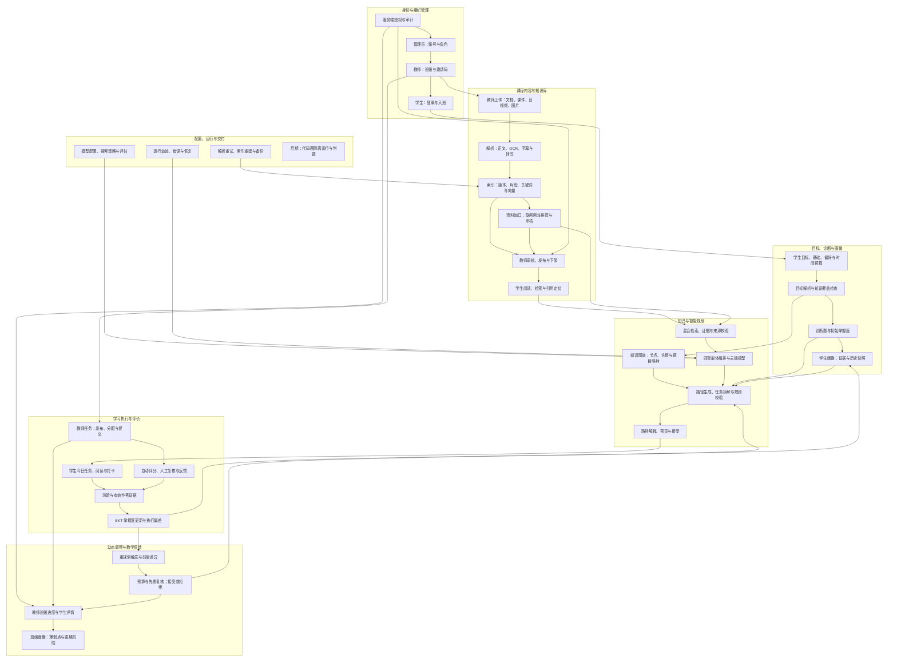
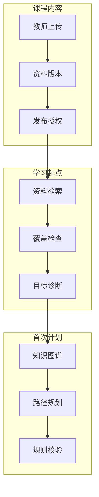
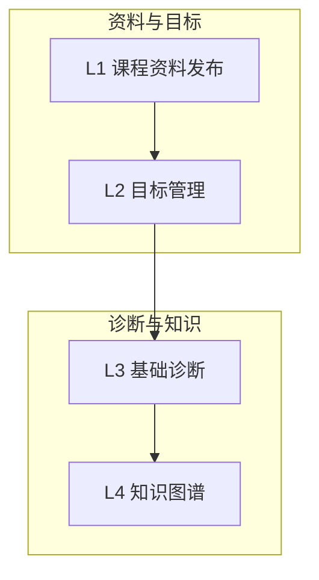
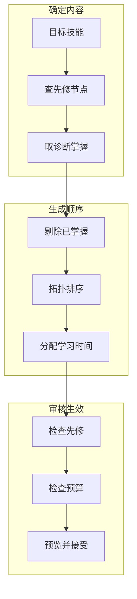
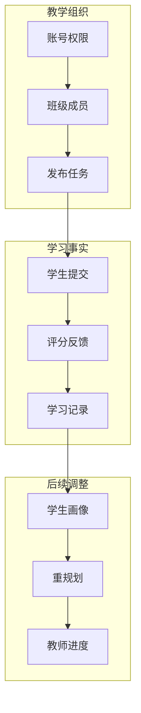
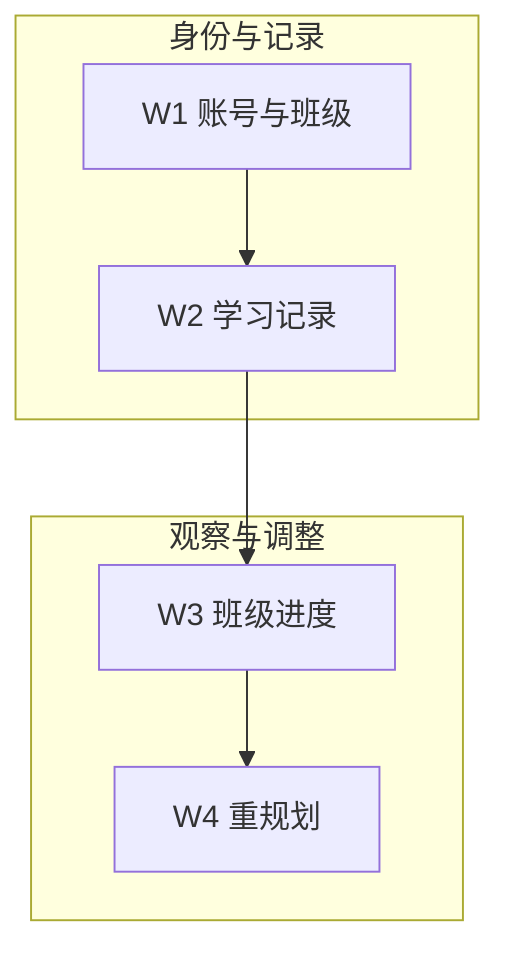
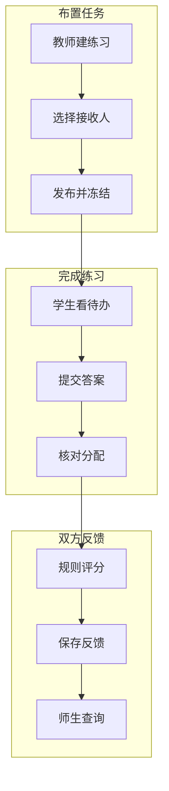

# 知行·智能学习规划助手——完整功能流程 PPT 设计文稿

> 功能架构与分工稿｜2026-11-04｜包含四层架构、三角色、功能架构图、功能状态表和两人分工流程图。
>
> 依据：项目需求规格、技术设计、第三周运行记录及实施计划新增功能。状态只说明已有证据和待完成事项，不使用旧版功能总数或完成率。技术细节区分已验证的本地链路与设计中的云端能力。

## 一、项目与业务主线

**项目定位：** 面向学生、教师和管理员的学习规划平台。教师建设课程资料和任务，学生基于目标与学习证据获得可解释的路径，管理员保障账号、配置及运行；系统根据真实作答与时间变化调整计划。

**贯穿案例：** 教师发布“Python 递归”课程资料和任务；学生创建“掌握递归并用于算法题”的目标，经过诊断与检索获得路径，学习后提交测验；未达标证据更新掌握度，系统提出补强与重规划；教师查看班级完成及薄弱点。

**汇报口径：** 将“需求规定”“已经在集成版本中运行”“尚待验证”分别标记。网页示意、测试替身和预置数据不能证明云端调用、真实联网、向量检索或服务端权限已经完成。

## 二、四层架构与三角色

### 四层架构介绍

| 层次 | 核心职责 | 本项目对应内容 |
| --- | --- | --- |
| 展示交互层 | 面向三类用户提供页面、表单、路径展示与结果反馈 | React/TypeScript 前端；学生学习入口、教师教学入口、管理员管理入口 |
| 接口与权限层 | 接收前端请求，校验身份、角色和班级归属，向页面返回授权结果 | FastAPI REST API；登录会话、角色权限与班级对象级授权 |
| 业务与智能层 | 执行课程、任务、诊断、规划、评分、画像和重规划等业务规则 | 课程与任务服务、图谱及规划规则、评分与 BKT；混合检索和四智能体云端链属于待验收目标 |
| 数据与运行层 | 保存业务状态、资料索引、证据与历史，支持查询、备份和恢复 | SQLite 业务数据与全文索引、Chroma 向量索引、资料文件、运行轨迹和备份 |

**层间关系：** 三类用户通过展示交互层发起操作；接口与权限层先确认可访问范围；业务与智能层处理请求；数据与运行层保存结果。教师发布的资料和任务、学生的作答证据都沿此路径流转。表中列出的是设计职责，具体完成状态以第四节为准。

### 学生、教师、管理员三角色介绍

| 角色 | 主要操作 | 在业务闭环中的作用 |
| --- | --- | --- |
| 学生 | 入班、设定目标与时间预算、完成诊断、查看和接受学习路径、阅读资料、提交任务与测验、查看反馈及画像 | 提供目标和真实学习证据，并决定是否接受后续路径调整 |
| 教师 | 建班与管理成员、上传并发布课程资料、布置任务、复核评分、查看本班进度与薄弱点 | 提供可信教学内容和评价反馈，据班级情况调整教学安排 |
| 管理员 | 管理账号与角色、维护模型及检索配置、查看运行与审计信息、执行备份恢复 | 保证身份边界、配置和系统运行；不代替教师评价学生作答 |

**权限边界：** 学生查看本人学习数据；教师查看授权班级的教学数据；管理员处理平台配置与运维。跨班访问及新资料类型的权限仍需按功能状态表逐项验收。

## 三、完整功能架构图（按业务模块划分）

后续制作 PPT 时，将七个业务模块作为横向并列的模块卡片展示：第一排“身份与组织管理｜课程内容与知识库”，第二排“目标、诊断与画像｜知识与智能规划”，第三排“学习执行与评价｜动态调整与教学反馈｜配置、运行与交付”。每个模块内部保留原有节点和业务箭头；跨模块连线可用细线或编号标注，避免穿过模块正文。图中箭头表示主要业务或数据流向。所有节点均属于整体功能范围；代码题沙箱为后期扩展。

**图的讲解顺序：** 先说明身份与班级决定资料和任务的可见范围；再说明教师上传的资料如何成为有出处的检索证据；之后从学生目标、诊断、画像进入知识图谱和规划；学生执行、测验、评分形成新证据，驱动画像更新与重规划；最后教师查看本班反馈，管理员保障配置和恢复。

**关键边界：** 教师任务计入学生的统一时间预算，但教师发布任务不会直接改写 AI 路径。联网推荐网址是待核实线索，不能自动变成正式引用。阅读时长和任务完成不等于知识掌握。教师只能查看授权班级的教学指标。

## 四、业务模块完成情况

**状态口径：** “已有运行记录”指第三周项目材料中的具体操作或测试记录；“待完成/待验收”指当前材料尚不能证明新增要求已完成，不能据此断言代码不存在。旧基线曾通过的功能只放在第一张表，不因新要求而重复写入第二张表。

### 已有运行记录或模块验收记录

| 业务模块 | 可介绍的功能 | 证据边界 |
| --- | --- | --- |
| 身份与班级 | 登录会话、账号资料、建班邀请码、入班和成员管理；学生与教师自助注册有接口测试记录 | 服务端角色与班级权限有基础验证；新资料类型的跨班权限仍须单独测 |
| 教师课程内容 | 上传与分类、正文版本、发布下架、阅读下载、媒体播放与字幕、网址登记、阅读记录 | 原资料模块有验收记录；音频附件上传的回归测试失败需修复 |
| 教师任务与评价 | 草稿、分配发布、提交、客观评分、主观复核、更正评分及反馈 | 同一递归任务发布、张三得分 100%、刷新保留反馈、教师查询有现场记录 |
| 学生目标与首次路径 | 多目标与时间预算、题库诊断、知识图谱、硬先修校验、本地规则路径与历史 | 验证范围为 Python 函数、递归等既定主题；云端新主题不在此结论内 |
| 学习执行与调整 | 打卡、学习记录、学生与班级画像、本地规则重规划预览、接受或拒绝 | 历史快照和差异功能有模块记录；新增解释与联动判据尚需验证 |
| 运行保障的基础功能 | 轨迹、取消恢复、健康检查、一致性备份和隔离恢复 | 与完整 AI 编排、索引重建、他人安装试用分开判断 |

### 未完成或尚待新判据验收

| 业务模块 | 具体待办 | 判定依据 |
| --- | --- | --- |
| 教师课程内容 | 修复音频附件上传；无字幕视频转写、图片与扫描件 OCR、处理状态及低置信度复核、媒体时间定位 | 一项音频回归失败；KB/EXT 新增要求待验收 |
| 可信检索与来源 | 真正的关键词加向量混合检索、授权片段定位、缺资料联网网址、来源核验及搜索失败处理 | 第三周仅有关键词与固定主题覆盖基础，完整检索链未验收 |
| 云端智能规划 | 千问真实请求、配置评估激活、四 Agent 路由、任意新主题生成、有限修复与隐私授权 | 本地规则路径已可演示，云端链仍待完整验收 |
| 学生画像新增能力 | 学生修正主动偏好；按单次作答显示掌握变化的证据、时间与参数版本 | EXT-03 新判据；旧画像与历史快照已列在完成表 |
| 教师评价新增能力 | 退回补交的提交版本；评分更正后重算有效证据和掌握度 | EXT-04 新判据；旧主观复核与更正评分已列在完成表 |
| 重规划新增能力 | 接受前同屏说明触发证据、任务变化、硬先修与统一预算，并在生效时重核路径版本 | EXT-05 新判据；旧差异预览和拒绝保留路径已列在完成表 |
| 班级洞察新增能力 | 按知识点下钻薄弱分布，说明逾期原因及关注学生依据 | EXT-06 新判据；旧班级画像已列在完成表 |
| 运维与交付 | 审计筛选、演示初始化与重置、他人安装试用；索引重建进度与恢复结果查询 | 原运维未完成项及 EXT-07 新判据 |
| 后期扩展 | 隔离运行代码题、资源限制和自动判题 | EXT-08 后期范围 |

## 五、两人的分工与关键模块

每张流程图分三行、每行三个短节点：第一行向右，第二行向左，第三行向右，转折处向下。功能图说明负责范围，关键模块图说明一次具体操作。总职责包含待办能力，但功能完成状态仍以第四节为准。

### 5.1 刘天奇：课程资料到首次学习路径

**负责范围：** 课程资料与知识库、目标与诊断、资料检索、知识图谱、首次路径规划与质量校验。负责相关页面、接口、数据和验证；与吴禹昕交接活动路径、诊断快照和预算占用。

#### 总分工流程图

资料发布、既定主题诊断及本地规则路径有阶段性记录。向量混合检索、真实联网和云端新主题仍属于待完成或待验收范围。

#### 简单模块：功能与作用

下图按“资料准备 → 确定目标 → 获取诊断证据 → 组织知识”的顺序连接四个简单模块。图中 L1～L4 与下方同编号表格一一对应；完成 L4 后，结果进入后文的“首次学习路径”关键模块。图表示业务衔接，不表示所有扩展项已经验收。

**连接关系：** L1 为学习提供有来源的材料；L2 确定本次要学什么及可用时间；L3 针对目标留下作答证据；L4 用知识点与先修关系界定待学范围。目标也直接供路径规划使用，不能理解为诊断必须等待资料发布完毕。

**L1｜课程资料发布**

| 项目 | 说明 |
| --- | --- |
| 使用者与目的 | 教师整理本班材料，学生获得明确、授权的阅读入口。 |
| 主要功能 | 上传并填写课程、班级、标题和标签；管理正文版本、发布与下架；学生查看已发布资料。 |
| 业务作用 | 把零散讲义变成有归属、有版本的教学资料，后续阅读和路径引用可定位来源。 |
| 输入与结果 | 文件及课程信息 → 资料版本、发布状态、学生可见范围。 |
| 与下一模块的连接 | 已发布资料为 L2 的目标确认提供课程范围与可阅读材料，也可在后续路径中作为任务引用；资料发布不是创建目标的前置条件。 |

**L2｜目标管理**

| 项目 | 说明 |
| --- | --- |
| 使用者与目的 | 学生把“想学递归”等自然语言意图转成可检查的学习目标。 |
| 主要功能 | 填写技能、截止日期、每周时间和偏好；查看并修正解析结果；管理多个目标及版本。 |
| 业务作用 | 为诊断选择知识范围，也为后续任务排期提供时间约束。 |
| 输入与结果 | 目标描述、时间预算 → 经学生确认的目标规格。 |
| 与下一模块的连接 | 将确认的技能与目标知识点交给 L3 选择诊断题；截止日期和时间预算同时传给首次路径规划。 |

**L3｜基础诊断**

| 项目 | 说明 |
| --- | --- |
| 使用者与目的 | 学生回答与目标知识点对应的题目，确定学习起点。 |
| 主要功能 | 生成诊断卷、暂存作答、交卷防重、展示逐题反馈；无题库时提示资料缺口。 |
| 业务作用 | 区分已掌握与待补学节点，避免给所有学生生成相同路径。 |
| 输入与结果 | 目标题目及答案 → 诊断证据、初始掌握快照。 |
| 与下一模块的连接 | 将有效作答与掌握快照交给 L4 对照知识节点；没有题目或证据不足时保留“未知”，不直接判定已经掌握。 |

**L4｜知识图谱**

| 项目 | 说明 |
| --- | --- |
| 使用者与目的 | 系统组织知识点以及“学会 A 才能学 B”的关系。 |
| 主要功能 | 维护知识节点、硬先修边和版本；检测先修环，提供目标所需子图。 |
| 业务作用 | 约束路径顺序，例如将函数与调用栈基础安排在递归之前。 |
| 输入与结果 | 节点、先修边、目标技能 → 无环的待学知识子图。 |
| 与关键模块的连接 | 将目标所需节点和先修约束交给“首次学习路径”；路径模块再结合 L3 的掌握快照决定学习顺序。 |

#### 关键模块：首次学习路径如何形成

**作用：** 把目标、诊断结果与先修关系转成可执行任务，并确认时间和规则允许该路径生效。下图展示既定主题的本地规则流程。

| 环节 | 具体实现与模块作用 |
| --- | --- |
| 查找待学节点 | 从目标技能反向找到硬先修闭包，结合有效诊断证据剔除已掌握节点，避免漏学基础或重复安排。 |
| 安排顺序和时间 | 对剩余节点做拓扑排序，再按日/周可用时间拆成任务；预算不足时说明原因。 |
| 校验并保存 | 检查先修、学时、每日和每周负荷、重复节点与引用；合格路径作为候选保存，学生确认后才成为活动版本。 |
| 采用的技术 | React/TypeScript 展示目标与路径；FastAPI 承担规划接口；图遍历和 Kahn 拓扑排序处理先修；SQLite 保存目标、掌握快照及路径版本。 |

**范围边界：** 这里讲的是已有记录的本地规则规划。混合检索、云端生成和四智能体审查不能凭这张图宣称通过。

### 5.2 吴禹昕：班级任务到学习反馈

**负责范围：** 账号与班级、教师任务、学生提交、评分反馈、学习记录与画像、重规划及班级进度。重点解释谁做了什么、状态如何变化、师生能看到什么；技术实现只保留必要说明。

#### 总分工流程图

教师发布、学生作答、反馈保存和教师查看同一任务有第三周运行记录。画像解释、评分更正后的证据重算和重规划新判据仍待逐项验收。

#### 简单模块：功能与作用

下图用 W1～W4 串联身份范围、学习事实、班级汇总和后续调整；编号与下方每张表对应。W2 与 W3 分别面向学生本人及本班教师，W4 依据有效证据决定是否提出新路径。任务发布与评分的细节见后文关键模块。

**连接关系：** W1 限定记录的归属与可见范围；W2 保存阅读、提交和评分事实；W3 根据本班分配汇总进度；W4 根据学生本人有效证据与预算变化提出调整。W3 是教师观察入口，不是 W4 的必经触发条件；图中的最后一段表示教学反馈可促成后续调整。

**W1｜账号与班级**

| 项目 | 说明 |
| --- | --- |
| 使用者与目的 | 管理员、教师、学生确认身份和班级归属。 |
| 主要功能 | 登录与会话；教师建班并发邀请码；学生入班；教师管理本人班级成员。 |
| 业务作用 | 决定谁能发布任务、谁能阅读班级资料，防止跨班访问。 |
| 输入与结果 | 账号、角色、邀请码 → 有效会话和班级成员关系。 |
| 与下一模块的连接 | 班级归属和身份权限限定 W2 的记录写入、本人查询与教师查看范围。 |

**W2｜学习记录**

| 项目 | 说明 |
| --- | --- |
| 使用者与目的 | 学生查看自己的学习过程，教师查看有权访问的教学事实。 |
| 主要功能 | 分开保存阅读时长、任务提交、评分反馈和掌握快照，并按时间或任务查询。 |
| 业务作用 | 明确“读过”“交过”“学会”是三种不同状态，给画像和进度提供依据。 |
| 输入与结果 | 阅读、提交和测验事件 → 可追溯的本人历史及班级学习事实。 |
| 与下一模块的连接 | 将本班任务及学习事实提供给 W3 汇总；有效测验证据另供 W4 判断，阅读时长不能直接算作掌握度。 |

**W3｜班级进度**

| 项目 | 说明 |
| --- | --- |
| 使用者与目的 | 教师了解本人班级的任务执行和学习情况。 |
| 主要功能 | 查看完成、按时、逾期与学习时长等指标，并进入授权学生详情。 |
| 业务作用 | 帮助教师发现需要提醒或补充讲解的学生；不展示无关私人目标。 |
| 输入与结果 | 本班任务分配和学习事实 → 班级指标与学生详情。 |
| 与下一模块的连接 | 教师据此发现需要提醒或辅导的情况；学生路径是否变化仍由 W4 对本人证据和时间约束判断。 |

**W4｜重规划**

| 项目 | 说明 |
| --- | --- |
| 使用者与目的 | 学生在未达标、连续未完成或预算变化后调整后续学习安排。 |
| 主要功能 | 评估触发条件、生成调整预览，学生接受或拒绝，并保留路径历史。 |
| 业务作用 | 已完成内容不被随意改写；拒绝调整时原路径继续有效。 |
| 输入与结果 | 掌握证据、执行偏差、时间变化 → 新路径候选或维持原路径。 |
| 业务闭环 | 学生接受后产生新活动路径并留存旧版本；后续执行继续写入 W2，供本人和有权限的教师查看。 |

#### 关键模块：教师任务与评分反馈

**作用：** 教师布置练习，学生得到反馈，教师查到同一份提交。这是已有浏览器演示的跨角色链路：递归基础练习由教师发布，张三提交得分 100%，刷新后仍能查看反馈。

| 环节 | 具体作用与实现 |
| --- | --- |
| 发布 | 教师选班级和学生，系统保存任务及接收人；发布后的题目和分配作为本次练习的固定依据。 |
| 提交 | 学生只看到分配给自己的待办；提交时核对任务、接收人和答案，重复请求不重复形成作答。 |
| 反馈 | 客观题按确定规则评分并保存得分与解析；主观题进入待复核，不提前形成有效掌握证据。 |
| 查询 | 学生刷新后能重新看到反馈，教师在本班提交列表查到同一任务和学生。数据由服务端保存并按身份查询。 |

**与后续模块的关系：** 有效得分可以进入画像与掌握度计算，未达标可触发重规划判断；这些新增联动细节仍按第四节待办表验证。两人共同维护知识点、预算、路径与作答证据的关联。
