# 第四周课堂阶段式汇报PPT文稿

编制依据：现有需求、项目设计、技术设计、编码前分析、源码及验收记录；核对日期2026年11月10日。

本稿提供逐页内容、流程图节点、技术表格和讲述重点，不规定版式。A/B沿用项目设计第15.1节的责任主线，是汇报组织方式；姓名、实际贡献与演示结果须由两位成员据实补充。流程中的方框表示处理或操作步骤，不等同于相同数量的独立页面。关键流程图各12个节点，简单流程图各8个节点；操作、判断和结果均计入节点总数。

建议23页，讲述约24分钟，运行演示及问答约6分钟。项目基础→已有架构图→分工→A的模块、集成问题、状态与证据→B的模块、集成问题、状态与证据→共同补齐计划。

## 第1页 项目名称与第四周主题

标题：知行智能学习规划助手

副标题：第四周阶段汇报 集成版本与模块完成情况

- 成员：[A姓名]、[B姓名]
- 本周汇报：集成版本、各模块完成状态、关键设计及集成问题。
- 本周要回答：哪些已完成、哪些部分完成、哪些仍未完成？

讲述：本次先介绍平台与架构，再分别展示两条责任主线，最后依据实现和验收证据说明缺口。

## 第2页 项目解决什么问题

核心结论：连接教师组织教学与学生个性化学习。

| 使用者 | 需求 | 平台提供的能力 |
|---|---|---|
| 学生 | 找资料、明确学习顺序、获得反馈 | 目标诊断、资料检索、路径与练习、学习记录 |
| 教师 | 管班、发任务、了解学习情况 | 班级资源、任务分配、评分复核、班级画像 |
| 管理员 | 维护系统和模型使用条件 | 账号管理、图谱审核、模型配置与审计 |

贯穿案例：教师发布Python函数练习，学生先诊断再规划，完成任务后根据新证据调整学习安排。

## 第3页 第四周集成版本的范围

核心结论：基础教学流程与本地规划已形成连接，外部能力需要分开验收。

- 教学流程：入班→资料→任务→提交→反馈→记录与班级查询。
- 个性化流程：目标→诊断→路径→执行→反馈→重规划。
- 支撑能力：权限、资料解析与检索、版本、运行轨迹、备份恢复。
- 外部条件：模型与搜索密钥、Docker环境、独立电脑试用。

技术基础：React/TypeScript＋FastAPI＋SQLAlchemy/SQLite＋Alembic；LangGraph组织规划流程。

状态说明：最新源码、隔离验收版本和8000当前运行库必须分别确认。已有记录说明部分新增迁移只在隔离库验证，不能直接把最新源码能力都当作8000演示能力。

## 第4页 模块架构与两条业务主线

此页放用户已有的模块架构流程图，不重新设计架构。

配套文字：

- 输入：账号身份、教学资源、学习目标与预算。
- 处理：诊断、证据检索、规划、规则审查、任务与评分。
- 输出：学习路径、反馈记录、学生与班级画像。
- 回流：新的学习事实进入掌握度与预算评估，支持重规划。

讲述顺序：从输入走到输出，再沿反馈线返回规划，说明两位成员在哪些接口交接。

## 第5页 双人分工与汇报路线

| 成员 | 文档责任主线 | 本次关键模块 | 本次简单模块 |
|---|---|---|---|
| A [姓名] | 首次计划、内容证据及教师任务负荷关联 | 首次学习路径规划 | 目标与预算 |
| B [姓名] | 权限平台、学习反馈、画像及重规划 | 学习反馈驱动的重规划 | 班级与邀请码 |
| 共同 | API、数据契约、联调及验收 | 跨模块流程 | 证据与问题清单 |

其他模块、集成问题、完成状态、验证证据与运行展示均在各自分工章节内介绍。这里的安排对应设计中的责任划分，不替代成员真实贡献记录。

## 第6页 A关键模块 首次学习路径规划

核心结论：把目标和诊断结果转化为满足约束、可追踪的学习安排。

- 输入：确认后的目标、知识点、预算、诊断证据及授权资料。
- 输出：学习节点、顺序、活动、时间安排和依据。
- 正式路径产生前需要检查先修、预算、证据和输入版本。
- 本地模式与云端分支区分展示；当前真实供应商调用尚无成功验收结论。

运行展示：选择已有题库主题，展示诊断结果、候选路径、规则结果与接受入口。

## 第7页 A关键模块流程图 十二个节点

核心结论：规划由输入校验、证据准备、候选审查和确认提交组成，失败按原因回到相应阶段。

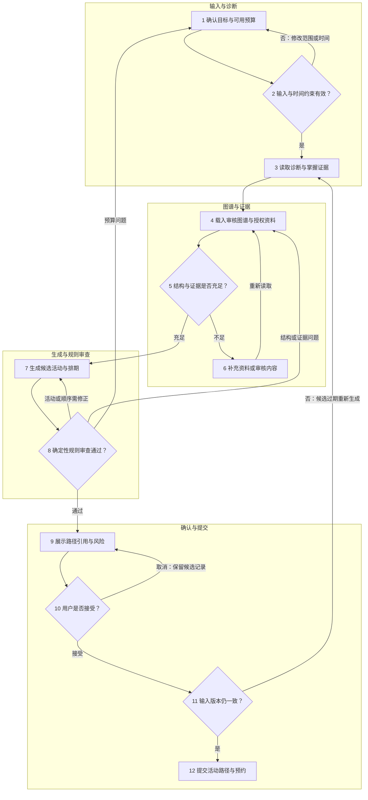

### PPT绘图节点与技术信息

| 分区 | 节点 | 附属信息卡 |
|---|---|---|
| 输入与诊断 | 1—3 | 技能、截止、可学习日、题目版本、有效观察 |
| 图谱与证据 | 4—6 | 先修边、资料版本、来源定位、缺口类型 |
| 生成与审查 | 7—8 | 本地规则／云端分支；先修、预算、证据检查 |
| 确认与提交 | 9—12 | 差异与风险、输入指纹、路径版本、预约 |

恰好12个节点，判断节点已计入总数。实线表示主业务连接，回路标明退回原因，避免画成12框串联。

特色表达：底部附一条不计入节点的“版本轨迹”，列出目标、诊断、资料、运行与路径版本；节点6旁用注释注明“外部搜索需配置，真实供应商待验收”。节点7的云端有限修复写在技术注释，最多3次，不泛化为所有失败自动重试。补充后仍不足时保留草稿，不宣称正式规划成功。

取消边表示本次不提交，可停留查看候选，不表示系统自动重新弹出接受操作。

讲述分层：先沿成功路径说明结果如何产生，再讲证据不足、审查退回与版本过期三个回路。

## 第8页 A关键模块技术设定与设计决策

| 层次 | 技术设定 | 设计理由 |
|---|---|---|
| 编排 | LangGraph与运行步骤记录 | 分离阶段，便于定位失败 |
| 知识结构 | 已审核图谱、先修DAG与题库版本 | 防止先修环和无题节点进入正式安排 |
| 证据 | FTS5＋本地FastEmbed向量，授权后召回 | 同时支持关键词与语义候选，控制数据范围 |
| 审查 | 确定性规则与预算校验 | 模型文本不能替代业务判据 |
| 并发保护 | 输入版本与指纹 | 防止接受陈旧候选 |
| 云端 | 服务端配置与质量门槛 | 配置可登记不代表可直接激活 |

源码定位：backend/app/services/planning.py、planning_rules.py、cloud_planning.py、vector_index.py；frontend/src/PlanningDetails.tsx、PlanningReadiness.tsx。

## 第9页 A关键模块运行与集成问题

运行证据建议依次放：诊断结果→候选路径→规则解释→接受后活动路径。

| 集成问题 | 当前处理 | 验证与限制 |
|---|---|---|
| 生成期间目标或预算变更 | 接受前核对版本，过期候选拒绝 | 已有版本冲突回归记录 |
| 模型未就绪导致学生困惑 | 显示模型状态和激活说明；诊断不依赖云端激活 | 11月9日页面及诊断回归记录 |
| 目录无题却允许继续 | 返回逐知识点题库可用性，禁选无题项 | 已有目录与诊断浏览器记录 |
| 检索命中被当作教学充分 | 候选证据与语义审查分开 | 教学语义确认仍需人工 |

完成判断：本地基础流程有验证；真实云端端到端规划为未验收部分。

## 第10页 A简单模块 目标与预算 八个节点

核心结论：目标需要用户确认，并通过日期和预算检查后才能作为诊断与规划输入。

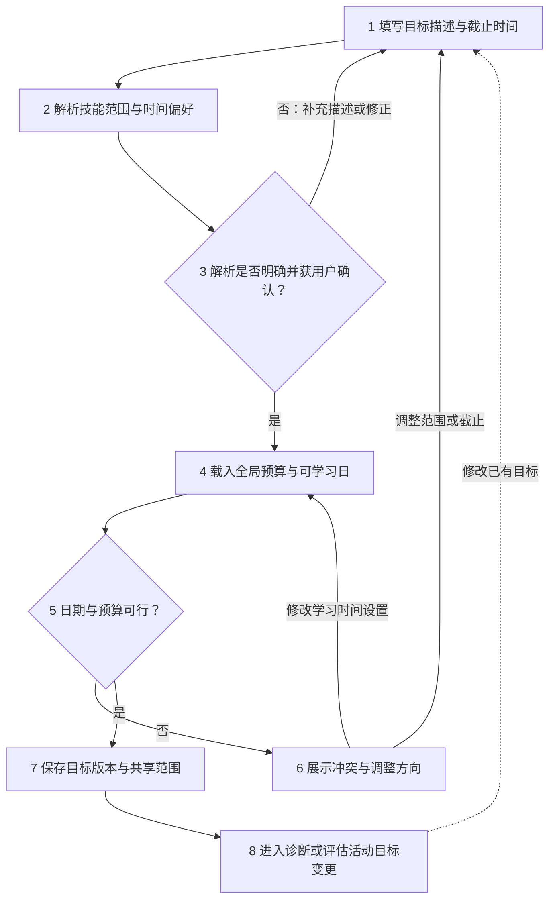

恰好8个节点，包含两个判断、两条修正回路和一个版本变更回路。G4返回时表示用户已修改相关设置后重新读取，不表示后台自动增加预算。

| 功能层 | 节点 | 技术设定 |
|---|---|---|
| 输入确认 | 1—3 | 输入校验、本地解析与人工确认 |
| 约束校验 | 4—6 | 全局日周预算、可学习日、截止与冲突说明 |
| 保存衔接 | 7—8 | 目标版本、默认私有与显式班级关联 |

特色：在节点5旁放“可用时间／所需时间”对比卡；节点7附版本标签，不虚构具体数值。节点8区分新目标进入诊断与活动目标变更后的评估，不直接覆盖历史路径。

技术定位：GoalCreator.tsx、GoalInspector.tsx及后端目标与规划服务。运行展示一个可行目标，再展示一个预算冲突案例。

## 第11页 A负责的其他模块与技术

本页归入A分工，集中介绍首次规划依赖的资料与模型能力。

| 模块 | 本人职责范围 | 技术设定 | 状态与缺口 |
|---|---|---|---|
| 资源与知识库 | 资料进入规划证据的解析、版本与召回链路 | 持久解析、RapidOCR、faster-whisper、FTS5与FastEmbed | 本地样本有实测；复杂媒体质量需扩样 |
| 检索与外部来源 | 授权检索、来源定位、搜索与网页导入 | 二次授权、来源版本、搜索适配器 | 本地检索与网页抓取有实测，真实搜索供应商待密钥 |
| 图谱与题库 | 首次规划使用的图谱、题库与审核接口 | DAG校验、独立题库、版本冻结 | 已审核主题可用，任意新主题泛化未证明 |
| 模型与四Agent | 云端网关、配置适配与质量门槛 | LangGraph、服务端密钥、60场景逐例审核 | 契约测试已有，真实调用与语义评价未完成 |

分工边界：资源管理页面与平台权限由双方联调；本页归属是汇报主责，实际编码贡献需据实填写。

### 其他模块技术配图设计

每个模块独立一张技术示意图，恰好6个关键技术节点。该页可作为模块概览，详细图作为同节扩展页或局部放大素材；不必把所有图挤进一页。主文稿页号保持不变，实际制作PPT时可拆页。

#### 技术图1 资源解析与版本

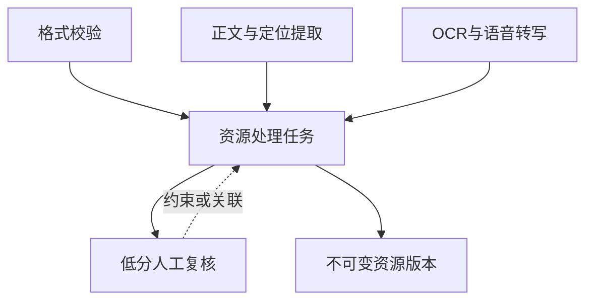

图意：持久任务关联校验、解析、复核与版本提交。OCR/转写只在对应媒体需要时进入，不能画成所有文件必经步骤。

PPT绘图：中心使用较大的圆角矩形，其余5个节点围绕中心分两层布置；实线表示依赖或数据关联，虚线表示校验反馈，不解释为所有能力必须按箭头依次执行。节点外可加小型技术标签，不增加流程节点。

#### 技术图2 授权混合检索

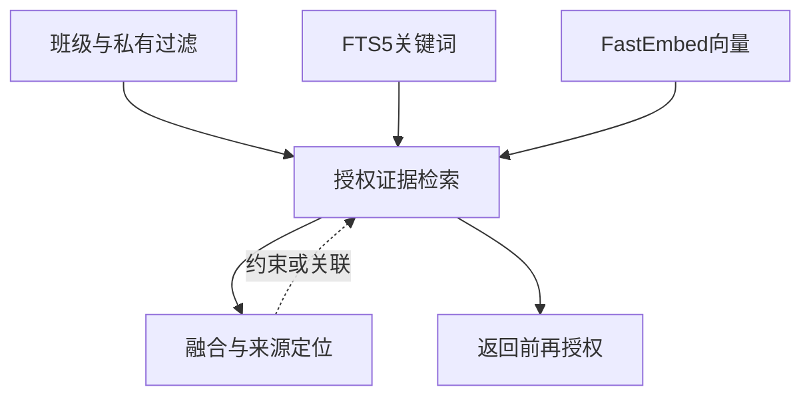

图意：权限过滤包围关键词和向量两路召回，汇合后定位并再次授权。命中只证明候选存在，不证明教学充分。

PPT绘图：中心使用较大的圆角矩形，其余5个节点围绕中心分两层布置；实线表示依赖或数据关联，虚线表示校验反馈，不解释为所有能力必须按箭头依次执行。节点外可加小型技术标签，不增加流程节点。

#### 技术图3 图谱与题库

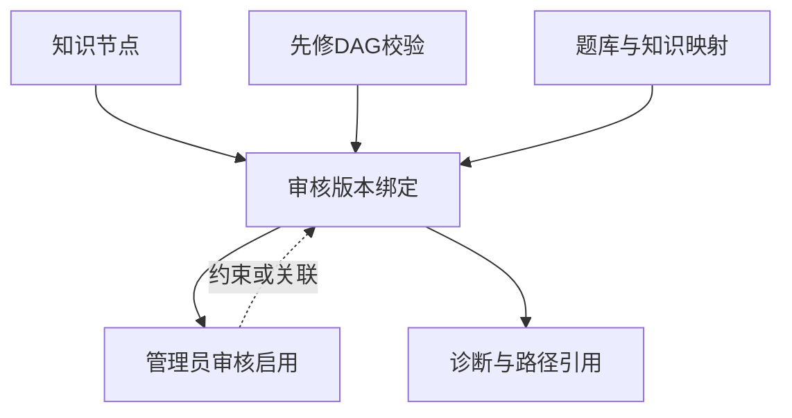

图意：以审核版本为中心连接图谱与题库，两者共同约束诊断与路径；新主题未经审核不直接生效。

PPT绘图：中心使用较大的圆角矩形，其余5个节点围绕中心分两层布置；实线表示依赖或数据关联，虚线表示校验反馈，不解释为所有能力必须按箭头依次执行。节点外可加小型技术标签，不增加流程节点。

#### 技术图4 模型与四Agent

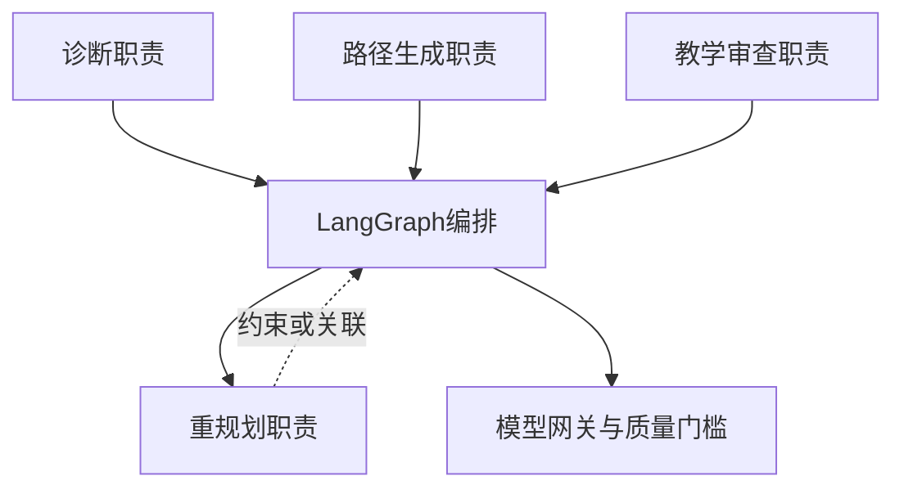

图意：四种职责围绕编排节点连接，网关与质量门槛作为共享支撑。云端真实调用仍待验收，不能把设计职责画成供应商已成功运行。

PPT绘图：中心使用较大的圆角矩形，其余5个节点围绕中心分两层布置；实线表示依赖或数据关联，虚线表示校验反馈，不解释为所有能力必须按箭头依次执行。节点外可加小型技术标签，不增加流程节点。

## 第12页 A的跨模块集成问题与处理

| 集成点 | 问题 | 处理与责任 |
|---|---|---|
| 资料→规划 | 新正文覆盖旧引用 | A维护证据版本绑定，与B联调资源权限 |
| 目标预算→首次路径 | 候选产生后输入变化 | A生成输入指纹，接受前校验版本 |
| 搜索→规划 | 命中不代表覆盖充分 | A区分候选证据、结构检查和人工语义审查 |
| 模型→业务提交 | 无密钥或输出不合规 | A提供明确失败、有限修复和提交门控 |

讲述顺序：一个实际问题→影响→设计取舍→修复证据。具体问题编号与截图：[据实补充]。

## 第13页 A模块完成状态、验证与运行展示

| 状态 | A责任范围 | 证据与限制 |
|---|---|---|
| 已有完成与验证记录 | 目标预算、诊断、本地首次路径、版本接受和基础授权检索 | 历史专项与页面记录；演示前核对当前运行版本 |
| 部分完成 | OCR/ASR扩展、新主题、云端与搜索适配 | 本地样本或契约通过，完整质量仍需实测 |
| 未完成的验收 | 真实供应商端到端、60场景语义审核与泛化指标 | 需要密钥、真实报告及人工审查 |

本人运行顺序：目标预算→诊断→证据与候选路径→规则审查→接受。补充演示预算不足或过期候选中的一个异常。

本人证据：[源码或提交记录]、[本人设计决策]、[实际测试与页面截图]。

可信范围：本地OCR、转写、512维向量样本证明对应样本真实运行；GPT/DeepSeek配置回归证明请求适配，不证明供应商成功调用。11月9日诊断页面记录证明目录和入口修复，不证明模型激活。

本人补齐：真实云端与搜索验证、模型质量审查、资料语义充分性验证；与B共同维护版本和接口契约。

## 第14页 B关键模块 学习反馈驱动的重规划

核心结论：让新的学习事实成为路径调整依据，调整前保留用户确认。

- 输入：作答评分、复核更正、路径测验、预算或目标变化。
- 中间结果：有效证据、掌握度、画像与约束变化。
- 输出：新旧路径差异、风险、候选排期与接受/拒绝结果。
- 保留原路径和已完成事实，避免改写历史。

运行：展示一个已有活动路径，改变预算或提交新证据后查看重规划预览。

## 第15页 B关键模块流程图 十二个节点

核心结论：新的作答事实经评分和去重进入掌握评估，必要时形成可接受或拒绝的调整方案。

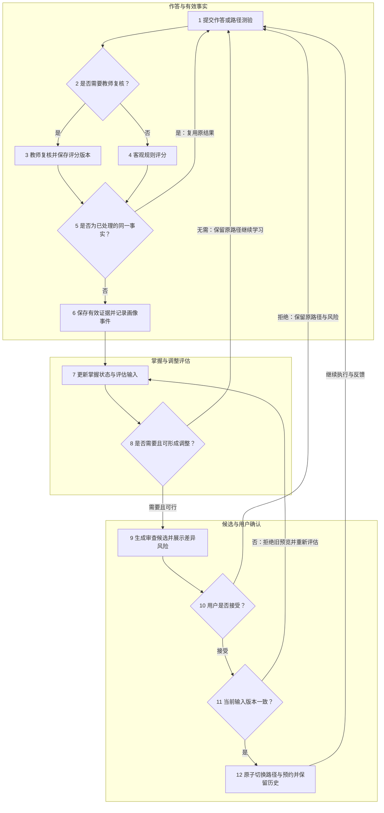

### PPT绘图节点与技术信息

| 分区 | 节点 | 需要强调的规则 |
|---|---|---|
| 作答与有效事实 | 1—6 | 主观待复核、评分版本、重复事实不重复计入 |
| 掌握与调整评估 | 7—8 | BKT按有效证据更新；不是每次作答都重排 |
| 候选与确认 | 9—12 | 差异预览、接受／拒绝、版本核对、原子提交 |

恰好12个节点，评分双分支在节点5汇合，最终形成执行反馈环。重复边表示返回原结果后继续使用系统，不表示自动重复提交。

特色表达：节点6附“同事务事件”标签；在其侧面用技术注释说明画像后台消费，失败保留旧快照并标stale、冷却后重试，不把画像完成画成提交的同步前提。节点9附“变更摘要卡”：保留节点、排期变化、补强任务和预算影响，数字使用真实演示数据。

教师更正可从节点3按新评分版本重放有效证据进入节点7，不能被当成同一请求简单丢弃。节点8不可行时显示冲突并保留原路径，其提示作为节点注释，不新增业务节点。节点9审查失败保留候选或明确问题，不进入接受步骤。

讲述分层：评分分流与汇合→证据及评估→用户确认与版本保护→历史保留和反馈环。

## 第16页 B关键模块技术设定与设计决策

| 层次 | 技术设定 | 设计理由 |
|---|---|---|
| 评分 | 确定性客观规则、主观待复核 | 区分自动结果与教师判断 |
| 证据 | 业务去重、评分版本与更正重放 | 重试不重复增加掌握度 |
| 掌握度 | BKT及证据记录 | 更新可追踪，不凭打卡猜测掌握 |
| 画像 | 持久事件、后台消费、快照与水位 | 刷新失败可保留旧快照并重试 |
| 重规划 | 版本化候选、预算重排、差异展示 | 用户先理解调整再确认 |
| 提交 | 原子接受、旧预览拒绝 | 保证路径与预约的一致性 |

源码：learning.py、profile_worker.py、planning.py、planning_rules.py；ProfileExplorer.tsx、PlanningDetails.tsx、RunHistory.tsx。

## 第17页 B关键模块运行与集成问题

| 问题 | 处理方式 | 展示证据 |
|---|---|---|
| 重复提交产生重复观察 | 按业务事实去重 | 同一作答重试结果一致 |
| 教师更正成绩后掌握度失真 | 按有效评分重放证据 | 更正前后历史与结果 |
| 画像刷新失败 | 保留旧快照、标记stale并重试 | 故障注入与恢复记录 |
| 用户接受过期方案 | 输入版本检查并拒绝 | 冲突提示与重新生成 |
| 教师任务挤占学习时间 | 参与负荷评估，不直接覆盖路径 | 预算冲突或调整预览 |

完成判断：评分、画像与本地重规划已有专项和历史页面证据；云端调整解释与完整语义质量仍需真实供应商验收。

## 第18页 B简单模块 班级与邀请码 八个节点

核心结论：入班不仅验证邀请码，也要避免重复建关系和重复消耗名额。

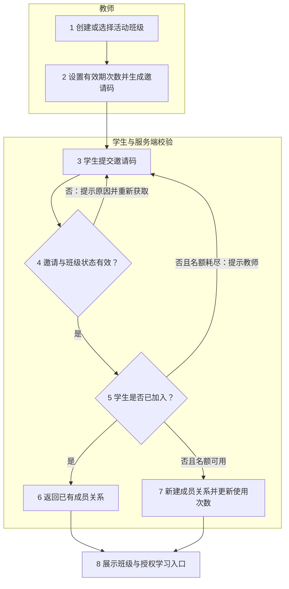

恰好8个节点，用教师、学生与系统分区表现角色交接。重复成员与新成员是两条分支，在结果页汇合。

| 功能层 | 节点 | 技术设定 |
|---|---|---|
| 邀请产生 | 1—2 | 教师权限、活动班级、邀请码哈希存储 |
| 入班校验 | 3—5 | 有效期、撤销与归档校验、已有成员优先判断 |
| 关系与结果 | 6—8 | 业务去重、次数更新、对象授权 |

节点4不提前把“名额耗尽”统一拒绝：有效邀请下已有成员可返回原关系，避免破坏重复入班幂等；新成员再检查剩余次数。最终以服务端当前实现和复测结果为准。

特色：节点2附邀请码状态卡，使用遮罩示例；节点8附“班级说明／本班资料／本人任务”入口卡。侧边注明晚入班历史任务需教师指定补发，不把全部历史任务自动出现画成默认流程。

技术定位：backend/app/api/classes.py、学生我的班级与教师班级页面。运行展示生成邀请、成功加入及重复加入结果。

## 第19页 B负责的其他模块与技术

| 模块 | 本人职责范围 | 技术设定 | 状态与缺口 |
|---|---|---|---|
| 账号与权限 | 注册登录、改密、停用重置、对象授权 | 会话、密码哈希、后端RBAC | 基础验证已有，持续回归跨角色边界 |
| 教师任务与提交 | 草稿发布、分配、补发、暂存提交与评分更正 | 冻结资源与题目版本、去重、有效评分重放 | 基础及专项记录已有 |
| 学生与班级画像 | 记录筛选、统计、授权下钻与历史 | 确定性聚合、持久事件与快照 | 已有接口与页面记录，教学语义另行确认 |
| 代码判题 | 教师用例、学生提交与隔离执行入口 | Docker禁网、只读、资源限制 | 适配契约已有，真实Docker未验收 |
| 运维与交付 | 审计、健康、备份恢复、独立试用 | 哈希清单、隔离恢复、索引重建 | 备份恢复有记录，独立电脑试用未完成 |

接口边界：A提供规划与内容证据，B提供学习事实、权限及执行约束；双方维护教师任务负荷关联。

### 其他模块技术配图设计

每个模块独立一张技术示意图，恰好6个关键技术节点。该页可作为模块概览，详细图作为同节扩展页或局部放大素材；不必把所有图挤进一页。主文稿页号保持不变，实际制作PPT时可拆页。

#### 技术图1 账号与权限

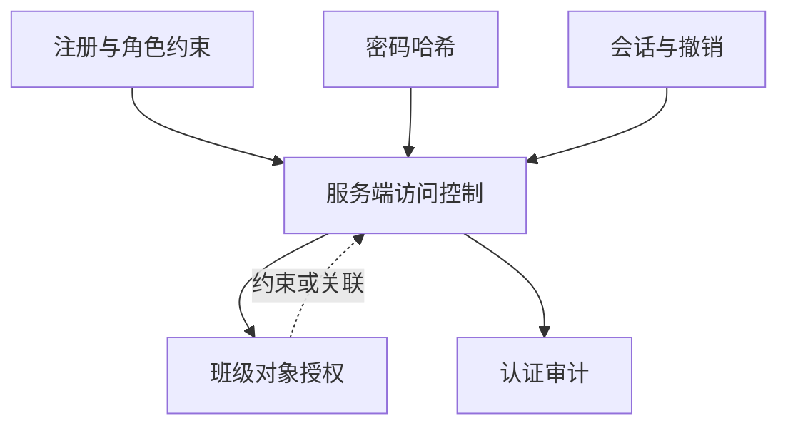

图意：访问控制居中，会话识别身份、对象授权限制范围，审计记录关键结果。公开注册不开放管理员角色。

PPT绘图：中心使用较大的圆角矩形，其余5个节点围绕中心分两层布置；实线表示依赖或数据关联，虚线表示校验反馈，不解释为所有能力必须按箭头依次执行。节点外可加小型技术标签，不增加流程节点。

#### 技术图2 教师任务与提交

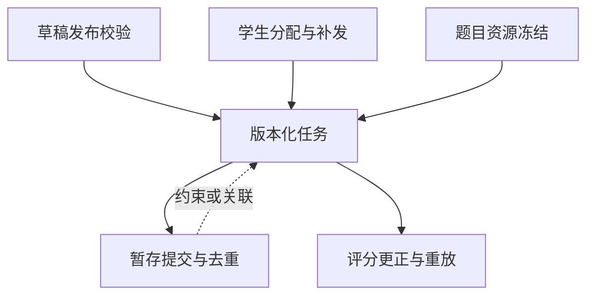

图意：任务为中心，发布、分配和冻结形成前置约束；提交与评分形成结果回流。暂存不产生正式评分证据。

PPT绘图：中心使用较大的圆角矩形，其余5个节点围绕中心分两层布置；实线表示依赖或数据关联，虚线表示校验反馈，不解释为所有能力必须按箭头依次执行。节点外可加小型技术标签，不增加流程节点。

#### 技术图3 学生与班级画像

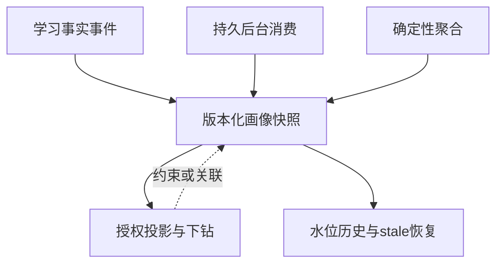

图意：事件和消费提供更新，聚合产生数值，快照关联授权投影与历史恢复。失败不丢弃旧快照。

PPT绘图：中心使用较大的圆角矩形，其余5个节点围绕中心分两层布置；实线表示依赖或数据关联，虚线表示校验反馈，不解释为所有能力必须按箭头依次执行。节点外可加小型技术标签，不增加流程节点。

#### 技术图4 代码判题

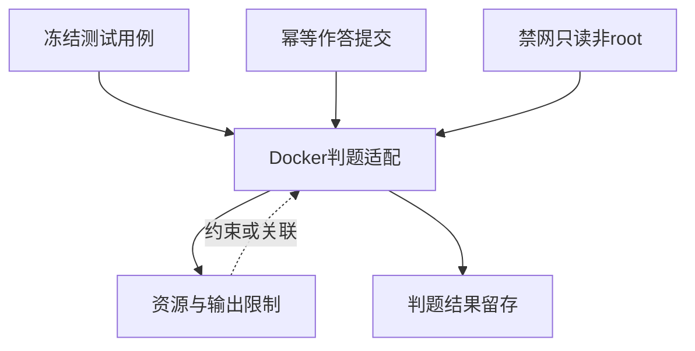

图意：执行适配居中，输入、隔离约束和输出围绕中心组织。真实Docker运行尚未验收，图中显式注明。

PPT绘图：中心使用较大的圆角矩形，其余5个节点围绕中心分两层布置；实线表示依赖或数据关联，虚线表示校验反馈，不解释为所有能力必须按箭头依次执行。节点外可加小型技术标签，不增加流程节点。

#### 技术图5 运维与交付

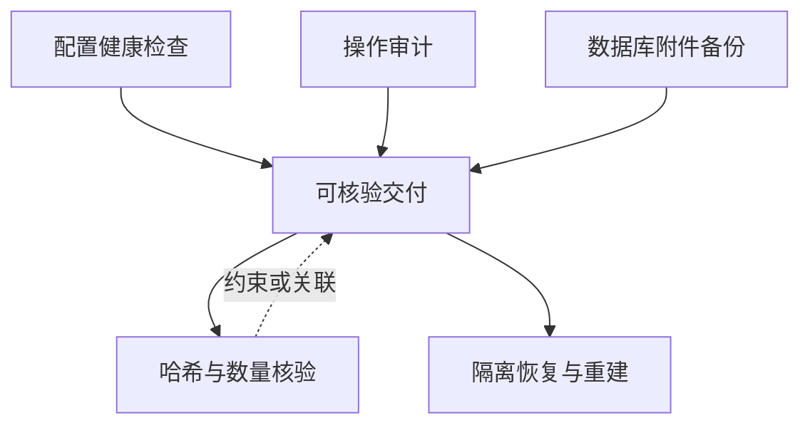

图意：备份、校验和恢复构成闭环，健康与审计作为旁路支撑。独立电脑试用仍未完成。

PPT绘图：中心使用较大的圆角矩形，其余5个节点围绕中心分两层布置；实线表示依赖或数据关联，虚线表示校验反馈，不解释为所有能力必须按箭头依次执行。节点外可加小型技术标签，不增加流程节点。

## 第20页 B的跨模块集成问题与处理

| 集成点 | 问题 | 处理与责任 |
|---|---|---|
| 任务→掌握度 | 重复提交或成绩更正污染证据 | 去重、评分版本与有效证据重放 |
| 学习事实→画像 | 事实保存成功但刷新失败 | 同事务事件、后台消费、stale与重试 |
| 班级→画像 | 私有目标和其他班级数据泄露 | 对象授权与显式班级关联 |
| 教师任务→重规划 | 教师任务直接覆盖学习路径 | 独立任务参与负荷，候选需用户确认 |
| 页面→运行库 | 新前端与旧结构不匹配 | 与A核对迁移、服务和演示版本后联调 |

讲述顺序：一个实际问题→影响→处理→复测。运行库升级属于待核对动作，不在文稿中冒称完成。

## 第21页 B模块完成状态、验证与运行展示

| 状态 | B责任范围 | 证据与限制 |
|---|---|---|
| 已有完成与验证记录 | 班级权限、任务作答评分、BKT、画像、本地重规划及备份恢复 | 历史专项与页面记录；演示需同一集成版本 |
| 部分完成 | 代码判题、整体部署交付与更广边界验证 | 适配与隔离目录验证不代表真实生产或他人环境通过 |
| 未完成的验收 | Docker真实隔离、独立电脑试用与真实参与者记录 | 需运行环境与真实试用者 |

本人运行顺序：入班→作答反馈→画像变化→重规划预览→接受或拒绝。演示一次重复提交、画像恢复或过期预览异常。

本人证据：[源码或提交记录]、[本人集成问题]、[实际测试与页面截图]。

可信范围：11月6日全量165项是当时版本测试用例数，不是功能数；专项可能重叠，不累加。Edge与布局记录只证明被检查的页面。备份恢复记录不证明独立电脑安装完成。

本人补齐：Docker边界实测、独立电脑试用、权限与画像回归；与A共同确认数据库迁移及演示版本。现有记录提示8000运行库曾未同步全部迁移，必须核对，不能直接宣称升级完成。

## 第22页 缺口与补齐计划

| 缺口 | 建议责任人 | 执行动作 | 完成判据 |
|---|---|---|---|
| 云端与外部搜索真实验证 | A | 在获授权的密钥环境执行真实请求与失败场景 | 真实来源、运行轨迹和失败复测可追踪 |
| 模型质量 | A主导、B复核 | 运行60场景并逐例语义审查 | 硬判据与人工审核均满足配置门槛 |
| Docker判题 | B | 准备环境，运行正常及超限程序 | 超时、越界、禁网等实测符合预期 |
| 新版范围验收台账 | 共同 | 分解增补范围，逐项关联证据 | 已完成/部分/未完成均能定位证据 |
| 运行库与演示版本 | 共同 | 备份，确认适用迁移，按既定授权升级并复测 | 同一版本连续演示两条主线 |
| 独立电脑试用 | B主导、A支持 | 按安装说明部署并记录问题 | 他人可启动并完成关键流程 |

时间：[分别填写计划日期]。本表为计划，不作为已完成声明；不因编写汇报自动执行迁移或外部调用。

## 第23页 阶段结论与下一阶段重点

- 集成：平台已连接教师教学活动与学生本地个性化学习流程。
- 设计：模块通过统一权限、数据契约、证据和版本机制协作。
- 状态：基础能力已有验证；外部依赖、扩展质量与交付验证仍存在明确缺口。
- 下一阶段：补齐真实环境验证，统一运行版本和逐项验收台账。

结束讲述：第四周我们重点说明系统如何集成、两人如何处理关键模块，以及完成结论由什么证据支持。下一阶段将按责任人与判据逐项关闭缺口。

---

## 编稿依据与复查入口

- docx/2026-10-27-smart-learning-planner-requirements-spec.md：需求范围及增补。
- docx/2026-10-27-smart-learning-planner-design.md：项目设计、第15.1节双人分工。
- docx/2026-10-27-smart-learning-planner-technical-design.md：技术与数据契约。
- docx/2026-11-02-zhixing-followup-preimplementation-technical-design.md：编码前分析。
- README.md：当前技术基础、启动和能力边界。
- docs/evidence/implementation/current-function-inventory.md：当前功能范围及旧完成率限制。
- docs/evidence/implementation/implementation-status.md：分批实现与近期修复记录。
- docs/evidence/implementation/remaining-functions-acceptance.md：本地实测、契约测试和外部缺口。
- backend/app/services/：规划、规则、画像、检索、云端、解析与判题实现。
- frontend/src/：目标、诊断、规划、画像、任务与模型等交互。

以上是文稿编制来源；实际成员归属、演示环境版本和最新测试数字须在课堂展示前据实登记。
